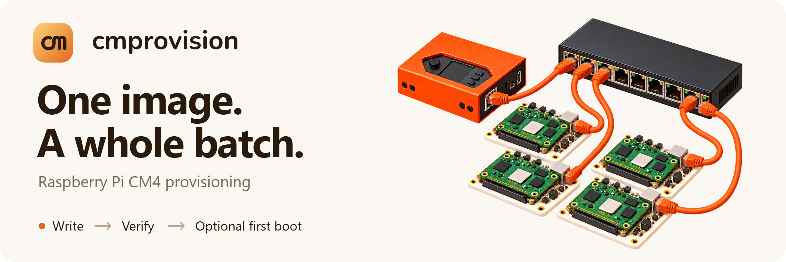

# Batch provisioning for Raspberry Pi CM4

Write OS images, update EEPROM firmware and verify a batch of Compute Modules from one Raspberry Pi and a browser. Optionally boot each module into its new system, install packages and run first-boot checks before marking it done.

An independently maintained fork of [raspberrypi/cmprovision](https://github.com/raspberrypi/cmprovision), built for Raspberry Pi OS Trixie. See the [changelog](debian/changelog) for release history.

**[Quick start](#quick-start)** · **[Screenshots](docs/gallery.md)** · **[Operation guide](docs/operations.md)** · **[Upgrading](#upgrading)** · **[API](docs/api.md)**

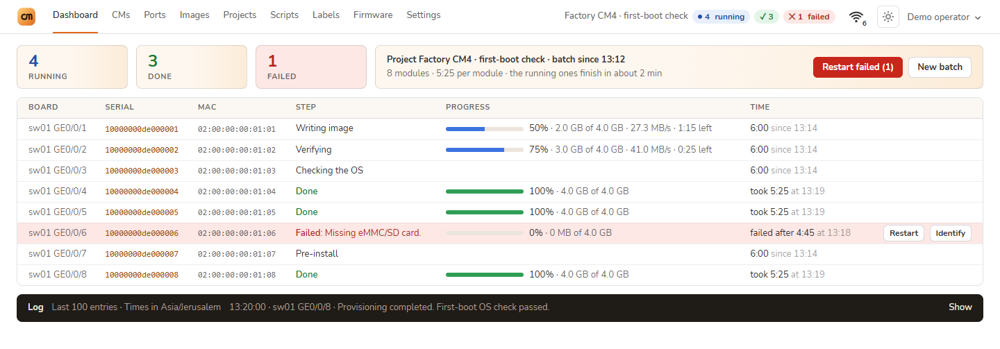

*Live batch dashboard. All screenshots use a disposable demo with simulated modules, network and switch data; displayed speeds and timings are illustrative. [Explore every tab](docs/gallery.md).*

## From image to checked device

- **Prepare a project.** Choose a compressed OS image, EEPROM firmware, scripts and a label template, then make the project active for the stand.
- **Follow the batch.** See each module's phase, progress, transfer rate, time remaining and errors. Use the Ports page to locate modules on configured SNMP switches.
- **Recover interrupted writes.** Downloads resume after connection loss. Enable image splitting to continue after a restart from the last verified 512 MB piece; enable verification to check the whole image.
- **Check the installed system.** First-boot checks can install uploaded `.deb` packages, run scripts and report the hostname before labels and notifications are sent.
- **Operate the stand.** Use Identify to find a finished module, including after its first-boot OS check until the next reboot. Restart eligible modules through PoE, manage Wi-Fi networks and keep the built-in radio as a cold spare when another adapter provides the uplink.
- **Re-provision an installed sensor.** Check its identity over SSH, confirm its disk and return it to network boot from the module card. [Setup and supported layouts](docs/operations.md#re-provision-an-installed-sensor).

Details and limits are in the [operation guide](docs/operations.md).

## What this fork adds

The original provisioner supplies the image-to-device workflow. This fork extends it with tools for watching and operating a busy stand:

| Feature | What you can see or do |
| --- | --- |
| Batch monitoring | Follow write, verification and first-boot phases, progress, rates, estimated time and failure advice; inspect each module's run history. |
| Switch and PoE view | Find modules on a visual port map, filter by state, identify a module and restart eligible ports or failed modules on supported switches. |
| Connection details | Open the uplink indicator for Wi-Fi generation, signal, link rate, band, channel, adapter and address, plus cold-spare and module-network status. |
| Appearance controls | Choose **Warm** or **Neutral**, **Light**, **Dark** or **Auto**, and **Compact** or **Roomy** spacing. Choices are remembered in the browser. |
| Stand management | Manage Wi-Fi networks and a spare radio, check the installed OS, run first-boot scripts and packages, and send batch notifications. |

| Connection at a glance | Appearance controls |
| --- | --- |
| <a href="docs/gallery.md#connection-status">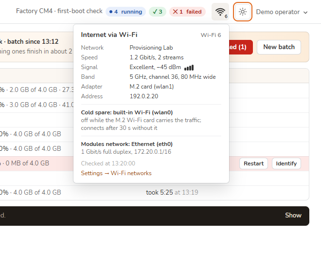</a> | <a href="docs/gallery.md#appearance">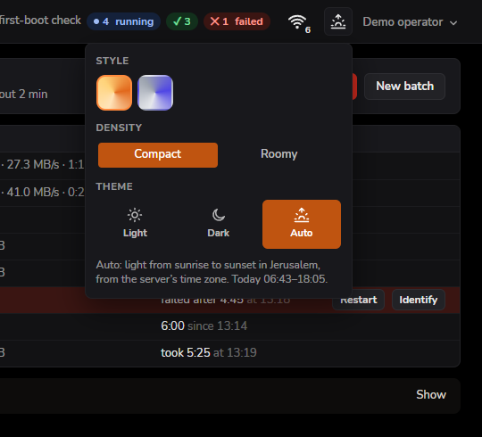</a> |

**Auto** switches between light and dark at sunrise and sunset for the location associated with the server's time zone, falling back to the system preference when solar times are unavailable. See [all four palettes, both densities and mobile navigation](docs/gallery.md#appearance).

## Explore the interface

All nine main tabs are shown below. Open the [screenshot tour](docs/gallery.md) for full-size views, editor dialogs, module details and account screens.

| Dashboard | CMs | Ports |
| --- | --- | --- |
| <a href="docs/gallery.md#dashboard"></a><br>Batch progress and actions | <a href="docs/gallery.md#cms">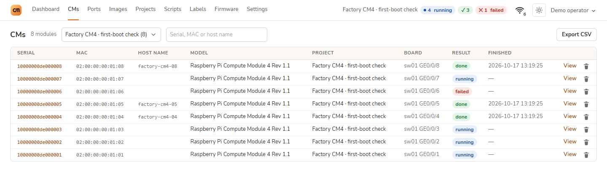</a><br>Device records and CSV export | <a href="docs/gallery.md#ports">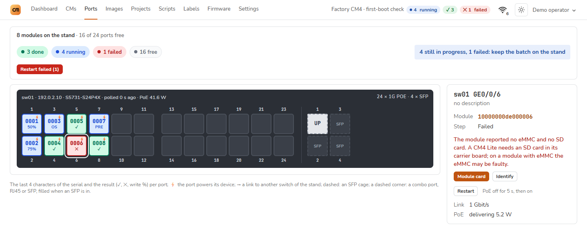</a><br>Switch map and PoE |

| Images | Projects | Scripts |
| --- | --- | --- |
| <a href="docs/gallery.md#images">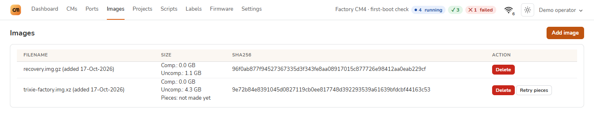</a><br>OS images and checksums | <a href="docs/gallery.md#projects">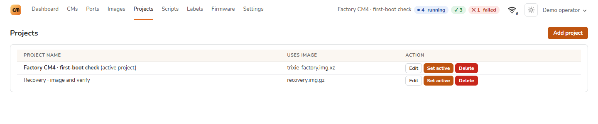</a><br>Reusable provisioning recipes | <a href="docs/gallery.md#scripts">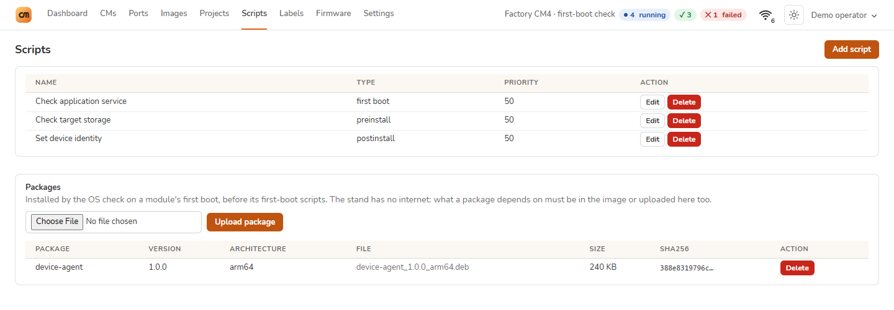</a><br>Scripts and Debian packages |

| Labels | Firmware | Settings |
| --- | --- | --- |
| <a href="docs/gallery.md#labels">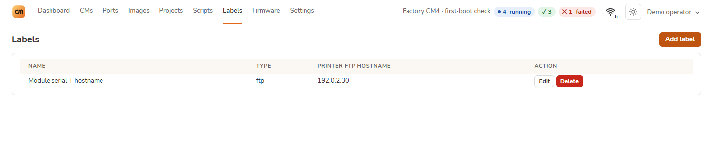</a><br>Printed device identifiers | <a href="docs/gallery.md#firmware">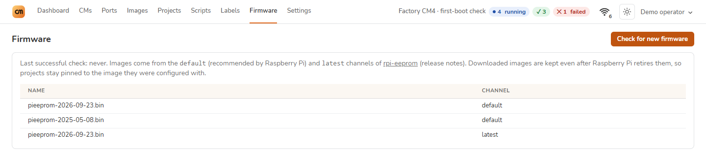</a><br>EEPROM release channels | <a href="docs/gallery.md#settings">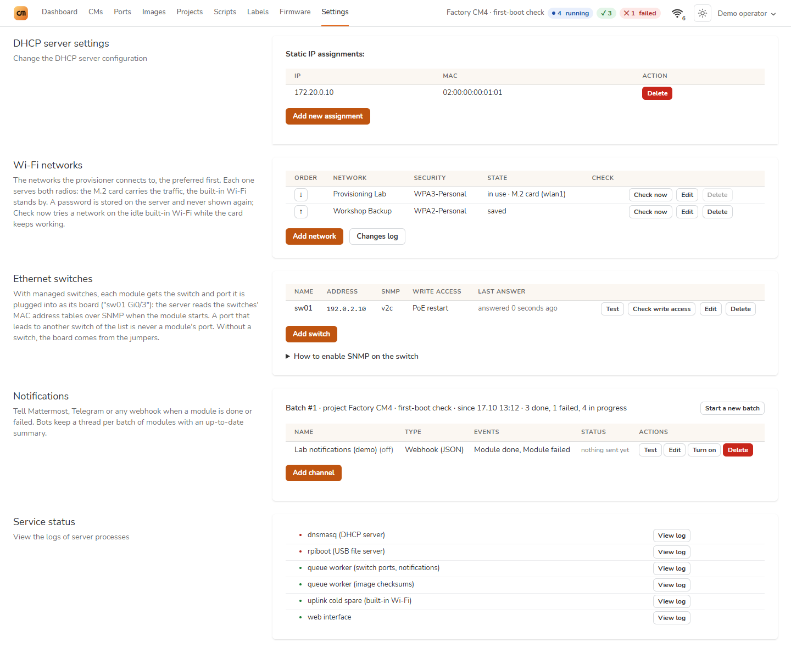</a><br>Networks, switches and services |

## The stand

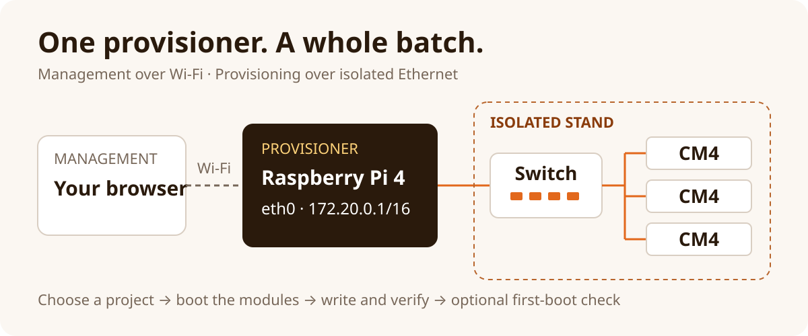

Use **Wi-Fi for management** and **eth0 for provisioning**. The provisioner serves the boot environment and images to modules on an isolated Ethernet switch.

> [!WARNING]
> Connect `eth0` only to the provisioning switch. Connecting it to an office or public network may provision other Raspberry Pi devices on that network.

| Component | Requirement |
| --- | --- |
| Provisioning server | Dedicated Raspberry Pi 4 with Raspberry Pi OS Lite **64-bit**, Trixie / Debian 13 or newer |
| Target modules | Compute Module 4; CM3 and CM3+ are not supported from 2.5.1 |
| Raspberry Pi 4 targets | Enable network boot in each board's EEPROM first |
| Network | Isolated Ethernet switch; server `eth0` at `172.20.0.1/16`, with no default gateway |
| Optional switch controls | SNMP read access for port lookup; separate write access for PoE restart |

For CM3/3+ or Debian 11/12, use this fork's [`v1.6.11`](https://github.com/nimbo78/cmprovision/tree/v1.6.11) on Raspberry Pi OS with dhcpcd, or consult upstream. For Pi 4 targets, Raspberry Pi Imager provides a **Bootloader → Network boot** utility image.

## Quick start

### 1. Prepare the server

Install a fresh 64-bit Raspberry Pi OS Lite with [Raspberry Pi Imager](https://www.raspberrypi.com/software/). Set its hostname, login and Wi-Fi connection in Imager. Use the Wi-Fi address to administer the server; 64-bit OS is required for images larger than 2 GB.

On Trixie, configure the provisioning interface with NetworkManager:

```sh
sudo nmcli connection add type ethernet ifname eth0 con-name cmprovision \
  ipv4.method manual ipv4.addresses 172.20.0.1/16 ipv4.never-default yes \
  ipv6.method link-local ipv6.addr-gen-mode eui64 connection.autoconnect yes
sudo nmcli connection up cmprovision
sudo apt update
```

### 2. Install cmprovision

Use a `cmprovision4_*_all.deb` built from **this fork**; the [build instructions](#build-the-debian-package) below produce it. Copy the package to the server, then run:

```sh
sudo apt install ./cmprovision4_*_all.deb
sudo -u www-data /var/lib/cmprovision/artisan auth:create-user
```

Open `http://<server-wifi-address>/` and sign in with the account you created. For an existing server, read [Upgrading](#upgrading) before installing.

### 3. Provision the first module

1. In **Images**, upload an OS image compressed as `.gz`, `.xz` or `.bz2` and wait for its checksum to finish.
2. In **Projects → Add project**, select the image and destination storage. Enable **Verify that image was written correctly**; add EEPROM settings, scripts or labels as needed.
3. Save the project and choose **Set active**.
4. Connect a CM4 prepared for network boot to the isolated switch and power it on. Follow its progress on **Dashboard**; open the module for its detailed log.
5. Wait for **Done**. If **Check the OS after the first boot** is enabled, the run finishes only after the new system reports back.

For carrier-board and boot-mode setup, see Raspberry Pi's [Using the Compute Module Provisioner](https://pip.raspberrypi.com/categories/685-whitepapers-app-notes/documents/RP-003468-WP/Using-the-Compute-Module-Provisioner.pdf). This upstream guide covers the original hardware workflow; use this README for the fork's software requirements.

> [!NOTE]
> First-boot checks need a systemd-based image with `curl`, an ext4 second partition and a boot order that tries eMMC before the network. USB-booted modules are not checked. The target network has no internet: include package dependencies in the image or upload them too. See [first-boot checks](docs/operations.md#first-boot-os-check).

## Utility OS

Modules are provisioned from a small OS they boot over the network or over USB. Since 2.7.0 the package ships two: ours
(`scriptexecute64/`, built with buildroot from current versions, 64-bit) and the legacy one (`scriptexecute/`, 2022,
32-bit). Settings → Utility OS picks the one modules get; switching back is the same button. How the OS is built and
updated: [docs/utility-os.md](docs/utility-os.md).

USB boot can start a CM4 whose installed system or boot order prevents network boot;
Ethernet still carries the script and image. A local shell on **tty2**, reached with a
monitor and keyboard on the target, helps diagnose boot and network problems. See
[USB provisioning](docs/usb-provisioning.md), [local console](docs/local-console.md)
and the [WLAN Pi M4+ connections](docs/hardware/wlanpi-m4-plus.md).

## Upgrading

> [!IMPORTANT]
> Install the new package over the old one. **Do not run `apt remove` first:** package removal deletes the database and storage.

```sh
sudo apt install ./cmprovision4_*_all.deb
```

Upgrades from versions older than 2.5 take a rollback snapshot automatically. For other upgrades, create a backup first. Reload open browser tabs after upgrading.

The [upgrade and restore guide](docs/upgrading.md) covers snapshots, rollback, PHP upgrades and changes to switch settings.

## Documentation

| Task | Guide |
| --- | --- |
| Tour every tab, theme and UI mode | [Screenshot gallery](docs/gallery.md) |
| First-boot checks, packages and scripts | [OS check](docs/operations.md#first-boot-os-check) |
| Interrupted downloads and power loss | [Image recovery](docs/operations.md#image-download-and-write-recovery) |
| Wi-Fi networks and a spare radio | [Wi-Fi management](docs/operations.md#wi-fi-networks) · [Cold spare](docs/operations.md#built-in-wi-fi-as-a-cold-spare) |
| Find a module's port or restart it | [Switches and PoE](docs/operations.md#switches-and-poe-restart) |
| Start CM4 provisioning through its USB port | [USB provisioning](docs/usb-provisioning.md) |
| Diagnose a target with a monitor and keyboard | [Local console (tty2)](docs/local-console.md) |
| Connect WLAN Pi M4+ as server and target | [M4+ hardware and BOOT/OTG](docs/hardware/wlanpi-m4-plus.md) |
| Read the module's LEDs | [LED signals](docs/leds.md) |
| Restrict access to the stand | [Network access](docs/operations.md#network-access) |
| Back up or roll back a server | [Upgrade and restore](docs/upgrading.md) |
| Automate projects, images and scripts | [HTTP API](docs/api.md) |

The `/scriptexecute` endpoint is restricted to the stand network and the server itself. Keep nginx connected directly to clients. Files under `/uploads` are downloadable by anyone who can reach the web server; keep secrets out of images and packages.

## Development

The application uses **Laravel 13, Livewire 3, Tailwind CSS 3.4 and SQLite**, with patched PHP **8.3.36+, 8.4.27+ or 8.5.12+**, according to the branch. See [PHP security updates](docs/upgrading.md#php-security-updates). Provisioning and service management depend on Linux tools; the [Debian 13 test bench](docker/README.md) provides nginx and PHP 8.4 in the installed package layout.

```sh
composer install
php artisan test
npm run test:js
```

PHP tests use an in-memory SQLite database. JavaScript tests need Node.js 20+. End-to-end network boot and EEPROM flashing require real Raspberry Pi hardware; the [load-test guide](tests/load/README.md) documents the simulated 48-module stand.

Styles are built with the standalone Tailwind CLI 3.4.19. After changing templates or styles, rebuild and commit `public/css/app.css`:

```sh
tailwindcss -c tailwind.config.js -i resources/css/app.css \
  -o public/css/app.css --minify
```

### Build the Debian package

On Raspberry Pi OS Trixie / Debian 13 or newer, install the build tools and PHP extensions, then build from a fresh checkout:

```sh
sudo apt update
sudo apt install git build-essential debhelper fakeroot composer unzip php-cli \
  php-sqlite3 php-bcmath php-mbstring php-xml php-zip php-snmp php-curl
git clone https://github.com/nimbo78/cmprovision.git
cd cmprovision
dpkg-buildpackage -b -us -uc
```

The package is written to the parent directory. Start without a `vendor/` directory: the build installs production dependencies itself, but reuses an existing `vendor/` unchanged. Install the resulting package on the Raspberry Pi server with `apt` so runtime dependencies are installed too.

See the [roadmap](ROADMAP.md) for planned work and the [brand files](docs/brand/README.md) for reusable logos.

## Licence

[BSD 3-Clause](LICENSE). Originally developed by Raspberry Pi; this fork is maintained independently. Dependencies retain their own licences in `vendor/` after `composer install`.
