> **Language / Язык:** [English](README.md) | [Русский](README.ru.md)

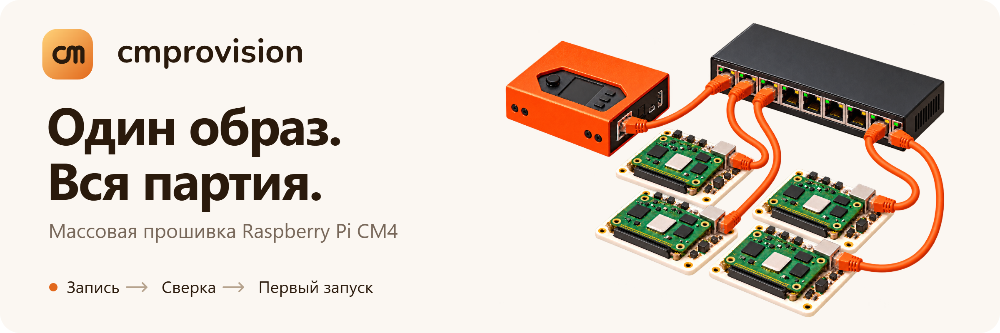

# Массовая прошивка Raspberry Pi CM4

Запись образов ОС, обновление прошивки EEPROM и сверка партии модулей Compute Module с одного Raspberry Pi и через браузер. Опциональная загрузка каждого модуля в записанную систему, установка пакетов и выполнение проверок первого запуска перед отметкой о готовности.

Независимый форк [raspberrypi/cmprovision](https://github.com/raspberrypi/cmprovision), адаптированный для Raspberry Pi OS Trixie. Историю выпусков см. в [changelog](debian/changelog).

**[Быстрый старт](#быстрый-старт)** · **[Скриншоты](docs/ru/gallery.md)** · **[Руководство по эксплуатации](docs/ru/operations.md)** · **[Обновление](#обновление)** · **[API](docs/ru/api.md)**

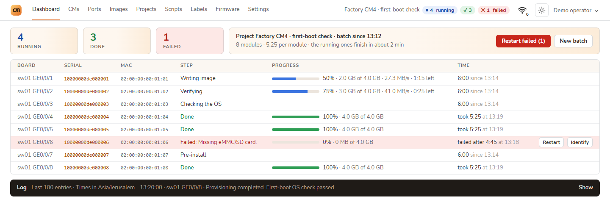

*Живой дашборд партии. Все скриншоты сняты на демонстрационном стенде со смоделированными модулями, сетью и данными коммутатора; скорости и тайминги носят иллюстративный характер. [Обзор всех вкладок интерфейса](docs/ru/gallery.md).*

## От образа к проверенному устройству

- **Подготовка проекта.** Выберите сжатый образ ОС, прошивку EEPROM, скрипты и шаблон этикетки, затем сделайте проект активным для стенда. Образы можно [скачивать из интернета](docs/ru/operations.md#образы-из-интернета) (релизы GitHub, Raspberry Pi OS, прямые ссылки) со сверкой контрольных сумм; список прошивок EEPROM отображает историю изменений.
- **Наблюдение за партией.** Отслеживайте фазу каждого модуля, прогресс, скорость передачи, оставшееся время и ошибки. Страница Ports находит модули на портах настроенных SNMP-коммутаторов с отображением [физических передних панелей](docs/ru/switch-front-panels.md) для проверенных моделей.
- **Вывод стенда на монитор.** Опциональный [консольный дисплей HDMI](docs/ru/hdmi-display.md) отображает карту портов, карточки устройств и сохранённые снимки диагностики; режим Auto останавливает отрисовку при отключении кабеля HDMI.
- **Восстановление прерванной записи.** Скачивание докачивается при обрыве связи. Включение нарезки образа позволяет продолжить запись после перезагрузки с последнего проверенного блока 512 МБ; верификация проверяет весь образ целиком.
- **Проверка установленной системы.** Проверка при первом запуске (first-boot) может устанавливать загруженные пакеты `.deb`, выполнять скрипты и передавать имя хоста до печати этикеток и отправки уведомлений.
- **Управление стендом.** Функция Identify помогает найти готовый модуль (в том числе после проверки ОС до следующей перезагрузки). Перезапуск по PoE на поддерживаемых коммутаторах, управление сетями Wi-Fi и удержание встроенного адаптера в холодном резерве при наличии внешнего аплинка.
- **Повторный провижининг установленного сенсора.** Проверка доступа по SSH, подтверждение диска и возврат в сетевую загрузку из карточки модуля. [Настройка и поддерживаемые структуры](docs/ru/operations.md#повторный-провижининг-установленного-сенсора).

- **Перенос конфигурации между станциями.** Создавайте проекты, скрипты и этикетки через [мастера](docs/ru/creation-wizards.md), затем [экспортируйте выбранное](docs/ru/configuration-transfer.md) в Settings → Status → Backup. Передавайте файлы или текст, защищайте секреты мастер-паролем и проверяйте конфликты перед импортом.

Подробные параметры и ограничения описаны в [руководстве по эксплуатации](docs/ru/operations.md).

## Что добавлено в этом форке

Оригинальный провижинер обеспечивает базовый процесс записи образа. Этот форк расширяет его инструментами для контроля и управления загруженным промышленным стендом:

| Возможность | Что вы видите или можете делать |
| --- | --- |
| Мониторинг партии | Фазы записи, сверки и первого запуска, процент, скорости, расчётное время и рекомендации при сбоях; история прогонов каждого модуля. |
| Коммутаторы и PoE | Карта портов коммутатора, фильтрация по статусу, функция Identify и перезапуск по PoE сбойных портов на поддерживаемых моделях. |
| Параметры подключения | Индикатор аплинка с поколением Wi-Fi, уровнем сигнала, канальной скоростью, диапазоном, каналом, адаптером, статусом холодного резерва и сети стенда. |
| Настройки оформления | Стили **Warm** или **Neutral**, темы **Light**, **Dark** или **Auto**, плотность **Compact** или **Roomy**. Выбор сохраняется в браузере. |
| Управление стендом | Управление сетями Wi-Fi и резервным радиомодулем, проверка целевой ОС, first-boot скрипты и пакеты, групповые оповещения о партиях. |

| Подключение одной кнопкой | Настройки оформления |
| --- | --- |
| <a href="docs/ru/gallery.md#статус-сети">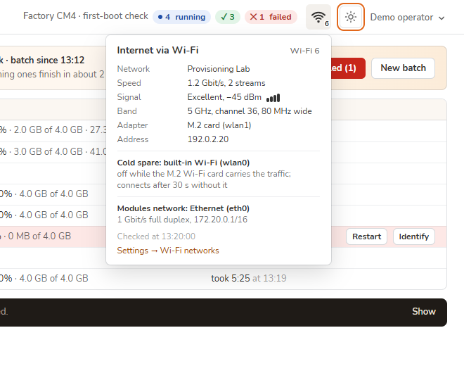</a> | <a href="docs/ru/gallery.md#оформление">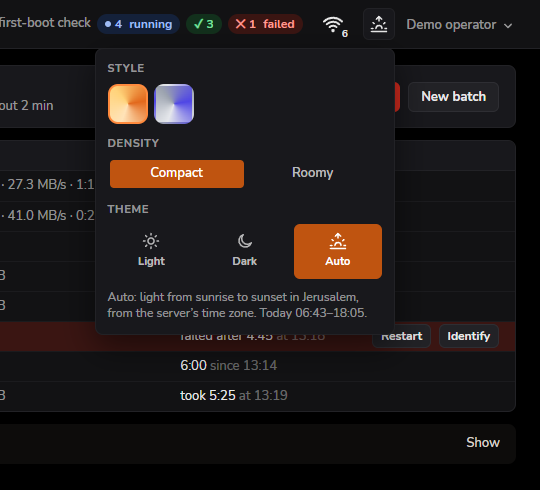</a> |

Режим **Auto** переключает светлую и тёмную тему по восходу и закату солнца для часового пояса сервера, переходя на системные настройки ОС при отсутствии координат. См. [все четыре палитры, оба варианта плотности и мобильное меню](docs/ru/gallery.md#оформление).

## Обзор интерфейса

Ниже представлены все девять основных вкладок. Откройте [тур по скриншотам](docs/ru/gallery.md) для просмотра полноразмерных экранов, редакторов, карточек модулей и страниц профиля.

| Dashboard | CMs | Ports |
| --- | --- | --- |
| <a href="docs/ru/gallery.md#dashboard"></a><br>Прогресс партии и действия | <a href="docs/ru/gallery.md#cms">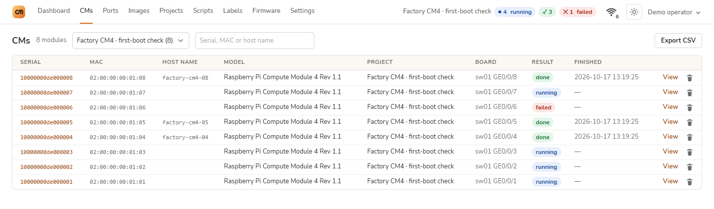</a><br>База устройств и экспорт CSV | <a href="docs/ru/gallery.md#ports">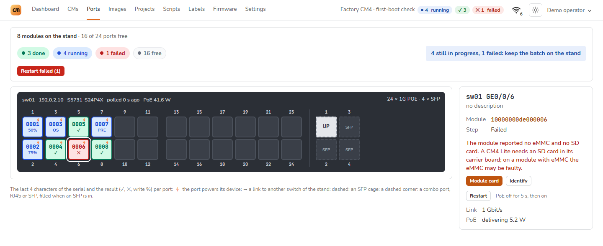</a><br>Карта портов и PoE |

| Images | Projects | Scripts |
| --- | --- | --- |
| <a href="docs/ru/gallery.md#images">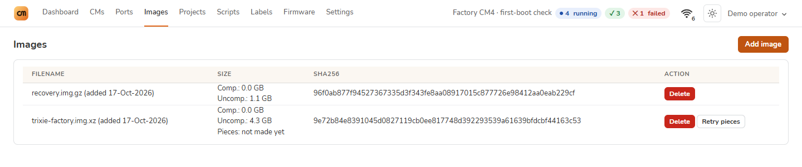</a><br>Образы ОС и контрольные суммы | <a href="docs/ru/gallery.md#projects">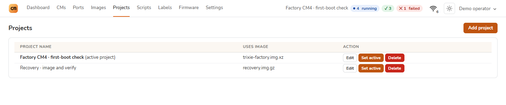</a><br>Шаблоны провижининга | <a href="docs/ru/gallery.md#scripts">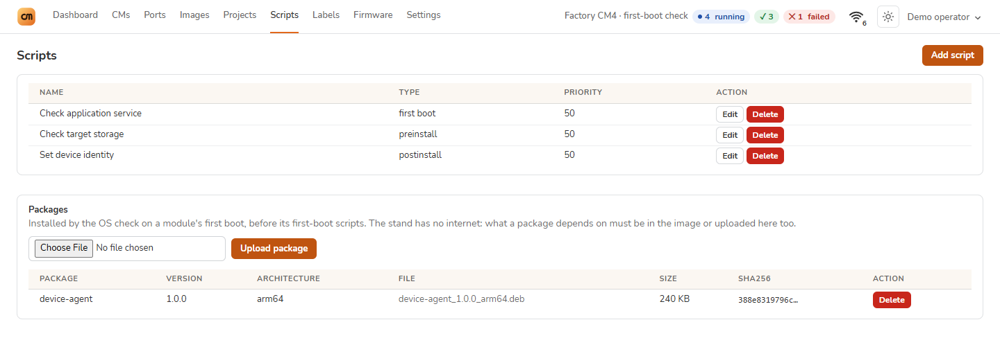</a><br>Скрипты и Debian-пакеты |

| Labels | Firmware | Settings |
| --- | --- | --- |
| <a href="docs/ru/gallery.md#labels">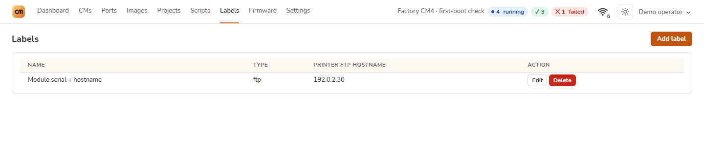</a><br>Печать этикеток устройств | <a href="docs/ru/gallery.md#firmware">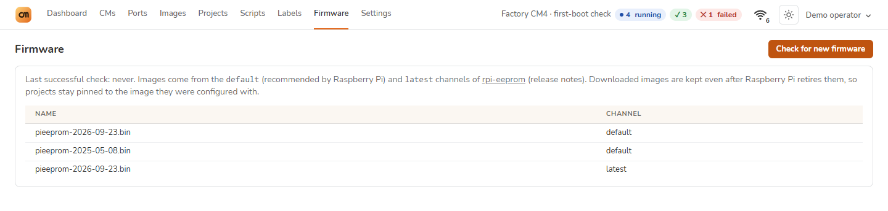</a><br>Каналы релизов EEPROM | <a href="docs/ru/gallery.md#settings">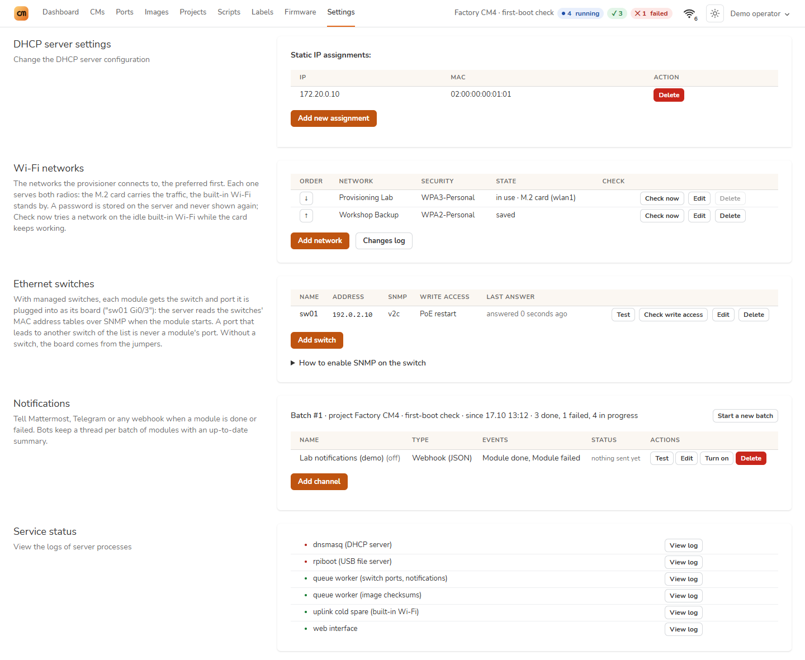</a><br>Сети, коммутаторы и службы |

## Стенд

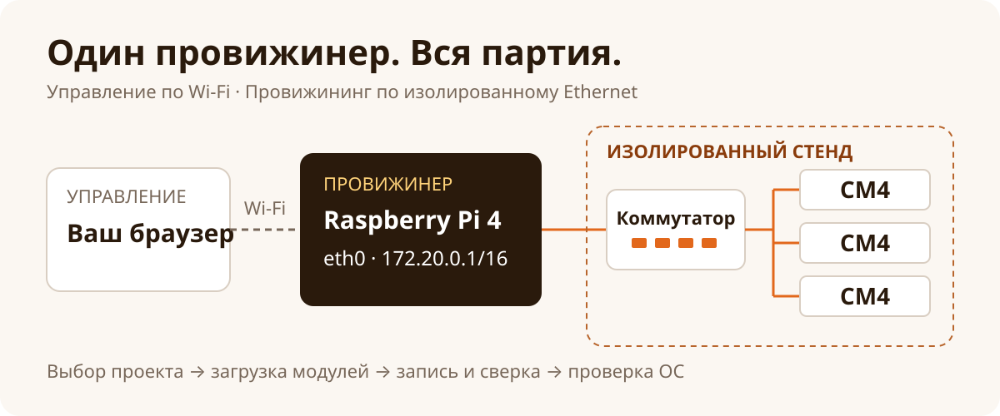

Используйте **Wi-Fi для управления** и **eth0 для провижининга**. Провижинер раздаёт загрузочное окружение и образы модулям через изолированный Ethernet-коммутатор.

> [!WARNING]
> Подключайте `eth0` только к коммутатору провижининга. Подключение к офисной или публичной сети может привести к случайной прошивке других устройств Raspberry Pi в этой сети.

| Компонент | Требование |
| --- | --- |
| Сервер провижининга | Выделенный Raspberry Pi 4 с Raspberry Pi OS Lite **64-bit**, Trixie / Debian 13 или новее |
| Целевые модули | Compute Module 4; поддержка CM3 и CM3+ прекращена с версии 2.5.1 |
| Целевые платы Pi 4 | Предварительно включите сетевую загрузку в EEPROM каждой платы |
| Сеть | Изолированный Ethernet-коммутатор; интерфейс сервера `eth0` на `172.20.0.1/16` без шлюза по умолчанию |
| Управление коммутатором | SNMP read для опроса портов; отдельный доступ на запись для перезапуска по PoE |

Для CM3/3+ или Debian 11/12 используйте релиз форка [`v1.6.11`](https://github.com/nimbo78/cmprovision/tree/v1.6.11) на Raspberry Pi OS с dhcpcd либо апстрим. Для целевых плат Pi 4 утилита Raspberry Pi Imager предоставляет образ **Bootloader → Network boot**.

## Быстрый старт

### 1. Подготовка сервера

Установите чистую 64-битную Raspberry Pi OS Lite с помощью [Raspberry Pi Imager](https://www.raspberrypi.com/software/). Задайте имя хоста, пользователя и подключение к Wi-Fi в настройках Imager. Используйте Wi-Fi для администрирования сервера; 64-битная ОС обязательна для образов более 2 ГБ.

В Trixie настройте интерфейс стенда с помощью NetworkManager:

```sh
sudo nmcli connection add type ethernet ifname eth0 con-name cmprovision \
  ipv4.method manual ipv4.addresses 172.20.0.1/16 ipv4.never-default yes \
  ipv6.method link-local ipv6.addr-gen-mode eui64 connection.autoconnect yes
sudo nmcli connection up cmprovision
sudo apt update
```

### 2. Установка cmprovision

Используйте пакет `cmprovision4_*_all.deb`, собранный из **этого форка** (см. [инструкции по сборке](#сборка-пакета-debian) ниже). Скопируйте пакет на сервер и выполните:

```sh
sudo apt install ./cmprovision4_*_all.deb
sudo -u www-data /var/lib/cmprovision/artisan auth:create-user
```

Откройте `http://<адрес-сервера-в-wifi>/` и войдите под созданной учётной записью. Для обновления существующего сервера ознакомьтесь с разделом [Обновление](#обновление).

### 3. Прошивка первого модуля

1. В разделе **Images** загрузите сжатый образ ОС (`.gz`, `.xz` или `.bz2`) либо выберите **Add from the internet** (релиз GitHub, например `WLAN-Pi/pi-gen`, Raspberry Pi OS или прямая ссылка; архив `.zip` переупаковывается автоматически). Дождитесь завершения вычисления контрольной суммы.
2. В разделе **Projects → Add project** выберите образ и целевой накопитель. Включите **Verify that image was written correctly**; добавьте настройки EEPROM, скрипты или этикетки при необходимости.
3. Сохраните проект и нажмите **Set active**.
4. Подключите модуль CM4, настроенный на сетевую загрузку, к изолированному коммутатору и подайте питание. Следите за прогрессом на **Dashboard**; откройте карточку модуля для просмотра подробного журнала.
5. Дождитесь статуса **Done**. Если включена опция **Check the OS after the first boot**, прогон завершится только после отчёта установленной системы.

Порядок настройки несущих плат и джамперов описан в документе Raspberry Pi [Using the Compute Module Provisioner](https://pip.raspberrypi.com/categories/685-whitepapers-app-notes/documents/RP-003468-WP/Using-the-Compute-Module-Provisioner.pdf). Это руководство покрывает аппаратную часть оригинального решения; используйте данный README для системных требований форка.

> [!NOTE]
> Проверка при первом запуске требует образ на базе systemd с установленным `curl`, второй раздел ext4 и порядок загрузки с приоритетом eMMC над сетью. Модули, загруженные по USB, не проверяются. Сеть стенда не имеет выхода в интернет: включайте зависимости пакетов в образ или загружайте их на сервер. См. [проверку ОС](docs/ru/operations.md#проверка-ос-при-первой-загрузке).

## Утилитарная ОС

Модули прошиваются из микро-ОС, загружаемой по сети или через USB. Начиная с версии 2.7.0 пакет содержит две сборки: нашу современную (`scriptexecute64/`, собранную через Buildroot из свежих компонентов, 64 бита) и устаревшую (`scriptexecute/`, 2022 год, 32 бита). В Settings → Utility OS переключается активная ОС для раздачи модулям. Подробнее о сборке и обновлении: [docs/ru/utility-os.md](docs/ru/utility-os.md).

Загрузка по USB позволяет прошить CM4, если установленная система или EEPROM блокируют сетевую загрузку; Ethernet по-прежнему передаёт скрипты и образы. Локальная командная оболочка на **tty2**, доступная при подключении монитора и клавиатуры к модулю, помогает диагностировать сеть и загрузку. См. [прошивку по USB](docs/ru/usb-provisioning.md), [локальную консоль](docs/ru/local-console.md) и [схему подключения WLAN Pi M4+](docs/ru/hardware/wlanpi-m4-plus.md).

## Обновление

> [!IMPORTANT]
> Устанавливайте новый пакет поверх старого. **Не выполняйте `apt remove` перед установкой:** удаление пакета удаляет базу данных и файлы образов.

```sh
sudo apt install ./cmprovision4_*_all.deb
```

Каждое обновление автоматически делает снимок для отката (сохраняются пять последних). Обновите вкладки браузера после установки.

В [руководстве по обновлению и восстановлению](docs/ru/upgrading.md) описаны снимки, откат, обновление PHP и миграция настроек коммутаторов.

## Документация

| Задача | Руководство |
| --- | --- |
| Обзор всех вкладок, тем и режимов интерфейса | [Галерея скриншотов](docs/ru/gallery.md) |
| Проверка ОС при первой загрузке, пакеты и скрипты | [Проверка ОС](docs/ru/operations.md#проверка-ос-при-первой-загрузке) |
| Скачивание образов с GitHub, Raspberry Pi OS или по ссылке | [Образы из интернета](docs/ru/operations.md#образы-из-интернета) |
| Обрыв скачивания и защита от потери питания | [Восстановление записи](docs/ru/operations.md#докачка-образа-и-восстановление-записи) |
| Сети Wi-Fi и резервный радиомодуль | [Управление Wi-Fi](docs/ru/operations.md#сети-wi-fi) · [Холодный запасной](docs/ru/operations.md#встроенный-wi-fi-как-холодный-запасной) |
| Поиск порта модуля и перезапуск по PoE | [Коммутаторы и PoE](docs/ru/operations.md#коммутаторы-и-перезапуск-по-poe) |
| Прошивка CM4 через сервисный порт USB | [Прошивка по USB](docs/ru/usb-provisioning.md) |
| Диагностика модуля с монитором и клавиатурой | [Локальная консоль (tty2)](docs/ru/local-console.md) |
| Вывод статуса стенда на HDMI-монитор провижинера | [HDMI-дисплей](docs/ru/hdmi-display.md) |
| Компактная передняя панель FPMS (preview) | [Дисплей FPMS](docs/ru/fpms-display.md) |
| Готовый образ станции и подключение через VLAN | [Варианты развёртывания](docs/ru/deployment-options.md) |
| Диагностика модуля по Ethernet и USB fallback | [Диагностика модуля](docs/ru/module-diagnostics.md) |
| Анализ неизвестной платы со статусом UNR | [Диагностика обнаружения](docs/ru/unrecognized-devices.md) |
| Подключение WLAN Pi M4+ как сервера и модуля | [Оборудование M4+ и BOOT/OTG](docs/ru/hardware/wlanpi-m4-plus.md) |
| Светодиодная индикация модуля | [Светодиоды модуля](docs/ru/leds.md) |
| Ограничение сетевого доступа к стенду | [Сетевой доступ](docs/ru/operations.md#доступ-к-сети) |
| Резервное копирование и откат сервера | [Обновление и восстановление](docs/ru/upgrading.md) |
| Автоматизация проектов, образов и скриптов | [HTTP API](docs/ru/api.md) |
| Диаграммы архитектуры и последовательности процессов | [Архитектура LikeC4](likec4/README.md) |

Эндпоинт `/scriptexecute` открыт только для сети стенда и самого сервера. Подключайте nginx напрямую к клиентам. Файлы в `/uploads` доступны любому клиенту с доступом к веб-серверу; не храните секреты в образах и пакетах.

### Архитектурные диаграммы (LikeC4)

Архитектура проекта, схема служб и процессы сквозного провижининга смоделированы в [LikeC4](https://likec4.dev) в каталоге [`likec4/`](likec4/):

- **Обзор и экосистема**: сервер-провижинер, до 48 модулей CM4, PoE-коммутатор, принтер этикеток, дисплеи, NetBox, Telegram.
- **Службы хоста**: Nginx, PHP-FPM, Dnsmasq (DHCP/TFTP), RpiBoot, SQLite (WAL), воркеры systemd и демоны дисплеев.
- **Компоненты приложения**: интерфейс Livewire 3, ScriptExecute (`StandNetworkOnly`), конечный автомат Provisioning Coordinator, очереди.
- **Сеть стенда**: питание PoE, загрузка PXE/TFTP, аварийный USB OTG и потоковая передача кусков образа.
- **Процесс провижининга**: сквозная динамическая последовательность от включения порта PoE до записи eMMC, обновления EEPROM, проверки ОС и печати этикетки.

Mermaid-версии диаграмм закоммичены в файле [`likec4/README.md`](likec4/README.md).

Локальный интерактивный просмотр архитектуры:

```sh
npm run likec4:start      # Локальный веб-интерфейс (http://localhost:5173)
npm run likec4:build      # Сборка статического сайта в likec4/dist
npm run likec4:validate   # Валидация модели и связей
npm run likec4:export-md  # Экспорт Mermaid-диаграмм в likec4/README.md
```

## Разработка

Стек приложения: **Laravel 13, Livewire 3, Tailwind CSS 3.4 и SQLite** с исправленным PHP **8.3.36+, 8.4.27+ или 8.5.12+**. См. [обновления безопасности PHP](docs/ru/upgrading.md#исправления-безопасности-php). Провижининг и управление службами завязаны на утилиты Linux; [стенд Debian 13](docker/README.md) предоставляет nginx и PHP 8.4 в конфигурации пакета.

```sh
composer install
php artisan test
npm run test:js
```

Тесты PHP используют SQLite в оперативной памяти. Тесты JavaScript требуют Node.js 20+. Сквозное тестирование сетевой загрузки и EEPROM требует реального оборудования Raspberry Pi; в [руководстве по нагрузочному тестированию](tests/load/README.md) описан стенд симуляции 48 модулей.

Стили собираются автономным бинарником Tailwind CLI 3.4.19. После редактирования шаблонов или CSS соберите и закоммитьте `public/css/app.css`:

```sh
tailwindcss -c tailwind.config.js -i resources/css/app.css \
  -o public/css/app.css --minify
```

### Сборка пакета Debian

В Raspberry Pi OS Trixie / Debian 13 или новее установите инструменты сборки и модули PHP, затем выполните сборку:

```sh
sudo apt update
sudo apt install git build-essential debhelper fakeroot composer unzip php-cli \
  php-sqlite3 php-bcmath php-mbstring php-xml php-zip php-snmp php-curl
git clone https://github.com/nimbo78/cmprovision.git
cd cmprovision
dpkg-buildpackage -b -us -uc
```

Пакет собирается в родительском каталоге. Собирайте при отсутствии папки `vendor/`: процесс сборки сам устанавливает рабочие зависимости, но использует существующий `vendor/` без изменений. Устанавливайте полученный пакет через `apt` для автоматической установки зависимостей.

Планы развития см. в [ROADMAP.md](ROADMAP.md), логотипы — в [материалах бренда](docs/brand/README.md).

## Лицензия

[BSD 3-Clause](LICENSE). Первоначально разработано Raspberry Pi; этот форк поддерживается независимо. Зависимости сохраняют собственные лицензии в каталоге `vendor/` после выполнения `composer install`.
