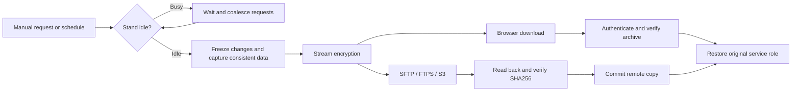
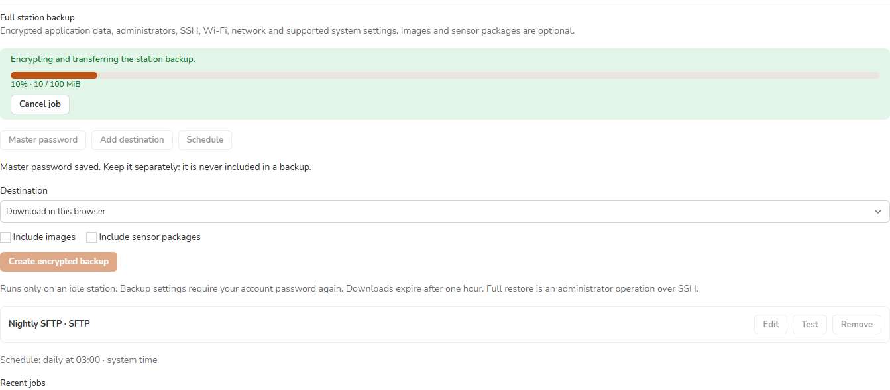

# Station backups

[Русский](ru/backups.md) · [Data-only backups and upgrades](upgrading.md) · [Selective transfer](configuration-transfer.md)

Open **Settings → System → Backup** to create an encrypted station copy, configure remote storage and enable a schedule. Full restoration is an administrator command over SSH.

> [!IMPORTANT]
> Keep the archive master password separately. It is never included in the copy. Changing it affects future archives; older files still need their original password.



## Choose the copy you need

| Workflow | Contents | How to restore |
|---|---|---|
| **Selective import / export** | Selected projects, scripts, labels and supported setting groups | Review and import in the web interface |
| **Download backup** | Existing data-only archive, without provisioning images | `cmprovision-restore --data-only` |
| **Full station backup** | Application data, secrets and the supported OS configuration below | `cmprovision-full-restore` over SSH |
| Automatic upgrade snapshot | Local recovery material for a package update | Existing updater recovery or `cmprovision-restore` |

The existing data-only and selective actions remain available in this same card.

Updater recovery points have a separate [seven-day retention policy](updates.md#apply): the previous point is retired before the next application snapshot's free-space check. The full-backup replacement rules below still verify a new copy before retiring its predecessor.

## What a full copy saves

| Always included | Optional / excluded |
|---|---|
| Consistent SQLite snapshot, application key, projects, scripts, labels, saved credentials and firmware store | Provisioning images: **Include images** |
| NetworkManager profiles, Wi-Fi secrets, supported certificate files, VLAN settings | Sensor OS-check packages: **Include sensor packages** |
| Local interactive administrators, password hashes, authorized SSH keys, SSH host keys/configuration and sudo configuration | Running jobs, browser sessions, caches, temporary uploads and active confirmation tickets are cleared |
| Host name/locale, time zone/NTP, cmprovision nginx/PHP configuration, stand role, HDMI/FPMS preferences | Backup master password, machine ID, old backup archives and updater recovery collections are excluded |
| Installed cmprovision/fpms-lite packages and the complete active Utility OS; remote backup profiles with schedules disabled | The underlying Debian installation, unrelated OS packages and arbitrary files outside the fixed policy are outside this format |

The supported baseline is Debian/Raspberry Pi OS **Trixie** with cmprovision installed. Wi-Fi certificates/keys referenced by profiles must be under `/etc/NetworkManager/certs/`. Custom SSH key or authorization sources outside the supported inventory prevent a successful full copy; resolve the reported configuration first. Standard Trixie locale/time-zone aliases are handled explicitly.

## Create or schedule a copy

1. Confirm your **account password** when requested. This authorizes the operation.
2. Open **Master password**, enter an archive password of at least 12 characters twice and save it.
3. Choose **Download in this browser**, or **Add destination** and save a remote profile.
4. For SFTP, read the server fingerprints, compare them with the server administrator's trusted value and explicitly accept a key. Choose **Test** to verify write/read/delete access.
5. Choose optional images/packages and select **Create encrypted backup**. You can leave the page and reconnect. **Cancel job** removes the incomplete copy and restores the station's previous services.
6. Use **Schedule** to opt in to daily/weekly copies. The default is off; the suggested time is **03:00 in the station time zone**. Choose one remote destination. Retention is fixed at **one verified copy per destination**, including profiles saved with a larger limit.

Busy stations wait for active/reserved work to finish. Missed schedule slots coalesce into one request. Repeated autumn hours run once; a missing spring time runs at the first valid minute. Changing the station time zone establishes a fresh schedule boundary.

A copy deferred for several days covers schedule slots up to its actual snapshot time. Selecting images/packages requires every usable database reference, including completed split copies, to exist with matching checksums/sizes. Missing selected payloads fail creation or restore inspection; pending/failed image downloads are excluded from usable references. SQLite reference inspection runs as www-data, supports databases up to **512 MiB** and **4,000 payload references**, and requires temporary space for another database copy.

Percentages appear only for measured byte counts. Preparation and streaming remote upload with unknown total size show an activity state. Verification completes before a copy is advertised as usable. Only the latest verified browser copy remains available, for up to **one hour**; its predecessor's link expires after replacement. Failed or canceled creation preserves the previous usable copy. The last **50 job summaries** remain without retaining their archives.



*Demonstration data; remote credentials are never displayed.*

## Remote storage

| Type | Required configuration |
|---|---|
| SFTP | Host, port, login, password or PEM private key, pinned server public key |
| FTPS | Explicit TLS (default) or implicit TLS, login/password; optional custom CA |
| Plain FTP | Explicit acknowledgement that transport credentials are exposed on the network |
| S3 / S3-compatible | Bucket, region, access/secret keys, optional session token and HTTPS endpoint/custom CA |

Blank credential fields preserve the saved value. **Clear saved value** explicitly removes one. Never put credentials in a URL. S3 uses a configured profile without ambient instance credentials.

Each station writes into its own UUID namespace. An upload becomes successful only after encrypted read-back matches the original size/SHA256 and a completion marker is committed. The previous copy is removed only after that verification, leaving **one verified copy per station and destination**. Retention deletes only copies recorded by this station for that exact destination; unrelated files remain. A retention failure leaves the new verified copy usable and reports a warning; fix destination delete permissions to remove the extra copy on the next successful backup.

Publishing that verified completion marker finishes the remote copy: cancellation arriving afterward does not undo it. If station service cleanup is interrupted, recovery finishes retention without uploading the archive again.

S3 bucket versioning may retain old object versions, and aborted multipart uploads can require a bucket lifecycle rule. Configure lifecycle separately for your dedicated backup prefix; cmprovision does not broadly purge a bucket's multipart uploads or foreign objects.

A power loss between remote publication and saving its ownership receipt can leave an unrecorded remote object. Inspect that station's dedicated prefix manually in this case; automatic cleanup never guesses ownership of unrecorded objects.

## Preview restoration

Install a compatible Trixie station first. Copy the `.cmpbackup` file onto protected storage with enough room for authentication, staging and a fresh recovery copy. The process preserves at least **256 MiB** free; required package capture also checks space before repacking. Repacking uses one compression thread. The archive limit is 1 TiB; configuration metadata is limited to 16 MiB per file and 64 MiB in total. Payload staging reads the archive once.

```sh
sudo cmprovision-full-restore /srv/restore/station.cmpbackup
```

Enter the archive master password at the terminal. A protected inherited descriptor is also supported with `--password-fd`; passwords are never command-line arguments. Inspection authenticates the complete encrypted stream and checks every allowed path, file size and hash before destination writes.

The preview lists changed groups, preserved groups, selected accounts, software installation and excluded payloads, without secret values. It prints the source station/version and encrypted archive SHA256. Review that identity before applying.

## Apply a migration

The default **migrate** mode preserves destination networking, SSH host keys/configuration, host identity, emergency administrator and stand role. It restores application data and the selected supported groups.

```sh
sudo cmprovision-full-restore /srv/restore/station.cmpbackup \
  --mode migrate --apply --yes
```

To restore selected account credentials and explicitly map a source network interface:

For a Wi-Fi profile bound only by MAC, use the source permanent MAC as the mapping key, for example `--map-interface 02:00:00:00:00:01=wlan0`. Map both rescue AP/client radios when replacing hardware: the AP profile and private controller configuration are rewritten consistently. Omit network restoration to preserve destination networking, including its rescue credentials.

```sh
sudo cmprovision-full-restore /srv/restore/station.cmpbackup \
  --mode migrate --groups time,display,web,network \
  --map-interface eth0=eth0 --account operator --emergency-user rescue
# Review the preview, then repeat the same options with --apply --yes.
```

Mappings use destination interface MAC addresses. Name/UID/GID conflicts or missing supplementary groups stop the operation. The selected emergency administrator is preserved. Existing OS service accounts remain. Password hashes are passed to fixed account tools on stdin, and SSH/sudo configuration is checked before use. Open a new SSH session and verify access before closing your existing one.

Available OS groups are `network`, `ssh`, `host`, `time`, `display`, `web`, `role`, `publisher`, `sudo`. Defaults are `time,display,web`. `sudo` configuration is restored only in `--mode same-station`; migration can put selected accounts in existing destination groups. Selecting `role` explicitly restores source service masks, so check the switch/network design first. A fresh migration keeps d62-style masked DHCP/USB services masked by default.

Restored schedules are disabled and the master password must be set again. Migration generates a new backup UUID. Excluding images/packages deactivates the active project; select and validate a usable project before provisioning. Destination Linux networking and SSH are preserved by default, while coherent application data includes the source `.env` and dnsmasq configuration. Review custom stand subnets and application URLs before enabling provisioning.

## Trust archived software

Matching already-installed station packages and a valid installed Utility OS can be reused. Installing archived software verifies its signed publisher manifest and hashes against the **destination's existing trusted publisher key**.

Package reuse also requires a clean installed-file verification. Emergency recovery reinstalls archived packages even when their versions match. Captured bundled Utility OS trees replace their slot exactly; obsolete files are removed by an atomic tree exchange. Explicitly trusted unsigned managed trees use the same exact replacement in bundled-modern.

Repacked packages and unsigned Utility OS trees are marked **local-snapshot**. To execute them, the administrator must review the preview/archive fingerprint and explicitly add `--allow-snapshot-software`. An encrypted archive password alone does not establish publisher provenance. An explicitly trusted unsigned managed Utility OS tree is restored into the editable bundled-modern slot; it is never given a forged signed managed-release identity.

Read-only preview can list software requiring this permission without granting it. Applying that plan still requires the explicit flag.

## Interrupted restoration

Before destination changes, the command creates and verifies:

```text
/var/backups/cmprovision-full-restore/<operation-id>/before.cmpbackup
```

It uses the password supplied for the restoration. **One verified pre-restore recovery copy** is retained separately from ordinary backups and excluded from later full archives. Older recorded copies are removed after successful restoration and health checks, or during idle cleanup. An active or interrupted restoration protects its recovery material until resolved; manually stored or unrecognized files are preserved.

Runtime service masks and a retained systemd boot guard prevent DHCP/TFTP/USB restarts during restore, including after a reboot or interrupted package configuration. The guard is released only after application/Utility OS health checks. Old job staging remains eligible for expiry after migration; the encrypted pre-restore recovery archive is retained separately. Administrator restores cannot be canceled from the browser.

If restoration fails after changes start, provisioning stays stopped and the maintenance marker remains. Use SSH/local console:

```sh
sudo cmprovision-full-restore --recover
# Review the recorded recovery copy and supply any needed account/interface choices.
sudo cmprovision-full-restore --recover --apply --yes --allow-snapshot-software
```

Only the station-recorded recovery path is accepted in this mode. SSH/account recovery choices still need operator review. Do not delete pending markers to reopen a partly restored stand. If no pre-restore copy was committed, the operation stopped before destination data changes; inspect the recorded service state over SSH before releasing maintenance.

For an interrupted **backup creation**, use `sudo python3 -I /usr/lib/cmprovision/station-backups.py --recover` and inspect `journalctl -u 'cmprovision-backup-*'`. Recovery restores recorded services and never repeats the interrupted upload/snapshot. Package removal refuses an active full-backup gate; protected backup state and recovery files are retained for administrator recovery.

## Validation level

The loopback FTPS fixture uses TLS 1.2 because of [pyftpdlib's TLS 1.3 truncation issue](https://github.com/giampaolo/pyftpdlib/issues/602). Production TLS negotiation and certificate verification remain unchanged; real FTPS-server acceptance is separate.

The automated checks cover the archive policy, authentication/tampering, multi-gigabyte streaming, scheduling/DST, admission/recovery, web authentication and real loopback SFTP/FTP/FTPS/HTTPS-S3 endpoints. The S3 fixture is Moto, with unversioned small PUT and versioned multipart coverage; external AWS/MinIO and unversioned multipart acceptance remain separate. A disposable Debian station exercises actual account tools, SSH validation, NetworkManager reload, SQLite as www-data, archived package downgrade/installation, same-version repair and interrupted CLI recovery. An injected configuration failure and simulated loss of runtime state verify that enabled boot services remain blocked until authenticated recovery restores their original role. Physical restore and real external storage acceptance require a designated expendable station.
