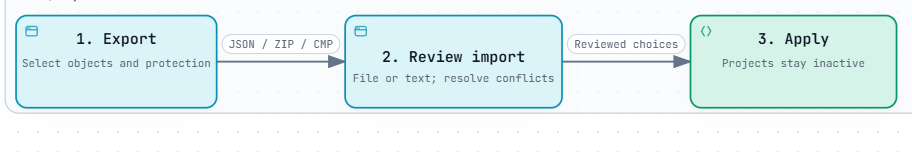
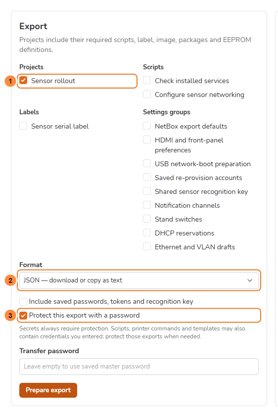
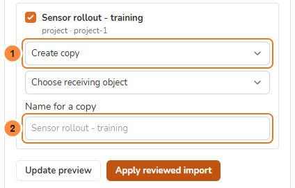
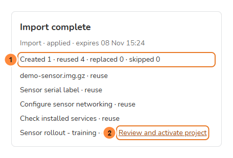

> **Language / Язык:** [English](configuration-transfer.md) | [Русский](ru/configuration-transfer.md)

# Move configuration between stations

[Operations](operations.md) · [Backup and restore](upgrading.md) · [Station image setup](station-project-setup.md)

Open **Settings → Status → Backup → Selective import / export**. Projects, Scripts and Labels also link to this page; an object's **Export** link selects it for you.

Configuration transfer copies selected definitions into an installed cmprovision station. A full backup and `cmprovision-restore --data-only` remain the recovery tools for a station's database and application key.

For a new project, label or script, use the [creation wizards](creation-wizards.md), then export the saved result from its row.

> [!NOTE]
> Feature preview available from `2.25.0~dev1`: both stations need a build containing this feature. Screenshots use demo data.

*Select the image to enlarge it. Download [the standalone HTML](diagrams/configuration-transfer-flow.html) and open it locally for interactive exploration.*

## Before you start

- [ ] You can sign in to both stations and confirm your account password.
- [ ] Their queues are running, especially the **images worker**.
- [ ] You know which receiving objects to keep, copy or replace.
- [ ] For protected exports, you have the transfer password or the same saved master password on the receiver.

## Choose what to export

Select projects, standalone scripts and labels, and any settings groups you need. A project brings its image definition, scripts, label, first-boot packages and EEPROM firmware references automatically.

Settings groups and station-specific exclusions

The settings groups cover NetBox defaults, display preferences, USB preparation, saved re-provision accounts, the shared sensor recognition key, notification channels, switches, DHCP reservations and Ethernet/VLAN drafts. They omit provisioning history, active-project selection, detected switch state, users, application keys and local operation records.

Station-project definitions include their Linux access and management Wi-Fi setup. This feature does not transfer the source station's own saved management Wi-Fi connections.

1. Select the objects. Project dependencies are included automatically.
2. Choose the format, optional binary files and password protection.
3. Select **Prepare export** and confirm your **cmprovision account password** if prompted.
4. Wait for ready, then download the file or select **Show text to copy** for JSON.

**1 — Objects. 2 — Format. 3 — Protection.** No need to select the project's required scripts and label a second time.

Choose a format:

| Format | Use |
| --- | --- |
| JSON | Download a small file or copy and paste its text. Binary files are described by size and SHA-256. |
| ZIP | Optionally include images, Debian packages and EEPROM files. Already compressed files are stored without recompression. |
| Protected CMP | Password-protected ZIP, selected automatically when protection is enabled. Protected JSON stays copyable text. |

With JSON, upload missing images and packages normally on the receiving station first. Matching files must be ready and their actual bytes must match the descriptor. Import never downloads an arbitrary URL from a manifest.

## Passwords and secrets

> [!WARNING]
> Including saved passwords, tokens and the recognition key requires protection. Scripts, printer commands and templates can contain credentials written as ordinary text; protect those exports too when appropriate.

Master password and account-password confirmation

You can save one **master password** on each station. Use the same password on another station, or enter a different one for an individual transfer. A new password needs 12–1024 characters. Forgetting it removes the station's saved copy; existing exports keep their original password.

**Include saved passwords, tokens and recognition key** requires protection. Otherwise those fields are excluded and the preview asks for replacement values where needed. Scripts, printer commands and templates may contain credentials entered as ordinary text; enable protection for those exports too when appropriate.

The saved master password and temporary supplied credentials are encrypted with the local application key. A protected export opens with its transfer password independently of the source application key. Imported encrypted settings are saved with the receiving station's key.

Saving/forgetting the master password, preparing an export, viewing/downloading its text and applying configuration use the normal account-password confirmation. Enter your cmprovision account password there, rather than the transfer password.

## Import and review

1. Upload JSON, ZIP or CMP, or paste exported text. Enter its transfer password if it differs from the saved master password.
2. Wait for preparation. The images worker validates the manifest and verifies included files, including unpacked image size and SHA-256 and Debian package metadata.
3. Review each object. Identical definitions default to **Reuse existing**. Ordinary name conflicts default to **Create copy**. Switch addresses, DHCP identities and settings groups require explicit replacement or reuse because their identities cannot be copied unchanged.
4. Resolve missing files and excluded secrets. For an excluded Linux password, enter a new password, not a password hash. For a network draft, map the receiving interface and VLAN parent.
5. Select **Update preview** after changing choices. Required dependencies must remain selected unless you reuse a complete receiving project instead.
6. Select **Apply reviewed import**. Application runs in the images queue. Its final report lists created, reused, replaced and skipped objects.

**1 — Conflict action. 2 — Copy name.** This crop shows the project row; its dependencies are listed above. **Expected before applying:** no unresolved requirements and the intended copy/reuse/replace choices. **Update preview** validates changed choices before **Apply reviewed import**.

An active project and dependencies used by it or by a running device cannot be replaced. Images with pending split preparation also require a copy or waiting until preparation finishes. EEPROM files are immutable: reuse matching bytes or create a separate copy.

If receiving configuration changes after preview, review again. A retry of an already applied operation returns its saved result and object IDs. The operation address survives a page reload in the same signed-in browser session. It is unavailable to another user/session and expires after 24 hours.

## Complete the follow-up actions

- [ ] **Import complete** lists the expected objects and counts.
- [ ] The imported project exists on **Projects** and is **inactive**.
- [ ] Follow-up actions are reviewed before changing a working stand.

Imported projects are saved without changing the active project. Review them on Projects and activate the intended one explicitly. Source script execution order is preserved when equally prioritised scripts have different IDs on the receiving station.

Some settings require another action:

- **Network drafts:** open a draft from the report, select a saved receiving profile on its mapped interface and load the values into the normal editor. Create a disconnected Ethernet profile first if needed; create a missing VLAN through the VLAN section. The VLAN ID and parent must match. Review addresses, DNS, routes and policy rules, then use the normal temporary apply, confirm or rollback workflow. Import itself changes no interfaces or routes.
- **Display services:** FPMS appearance is saved in the database. The report shows the pending HDMI/FPMS service preferences and offers a separate action to apply them through the normal service helpers.
- **DHCP reservations:** definitions are saved first. Apply the report's DHCP action while the stand is idle to regenerate the host section and restart DHCP; other dnsmasq options are retained.
- **USB preparation:** rebuild the selected EEPROM image through the report before enabling USB preparation. Import leaves that mode off.

An expired or removed network draft is discarded with a notice; normal network settings remain accessible.

## Limits and recovery

File sizes, expiry, verification and cleanup

The manifest limit is 16 MiB; protected text is at most 32 MiB. A transfer contains at most 2048 objects and 4096 archive entries. The archive format supports 64 GiB, while the installed package's normal HTTP upload limit is 8 GiB. For larger images, use the existing image-upload workflow and transfer their definitions as JSON.

Image verification permits up to 512 GiB unpacked data, with a two-hour per-file timeout and an XZ decoder memory limit of 128 MiB. Repack an unusually high-memory XZ image before importing it.

Keep both queue workers running, especially the images worker. Temporary transfer files live privately under `storage/framework/configuration-transfer`, outside ordinary backups. Cleanup runs when new operations start and through a delayed images-queue job after expiry; a stopped worker delays that scheduled cleanup. Cancel removes an unused transfer's temporary files. Unregistered staged assets are cleaned on failure, retry or expiry; committed assets remain registered.

Replacing an image or package retires its superseded files only after the import commits. Files still referenced by another record are retained, including shared image split files. If cleanup cannot finish, the applied result stays saved and the report offers **Retry file cleanup**. Check file-store permissions before retrying; expiry cleanup also retries pending files.

If preparation fails, check its message, available space and password, then start a new transfer. If application stops, refresh the preview before retrying. If the result is temporarily unavailable, reopen the same operation first so its committed result can be recovered.

Schema version 1 is accepted explicitly. Unsupported versions, unknown fields, broken references, archive links/traversal, undeclared members, mismatched hashes and incomplete protected streams are refused before configuration is applied.

