# Screenshot tour

[Back to README](../README.md) · [Quick start](../README.md#quick-start) · [Operation guide](operations.md)

Screenshots of the current interface, captured from a disposable local copy on 17 October 2026. **All device records, projects, network readings and switch responses are demo data.** Speeds, power readings and completion times are illustrative, not hardware measurements. The images and firmware listed in the demo are placeholders.

Most views use **Warm · Light · Compact** at a 1440-pixel browser width. Each screenshot links to its original PNG; dialogs and status panels are captured separately so their controls remain readable.

| Main tabs | More views |
| --- | --- |
| [Dashboard](#dashboard) · [CMs](#cms) · [Ports](#ports) | [Module detail](#module-detail) · [Connection status](#connection-status) |
| [Images](#images) · [Projects](#projects) · [Scripts](#scripts) | [Appearance](#appearance) · [Density](#density) |
| [Labels](#labels) · [Firmware](#firmware) · [Settings](#settings) | [Mobile navigation](#mobile-navigation) · [Account](#account) |

## Dashboard

Follow the active batch without opening individual records. Modules show their current phase, progress, write or verification rate, remaining time and errors. The demo includes writing, verification, first boot, completed runs and a missing-storage failure. Eligible modules offer **Restart** and **Identify** actions.

## CMs

Search the module inventory, review each device's latest result and export records as CSV. Open a serial number for the device's detailed record.

## Ports

See the stand as a switch port map. State filters highlight running, done, failed or free ports. Selecting a port reveals its module, failure advice, link and PoE information. This example selects the failed module on **sw01 GE0/0/6**.

Port lookup needs SNMP read access. PoE restart needs separate write access and a supported switch; see [switch setup and safeguards](operations.md#switches-and-poe-restart).

## Images

Upload compressed OS images and review their checksums before assigning them to a project.

## Projects

Keep provisioning settings in named projects and choose which one is active for the stand. A project combines the image, destination storage, optional EEPROM settings, scripts, first-boot checks and label template.

Open the project editor

The editor includes whole-image verification, split-image recovery, first-boot OS checks and EEPROM configuration.

<a href="../assets/readme/screenshots/project-editor.png">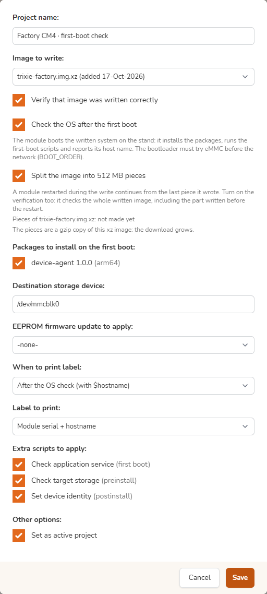</a>

## Scripts

Manage scripts for the pre-install, post-install and first-boot stages. Upload Debian packages for installation during the first-boot OS check. The target network has no internet, so package dependencies must already be present or uploaded too.

Open the script editor

Edit the script's name, execution stage and shell commands.

<a href="../assets/readme/screenshots/script-editor.png">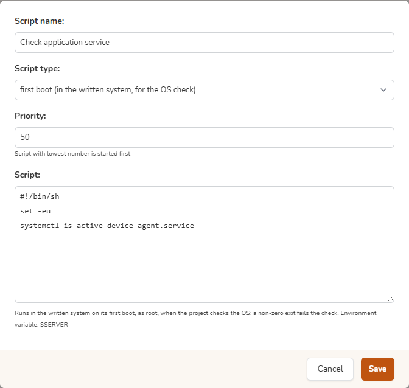</a>

See [first-boot requirements](operations.md#first-boot-os-check) before enabling scripts and packages in a project.

## Labels

Create label templates for provisioned devices and attach a template to a project. Template fields can include the module's serial number and the hostname reported by its installed system.

Open the label editor

Configure the printer connection and edit its label commands using the available device-data placeholders.

<a href="../assets/readme/screenshots/label-editor.png">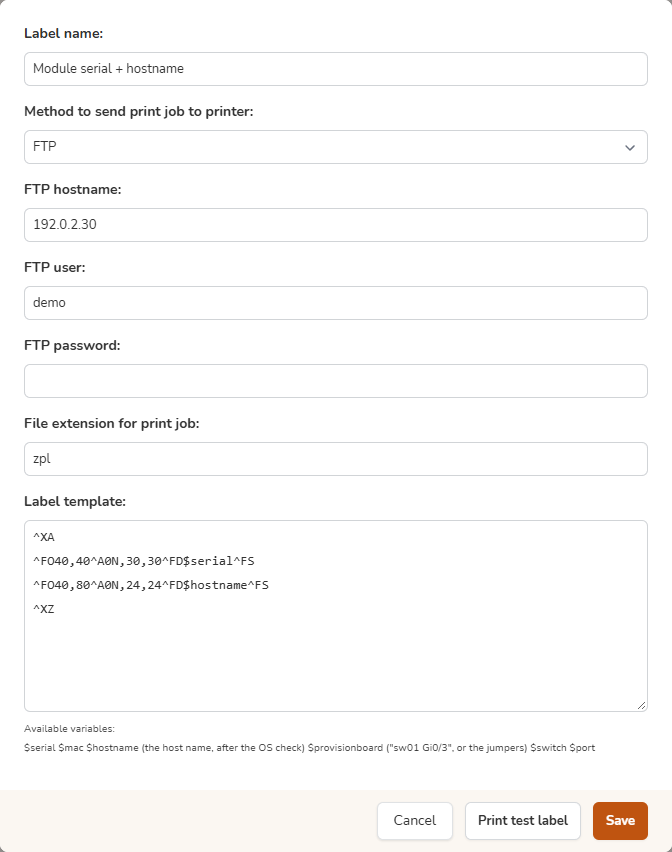</a>

## Firmware

Review the available Raspberry Pi bootloader EEPROM releases by channel. Choose the firmware to apply in the project editor.

## Settings

Settings is split into four tabs by purpose: **Status** (the services of the server and their logs), **Network** (Wi-Fi networks, SNMP switches, DHCP assignments), **Provisioning** (utility OS, re-provisioning, the HDMI display) and **Notifications** (channels and batches). On the three tabs besides Status, a strip above the sections shows the state of the services and a menu with their logs. The demo runs without provisioning hardware, so DHCP and USB boot services are shown as stopped. This view was captured on 23 October 2026 from the development bench.

## Module detail

A module's record brings together its hardware, project and image, switch port, last-run phases, first-boot result, EEPROM before and after, and log history. Here the installed system has reported back successfully with its hostname.

<a href="../assets/readme/screenshots/module-detail.png">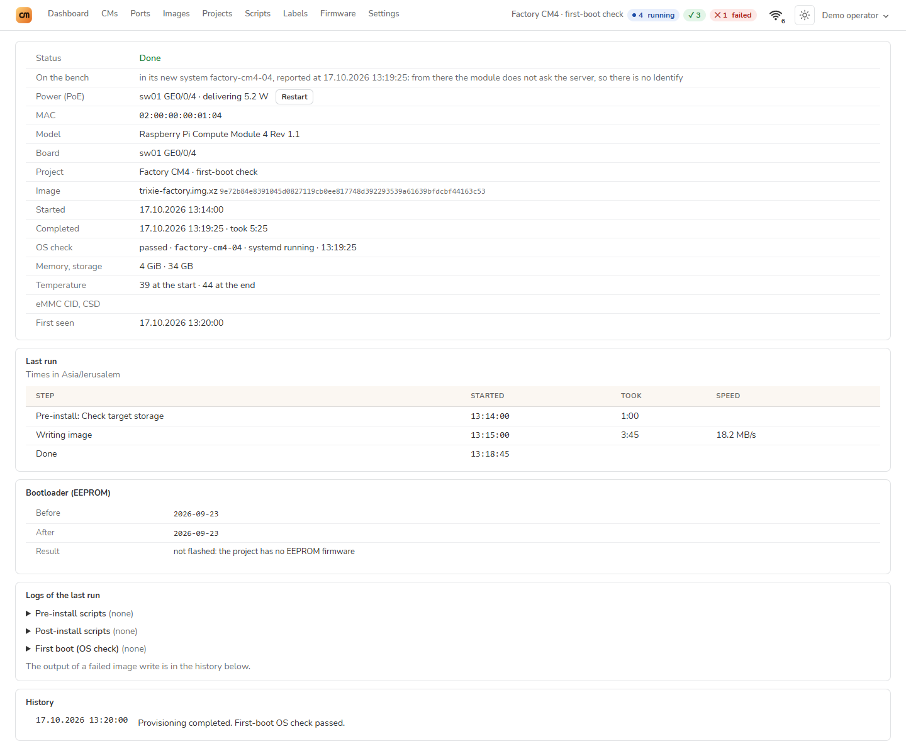</a>

## Connection status

Open or hover over the network indicator in the navigation bar to inspect the uplink. For Wi-Fi it shows the generation, network name, signal strength, negotiated link rate, band, channel, channel width, adapter and address. It also shows the built-in radio's cold-spare state and the separate Ethernet network serving the modules.

The Wi-Fi speed is the **link rate**, not measured internet throughput. See [cold-spare behavior](operations.md#built-in-wi-fi-as-a-cold-spare) for failover details.

## Re-provision an installed sensor

The module card checks access before offering the destructive action. These three views were captured on 18 October 2026 from the development implementation with simulated SSH responses, in Warm · Dark. No device was erased for the screenshots.

| Check access | Confirm identity, disk and project |
| --- | --- |
| <a href="../assets/readme/screenshots/reprovision-access.png">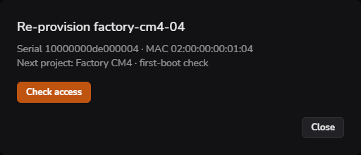</a> | <a href="../assets/readme/screenshots/reprovision-confirm.png">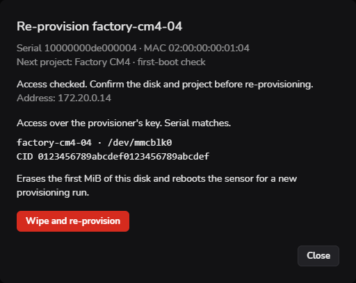</a> |

A sensor that requires a new password

<a href="../assets/readme/screenshots/reprovision-password.png">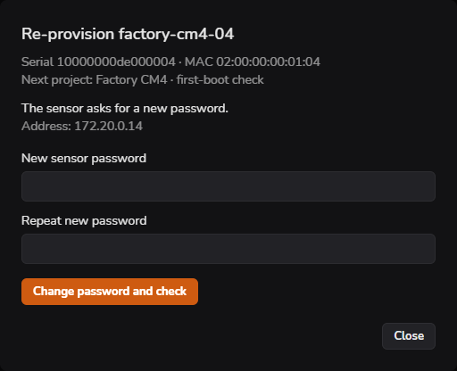</a>

See [supported layouts, key installation and recovery](operations.md#re-provision-an-installed-sensor).

Settings also has an ordered list of saved sensor accounts. The public factory profiles below are demonstration data; stored custom passwords are never displayed.

<a href="../assets/readme/screenshots/reprovision-accounts.png">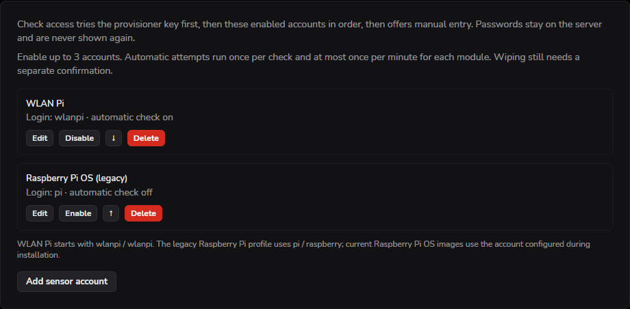</a>

## Appearance

Open **Appearance** in the navigation bar. Choose one of two styles, **Warm** or **Neutral**, and a **Light**, **Dark** or **Auto** theme. The same dashboard is shown in all four palettes below. Choices are saved in the browser and synchronized between its open tabs.

| Warm · Light | Warm · Dark |
| --- | --- |
| <a href="../assets/readme/screenshots/warm-light.png">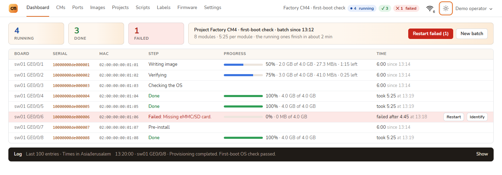</a> | <a href="../assets/readme/screenshots/warm-dark.png">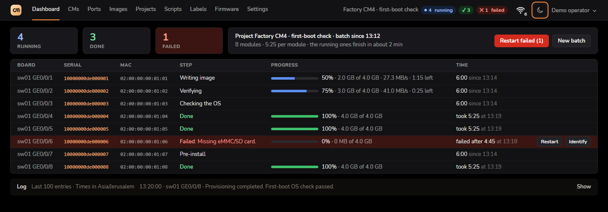</a> |

| Neutral · Light | Neutral · Dark |
| --- | --- |
| <a href="../assets/readme/screenshots/neutral-light.png">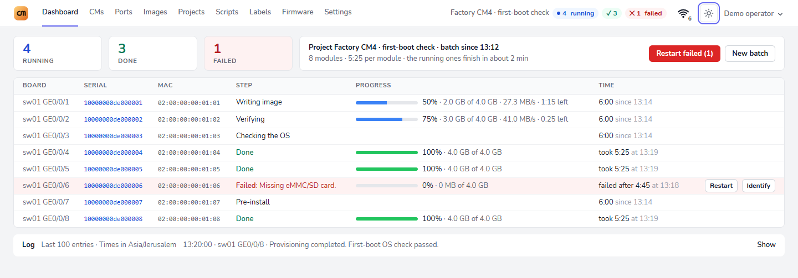</a> | <a href="../assets/readme/screenshots/neutral-dark.png">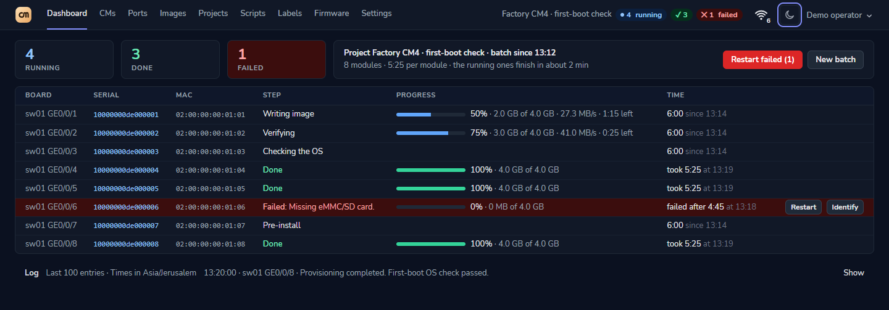</a> |

**Auto** uses sunrise and sunset for the representative location associated with the server's time zone. If solar times are unavailable, it follows the operating system's light or dark preference. The panel explains which rule is active.

## Density

**Compact** fits more information on the screen. **Roomy** gives rows and controls more space. Density is independent of the selected style and theme.

| Compact | Roomy |
| --- | --- |
| <a href="../assets/readme/screenshots/density-compact.png">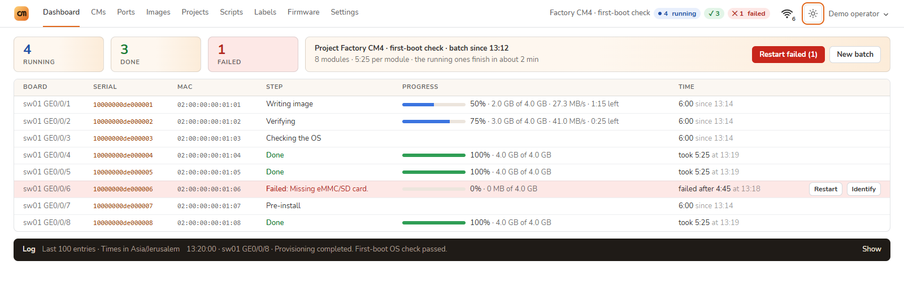</a> | <a href="../assets/readme/screenshots/density-roomy.png">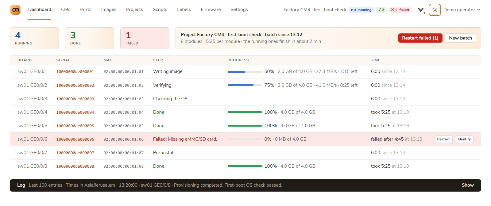</a> |

## Mobile navigation

On a narrow screen, the menu keeps all nine main tabs, the account links and appearance controls within reach.

<a href="../assets/readme/screenshots/mobile-menu.png">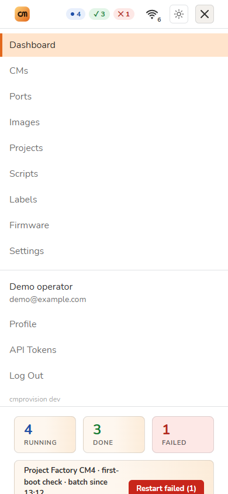</a>

## Account

The account menu opens **Profile** and **API Tokens**. Manage account and session settings in Profile; create tokens for automation under API Tokens. See the [HTTP API guide](api.md) for requests.

Profile

<a href="../assets/readme/screenshots/profile.png">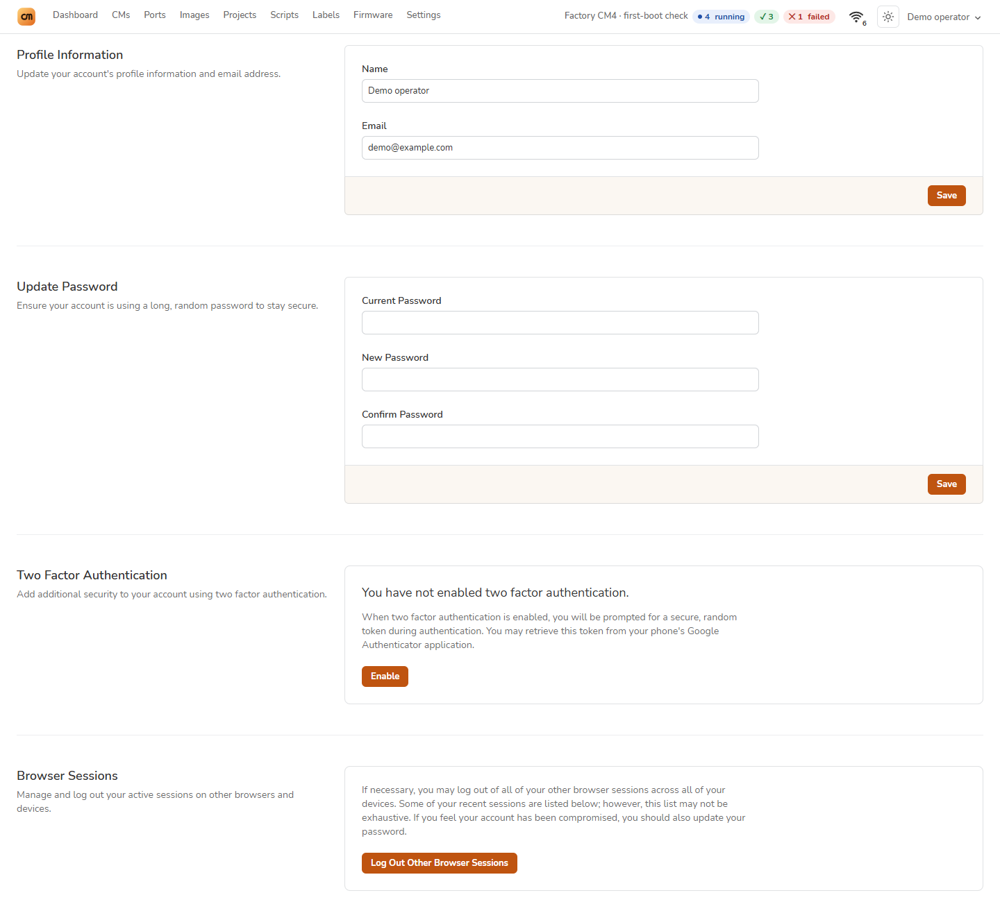</a>

API Tokens

<a href="../assets/readme/screenshots/api-tokens.png">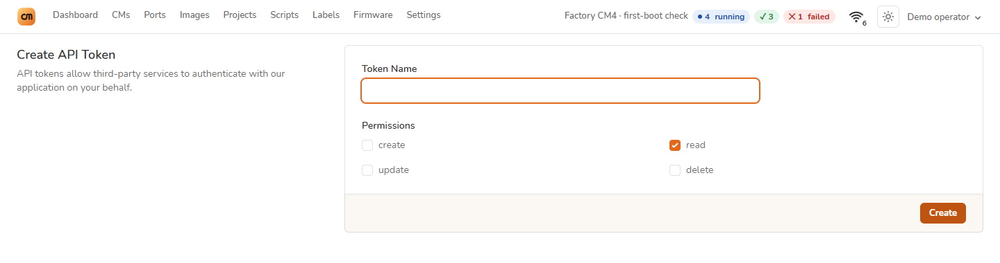</a>

[Set up your first stand](../README.md#quick-start) · [Screenshot provenance](../assets/readme/README.md)
