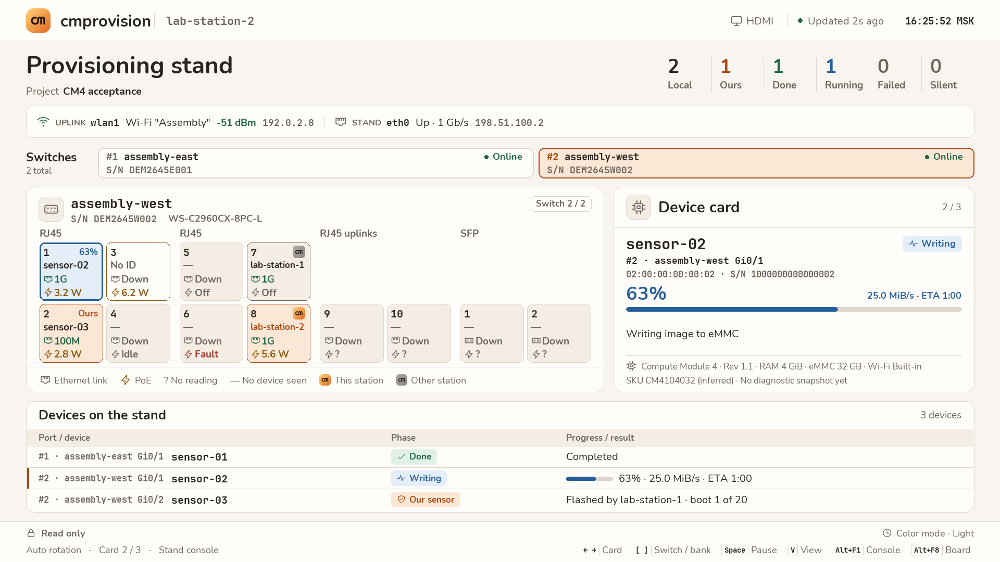

> **Language / Язык:** [English](hdmi-display.md) | [Русский](ru/hdmi-display.md)

# HDMI stand display

Connect a monitor or TV to the **provisioner** to follow the bench. The native graphical display shows the active
project, switch front panels, modules, write progress and saved diagnostics. It draws directly on an active HDMI output
and falls back to the text display on tty8 when graphics are unavailable. Both run offline on a console-only Raspberry Pi OS Lite installation.

When the wallboard is enabled and the rescue Wi-Fi access point starts, HDMI automatically shows its QR code, SSID and password for 60 seconds,
even without FPMS. The timer starts at AP activation and survives dashboard polling and renderer restarts.
The normal view returns when the timer expires. FPMS KEY2 can also dismiss the card.

A new station with a pending first-administrator code shows its setup address and the 16-character code on a connected
display, even with HDMI set to Off. An active rescue Wi-Fi card takes precedence until it closes.
Open the address on the management network and enter the code in the browser.
Creating the account completes this step. [First web administrator](station-setup.md)

This is separate from the target module's [tty2 troubleshooting console](local-console.md).

When [rescue Wi-Fi](rescue-wifi.md) is enabled, the header also shows its countdown or active SSID, gateway and associated-client count. It does not display the AP password.

The connection strip is visible in every normal screen. **UPLINK** identifies the default-route interface: Wi-Fi shows
its SSID, signal in dBm and IPv4 address; Ethernet shows link speed and IPv4 address. **STAND** identifies the flashing
network, **BACKUP** another default-route interface, and **LINK** other connected interfaces.

```text
UPLINK wlan1 / Wi-Fi "Lab 78" / -53 dBm / 192.0.2.4
STAND eth0 / UP 1 Gb/s / 172.20.0.1 | LINK eth1 / UP 100 Mb/s / 198.51.100.7
```

These are the same secret-free network readings as FPMS, cached for 30 seconds, including when FPMS is disabled.
Missing addresses show `no IP`. The rescue AP has its own status. On the text console, long details scroll in the header
and short consoles use a footer row to preserve device-card height.

## Enable it

1. Connect the provisioner's HDMI output to the monitor and select its HDMI input. Full HD is the usual target;
   higher resolutions also work. Connect a keyboard to the provisioner if local navigation is needed.
2. Open **Settings → System → HDMI display** in the web UI.
3. Select **Auto**, choose a screen and colors, and save. The display starts within a few seconds.
4. Use **Alt+F1** for the normal system console and **Alt+F8** to return to the stand display. SSH remains available.

After saving Auto once, no keyboard or login is needed: the enabled watcher starts at boot, detects HDMI and switches
to the display automatically. Connecting HDMI later also starts it. The saved mode survives package updates and reboots.

The default is **Off**. In **Auto**, a DRM HDMI connector reporting `connected` starts the renderer.
Disconnecting the last HDMI cable stops it. FPMS can still use the shared data reader.
**On** keeps the renderer running even when cable detection is unreliable. Graphical output needs a connected HDMI
port with an active video mode. Display settings take effect while provisioning continues.

A TV in standby, a KVM or an HDMI adapter can keep reporting `connected`. Detection describes the connector, not
whether someone is watching or whether the TV has selected this input. Use Off when this distinction matters.

## Screens and navigation

Choose the view in Settings or press **V** on the station keyboard.

- **Stand console** shows a switch front panel, a selected device and the stand's module list. Each port tile shows the connected device, Ethernet link and PoE readings.
- **All device cards** shows several modules together. Read host names, physical ports, phases and progress across the batch. Larger batches use additional pages.
- **Large device card and diagnostics** shows the selected module, provisioning steps, saved diagnostic evidence and advice. Use the web UI to request a fresh snapshot or start recovery.
- **Automatic** normally shows the stand console and opens diagnostics for a failed or silent selected module.

Cards advance every 12 seconds by default, adjustable from 5 to 60 seconds. **←** and **→** select a device.
**Space** pauses or resumes rotation. A local view choice lasts until the renderer stops. Settings defines the next start.

### Finding a port on a multi-switch stand



Match the chassis label to the **S/N** in the switch list or the open panel's header. `S/N unavailable` means the switch has supplied no serial. If a switch goes offline after a successful reading, its last known serial stays visible alongside its offline status. In the example, both switches have a Gi0/1. The device card identifies `sensor-02` as `#2 · assembly-west Gi0/1`.

The switch list highlights the open panel. Press `[` for the previous page or `]` for the next. A large switch can occupy several pages. The device card keeps its own switch and port visible as you browse. Use the arrow keys to select a device and return the map to its switch. During automatic rotation the map follows the device cards, then visits every switch page, including switches with no responding ports.

### Reading a port tile

Look below the physical port number for the module's host name, the station name or a name reported over LLDP/CDP. A MAC address can identify an unnamed device. When several known modules share a port, the tile names the one whose status it shows. `+N` counts the additional modules. `No ID` means the port shows activity, such as link or supplied power, and the device identity is unknown. A dash marks a port with no detected device.

| Reading | What it tells you |
| --- | --- |
| Ethernet | `1G` and `100M` are negotiated link speeds in Gbit/s and Mbit/s. `Up` means carrier is present and the speed is unknown. `Down` means no carrier. `?` means the switch supplied no reading. |
| PoE | Watts show measured power. `On` means the switch is supplying power and the wattage is unknown. `Idle` means it is waiting for a powered device. `Off` means PoE is disabled. `Fault` and `Test` identify a fault and a test in progress. `?` means no PoE reading. |

Read the two rows independently. On assembly-west, `sensor-02` on port 1 has a gigabit link and draws 3.2 W. Port 3 supplies 6.2 W with its link down. Port 4 is empty and shows `Down` and `Idle`.

Verified models use the physical port banks from the Ports page, including the 2960CX's odd/even rows and separate
RJ45/SFP uplinks. Other models use automatic layout. The local provisioner's port carries an orange `cm` mark. A neighbouring station has a grey `cm` mark. `Uplink` identifies a switch uplink and `UNR` an unrecognized device. [Switch front panels](switch-front-panels.md) · [Discovery troubleshooting](unrecognized-devices.md)

### Text console

If an HDMI output is inactive, shares its display pipeline with another connector, or has no free overlay plane,
the service uses the tty8 text console. Its panel identifies the current and next switch. The same keys control switch pages, device cards, rotation and views.

The current switch's S/N appears under the panel title when available. Each port shows its number and provisioning status, the attached device, and a line such as `Link Down  PoE 6.2 W`. Older snapshots that predate switch identity and port readings use single-line port tiles.

The console automatically sizes its font from the current visible HDMI resolution. With the bundled Terminus fonts,
1920×1080 uses 14×28-pixel cells, 3440×1440 uses 20×36 cells, and 3840×2160 uses 28×56 cells. This keeps about 38–40 rows
of readable text instead of shrinking the entire interface at high resolution. The watcher adjusts tty8 when the HDMI
mode changes; it does not switch away from a console you selected manually. No provisioning service is restarted.
Older kernels that reject tall fonts fall back to a smaller supported font. Selection is recorded in
`/run/cmprovision-wallboard/layout.json`; Settings also shows the detected resolution.

The layout uses the available width with small margins. Ultrawide screens fit three cards per row; ordinary Full HD
and 4K fit two. A compact switch front panel stays together when it fits beside the device card. The header uses a
small `cm` tile with the name of the stand on the tile's middle row, and a plain-text project name, rather than a large
word drawn from hash characters.

A module is named by its host name, or by its MAC address while it has none, in the table and as the title of the device
card. The card's second line is the MAC address under a host name, or `S/N` and the serial number under a MAC address,
so nothing is shown twice; with a host name the serial number follows on the fourth line.

The table under the front panel has three columns across the whole width: **Port / device**, **Phase** and
**Progress / result**, which says the percent, the speed and the time left of a module that writes (`63% / 25.0 MiB/s / ETA
1:00`, the speed as on the device card; a module that has not reported one yet shows the percent and the time). The first column is as wide as the longest port and device name needs (at most about half the
screen), the result takes the rest. A text that still does not fit is not cut: it rests at its start, runs through its
column one step at a time (about three columns a second), rests at its end and starts over; a `>` at the end of the
column says there is more. The same goes for the device name and port on the device card and for the failure line at
the bottom. The screen is redrawn faster only while something runs; with every text fitting nothing moves.

A sensor whose temporary mark is verified with the shared station key appears as `OURS` on the port and `OUR SENSOR` in the table and rotating cards. The card identifies the station and the current marked boot. These sensors have their own `OURS` count; `LOCAL` and `DONE` still count this station's runs only.

After the modules the table lists what a switch shows on a port where there is a device that is not a module and is not booting,
so the table tells what was plugged in: the phase says `UNR` (an unrecognized device) or `LNK` (a link up with nothing sent from
it), the name is what the device calls itself over LLDP or CDP with its system, address and abilities in the result column, and for
a device that says nothing it is the maker of its MAC address (the Raspberry Pi blocks are built in, the `ieee-data` package adds
the others) with the MAC itself. Texts that come from a device are cleaned before they reach the screen. The `flow` cards and the
`engineer` view say the speed of a write as the table does: `63% / 25.0 MiB/s / ETA 1:00`. A module that runs well past what the
finished ones of its batch took (2.19.0, [how it is decided](operations.md#a-module-that-takes-longer-than-the-rest)) gets
`/ SLOW +3:20` after its time left, and its row is drawn in the warning colour.

### Colors

HDMI has independent **Style** (Warm or Neutral) and **Color mode** (Dark, Light or Auto) settings, matching the web UI.
The graphical views use orange accents in Warm and indigo in Neutral. The text console reads the web UI's
`resources/css/app.css` tokens for the page, text, muted text, accent and status colors.
Warm dark uses the web's `#ff8a3d` orange; neutral dark uses `#818cf8` indigo. Alpha text colors are composited over the
page background. On the Linux console, the eight palette entries are redefined to these RGB values without changing
other virtual terminals; stopping the display resets tty8's palette. A terminal without programmable colors falls back
to basic ANSI colors. Auto follows the same sunrise/sunset calculation as the web using the station time zone; without coordinates or during
polar day/night it falls back to Dark. HDMI settings are shared; browser appearance is selected independently per browser.
Existing configurations retain their previous style and mode.
The earlier Phosphor/Monochrome choices migrate to Warm dark/Neutral dark when read, preserving Auto and other settings.

## What the numbers mean

ON STAND counts modules currently found on the switch map. Finished records from disconnected devices do not inflate
the count. Without a configured managed switch, recent module polls and active recent runs are shown with an unknown
port. A new USB-only board can appear as **Unregistered module**, separate from provisioning success/failure totals.

Progress, rate and ETA use the same calculations as the web UI. Silent modules are marked **NO REPORT**. Diagnostic
temperature, power and other facts are **saved snapshots**: their source and age are always shown. They are not live
hardware sensors. If application data stops updating for more than ten seconds, **DATA STALE** replaces the normal
footer. A switch that stops answering keeps its last known ports with an explicit warning.

No image files, project scripts, account passwords, SNMP credentials or run tokens are sent to the terminal. The local
screen is intended for a trusted support area: it shows device names, MAC addresses, serial numbers, project names and failure hints.

## Services and troubleshooting

Three units work together. `cmprovision-wallboard` is a small root watcher of connector state and the fixed settings
file; it starts and stops `cmprovision-wallboard-display`, and only it does (the display and the data units are not
enabled at boot). The renderer runs as the dedicated `cmprovision-wallboard` system user. It displays on tty8,
using a free DRM/KMS overlay on the active HDMI output when available. Provisioning data comes from
`cmprovision-wallboard-data`, which runs `wallboard:snapshot --watch --output=/run/cmprovision-wallboard-data/snapshot.json`
as the web user. The setup and rescue Wi-Fi cards use separate local files.

The data unit updates the file every two seconds and shares the web UI's SNMP cache: it takes a stored switch snapshot
up to 15 seconds old and polls a switch itself only when that has run out, so with a monitor attached each switch is asked
about every 15 seconds at most. No monitor in Auto means no HDMI renderer; the shared data unit also stops if FPMS is not using it. The
watcher itself remains to detect the next connection.

The watcher counts a connector change only after two equal readings in a row, so a TV in standby or a loose cable does
not start and stop the display. A new connection (or boot) takes the console for tty8; a restart after a crash or a
package upgrade does not, and a display unit that keeps failing is retried every ten seconds three times, then once a
minute.

Settings are stored in `/etc/default/cmprovision-wallboard.json` and included in a normal provisioner backup.
Switching to another virtual console releases the HDMI overlay. On stopping, the previous console is restored if tty8
is still active. The text fallback uses Terminus when available.

The station image includes the `python3-kms++` bindings with or without FPMS. The application package depends on
`python3-pil` and `libdrm2` and recommends `python3-kms++`. A Debian installation without those optional bindings
uses the text console. To check which display packages are installed, run `dpkg-query -W python3-pil libdrm2 python3-kms++`.

```sh
systemctl status cmprovision-wallboard cmprovision-wallboard-display cmprovision-wallboard-data
journalctl -u cmprovision-wallboard -u cmprovision-wallboard-display -u cmprovision-wallboard-data -n 50 --no-pager
cat /sys/class/drm/card*-HDMI-A-*/status
cat /sys/class/tty/tty0/active
sudo -u www-data /var/lib/cmprovision/artisan wallboard:snapshot
```

If the screen is blank, check the TV input, the HDMI connector status and the saved mode. Press **Alt+F8** to select
the wallboard again. If you see the text console, check the graphics packages and the display service journal.
Look for `HDMI graphical display active` or `HDMI text fallback`.
The graphical display uses the current HDMI video mode. The web UI has the full diagnostic reports and recovery actions.

The display unit is deliberately not enabled/started directly at boot: only the watcher starts it. When removing or
downgrading the package, all three units stop; restore stops the data unit before replacing the SQLite database. No reboot is
required for enabling, changing or disabling the display.

Implementation references: [systemd terminal service settings](https://www.freedesktop.org/software/systemd/man/latest/systemd.exec.html),
[Python curses](https://docs.python.org/3/library/curses.html), [Linux DRM interface](https://docs.kernel.org/gpu/drm-uapi.html).
Palette programming: [Linux console controls](https://man7.org/linux/man-pages/man4/console_codes.4.html).
Font scaling: [setfont](https://kbd-project.org/manpages/man8/setfont.8.html),
[framebuffer geometry](https://docs.kernel.org/fb/api.html).
