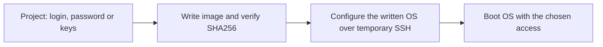
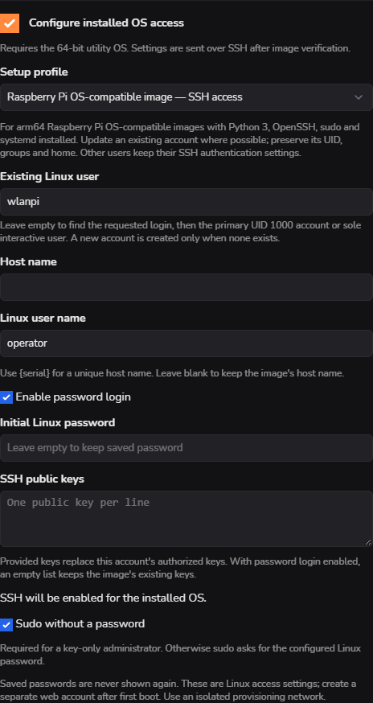

> **Language / Язык:** [English](image-access.md) | [Русский](ru/image-access.md)

# Set the installed OS's SSH login from a project

[Operations](operations.md) · [Station image setup](station-project-setup.md) · [Configuration transfer](configuration-transfer.md)

Use **Projects → Add / Edit → Configure installed OS access** and select **Raspberry Pi OS-compatible image — SSH access**. The same profile is available in **Create with wizard**. A cmprovision agent does not need to be preinstalled in the image.

The shared image file remains unchanged. Each device receives the project's access settings after its written image passes verification, before the remaining post-install scripts and first boot.

## Configure access

1. Select the OS image, `/dev/mmcblk0` storage and **Verify that image was written correctly**.
2. Enable **Configure installed OS access**, then choose the Raspberry Pi OS-compatible profile.
3. Enter the desired **Linux user name**. Leave **Existing Linux user** empty for automatic selection, or enter the exact account to update/rename.
4. Set the initial Linux password, public SSH keys, or both. An empty password while editing keeps the saved password. An empty key list with password login enabled keeps the image's existing keys; supplied keys replace this account's authorized keys.
5. Choose **Sudo without a password** independently. It is required for key-only access. Otherwise sudo asks for the configured Linux password. SSH is enabled by this profile; authentication changes apply only to the selected account.
6. Leave **Host name** empty to keep the image's host name, or set one, optionally using `{serial}`. Save with your web-account password confirmation.

*Demo data. Click the capture to enlarge it. Linux credentials and the cmprovision web account are separate.*

## Which account changes?

| Image state | Result |
| --- | --- |
| Requested login exists | Update that account. |
| Explicit existing user supplied | Update or rename it; reject a destination owned by another account. |
| Requested login absent | Prefer the primary UID 1000 account, then a sole interactive account. |
| Several possible accounts | Ask for **Existing Linux user**; do not choose silently. |
| No normal account exists | Create an administrator. A clean Pi OS's locked first-user `pi` template is reused. |

A rename preserves UID, primary GID, supplementary groups, file ownership and the **existing home path**. For example, a renamed `operator` can still have `/home/wlanpi`. Services or cron tasks tied to the old login can block a rename: keeping that login and changing its password is supported.

## Supported image layout

The first implementation requires an **arm64** Raspberry Pi OS/Debian-style system, the **64-bit utility OS**, and an ext4 root on partition 2 of `/dev/mmcblkN`. The image must already include Python 3, `useradd`, `usermod`, `chpasswd`, sudo/visudo, OpenSSH server/key tools, systemd and the `sudo` group. It does not download missing packages while provisioning.

Existing forced commands, MFA, group login restrictions or conflicting per-user SSH rules may prevent this profile from establishing the requested access. They cause a compatibility failure rather than a successful result with an unusable login. Other accounts' SSH authentication is preserved.

The separate **cmprovision station image — access and Wi-Fi** profile retains its schema-1 behavior, management Wi-Fi and station first-boot checks. Use that profile when preparing a new provisioner. This SSH-only profile does not configure Wi-Fi, station roles or web users.

## Scripts and failures

The built-in setup is a post-install helper delivered through temporary, restricted SSH. Its credential snapshot is encrypted on the provisioner; passwords/hashes do not appear in public module scripts or HTTP responses. Ordinary custom scripts still run in their [documented phases](creation-wizards.md#scripts); a later script can intentionally change the same OS settings.

| Post-install result | Next action |
| --- | --- |
| Several Linux accounts found | Set **Existing Linux user**. |
| Services/tasks depend on the old login | Keep that login or adapt the image before renaming it. |
| SSH rules prevent the requested login | Review the image's access restrictions. |
| Missing tools or unsupported paths/layout | Use a supported image or prepare its dependencies first. |

An interrupted application is not success. Identical retries use the same run receipt; different settings require a fresh verified write. Projects and this profile can be [transferred between stations](configuration-transfer.md), with password protection when credentials are included.

## Validation status

The generic helper has been checked on disposable real arm64 Raspberry Pi OS root filesystems under QEMU: first-user rename, existing-account password update, key-only sudo, preserved IDs/home/groups, real OpenSSH/sudo checks, unsafe-rename and conflicting-policy failures. The complete WLAN Pi OS 26.10 image also passed existing `wlanpi` password and key-only tests. The complete generic provisioning step still needs its own hardware acceptance; the station profile's earlier hardware acceptance does not replace it.
