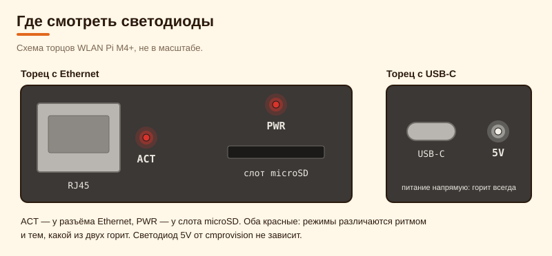
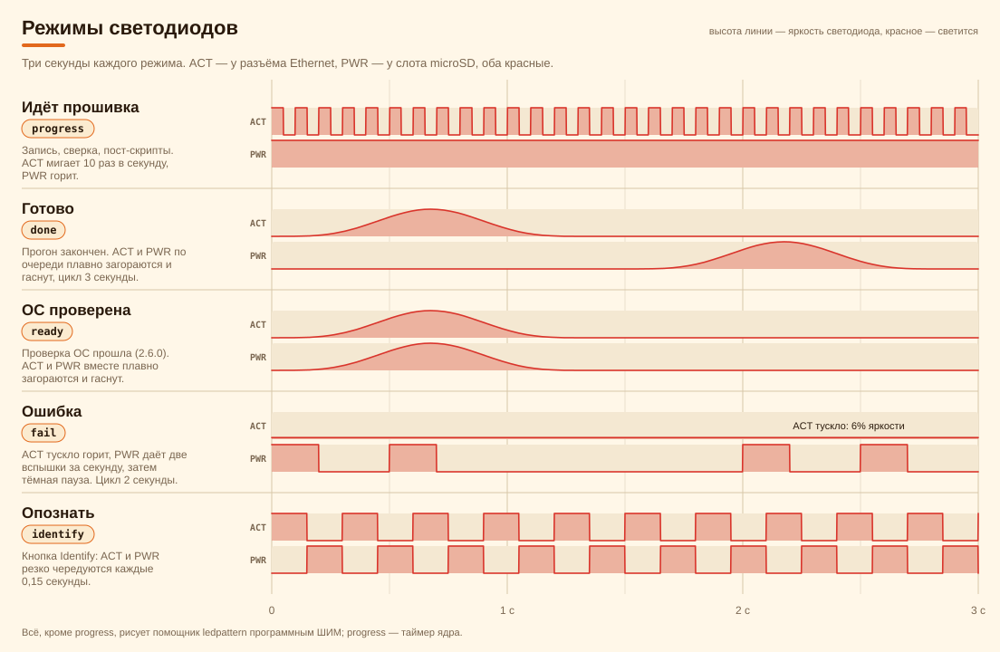
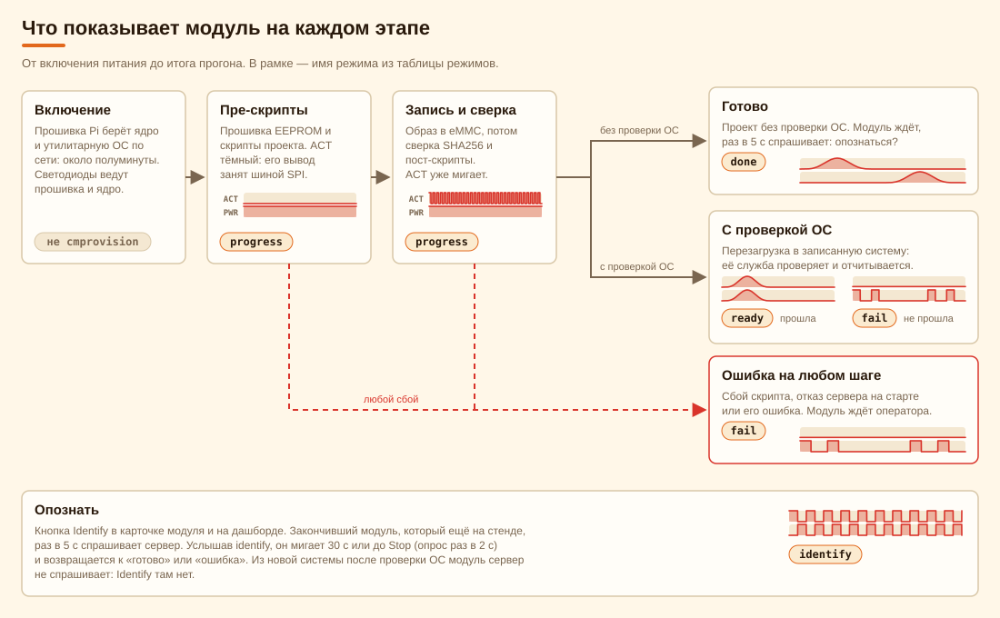
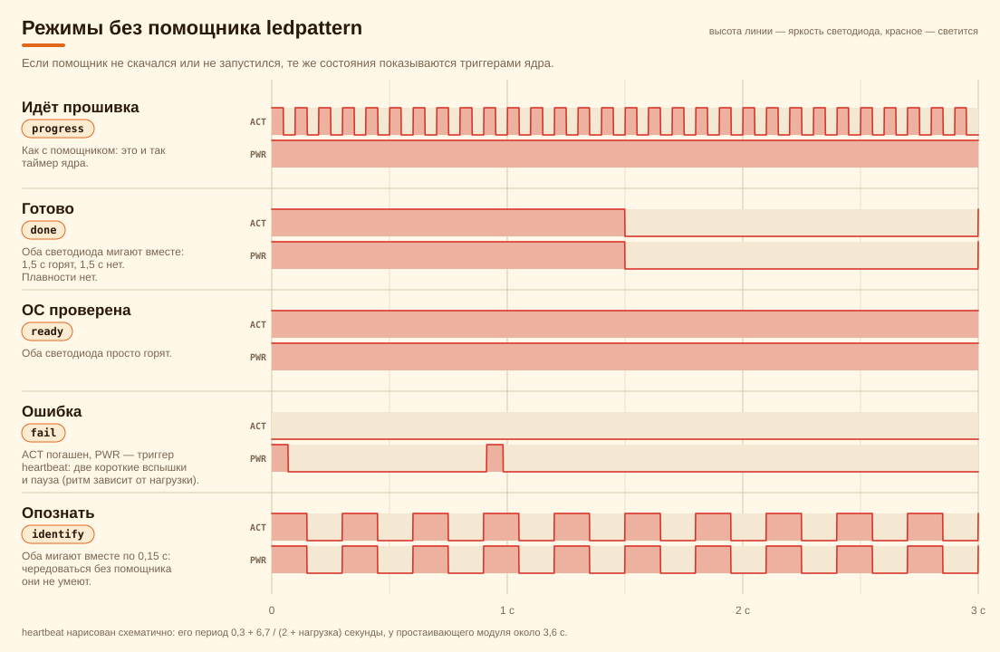
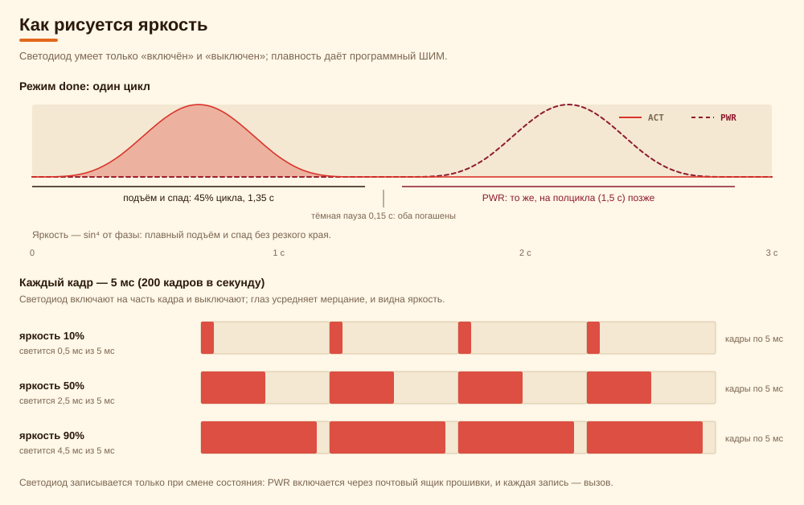

# Светодиоды модуля

Что показывают светодиоды ACT и PWR во время прошивки, как читать их на стенде и как это устроено в коде. Режимы выбраны
вместе с оператором на WLAN Pi M4+, где оба светодиода красные: состояния различаются ритмом и тем, какой из двух горит.

Графики собирает [leds/build_diagrams.py](leds/build_diagrams.py) из исходников (`tools/ledpattern/ledpattern.c`,
`resources/views/scriptexecute/leds.blade.php`), поэтому с кодом они не расходятся: `LedDocsTest` собирает их заново и
сравнивает с файлами в репозитории.

## Где смотреть



- **ACT** — у разъёма Ethernet, **PWR** — у слота microSD. Это единственные светодиоды, которыми управляет cmprovision.
- **5V** у USB-C подключён к питанию напрямую и горит всегда: он показывает только, что питание есть.
- Огни самого разъёма RJ45 (связь и активность) ведёт сетевая микросхема. К режимам cmprovision они не относятся.

## Режимы



| Режим | Ключ | ACT | PWR | Когда | Что делать |
|---|---|---|---|---|---|
| Идёт прошивка | `progress` | мигает 10 раз в секунду | горит | с начала скрипта до конца прогона | Ничего. Процент и остаток — на дашборде. |
| Готово | `done` | плавно загорается и гаснет | то же, на полцикла позже | прогон закончился, проверки ОС в проекте нет | Модуль ждёт. Найти его в стойке поможет Identify. |
| ОС проверена | `ready` | плавно загорается и гаснет | вместе с ACT | проверка ОС прошла (с 2.6.0) | — |
| Ошибка | `fail` | тускло горит | две вспышки, затем пауза | сбой любого шага, отказ сервера на старте, ошибка сервера, проверка ОС не прошла | Открыть карточку модуля: там причина и совет. Затем перезапуск (Restart в карточке или «Restart failed» на дашборде). |
| Опознать | `identify` | резко чередуется с PWR | резко чередуется с ACT | по кнопке Identify, 30 секунд или до Stop | Найти мигающий модуль. |

Числа режимов: цикл `done` и `ready` — 3 секунды, подъём и спад занимают 45% цикла (1,35 секунды), затем пауза;
`fail` — цикл 2 секунды: ACT горит на 6% яркости, PWR вспыхивает на 0,2 секунды в начале и на 0,5…0,7 секунды;
`identify` — смена каждые 0,15 секунды. Эти числа лежат в начале `tools/ledpattern/ledpattern.c` и в его `duties()`.

## Что показывает модуль на каждом этапе



- **Включение.** Около полуминуты светодиодами управляют прошивка Raspberry Pi и ядро, это не режим cmprovision. Режимы
  начинаются, когда запущен скрипт, и первым делом включается `progress`.
- **Пре-скрипты.** PWR горит, а ACT тёмный: его вывод (GPIO 42) отдан шине SPI, которой `flashrom` прошивает EEPROM. Скрипт
  забирает ACT обратно сразу после пре-скриптов, и с началом записи ACT мигает.
- **Запись и сверка.** `progress` без перемен, он же во время сверки (SHA256 записанного читается обратно с диска) и
  пост-скриптов.
- **Итог.** Прогон заканчивается либо `done`, либо `fail` (при любом сбое). С включённой проверкой ОС вместо `done` модуль
  перезагружается в записанную систему, и итог показывает уже её служба: `ready` или `fail`.
- **Ошибка до начала прогона.** Если сервер отказал на старте (нет активного проекта, образ не помещается, сверка включена,
  а SHA256 образа ещё не посчитан) или ответил ошибкой, модуль сразу показывает `fail`, а причина видна на его консоли и в
  журнале.

Дашборд и светодиоды говорят об одном и том же:

| Статус на дашборде | Светодиоды |
|---|---|
| Pre-install, Writing image, Verifying, Post-install | `progress` |
| Done | `done` (с проверкой ОС — `ready`) |
| Failed | `fail` |
| Checking the OS | перезагрузка, затем `ready` или `fail` |
| «нет связи» (модуль молчит) | зависит от причины, см. ниже |

### Чего светодиоды не показывают

- Сеть. ACT мигает, пока работает ядро, даже если сеть пропала и `curl` ждёт сервер.
- Сколько записано. Процент, скорость и «нет связи» — на дашборде и в карточке модуля.
- Зависший скрипт. Если модуль «молчит» на дашборде, а ACT мигает, скрипт или сеть стоят, а ядро работает. Тёмные оба
  светодиода — питание, загрузка или перезагрузка.

## Без помощника

Плавность и тусклость рисует помощник `ledpattern`, который модуль скачивает с сервера в начале скрипта. Не скачался
(сервер недоступен, файл не подошёл по архитектуре) или не запустился — те же состояния показываются триггерами ядра:



Если `done` мигает обоими светодиодами сразу и без плавности, помощника нет. Проверьте, что на сервере есть
`public/tools/ledpattern`: он закоммичен в репозитории и входит в пакет как есть.

## Как рисуется яркость

Светодиод умеет только «включён» и «выключен». Помощник включает и выключает его 200 раз в секунду на долю кадра; глаз
усредняет мерцание, и видна яркость. Подъём и спад — sin⁴ фазы: плавно, без резкого края.



- ACT и PWR — обычные светодиоды на выводах GPIO: ACT — `led0` (Linux 5.4) или `ACT` (с 6.1), PWR — `led1` или `PWR`;
  помощник понимает оба имени. PWR идёт через расширитель выводов прошивки, и каждая запись — вызов к ней, поэтому
  светодиод записывается только при смене состояния. Процессор при этом почти не нагружен.
- Триггер ядра перед записью отключается (`none`): иначе он бы боролся с помощником за светодиод.
- Один процесс ведёт оба светодиода. Два отдельных триггера `timer` не держат взаимную фазу, а «по очереди» и
  «вместе» без общей фазы не показать.

## Опознать

Кнопка Identify (карточка модуля, дашборд) просит закончивший модуль замигать. Модуль раз в 5 секунд спрашивает сервер
(`?identify=poll`); услышав `identify`, он включает режим `identify` и спрашивает уже раз в 2 секунды, пока слышит его.
Мигание заканчивается само через 30 секунд или кнопкой Stop, и модуль возвращается к своему итогу.

- Кнопка есть только у модуля, который ещё на стенде и опрашивает сервер (`cms.polled_at`).
- Из записанной системы после проверки ОС модуль сервер не спрашивает: Identify там нет. В карточке это написано.
- Опрос не пишется в журнал; `polled_at` обновляется не чаще раза в минуту.

## В записанной системе (проверка ОС)

Служба проверки (`resources/views/scriptexecute/firstboot.blade.php`) заканчивает итогом на светодиодах: `ready` при
успехе, `fail` при провале. Помощника в записанную систему копирует шаг установки (`oscheck-install.blade.php`) из
утилитарной ОС. Служба запускает его, через короткую паузу удаляет свой каталог (процесс уже в памяти) и держит итог до
следующей загрузки. Нет помощника — просто горят оба светодиода (`ready`) или PWR даёт heartbeat при погашенном ACT (`fail`).

## Где это в коде

| Что | Где |
|---|---|
| Функции для скрипта модуля (`led_init`, `led_mode`, `led_take_act`, `finish`) | `resources/views/scriptexecute/leds.blade.php` |
| Помощник с режимами `done`, `ready`, `fail`, `identify` | `tools/ledpattern/ledpattern.c`, бинарник `public/tools/ledpattern` |
| Ответ при отказе или ошибке сервера | `resources/views/scriptexecute/failed.blade.php` |
| Итог после проверки ОС | `resources/views/scriptexecute/firstboot.blade.php`, `oscheck-install.blade.php` |
| Опознать на сервере | `Cm::identify()`, `Cm::stopIdentify()`, `ScriptExecuteController::identifyPoll()` |
| Тесты | `tests/Feature/ModuleLedsTest.php`, `FirstBootServiceTest.php`, `LedDocsTest.php` (графики) |
| Эти графики | `docs/leds/build_diagrams.py` |

Помощник — статический 32-битный ARM-бинарник: утилитарная ОС 32-битная, а 64-битное ядро записанной системы запускает его
в режиме совместимости. В пакете он собирается готовым. Пересборка:

```sh
sh tools/ledpattern/build.sh    # нужен gcc-arm-linux-gnueabihf
```

## Как изменить или добавить режим

1. В `tools/ledpattern/ledpattern.c` поправьте `duties()` (для нового режима — ещё список в `main()` и строку usage).
2. Пересоберите помощник и закоммитьте `public/tools/ledpattern`.
3. В `leds.blade.php` поправьте запасной вариант на триггерах ядра (`led_mode`) и, для нового режима, место, где его
   включает скрипт.
4. Пересоберите графики и закоммитьте их: `python docs/leds/build_diagrams.py`. Если исходники изменились так, что скрипт
   их больше не понимает, он остановится и скажет, что поправить.
5. Поправьте таблицу режимов выше и тесты `ModuleLedsTest`.

## Проверить на модуле

От root, на модуле в утилитарной ОС (отладочная оболочка проекта) или в записанной системе:

```sh
curl -o /tmp/ledpattern http://172.20.0.1/tools/ledpattern && chmod +x /tmp/ledpattern
/tmp/ledpattern check && echo "оба светодиода доступны"
/tmp/ledpattern fail          # режим идёт, пока процесс не остановят (Ctrl-C)
```

Пока в утилитарной ОС идёт прогон, светодиодами управляет его скрипт: перед ручной пробой дождитесь итога модуля.

Что проверено на железе. Паттерны выбраны вместе с оператором на sensor0 (прототип под WLAN Pi OS, 10 октября 2026).
Скриптом в утилитарной ОС показаны и проверены `progress`, `done`, `identify` и Stop (1.6.9). `fail` скриптом на железе не
вызывался. Помощник с `ready` отработал на трёх модулях в живой проверке 2.6.0.
