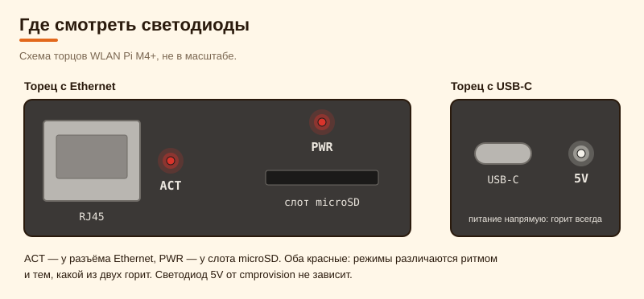
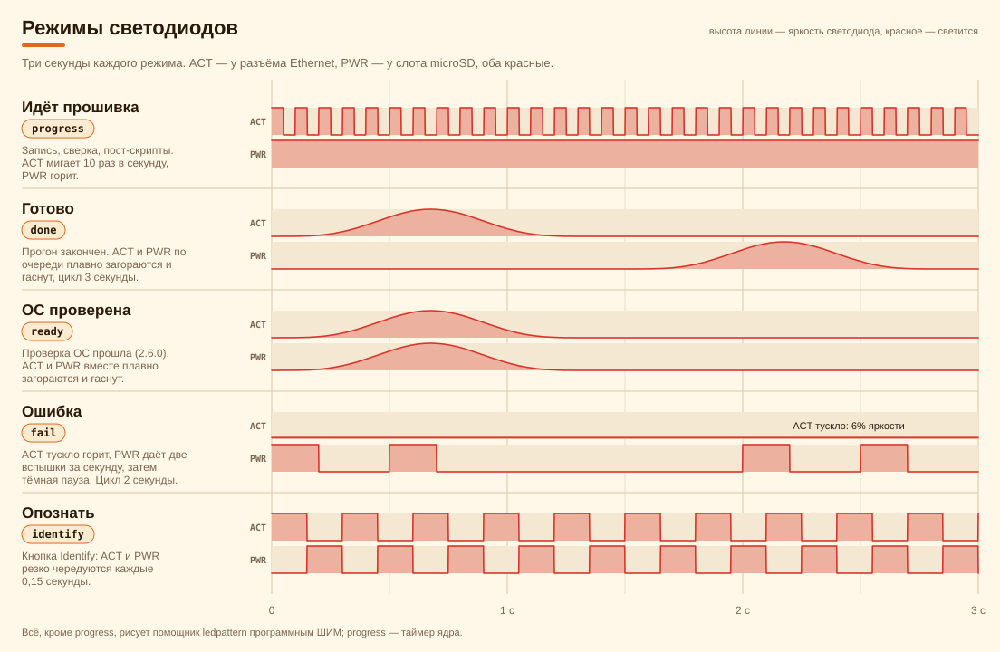
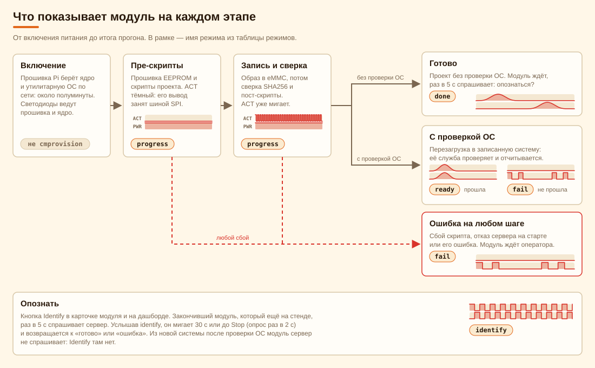
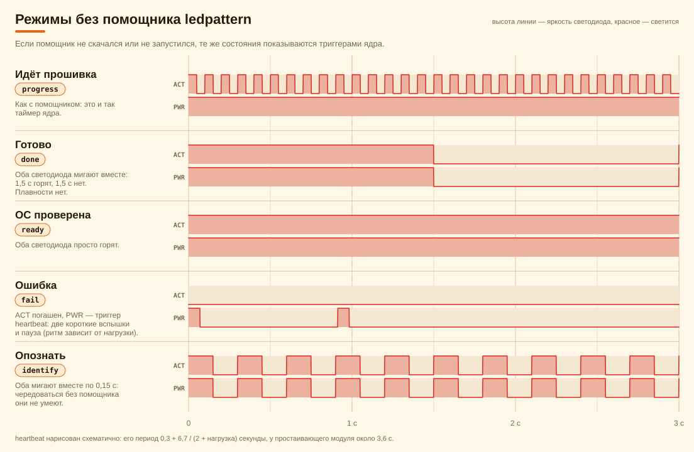
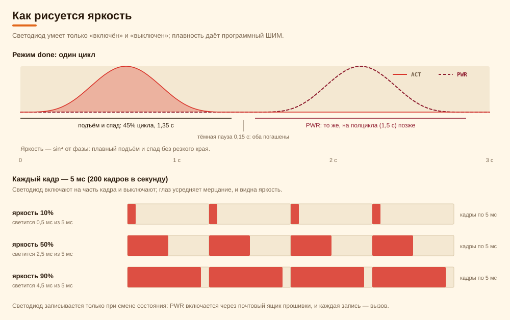

> **Language / Язык:** [English](leds.md) | [Русский](ru/leds.md)

# Target Module LEDs

What the ACT and PWR LEDs indicate during flashing, how to read them on the stand, and their implementation in code. Patterns were designed in collaboration with the operator on a WLAN Pi M4+, where both LEDs are red: states are distinguished by rhythm and alternating phase.

Diagrams are generated by [leds/build_diagrams.py](leds/build_diagrams.py) from source files (`tools/ledpattern/ledpattern.c`, `resources/views/scriptexecute/leds.blade.php`), ensuring they never drift from code: `LedDocsTest` regenerates and validates them against the repository.

## Where to Look



- **ACT** — next to the Ethernet jack, **PWR** — next to the microSD slot. These are the only LEDs managed by cmprovision.
- **5V** next to USB-C is hardwired to power and remains lit continuously whenever powered.
- RJ45 Ethernet jack LEDs (link and activity) are driven by the PHY chip and are independent of cmprovision states.

## LED Modes



| Mode | Key | ACT | PWR | When | Operator Action |
|---|---|---|---|---|---|
| Flashing in progress | `progress` | Blinks 10 times/sec | Solid on | From script start until run completes | None. Progress percentage and remaining time are on the dashboard. |
| Done | `done` | Smooth fade in and out | Same, half-cycle out of phase | Run finished, no OS check configured in project | Target is waiting. Use Identify to locate it in the rack. |
| OS verified | `ready` | Smooth fade in and out | In phase with ACT | OS check completed successfully (since 2.6.0) | Identify remains available until next reboot (since 2.6.4). |
| Failure | `fail` | Dim glow (6%) | Two sharp flashes, then pause | Failure at any step, server start error, or failed OS check | Open the module card to inspect failure reason and hints, then restart. |
| Identify | `identify` | Rapidly alternates with PWR | Rapidly alternates with ACT | Triggered by Identify button, runs for 30s or until Stop | Locate the blinking module in the rack. |

Timing parameters: `done` and `ready` cycle is 3.0 seconds, fade in and out take 45% of cycle (1.35s), followed by pause; `fail` cycle is 2.0 seconds (ACT at 6% duty, PWR pulses 0.2s at t=0 and 0.5–0.7s); `identify` alternates every 0.15s. Configured in `tools/ledpattern/ledpattern.c` and its `duties()` function.

## What the Module Shows at Each Stage



- **Power On.** For ~30 seconds, LEDs are driven by Raspberry Pi bootloader and kernel; this is not a cmprovision state. cmprovision takes control when the script launches, immediately setting `progress`.
- **Pre-Scripts.** PWR is on, ACT is dark: GPIO 42 (ACT) is assigned to the SPI bus while `flashrom` writes EEPROM. The script reclaims ACT immediately after pre-scripts complete, starting the blink pattern for image write.
- **Write and Verification.** `progress` runs continuously through writing, verification (SHA-256 read back from disk), and post-scripts.
- **Completion.** Run ends in either `done` or `fail` (upon any error). When OS check is enabled, the module reboots into the installed OS instead of showing `done`, and final status is reported by the target service: `ready` or `fail`. While booting the installed OS before OS check completes, LEDs reflect the bootloader, kernel, and OS services. The final LED pattern starts after check completion.
- **Pre-Run Errors.** If the server rejects the session on start (no active project, image too large, verification required but SHA-256 not ready) or returns an error, the module displays `fail` immediately, logging details to console and journal.

Dashboard status and LED indicators:

| Dashboard Status | LEDs |
|---|---|
| Pre-install, Writing image, Verifying, Post-install | `progress` |
| Done | `done` (with OS check: `ready`) |
| Failed | `fail` |
| Checking the OS | Reboot, then `ready` or `fail` |
| "No connection" (module silent) | Depends on cause, see below |

### What LEDs Do Not Show

- Network status. ACT blinks as long as the kernel runs, even if network drops and `curl` is waiting for server response.
- Flashing percentage. Progress, speed, and connectivity alerts are displayed on the dashboard and module card.
- Stalled scripts. If the module stops reporting to the dashboard while ACT blinks, the script or network has stalled while the kernel remains alive. Dark LEDs indicate loss of power, reboot, or bootloader phase.

## Fallback Without Helper Binary

Smooth fades and dim brightness are generated by the `ledpattern` helper binary downloaded from the server at script start. If the binary fails to download or start, equivalent states fall back to kernel LED triggers:



If `done` blinks both LEDs in lockstep without smooth fading, the helper binary is missing. Verify `public/tools/ledpattern` exists on the server (committed in repository and packaged in `.deb`).

## Software PWM Implementation

Standard LEDs support only on and off states. The `ledpattern` helper toggles the pin 200 times per second across sub-frame slices; human vision averages the pulses into smooth brightness. Transitions follow a sin⁴ curve: smooth acceleration without abrupt edges.



- ACT and PWR are standard GPIO-connected LEDs: ACT is `led0` (Linux 5.4) or `ACT` (6.1+), PWR is `led1` or `PWR`; the helper recognizes both names. PWR routes through the firmware pin expander where every write incurs a firmware call, so state changes are only sent when duty cycles change, keeping CPU utilization negligible.
- Kernel LED triggers are disabled (`none`) before writes to prevent kernel triggers from competing with user-space control.
- A single process drives both LEDs in lockstep to maintain precise phase alignment.

## Identify

The Identify button (module card, dashboard) requests a completed module to blink. The module polls the server every 5 seconds (`?identify=poll`). Upon receiving `identify`, it switches to `identify` mode and polls every 2 seconds until stopped. Blinking automatically terminates after 30 seconds or when the Stop button is pressed, restoring previous status.

- The button is active only while the target remains on the stand and polls the server (`cms.polled_at`).
- Starting with 2.6.4, the installed OS also polls the server following OS check while displaying completion status. This temporary polling loop terminates on subsequent reboot.
- Polling requests are omitted from audit logs; `polled_at` updates at most once per minute.

## Post-Install OS Check Environment

The first-boot verification service (`resources/views/scriptexecute/firstboot.blade.php`) displays final LED status upon completion: `ready` on success, `fail` on error. The installation step (`oscheck-install.blade.php`) copies `ledpattern` from the utility OS into the target system. After reporting results, the service moves the helper binary into an isolated directory `/run/cmprovision-leds.*`, cleans up scripts, packages, systemd unit files, and symlinks, then maintains the LED pattern until next reboot while listening for Identify/Stop commands.

## Code Locations

| Component | Source Path |
|---|---|
| Script functions (`led_init`, `led_mode`, `led_take_act`, `finish`) | `resources/views/scriptexecute/leds.blade.php` |
| Helper binary (`done`, `ready`, `fail`, `identify`) | `tools/ledpattern/ledpattern.c`, binary `public/tools/ledpattern` |
| Server error handler | `resources/views/scriptexecute/failed.blade.php` |
| OS check first-boot LEDs | `resources/views/scriptexecute/firstboot.blade.php`, `firstboot-leds.blade.php`, `oscheck-install.blade.php` |
| Server Identify endpoints | `Cm::identify()`, `Cm::stopIdentify()`, `ScriptExecuteController::identifyPoll()` |
| Automated tests | `tests/Feature/ModuleLedsTest.php`, `FirstBootServiceTest.php`, `LedDocsTest.php` (diagrams) |
| Documentation diagrams | `docs/leds/build_diagrams.py` |

The helper is a static 32-bit ARM binary: the utility OS is 32-bit, while the 64-bit kernel of installed systems runs it under arm32 compatibility mode. Precompiled in repository. Recompilation:

```sh
sh tools/ledpattern/build.sh    # requires gcc-arm-linux-gnueabihf
```

## Modifying or Adding Modes

1. Update `duties()` in `tools/ledpattern/ledpattern.c` (for new modes, add to `main()` list and usage message).
2. Recompile helper and commit `public/tools/ledpattern`.
3. Update kernel trigger fallback in `leds.blade.php` (`led_mode`) and script triggers.
4. Regenerate diagrams: `python docs/leds/build_diagrams.py`.
5. Update documentation mode tables and tests in `ModuleLedsTest`.

## Hardware Testing

Run as root on the target module in utility OS (via project debug shell) or installed OS:

```sh
curl -o /tmp/ledpattern http://172.20.0.1/tools/ledpattern && chmod +x /tmp/ledpattern
/tmp/ledpattern check && echo "Both LEDs accessible"
/tmp/ledpattern fail          # runs until interrupted (Ctrl-C)
```

During an active flashing run, the script controls the LEDs; wait for run completion before testing manually.
