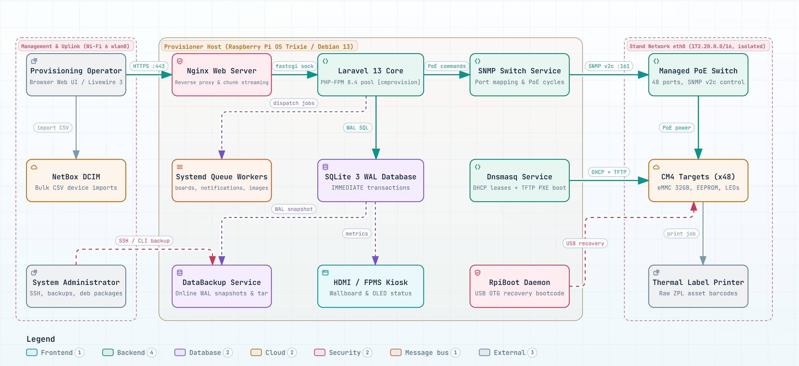

> **Language / Язык:** [English](provisioner-network.md) | [Русский](ru/provisioner-network.md)

# Provisioner Networking

Reference guide detailing the provisioner network architecture for three milestones:
2.5.1 (`/scriptexecute` restricted strictly to the stand network), 2.5.2 (onboard Wi-Fi as a cold
spare), and 2.5.3 (Wi-Fi management via web UI).
Recorded from live production node `wlanpi-da2` on October 15, 2026 (`nmcli`, `ip`, `iw`).

## Stand and Host Architecture

<a href="diagrams/stand-architecture.html" title="Open interactive Archify diagram"></a>

*Subsystems, daemons, and network isolation between management Wi-Fi and stand Ethernet. [Open standalone interactive diagram](diagrams/stand-architecture.html) with pan, zoom, dark/light theme switching, and subsystem inspection.*

## Target OS Network Differences

The `cmprovision4` package targets two different Linux distributions with distinct network setups:

- **Raspberry Pi OS Trixie** (Debian 13) — the user's primary provisioner (`wlanpi-da2`).
  NetworkManager manages **all** devices, including Wi-Fi interfaces. Onboard Wi-Fi is
  enabled. This is the primary target for Wi-Fi features (2.5.2 and 2.5.3).
- **WLAN Pi OS** — Wi-Fi diagnostic appliance. NetworkManager does **not** manage Wi-Fi
  (adapters are controlled by internal WLAN Pi OS utilities), and onboard CM4 Wi-Fi is
  disabled in `config.txt` (`dtoverlay=disable-wifi`). On this distribution, Wi-Fi management
  features (2.5.2 and 2.5.3) are unavailable — cmprovision detects this dynamically and
  hides unsupported controls.

Identification is performed based on active NM device management rather than OS name strings,
since both systems may share hostnames like `wlanpi-*`.

## Production Node `wlanpi-da2` (Raspberry Pi OS Trixie)

- Debian 13 trixie, kernel `6.18.50+rpt-rpi-v8`, NetworkManager 1.52.1.
- `/etc/NetworkManager/NetworkManager.conf`: `plugins=ifupdown,keyfile`, with `[ifupdown]` set
  to `managed=false`. This instructs NM not to manage interfaces in `/etc/network/interfaces` —
  it does not affect Wi-Fi. Profiles reside in keyfiles (`/etc/NetworkManager/system-connections/`);
  no `conf.d/` rule directory is present.

### Interfaces and Profiles

| Device | Hardware (Driver) | NM Profile | Type | autoconnect-priority | route-metric |
|---|---|---|---|---|---|
| `eth0` | bcmgenet | `cmprovision` | ethernet | — | — (`never-default=yes`) |
| `wlan0` | onboard, brcmfmac (phy0) | `uplink-onboard` | wifi WPA-PSK | 10 | 600 |
| `wlan1` | MT7922, mt7921e (phy1) | `uplink-m2` | wifi WPA-PSK | 20 | 100 |

- **Flashing Stand Network — `eth0`**, profile `cmprovision`: `ipv4.method=manual`,
  address `172.20.0.1/16`, `ipv4.never-default=yes`. The stand network never advertises
  a default route — all outbound internet access traverses Wi-Fi. This matches
  `NetworkStatus::SERVER_ADDRESS` and `etc/dnsmasq.conf`.
- **Stand DHCP Pool — Starts at `172.20.0.11`** (2.22.2): the first 10 addresses are reserved
  for static assignments: `.1` is the primary provisioner, `.2` is the secondary station on the
  same stand (wlanpi-d62, deployed alongside da2 with local DHCP and TFTP disabled). The package
  `postinst` automatically adjusts the default pool in `etc/dnsmasq.conf`, leaving custom ranges
  untouched. Static lease suggestions in Settings also start from `.11`.
- **Dual Wi-Fi Adapters**, both configured for autoconnect. Each profile is bound to its card's
  MAC address (`802-11-wireless.mac-address`), ensuring adapter priority is independent of
  kernel interface renaming (`wlan0`/`wlan1`).
- **Wi-Fi Credentials** are secured by NetworkManager; `nmcli` hides them unless run with `-s`.
  Passwords and MAC addresses are omitted from documentation and committed code.

### Active Behavior and the Need for a Cold Spare

Both wireless cards connect to the same Wi-Fi network simultaneously. Default route table:

```
default via … dev wlan1 … metric 100   (MT7922 — primary uplink)
default via … dev wlan0 … metric 600   (onboard — backup by metric)
```

Although the onboard radio has a higher metric ("worse" route), it remains connected: NetworkManager
activates every autoconnect profile on matching hardware independently. Autoconnect priority does not
prevent the secondary card from establishing a concurrent link. The cold spare feature (milestone B, 2.5.2)
resolves this.

## Implementation Architecture

- **A, 2.5.1 — `/scriptexecute` Restricted to Stand Network.** The corporate LAN accesses the
  provisioner over Wi-Fi (external subnet), while flashing modules connect via `eth0` on
  `172.20.0.0/16`. Incoming request IP cleanly differentiates stand traffic from management clients;
  `never-default` on `eth0` controls routing outbound packets, not ingress filtering. IPv6 link-local
  addresses cannot distinguish stand traffic, as they exist on `wlan0`/`wlan1` as well.
- **B, 2.5.2 — Onboard Wi-Fi as Cold Spare.** NM connection priority alone cannot unbind idle
  interfaces. A root helper `uplink-spare` (triggered by NM dispatcher events and a 5-minute timer)
  disables the onboard Wi-Fi interface as long as the primary default route has stayed up for 60 seconds.
  If the primary uplink drops for 30 seconds, it brings `wlan0` back online. The onboard radio is an `sdio`
  device; connection profiles remain unmodified. It can be disabled via `SPARE=no` in
  `/etc/default/cmprovision-uplink`.
- **C, 2.5.3 — Wi-Fi Management via Web Interface.** Settings → Wi-Fi networks: networks are stored
  as single keyfile profiles without MAC binding (`multi-connect=multiple`), capable of activation on
  either adapter. Route metrics are enforced by hardware class (packaged in `conf.d`: onboard `brcmfmac`
  receives 600, PCIe/USB Wi-Fi receives 100), while network priority is dictated by `autoconnect-priority`.
  Modifications are executed by the `wifi-networks` root helper via restricted sudo commands, reading
  payloads from stdin and never echoing credentials to the browser. "Check now" tests networks on the
  idle onboard radio while maintaining the active link. The legacy pair `uplink-m2`/`uplink-onboard`
  is seamlessly migrated to a unified profile on first save without downtime. Unavailable on WLAN Pi OS.
