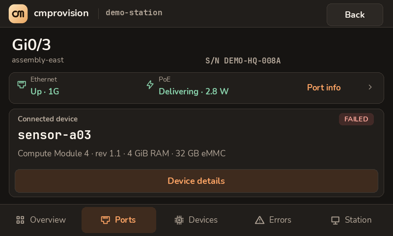
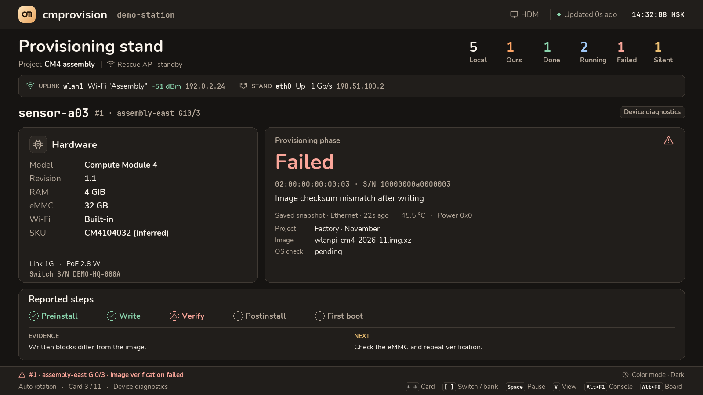

# 2.30.10 — From a switch port to its device 🔎

## HyperPixel

Open a port in **Ports** to see Ethernet speed and PoE together. **Port info** shows the chassis serial, connector, learned MAC addresses and any reported LLDP/CDP neighbor details. Choose **Device details** for hardware, the project and image used for that run, and the last diagnostic report. When several modules share a port, select one by name. Long hostnames scroll on the port tiles. [HyperPixel controls](https://github.com/nimbo78/cmprovision/blob/v2.30.10/docs/fpms-display.md#inspect-a-port-or-device)

## HDMI

**Automatic** shows a different device after each tour of the switch maps. A new failure brings up the affected module’s diagnostic card. In **Large device card and diagnostics**, use the arrow keys to inspect devices or a port delivering PoE without an Ethernet link. Long hostnames scroll on the graphical maps. [HDMI views and controls](https://github.com/nimbo78/cmprovision/blob/v2.30.10/docs/hdmi-display.md#screens-and-navigation)

On an existing station, open **Settings → Updates → Application**. The updater includes the matching `fpms-lite` package on stations that already use it. [Upgrade guide](https://github.com/nimbo78/cmprovision/blob/v2.30.10/docs/upgrading.md)
