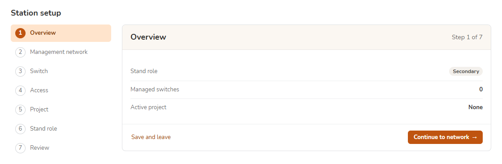

# 2.30.4 — Updates journal and station setup 🧙📦

This patch brings the Updates journal, station setup wizard and CI fixes together. The automatic release publishes only after checks, production packages, the ARM64 station image and signed update metadata have passed verification.

## Updates in one journal

Settings → Updates groups the selected component, available release, next action, current phase and recent operations. Application and Utility OS checks remain independent. Password confirmation, Back and recovery/reconnect handling remain available. [Update instructions](https://github.com/nimbo78/cmprovision/blob/v2.30.4/docs/upgrading.md).

## A guided station setup

Open **Settings → System → Open setup wizard**. Its seven steps cover management networking, the switch, station/sensor access, a project, the stand role and actual readiness. A fresh unconfigured station also offers setup on Dashboard.

The wizard reuses the existing forms and network confirmation/rollback. Open editors, unsaved fields and pending network changes block navigation. Web and SSH drafts remain independent. Next and Complete setup do not apply configuration, activate a project or start boot services. A primary needs a prepared project; a secondary or disabled station does not. The final check reads actual interfaces, services, image/hash and prepared EEPROM state.

## Station web and SSH access

The Access step and Settings → System can update the current web profile/password, an existing Linux administrator's password and additional SSH public keys. SSH changes need a one-use code issued by an existing sudo/console session after reviewing the exact request. The web helper cannot issue its own code. Existing keys and SSH/sudo policies are retained.

The first web account still uses the existing `auth:create-user` console procedure. The form does not create/rename Linux users, grant sudo or rewrite global SSH policy. Credentials explicitly applied to the OS persist independently of application rollback. [Setup guide](https://github.com/nimbo78/cmprovision/blob/v2.30.4/docs/station-setup.md).

## CI and verification

Display-only changes no longer trigger a full Utility OS build; changes to boot, diagnostics or the OS retain their required checks. Debian recovery acceptance waits for the actual worker lock release before the next scenario; production updater locking is unchanged.

- Final local Linux run: **2407 PHP tests / 9491 assertions**, with three existing warnings and 27 environment skips; **102 JavaScript tests**, **15 access-controller tests** and **2 real-flock tests**.
- The wizard PR passed Application and FPMS/HDMI CI, including real shadow/OpenSSH/key/sudo operations in a disposable container and real Debian installation, automatic rollback and full restoration. Independent review findings were fixed and retested.
- Production development packages were installed **d62 → da2**. Actual browser checks found the expected Secondary/off and Primary/running roles; da2's `stage1-test` was ready. Configuration digests and boot-service roles were preserved. Disposable accounts and installation files were removed; one verified recovery snapshot was retained on each station. Live Linux credentials were not changed for this test.
- The new wizard passed desktop/mobile and Light/Dark/Auto checks, including draft protection and network confirmation/rollback navigation. The earlier Updates journal passed 120 combinations of state, viewport and appearance.

The station image remains experimental. Cold boot of this exact published image, physical power interruption during updating and full encrypted restore on a physical station remain separate hardware acceptance. HyperPixel support is not included.
