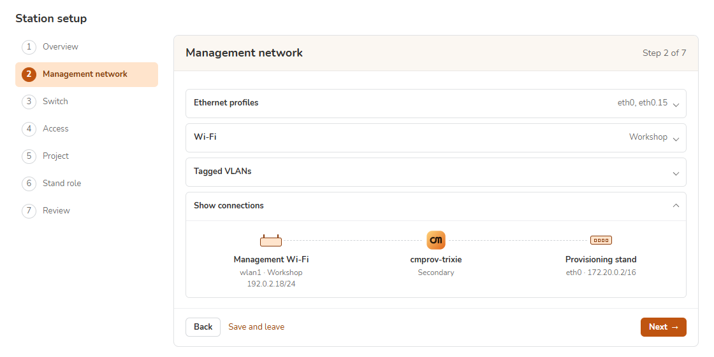

# 2.30.5 — First sign-in from the browser 🗝️

On a fresh station, open its management address, enter the 16-character code from HDMI or FPMS, and create the first web administrator. The browser signs you in and opens the setup wizard. Upgrades and restores keep the existing sign-in. [First sign-in and console recovery](https://github.com/nimbo78/cmprovision/blob/v2.30.5/docs/station-setup.md#before-opening-the-wizard)

## Set up a station without a display

When flashing the 2.30.5 station image through cmprovision, enable **First web administrator in browser** in the imaging project. After the settings are delivered, choose **Open setup code** on the new station's device card. Confirming your password takes you back to that code. The imaging station keeps its copy for 12 hours from the start of the run. On the new station the code stays valid until its first use or rotation. [Station project guide](https://github.com/nimbo78/cmprovision/blob/v2.30.5/docs/station-project-setup.md)

## A shorter setup screen

The seven steps now fit a phone. The network and stand-role steps show the management uplink and the provisioning interface. The access step has separate editors for the web account, station SSH and sensor accounts. **Save and leave** lets you resume. **Complete setup** removes the wizard card from Settings for everyone. You can still review the station at `/settings/setup`.

## Verification and installation

On a physical CM4, all four groups of the setup code in the 128 × 128 FPMS software frame matched the source station's device card. Creating the account in the browser opened the wizard. The completed and paused states were checked in desktop and mobile browser sessions.

Use **Settings → Updates → Application** on an existing provisioner. For a fresh station, use the ARM64 Lite image in the release assets. When installing the package in an offline Debian root without `/proc`, each station generates its own code on first boot. Hardware first-boot testing used a development build of the image. [Upgrade guide](https://github.com/nimbo78/cmprovision/blob/v2.30.5/docs/upgrading.md)
