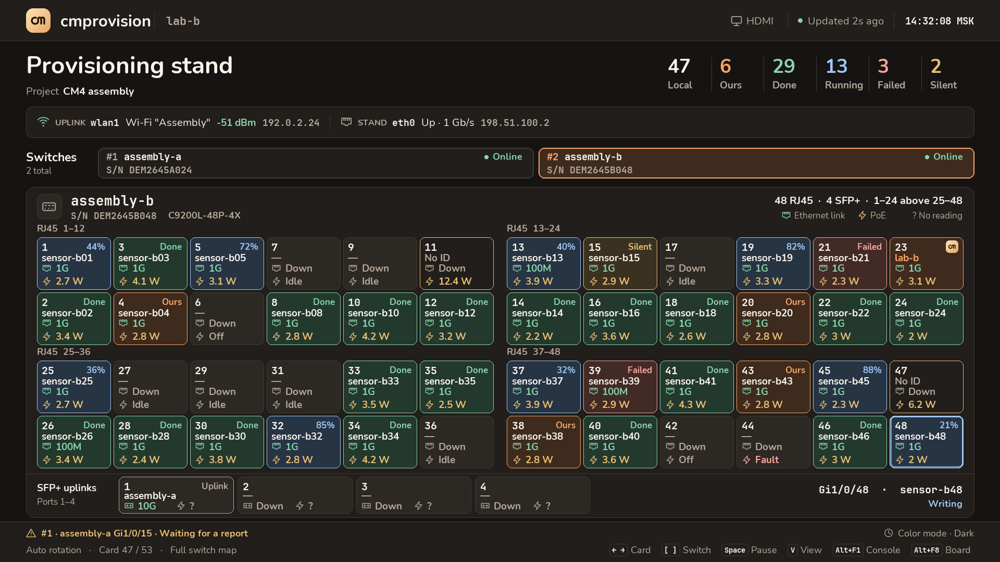

# 2.30.9 — The whole switch on HDMI 🖥️

## Find a device from its port

In **Settings → System → HDMI display**, set **HDMI activation** to **Auto** and **Screen** to **Full switch map**. On a running wallboard, **V** cycles the views. On a supported Cisco Catalyst 9200L, one screen shows all 24 or 48 copper ports and four SFP or SFP+ uplinks. The 24-port view also fits the device table. The 48-port view puts ports 1–24 above ports 25–48. Use `[` and `]` to switch chassis and match **S/N** to the label on the switch.

Each port shows the device name, Ethernet link or speed, and PoE state or measured watts. For example, `Down` with `6.2 W` means power is reaching the device while the Ethernet link is down. **Stand console** keeps the paged front panel and the selected device card side by side. **Automatic** chooses the full map on supported switches and opens diagnostics when the selected module fails or stops reporting. The native graphical display runs on Raspberry Pi OS Lite. The tty8 console takes over when graphical HDMI is unavailable. [HDMI controls and port readings](https://github.com/nimbo78/cmprovision/blob/v2.30.9/docs/hdmi-display.md#full-switch-map)

## First boot and two displays

The ready-to-flash ARM64 image uses the generic `default` profile. To enable a GPIO panel on first boot, choose `hyperpixel-4-touch` or `waveshare-144` when building an image with `fpms-lite`, or apply the profile to a mounted image with that package before it boots. A pending first-administrator code can then appear on the panel. [First-boot display setup](https://github.com/nimbo78/cmprovision/blob/v2.30.9/docs/hdmi-display.md#choose-a-gpio-panel-before-first-boot)

The rectangular HyperPixel 4.0 Touch and the graphical HDMI wallboard can run together on separate display pipelines. On the `wlanpi-d62` CM4, HDMI refreshed at 3440 × 1440 while FPMS continued on the 800 × 480 landscape panel. During a 26.1-second observation the HDMI framebuffer changed, the FPMS heartbeat stayed within 3.1 seconds and neither display service restarted. This bench check used the development build preceding the full switch map. The native renderer drew both the 24- and 48-port layouts from synthetic data at 1920 × 1080 and 3440 × 1440. [HyperPixel setup](https://github.com/nimbo78/cmprovision/blob/v2.30.9/docs/fpms-display.md#hyperpixel-40-touch)

On an existing station, use **Settings → Updates → Application**. The updater preserves the current boot display profile and includes the matching `fpms-lite` when it is already installed. [Upgrade guide](https://github.com/nimbo78/cmprovision/blob/v2.30.9/docs/upgrading.md)
