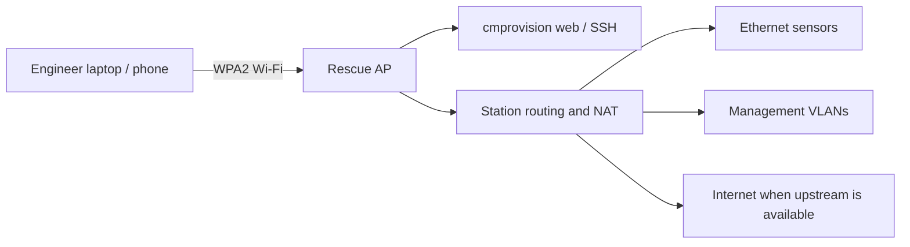

> **Language / Язык:** [English](rescue-wifi.md) | [Русский](ru/rescue-wifi.md)

# Rescue Wi-Fi access

An optional protected hotspot gives engineers access when saved management Wi-Fi networks cannot be reached. It is disabled by default. The normal management radio keeps trying saved networks while a separate radio provides the AP.



## Enable it before losing management access

1. Open **Settings → Network → Rescue Wi-Fi access point**.
2. Enable automatic rescue Wi-Fi. The default search timeout is **10 minutes**; allowed range is 1–30 minutes.
3. Leave radio selection automatic for a built-in AP radio and a separate external client radio, or select their permanent MAC addresses under **Radio and network options**. They must use independent PHYs. A healthy client connection is never disconnected to start the AP.
4. Leave the private `/24` subnet automatic, or choose a nonoverlapping private `/24`. Existing routes and saved static networks are checked. Channels 1, 6 and 11 are available in 2.4 GHz; the system regulatory domain is retained.
5. Optionally select wired/VLAN management profiles. An active usable address on any selected profile also prevents fallback. The flashing interface never counts as management.
6. Save and confirm your web account password. Open **Connection details**, confirm again if requested, and save the generated SSID and password. **Show** and **Copy** are explicit actions; routine status and display snapshots contain no password.

> [!IMPORTANT]
> Provisioning DHCP must be bound to the flashing interface first. If the card reports a missing binding, configure it in Network settings during an idle maintenance window. Starting the rescue AP never restarts flashing DHCP or changes stand Ethernet/VLAN settings.

## What happens automatically

| Situation | Result |
|---|---|
| Saved management networks disappear | Try normal client connections; the enabled cold spare gets its normal 30-second opportunity. |
| Management remains unavailable for 10 minutes | Start the protected AP on the idle selected radio. |
| Engineer joins | Open the IP shown in Settings, HDMI or FPMS; normal web/SSH authentication still applies. |
| Management returns | Wait for 60 seconds of stability, then keep the AP while any client is associated. |
| No clients remain | Wait a further 60 seconds, then stop the AP and return the radio to client use. |
| A new route overlaps the AP subnet | Stop the owned AP; select another subnet before restarting. |
| NetworkManager status or client count is unavailable | Preserve existing AP access and report the uncertainty. |

The AP is routed, with NetworkManager providing DHCP, DNS and NAT. Engineers can reach attached sensor addresses and routed VLAN networks without adding return routes to sensors. Internet access follows the station's available upstream routes. Layer-2 discovery broadcasts and network boot are not relayed through the AP. IPv6 is disabled on the AP. Other station firewall rules still apply.

## Manual controls and passwords

- **Start now** requests at least 15 minutes of availability; it still respects radio safety checks.
- **Stop for 15 minutes** pauses automatic AP startup. A separate warning confirms the disconnection of an active AP.
- **Resume automatic policy** cancels a pause.
- Saving SSID, subnet or password while the AP is active stages changes for its next start. **Restart with saved settings** requires a separate disconnection confirmation.
- Disabling an active AP also requires disconnection confirmation. **Back** cancels the pending action.

The generated AP password is unique to this station. It differs from web and SSH credentials. A replacement must contain 12–63 printable ASCII characters.

## Status and recovery

Settings shows the state, countdown, active SSID, gateway, client count and staged changes. The uplink summary lists rescue access separately from internet connectivity. HDMI and both FPMS layouts show the same AP state and connection address, without passwords.

For an activation failure, check the card's explanation, interface binding, selected radio, conflicting routes and the service journal:

```sh
sudo journalctl -u cmprovision-rescue-wifi.service -n 80 --no-pager
sudo /usr/lib/cmprovision/rescue-wifi status
```

An encrypted full backup includes the AP configuration and its NetworkManager profile as **network settings**. Migration preserves the destination station's network by default. Explicit network restoration may require selecting replacement radios on different hardware; a missing source MAC prevents activation rather than selecting an arbitrary card. See [full backups](backups.md).
