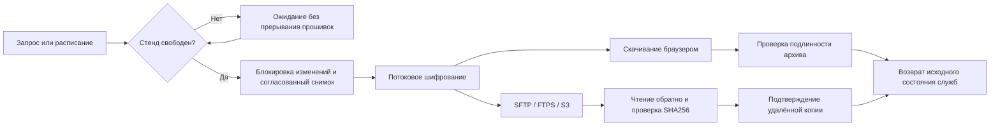
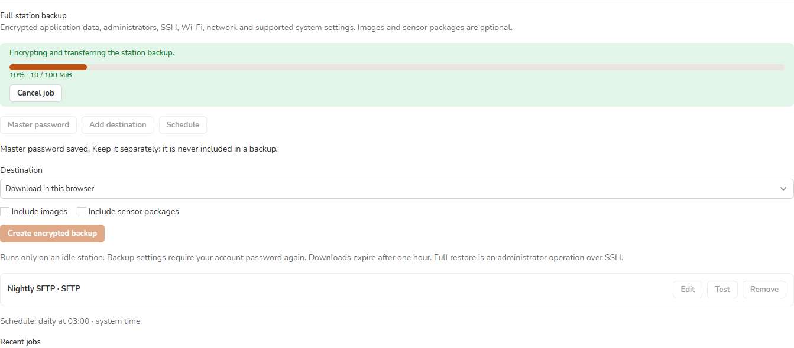

# Резервные копии станции

[English](../backups.md) · [Обновление и копии данных](upgrading.md) · [Выборочный перенос](configuration-transfer.md)

Откройте **Settings → System → Backup**, чтобы скачать зашифрованную копию станции, настроить удалённое хранилище или расписание. Полное восстановление запускает администратор через SSH.

> [!IMPORTANT]
> Храните мастер-пароль отдельно: в самой копии его нет. Новый пароль действует для будущих архивов; старым файлам по-прежнему нужен прежний пароль.



## Какой вариант выбрать

| Действие | Состав | Восстановление |
|---|---|---|
| **Selective import / export** | Выбранные проекты, скрипты, этикетки и поддерживаемые группы настроек | Предварительный просмотр и импорт в браузере |
| **Download backup** | Прежняя копия данных приложения без образов | `cmprovision-restore --data-only` |
| **Full station backup** | Данные приложения, секреты и поддерживаемые настройки ОС из таблицы ниже | `cmprovision-full-restore` через SSH |
| Снимок перед обновлением | Локальные материалы для отката пакета | Штатное восстановление обновлятора или `cmprovision-restore` |

Прежнее скачивание и выборочный перенос остаются в этой же карточке.

## Состав полной копии

| Включается всегда | По выбору или исключается |
|---|---|
| Согласованный снимок SQLite, ключ приложения, проекты, скрипты, этикетки, сохранённые учётные данные и хранилище прошивок | Образы для заливки: **Include images** |
| Профили NetworkManager, пароли Wi-Fi, поддерживаемые сертификаты, настройки VLAN | Пакеты проверки ОС сенсоров: **Include sensor packages** |
| Локальные интерактивные администраторы, хеши паролей, SSH-ключи доступа, ключи/конфигурация SSH-сервера и sudo | Очереди задач, браузерные сессии, кэш, временные загрузки и действующие подтверждения очищаются |
| Имя станции/локаль, часовой пояс/NTP, конфигурация nginx/PHP для cmprovision, роль стенда и настройки HDMI/FPMS | Мастер-пароль, machine ID, старые архивы и коллекции восстановления обновлятора исключены |
| Пакеты cmprovision/fpms-lite и полная активная Utility OS; профили хранилищ с выключенным расписанием | Базовая установка Debian, сторонние пакеты ОС и произвольные файлы за пределами фиксированного перечня не входят в формат |

Поддерживаемая основа — Debian/Raspberry Pi OS **Trixie** с установленным cmprovision. Сертификаты и ключи, на которые ссылаются профили Wi-Fi, должны лежать в `/etc/NetworkManager/certs/`. Внешние источники авторизации или нестандартные пути SSH-ключей останавливают создание полной копии с пояснением. Штатные ссылки Trixie для локали и часового пояса обрабатываются явно.

## Создание и расписание

1. Подтвердите **пароль своей учётной записи**, если интерфейс его запросит: это разрешение на операцию.
2. Откройте **Master password**, дважды введите пароль архивов длиной от 12 символов и сохраните его.
3. Выберите скачивание браузером либо **Add destination** и сохраните удалённое хранилище.
4. Для SFTP получите отпечатки, сравните их с доверенным значением администратора сервера и явно примите ключ. Кнопка **Test** проверяет запись, чтение и удаление тестового файла.
5. Выберите образы/пакеты при необходимости и нажмите **Create encrypted backup**. Страницу можно закрыть и открыть снова. **Cancel job** удаляет незавершённую копию и возвращает прежнее состояние служб.
6. В **Schedule** включите ежедневное или еженедельное копирование. Изначально оно выключено; предлагаемое время — **03:00 в часовом поясе станции**. Выберите одно удалённое хранилище. Лимит фиксирован: **одна проверенная копия на хранилище**, в том числе для профилей с ранее сохранённым большим лимитом.

Занятый стенд ждёт завершения прошивок и уже зарезервированных задач. Пропущенные интервалы объединяются в один запрос. Повторяющийся осенний час выполняется один раз, отсутствующее весеннее время переносится на первую существующую минуту. Смена часового пояса устанавливает новую границу расписания.

Проценты показываются только при известном числе байтов. Подготовка и потоковая отправка без известного общего размера отображают состояние работы. Копия становится доступной после проверки. Доступен только последний проверенный браузерный файл, не более **одного часа**; после замены ссылка на предыдущий истекает. Неудачное или отменённое создание сохраняет предыдущую пригодную копию. История содержит **50 последних операций**, без хранения их архивов.



*Демонстрационные данные. Сохранённые секреты хранилища не отображаются.*

## Удалённые хранилища

| Протокол | Что настроить |
|---|---|
| SFTP | Адрес, порт, логин, пароль или закрытый ключ PEM, закреплённый открытый ключ сервера |
| FTPS | Явный TLS по умолчанию либо неявный TLS, логин/пароль, при необходимости свой CA |
| Обычный FTP | Явное подтверждение, что транспортные учётные данные видны в сети |
| S3 / совместимый сервис | Корзина, регион, ключи доступа, при необходимости временный токен и HTTPS-адрес/CA |

Пустое поле сохраняет прежний секрет. **Clear saved value** явно удаляет его. Не добавляйте логин и пароль в URL. S3 использует заданный профиль без автоматического заимствования учётных данных окружения.

Каждая станция пишет в собственное пространство UUID. Успех фиксируется после чтения зашифрованного файла обратно, совпадения размера/SHA256 и записи маркера завершения. Предыдущая копия удаляется только после этой проверки, остаётся **одна проверенная копия на станцию и хранилище**. Очистка затрагивает только копии из собственного журнала для этого же хранилища. Чужие файлы остаются. Ошибка очистки оставляет новую проверенную копию пригодной и показывает предупреждение; исправьте права удаления, чтобы следующий успешный бэкап убрал лишнюю копию.

Публикация проверенного маркера завершает удалённую копию: более поздняя отмена её не отменяет. Если возврат служб станции прервётся, восстановление завершит очистку без повторной отправки архива.

При включённой версионности S3 старые версии объектов могут сохраняться, а незавершённым многокомпонентным загрузкам может потребоваться правило жизненного цикла. Настройте его отдельно для выделенного префикса бэкапов. cmprovision не выполняет массовую очистку чужих объектов или всех незавершённых загрузок корзины.

## Предварительный просмотр восстановления

Если копирование откладывалось несколько дней, одна успешная копия покрывает расписание до фактического момента снимка. При включении образов/пакетов проверяются все пригодные ссылки из базы, включая готовые части образов: отсутствие файла или несовпадение размера/хеша останавливает создание и проверку восстановления. Незавершённые и неудачные загрузки образов исключены из пригодных ссылок. Базу проверяет www-data; предел — **512 МиБ** и **4000 ссылок на полезную нагрузку**, требуется временное место ещё для одной копии базы.

Сначала установите совместимую станцию Trixie. Скопируйте `.cmpbackup` в защищённый каталог с местом для проверки, подготовки данных и новой аварийной копии. Сохраняется запас **256 МиБ**; место для копии обязательного пакета проверяется до его перепаковки. Сжатие перепакованных пакетов использует один поток. Предел архива — 1 ТиБ, конфигурационных данных — 16 МиБ на файл и 64 МиБ суммарно. Подготовка полезной нагрузки читает архив за один проход.

```sh
sudo cmprovision-full-restore /srv/restore/station.cmpbackup
```

Пароль архива вводится в терминале. Для автоматизации есть `--password-fd` с защищённым унаследованным дескриптором; сам пароль не передаётся аргументом процесса. До записи данных проверяются подлинность всего потока, разрешённые пути, размеры и хеши файлов.

Предварительный просмотр перечисляет изменяемые и сохраняемые группы, выбранные учётки, устанавливаемые пакеты и отсутствующие полезные нагрузки без раскрытия секретов. Показываются исходная станция/версия и SHA256 зашифрованного файла. Проверьте их перед применением.

## Перенос на другую станцию

Режим **migrate** по умолчанию сохраняет сеть, ключи/настройки SSH-сервера, идентичность новой станции, аварийного администратора и роль стенда. Возвращаются данные приложения и выбранные поддерживаемые группы.

```sh
sudo cmprovision-full-restore /srv/restore/station.cmpbackup \
  --mode migrate --apply --yes
```

Для возврата конкретной учётки и явного сопоставления сетевого интерфейса:

Если профиль Wi-Fi привязан только по MAC, укажите постоянный MAC источника слева: например, `--map-interface 02:00:00:00:00:01=wlan0`. При замене оборудования сопоставьте обе карты резервного Wi-Fi: профиль точки и закрытая конфигурация контроллера изменятся согласованно. Без восстановления сети сохраняются настройки станции назначения, включая её пароль резервной точки.

```sh
sudo cmprovision-full-restore /srv/restore/station.cmpbackup \
  --mode migrate --groups time,display,web,network \
  --map-interface eth0=eth0 --account operator --emergency-user rescue
# После проверки повторите те же параметры с --apply --yes.
```

Используется MAC интерфейса назначения. Конфликты имени/UID/GID или отсутствующие дополнительные группы останавливают перенос. Выбранный аварийный администратор сохраняется, служебные учётки ОС остаются. Хеши паролей поступают штатным утилитам через стандартный ввод. Конфигурация SSH/sudo проверяется перед использованием. Откройте новое SSH-соединение и проверьте доступ, прежде чем закрывать существующее.

Группы ОС: `network`, `ssh`, `host`, `time`, `display`, `web`, `role`, `publisher`, `sudo`. По умолчанию выбраны `time,display,web`. Конфигурация sudo восстанавливается только в `--mode same-station`; при переносе выбранные учётки могут присоединяться к уже существующим группам назначения. Явный выбор `role` возвращает маски служб источника — сначала проверьте схему сети. Без него маски DHCP/USB на станции наподобие d62 сохраняются.

Восстановленное расписание выключено, мастер-пароль нужно задать заново. При переносе создаётся новый UUID бэкапов. Если образы или пакеты не включались, активный проект деактивируется: выберите и проверьте пригодный проект перед заливкой. Сеть Linux и SSH назначения сохраняются по умолчанию, но согласованные данные приложения включают исходные `.env` и конфигурацию dnsmasq. Перед включением заливки проверьте нестандартные подсети стенда и адрес приложения.

## Доверие программному обеспечению

Совпадающие уже установленные пакеты станции и исправная установленная Utility OS могут использоваться повторно. Перед установкой архивного ПО подпись манифеста и хеши проверяются **существующим доверенным ключом издателя станции назначения**.

Повторное использование пакета также требует успешной проверки установленных файлов. Аварийное восстановление переустанавливает архивные пакеты даже при совпадении версий. Дерево встроенной Utility OS заменяется целиком атомарным обменом каталогов, без устаревших файлов. Явно доверенное неподписанное управляемое дерево так же целиком заменяет слот bundled-modern.

Перепакованные пакеты и неподписанные деревья Utility OS отмечаются **local-snapshot**. Для их исполнения администратор проверяет предварительный просмотр/отпечаток архива и явно добавляет `--allow-snapshot-software`. Пароль зашифрованного файла сам по себе не подтверждает происхождение от издателя. Явно доверенное неподписанное дерево управляемой Utility OS помещается в редактируемый слот bundled-modern; подписанная идентичность управляемого релиза ему не присваивается.

Предварительный просмотр может перечислять такое ПО без разрешения на его исполнение. Для применения плана явный флаг по-прежнему обязателен.

## Если восстановление прервалось

Перед изменениями создаётся и проверяется новая копия:

```text
/var/backups/cmprovision-full-restore/<operation-id>/before.cmpbackup
```

Она зашифрована паролем, введённым для восстановления. **Одна проверенная аварийная копия перед восстановлением** хранится отдельно от обычных бэкапов и исключена из последующих полных архивов. Старые зарегистрированные копии удаляются после успешного восстановления и проверок работоспособности либо при очистке свободного стенда. Активное или прерванное восстановление защищает свои данные до разрешения ситуации; вручную сохранённые и неопознанные файлы остаются.

Временные маски служб и сохраняемый системный барьер блокируют запуск DHCP/TFTP/USB во время восстановления, в том числе после перезагрузки и сбоя настройки пакетов. Барьер снимается после проверки приложения и Utility OS. Старые рабочие каталоги удаляются по сроку и после смены UUID, а зашифрованная аварийная копия сохраняется отдельно. Административное восстановление нельзя отменить из браузера.

При сбое после начала изменений провижининг остаётся остановленным, маркер обслуживания сохраняется. Через SSH или локальную консоль:

```sh
sudo cmprovision-full-restore --recover
# Проверьте записанную аварийную копию и нужные параметры учёток/интерфейсов.
sudo cmprovision-full-restore --recover --apply --yes --allow-snapshot-software
```

В этом режиме принимается только аварийный путь, записанный самой станцией. Выбор учёток и сети требует проверки оператором. Не удаляйте маркеры, чтобы открыть частично восстановленный стенд. Если аварийная копия не была завершена, данные назначения ещё не менялись; проверьте записанное состояние служб через SSH перед снятием блокировки.

После прерывания **создания бэкапа** используйте `sudo python3 -I /usr/lib/cmprovision/station-backups.py --recover` и журнал `journalctl -u 'cmprovision-backup-*'`. Восстановление возвращает службы, не повторяя загрузку или снимок. Удаление пакета при активном маркере полного бэкапа запрещено; защищённые настройки и аварийные копии сохраняются для администратора.

## Что проверяется автоматически

Локальный сервер FTPS в тесте использует TLS 1.2 из-за [обрезания передач TLS 1.3 в pyftpdlib](https://github.com/giampaolo/pyftpdlib/issues/602). Согласование TLS и проверка сертификатов рабочего клиента не менялись; настоящий сервер FTPS требует отдельной приёмки.

Проверки охватывают перечень файлов, подлинность и повреждения архива, потоковую обработку нескольких гигабайт, расписание/DST, блокировки/восстановление, доступ через веб и настоящие локальные SFTP/FTP/FTPS/HTTPS-S3. S3 проверяется через Moto: обычная небольшая запись и многокомпонентная запись с версионностью. Внешние AWS/MinIO и многокомпонентная запись без версионности требуют отдельной приёмки. Изолированная Debian-станция проверяет настоящие утилиты учёток, SSH, перезагрузку профилей NetworkManager, SQLite от www-data, возврат и установку архивного пакета, исправление той же версии и аварийное восстановление через CLI. Внедрённый сбой настройки пакета и имитация потери временного состояния проверяют, что включённые службы загрузки остаются заблокированными до восстановления их прежней роли. Физическое восстановление и настоящее внешнее хранилище проверяются на отдельно выделенной расходной станции.
