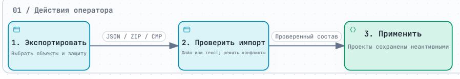
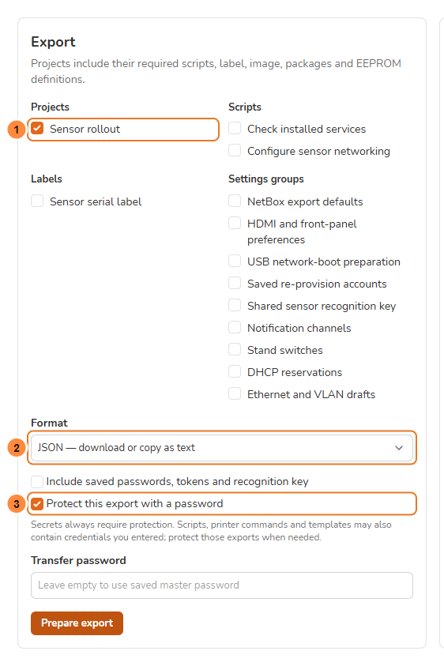
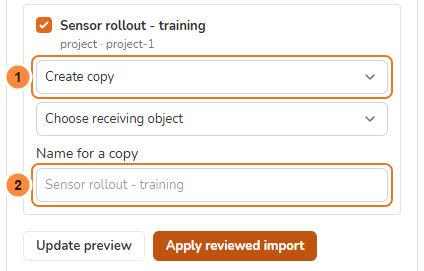
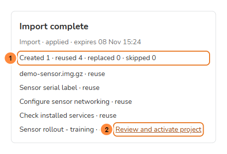

> **Language / Язык:** [English](../configuration-transfer.md) | [Русский](configuration-transfer.md)

# Перенести конфигурацию между станциями

[Эксплуатация](operations.md) · [Резервная копия и восстановление](upgrading.md) · [Настройка образа станции](station-project-setup.md)

Откройте **Settings → System → Backup → Selective import / export**. Это общий вход: проекты, скрипты и этикетки выбираются на странице переноса.

Выборочный перенос копирует определения в уже установленную станцию cmprovision. Полная резервная копия и `cmprovision-restore --data-only` остаются средствами аварийного восстановления базы и ключа приложения.

Новые проекты, этикетки и скрипты можно подготовить через [мастера создания](creation-wizards.md), затем экспортировать сохранённый результат.

> [!NOTE]
> Предварительная функция доступна с `2.25.0~dev1`: на обеих станциях нужна сборка с её поддержкой. На скриншотах — демонстрационные данные.

*Нажмите на изображение для увеличения. Для интерактивного просмотра скачайте [автономный HTML](../diagrams/configuration-transfer-flow.ru.html) и откройте его локально.*

## Перед началом

- [ ] Вы можете войти на обе станции и подтвердить пароль учётной записи.
- [ ] Очереди работают, особенно **images worker**.
- [ ] Понятно, какие существующие объекты сохранить, скопировать или заменить.
- [ ] Для защищённого экспорта есть пароль переноса либо такой же сохранённый мастер-пароль на принимающей станции.

## Выберите состав экспорта

Выберите проекты, отдельные скрипты, этикетки и нужные группы настроек. Вместе с проектом автоматически включаются определение образа, скрипты, этикетка, пакеты первого запуска и ссылки на прошивку EEPROM.

Группы настроек и локальные исключения

Группы охватывают умолчания NetBox, оформление экранов, USB-подготовку, сохранённые учётки re-provision, общий ключ распознавания сенсоров, каналы уведомлений, коммутаторы, DHCP-резервации и черновики Ethernet/VLAN.

История прошивок, выбор активного проекта, обнаруженное состояние коммутаторов, пользователи, ключи приложения и локальные операции не включаются. Определение проекта станции включает Linux-доступ и Wi-Fi для прошиваемой станции. Собственные сохранённые управляющие Wi-Fi-подключения исходного провижинера не переносятся.

1. Выберите объекты. Зависимости проектов включаются автоматически.
2. Выберите формат, при необходимости двоичные файлы и защиту паролем.
3. Нажмите **Prepare export** и при запросе подтвердите **пароль учётной записи cmprovision**.
4. Дождитесь готовности, затем скачайте файл или нажмите **Show text to copy** для JSON.

**1 — Объекты. 2 — Формат. 3 — Защита.** Обязательные скрипты и этикетку проекта не требуется выбирать повторно.

| Формат | Для чего |
| --- | --- |
| JSON | Небольшой файл или копируемый текст. Двоичные файлы описываются размером и SHA-256 |
| ZIP | Можно включить образы, Debian-пакеты и EEPROM. Уже сжатые файлы сохраняются без повторного сжатия |
| Защищённый CMP | ZIP с защитой паролем; выбирается автоматически при включении защиты. Защищённый JSON остаётся копируемым текстом |

Для JSON сначала загрузите недостающие образы и пакеты обычным способом на принимающую станцию. Файлы должны быть готовы, а реальные данные — совпадать с описанием. Импорт не скачивает произвольный URL из манифеста.

## Пароли и секреты

> [!WARNING]
> Включение сохранённых паролей, токенов и ключа распознавания требует защиты. Скрипты, команды печати и шаблоны могут содержать секреты, вписанные обычным текстом; такие выгрузки также следует защищать.

Мастер-пароль и подтверждение пароля учётной записи

На станции можно сохранить один **мастер-пароль**. На другой используйте такой же либо укажите отдельный пароль переноса. Новый пароль требует 12–1024 символа. Удаление сохранённого пароля убирает его копию на станции; у существующих выгрузок сохраняется исходный пароль.

**Include saved passwords, tokens and recognition key** требует защиты. Иначе поля исключаются, а предпросмотр запрашивает необходимые замены. Скрипты, команды печати и шаблоны могут содержать секреты в обычном тексте.

Сохранённый мастер-пароль и временные учётные данные зашифрованы локальным APP_KEY. Защищённая выгрузка открывается паролем переноса независимо от APP_KEY источника. Импортированные зашифрованные настройки сохраняются под ключом получателя.

Сохранение и удаление мастер-пароля, подготовка экспорта, просмотр и скачивание текста, применение конфигурации используют обычное подтверждение. В нём нужен **пароль учётной записи cmprovision**, а не пароль переноса.

## Импорт и проверка

1. Загрузите JSON, ZIP или CMP либо вставьте экспортированный текст. Введите пароль переноса, если он отличается от сохранённого мастер-пароля.
2. Дождитесь подготовки. Обработчик images проверяет манифест, включённые файлы, распакованные размеры и SHA-256 образов, метаданные Debian-пакетов.
3. Проверьте объекты. Совпадающие определения по умолчанию используют **Reuse existing**, обычные конфликты имён — **Create copy**. Адреса коммутаторов, DHCP-идентификаторы и группы настроек требуют явного использования или замены: их нельзя без изменений скопировать как отдельную идентичность.
4. Устраните недостающие файлы и секреты. Для исключённого пароля Linux вводите новый пароль, а не хеш. Для сетевого черновика сопоставьте интерфейс и родительский интерфейс VLAN.
5. После изменений нажмите **Update preview**. Обязательные зависимости должны оставаться выбранными, если только целиком не используется существующий проект принимающей станции.
6. Нажмите **Apply reviewed import**. Применение идёт в очереди images, итоговый отчёт перечисляет созданные, использованные, заменённые и пропущенные объекты.

**1 — Действие при конфликте. 2 — Имя копии.** Здесь показана строка проекта; зависимости перечислены выше. **Ожидаемый результат до применения:** нет нерешённых требований, выбраны нужные действия копирования, использования и замены. **Update preview** проверяет изменения перед **Apply reviewed import**.

Активный проект, его зависимости и объекты текущего прогона заменять нельзя: выберите копию или дождитесь освобождения. Для образа с незавершённой подготовкой частей также нужна копия или ожидание. Файлы EEPROM неизменяемы: используйте совпадающие данные либо отдельную копию.

Если конфигурация получателя изменилась после предпросмотра, выполните проверку заново. Повтор уже применённой операции возвращает сохранённый результат и ID. Адрес операции сохраняется после перезагрузки страницы в той же сессии; другой пользователь или сессия доступа не имеют. Срок действия — 24 часа.

## Завершите дополнительные действия

- [ ] **Import complete** перечисляет ожидаемые объекты и количества.
- [ ] Импортированный проект появился на **Projects** и **неактивен**.
- [ ] Дополнительные действия проверены до изменения работающего стенда.

Импорт не меняет активный проект. Проверьте и явно активируйте нужный на **Projects**. Порядок исходных скриптов сохраняется даже при одинаковом приоритете и других ID на принимающей станции.

- **Network drafts:** откройте черновик из отчёта, выберите сохранённый профиль получателя на сопоставленном интерфейсе и загрузите параметры в обычный редактор. При необходимости сначала создайте отключённый Ethernet-профиль или VLAN через штатный раздел. ID и родитель VLAN должны совпадать. Проверьте адреса, DNS, маршруты и правила, затем используйте обычное временное применение с подтверждением или откатом. Сам импорт интерфейсы и маршруты не меняет.
- **Display services:** оформление FPMS сохраняется в базе; ожидающие параметры служб HDMI/FPMS применяются отдельным действием отчёта через обычные помощники.
- **DHCP reservations:** определения сохраняются сначала; отдельное действие пересоздаёт резервации и перезапускает DHCP, сохраняя остальные директивы dnsmasq. Выполняйте в свободный момент.
- **USB preparation:** пересоберите выбранный EEPROM-образ перед включением подготовки. Импорт оставляет этот режим выключенным.

Истёкший или удалённый сетевой черновик отбрасывается с уведомлением; обычные настройки сети остаются доступны.

## Лимиты и восстановление

Размеры файлов, срок действия, проверка и очистка

Лимит манифеста — 16 МиБ, защищённого текста — 32 МиБ, не более 2048 объектов и 4096 записей архива. Формат архива допускает 64 ГиБ, а обычный HTTP-лимит пакета остаётся 8 ГиБ. Для больших образов используйте штатную загрузку и перенос определений через JSON.

Проверка образа допускает 512 ГиБ после распаковки, два часа на файл и 128 МиБ памяти декодера XZ. Нестандартный XZ с большим расходом памяти предварительно перепакуйте.

Обе очереди должны работать, особенно images. Временные файлы приватны и находятся в `storage/framework/configuration-transfer`, вне обычных резервных копий. Очистка запускается при новых операциях и отложенным заданием images после истечения срока; остановленный обработчик задерживает её. Cancel удаляет неиспользуемые временные данные. Незарегистрированные подготовленные файлы удаляются после ошибки, при повторе или истечении срока; зарегистрированные сохраняются.

Заменённые файлы образов и пакетов удаляются только после COMMIT. Файлы, на которые ссылается другой объект, включая общие файлы частей образов, сохраняются. При неудаче очистки результат импорта остаётся сохранённым, а отчёт предлагает **Retry file cleanup**. Проверьте права хранилища перед повтором; очистка истёкших операций также повторяет удаление.

При ошибке подготовки проверьте сообщение, свободное место и пароль, затем начните новый перенос. После остановки применения обновите предпросмотр перед повтором. Если результат временно недоступен, сначала откройте ту же операцию, чтобы восстановить подтверждённый результат.

Версия схемы 1 проверяется явно. Неподдерживаемые версии, неизвестные поля, битые ссылки, ссылки и выход за пути в архиве, необъявленные файлы, несовпавшие хеши и неполный защищённый поток отклоняются до применения.

