> **Language / Язык:** [English](../gallery.md) | [Русский](gallery.md)

# Обзор интерфейса в скриншотах

[Назад к README](../../README.ru.md) · [Быстрый старт](../../README.ru.md#быстрый-старт) · [Руководство по эксплуатации](operations.md)

Скриншоты актуального интерфейса, сделанные на локальном стенде 17 октября 2026 года. **Все записи устройств, проектов, сетевые параметры и ответы коммутаторов являются демонстрационными данными.** Скорости, показатели питания и время выполнения носят иллюстративный характер. Образы и прошивки в демо являются заполнителями.

Начиная с версии 2.10 модуль именуется по MAC-адресу и имени хоста, а серийный номер перенесён в конец строки; представленные ниже скриншоты разделов CMs, Dashboard, Ports и карточки модуля были сняты ранее и отображают серийный номер в начале.

Большинство экранов показано в теме **Warm · Light · Compact** при ширине браузера 1440 пикселей. Каждый скриншот содержит ссылку на исходный полноразмерный PNG; диалоговые окна и панели статуса сняты отдельно для сохранения читаемости элементов управления.

| Основные вкладки | Дополнительные экраны |
| --- | --- |
| [Dashboard](#dashboard) · [CMs](#cms) · [Ports](#ports) | [Карточка модуля](#карточка-модуля) · [Статус сети](#статус-сети) |
| [Images](#images) · [Projects](#projects) · [Scripts](#scripts) | [Оформление](#оформление) · [Плотность](#плотность) |
| [Labels](#labels) · [Firmware](#firmware) · [Settings](#settings) | [Мобильное меню](#мобильное-меню) · [Учётная запись](#учётная-запись) |

## Dashboard

Наблюдение за текущей партией без необходимости открывать отдельные карточки. Для каждого модуля отображаются текущая фаза, прогресс, скорость записи или сверки, оставшееся время и ошибки. В демо представлены этапы записи, сверки, первого запуска, завершённые прогоны и ошибка отсутствия накопителя. Для доступных модулей выводятся действия **Restart** и **Identify**.

<a href="../../assets/readme/screenshots/dashboard.png">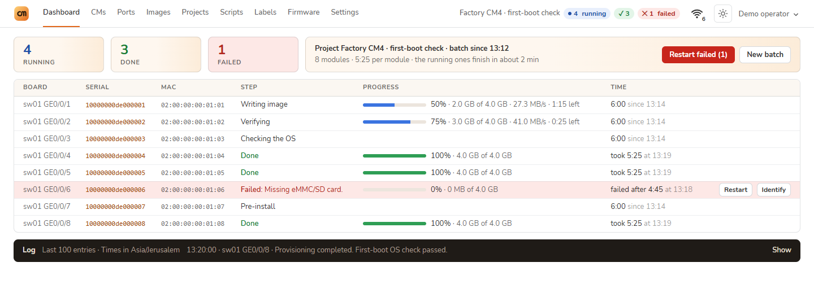</a>

## CMs

Поиск по базе модулей, просмотр последних результатов прошивки каждого устройства и экспорт записей в CSV. Нажатие на MAC-адрес открывает детальную карточку устройства.

<a href="../../assets/readme/screenshots/cms.png">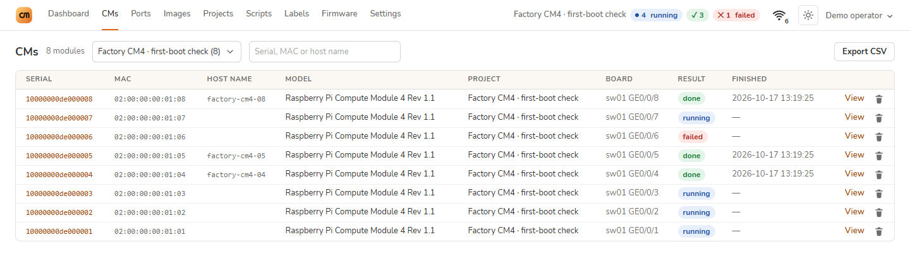</a>

## Ports

Отображение стенда в виде карты портов коммутатора. Фильтры статусов выделяют порты в процессе прошивки, завершённые, с ошибкой или свободные. Выбор порта открывает информацию о модуле, советы при ошибках, параметры линка и PoE. В данном примере выбран модуль с ошибкой на порту **sw01 GE0/0/6**.

<a href="../../assets/readme/screenshots/ports.png">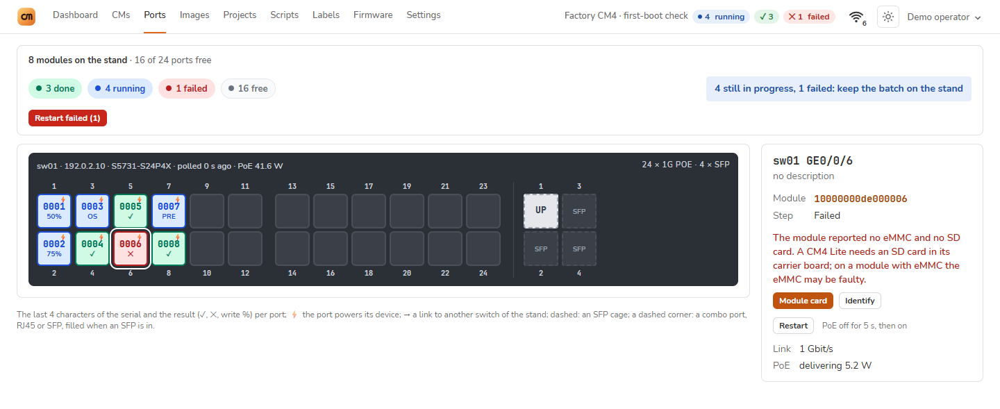</a>

Опрос портов требует SNMP-доступа на чтение. Перезапуск по PoE требует отдельного доступа на запись и поддерживаемой модели коммутатора; см. [настройка коммутаторов и ограничения PoE](operations.md#коммутаторы-и-перезапуск-по-poe).

## Images

Загрузка сжатых образов ОС и проверка их контрольных сумм перед назначением в проект.

<a href="../../assets/readme/screenshots/images.png">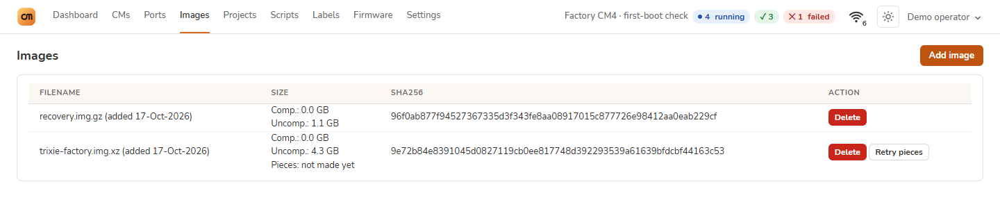</a>

## Projects

Хранение параметров прошивки в именованных проектах с выбором активного проекта для стенда. Проект объединяет образ ОС, целевой накопитель, настройки EEPROM, скрипты, проверки при первой загрузке и шаблон этикетки.

<a href="../../assets/readme/screenshots/projects.png">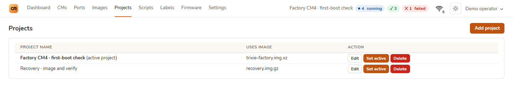</a>

Открыть редактор проекта

Редактор включает сверку полного образа, восстановление разделов, проверки ОС при первом запуске и настройку EEPROM.

<a href="../../assets/readme/screenshots/project-editor.png">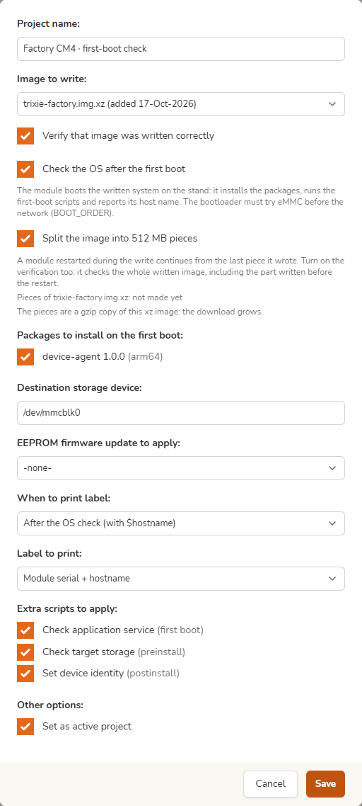</a>

## Scripts

Управление скриптами этапов pre-install, post-install и first-boot. Загрузка пакетов Debian для установки во время проверки ОС при первом запуске. Сеть стенда не имеет выхода в интернет, поэтому зависимости пакетов должны присутствовать в образе или быть загружены вместе с ними.

<a href="../../assets/readme/screenshots/scripts.png">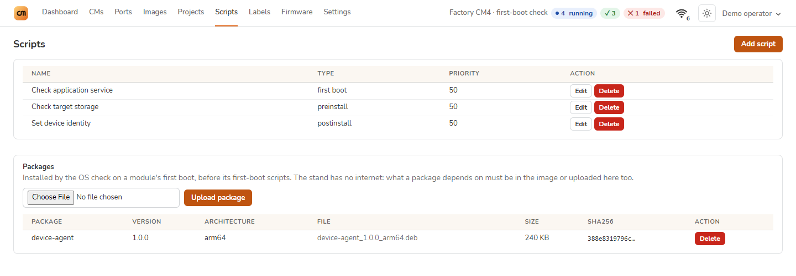</a>

Открыть редактор скрипта

Редактирование имени скрипта, этапа выполнения и команд оболочки.

<a href="../../assets/readme/screenshots/script-editor.png">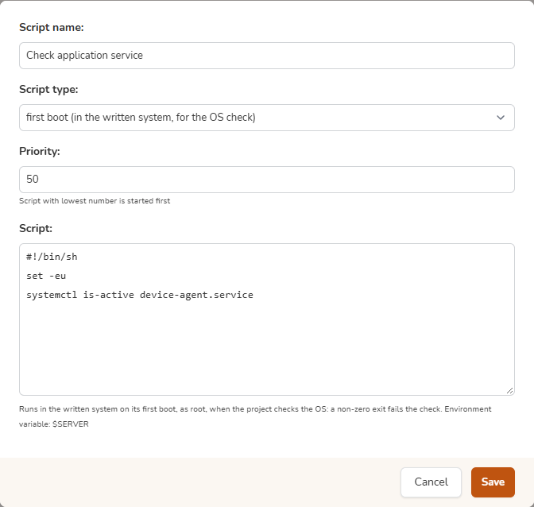</a>

Ознакомьтесь с [требованиями к первому запуску](operations.md#проверка-ос-при-первой-загрузке) перед включением скриптов и пакетов в проекте.

## Labels

Создание шаблонов этикеток для прошитых устройств и привязка шаблона к проекту. Поля шаблона могут содержать серийный номер модуля и имя хоста, переданное установленной системой.

<a href="../../assets/readme/screenshots/labels.png">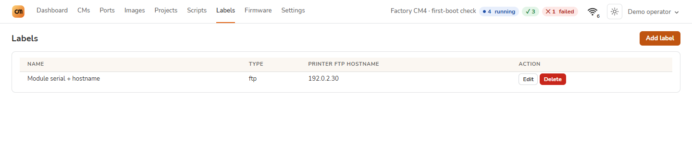</a>

Открыть редактор этикетки

Настройка подключения к принтеру и редактирование команд печати с подстановкой параметров устройства.

<a href="../../assets/readme/screenshots/label-editor.png">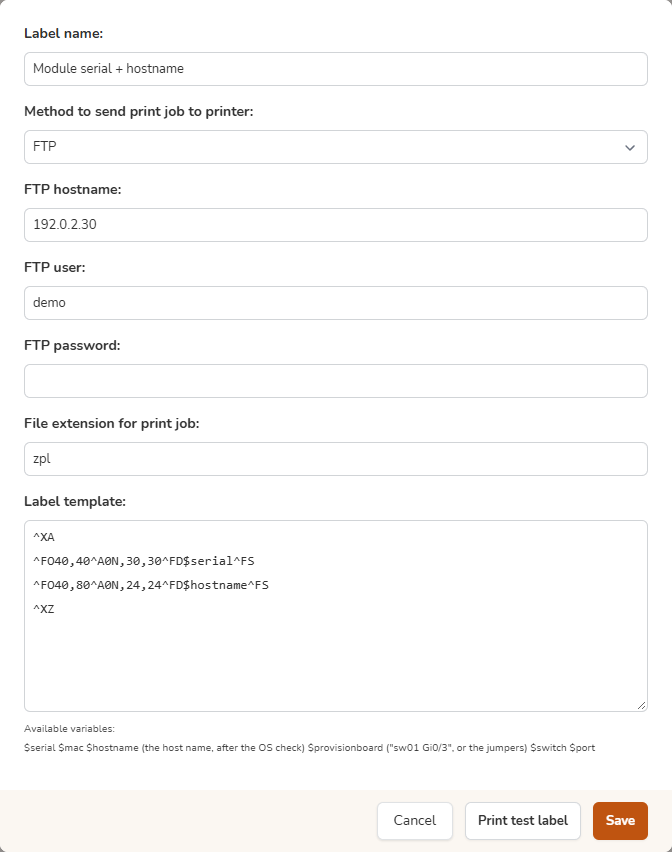</a>

## Firmware

Список доступных релизов загрузчика EEPROM Raspberry Pi по каналам обновлений. Выбор применяемой прошивки выполняется в редакторе проекта.

<a href="../../assets/readme/screenshots/firmware.png">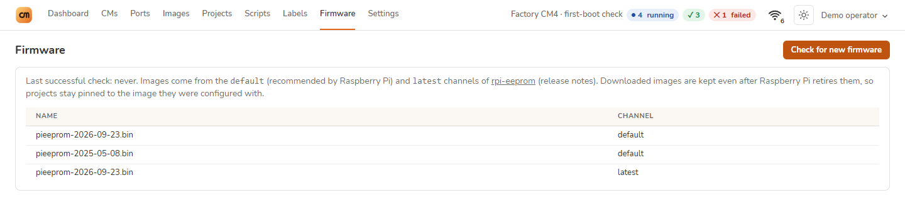</a>

## Settings

Раздел Settings разделён на четыре вкладки по назначению: **Status** (службы сервера и их журналы), **Network** (сети Wi-Fi, SNMP-коммутаторы, аренда DHCP), **Provisioning** (утилитарная ОС, повторный провижининг, HDMI-дисплей) и **Notifications** (каналы оповещений и партии). На трёх вкладках, помимо Status, верхняя плашка показывает статус служб и меню их журналов. Демо работает без подключённого стендового оборудования, поэтому службы DHCP и загрузки по USB отображаются как остановленные. Снимок сделан 23 октября 2026 года со стенда разработки.

<a href="../../assets/readme/screenshots/settings.png">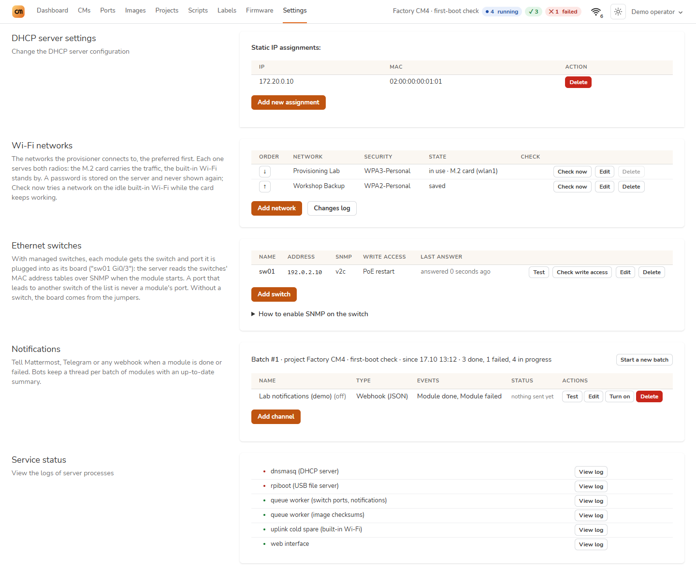</a>

## Карточка модуля

Запись модуля объединяет данные об оборудовании, проекте и образе, порте коммутатора, фазах последнего прогона, результатах первого запуска, версиях EEPROM до и после прошивки, а также историю журналов. В примере установленная система успешно передала отчёт со своим именем хоста.

<a href="../../assets/readme/screenshots/module-detail.png">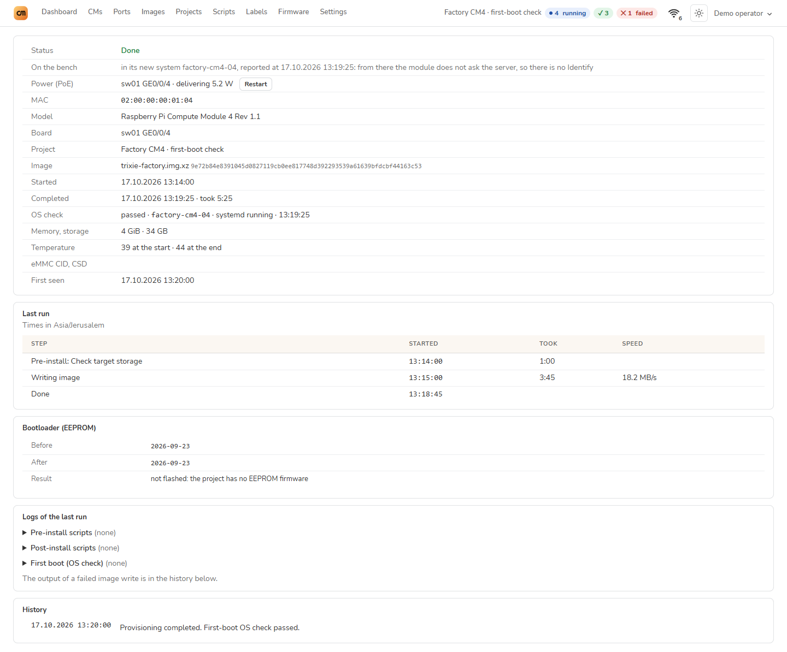</a>

## Статус сети

Нажмите или наведите курсор на индикатор сети в верхней панели навигации для просмотра параметров аплинка. Для Wi-Fi отображаются поколение, имя сети, уровень сигнала, канальная скорость, диапазон, номер и ширина канала, адаптер и IP-адрес. Также отображается статус холодного резерва встроенного адаптера и отдельная Ethernet-сеть стенда для модулей.

<a href="../../assets/readme/screenshots/connection.png">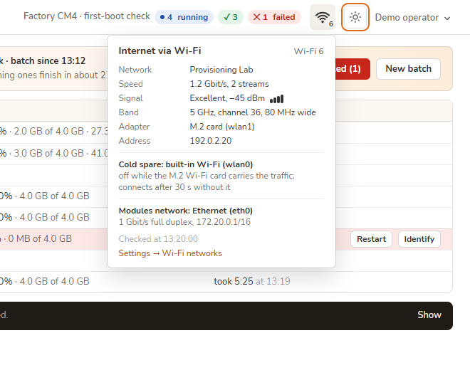</a>

Скорость Wi-Fi представляет собой **канальную скорость подключения**, а не пропускную способность интернет-канала. Подробнее см. [поведение холодного резерва](operations.md#встроенный-wi-fi-как-холодный-запасной).

## Повторный провижининг установленного сенсора

Карточка модуля проверяет доступ к устройству перед тем, как предложить деструктивную операцию. Эти три экрана сняты 18 октября 2026 года на стенде разработки с симуляцией SSH-ответов в палитре Warm · Dark. Ни одно устройство при съёмке не стиралось.

| Проверка доступа | Подтверждение идентификации, диска и проекта |
| --- | --- |
| <a href="../../assets/readme/screenshots/reprovision-access.png">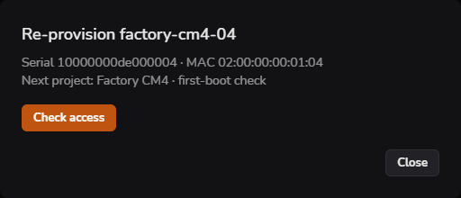</a> | <a href="../../assets/readme/screenshots/reprovision-confirm.png">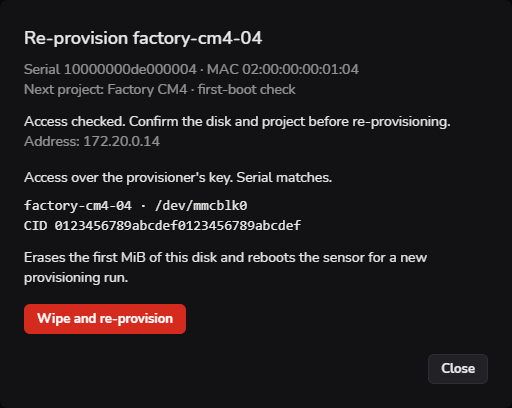</a> |

Сенсор, требующий нового пароля

<a href="../../assets/readme/screenshots/reprovision-password.png">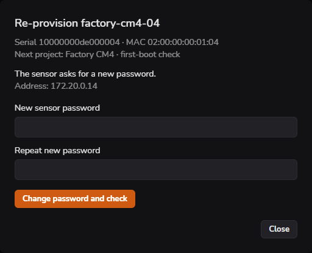</a>

См. [поддерживаемые структуры, установка ключей и восстановление](operations.md#повторный-провижининг-установленного-сенсора).

В разделе Settings также доступен упорядоченный список сохранённых учётных записей сенсоров. Общедоступные заводские профили ниже являются демонстрационными; сохранённые пользовательские пароли никогда не отображаются в открытом виде.

<a href="../../assets/readme/screenshots/reprovision-accounts.png">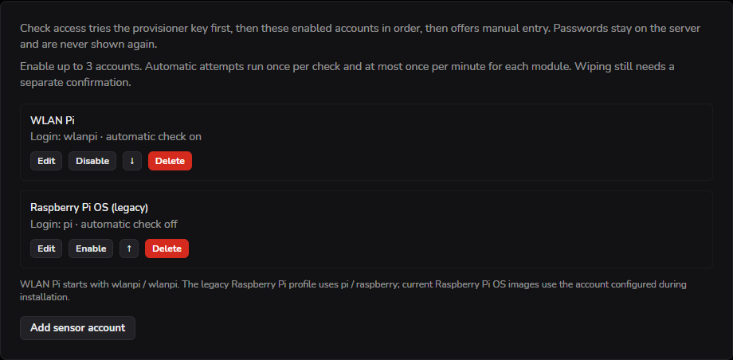</a>

## Оформление

Откройте пункт **Appearance** в панели навигации. Выберите один из двух стилей: **Warm** или **Neutral**, а также цветовую тему: **Light**, **Dark** или **Auto**. Ниже показан один и тот же дашборд во всех четырёх комбинациях. Выбор сохраняется в браузере и синхронизируется между открытыми вкладками.

| Warm · Light | Warm · Dark |
| --- | --- |
| <a href="../../assets/readme/screenshots/warm-light.png">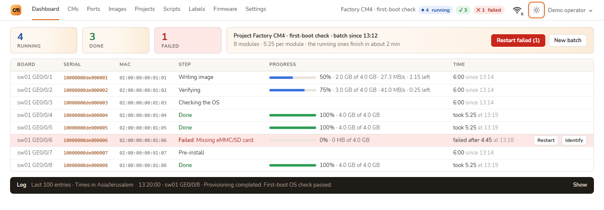</a> | <a href="../../assets/readme/screenshots/warm-dark.png">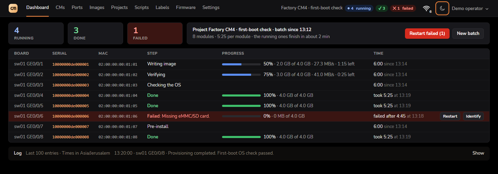</a> |

| Neutral · Light | Neutral · Dark |
| --- | --- |
| <a href="../../assets/readme/screenshots/neutral-light.png">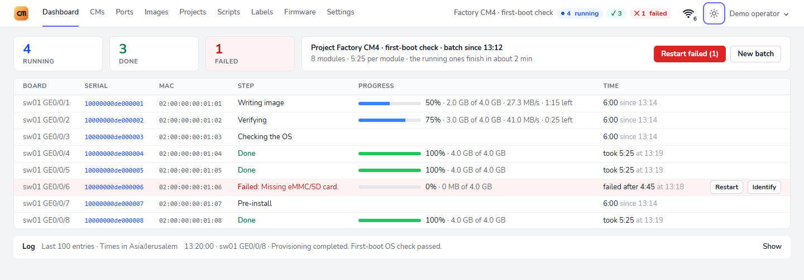</a> | <a href="../../assets/readme/screenshots/neutral-dark.png">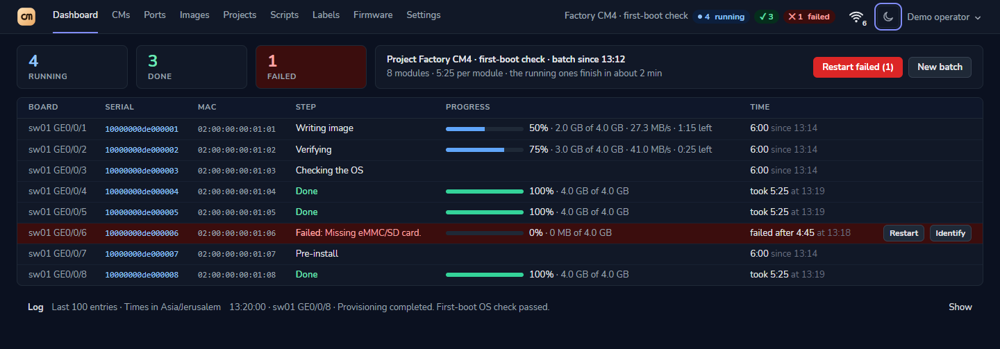</a> |

Режим **Auto** вычисляет время восхода и захода солнца для опорной локации часового пояса сервера. Если астрономические данные недоступны, тема следует системным настройкам операционной системы. На панели отображается активное в данный момент правило.

<a href="../../assets/readme/screenshots/appearance.png">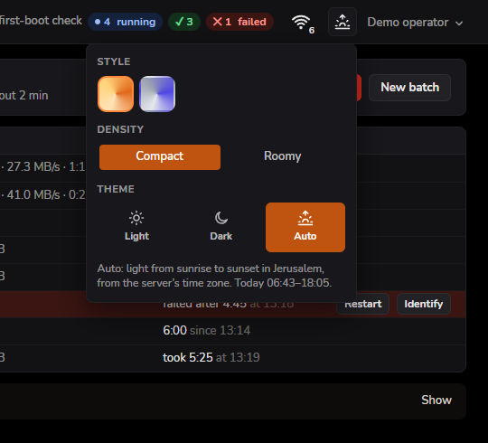</a>

## Плотность

Режим **Compact** вмещает больше данных на экране. Режим **Roomy** увеличивает отступы строк и элементов управления. Плотность не зависит от выбранного стиля и темы.

| Compact | Roomy |
| --- | --- |
| <a href="../../assets/readme/screenshots/density-compact.png">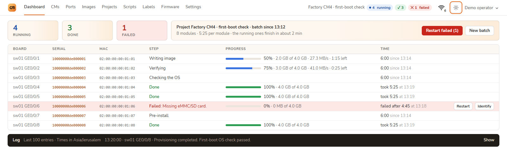</a> | <a href="../../assets/readme/screenshots/density-roomy.png">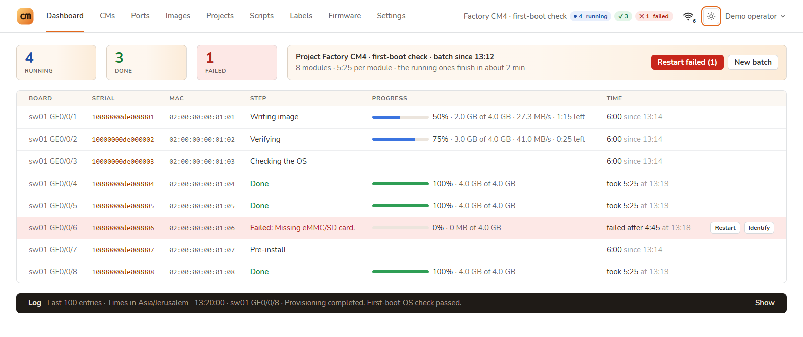</a> |

## Мобильное меню

На узких экранах мобильное меню обеспечивает быстрый доступ ко всем девяти основным вкладкам, параметрам профиля и настройкам оформления.

<a href="../../assets/readme/screenshots/mobile-menu.png">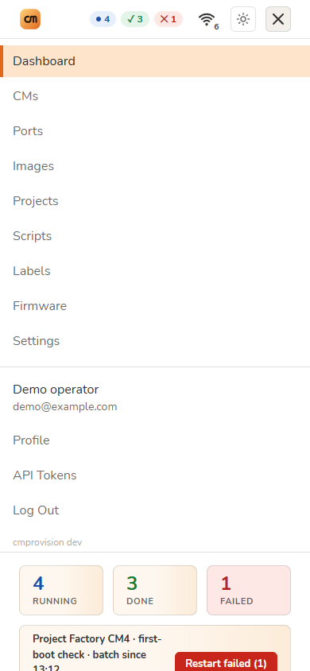</a>

## Учётная запись

Меню учётной записи открывает страницы **Profile** и **API Tokens**. Управляйте параметрами сессий и профиля в разделе Profile; создавайте токены для автоматизации в разделе API Tokens. Примеры обращений приведены в [руководстве по HTTP API](api.md).

Профиль

<a href="../../assets/readme/screenshots/profile.png">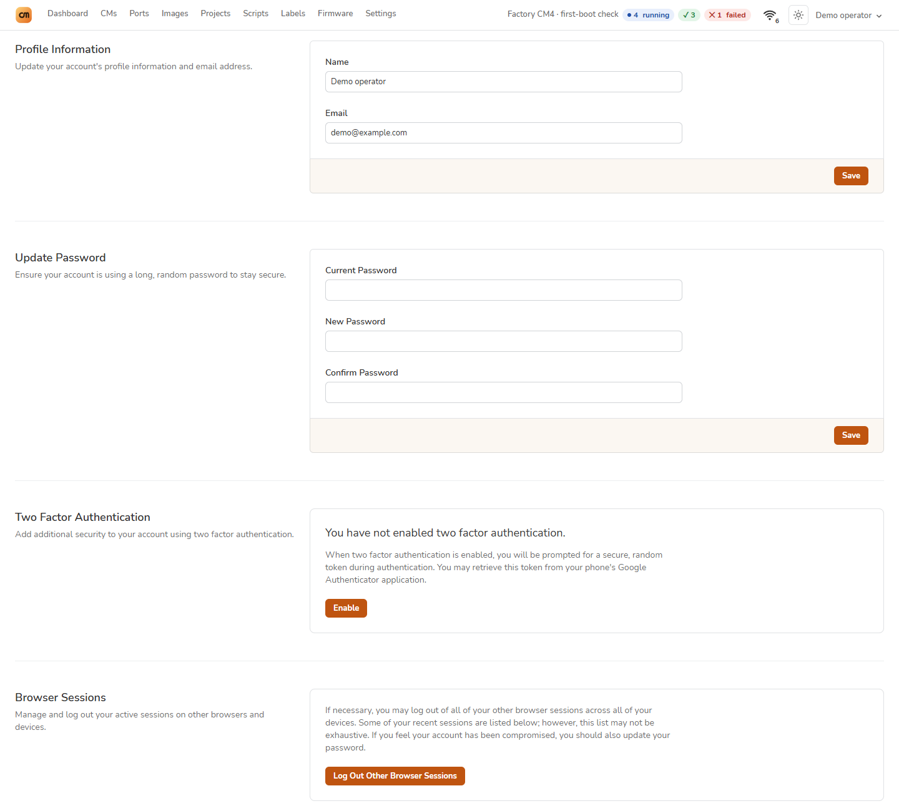</a>

API-токены

<a href="../../assets/readme/screenshots/api-tokens.png">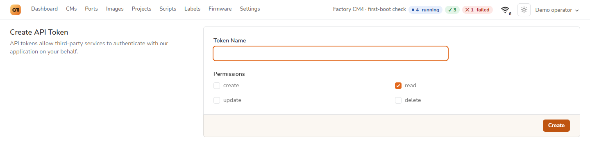</a>

[Настройка первого стенда](../../README.ru.md#быстрый-старт) · [Происхождение скриншотов](../../assets/readme/README.md)
