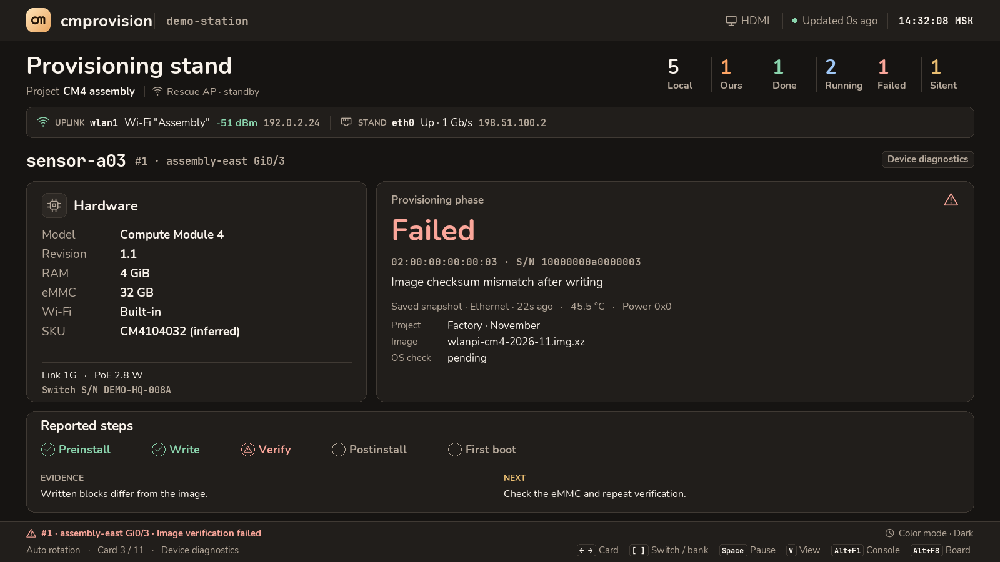
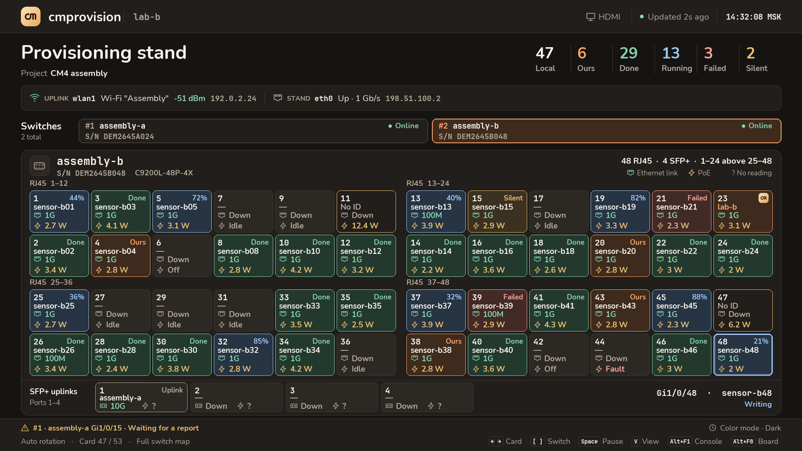
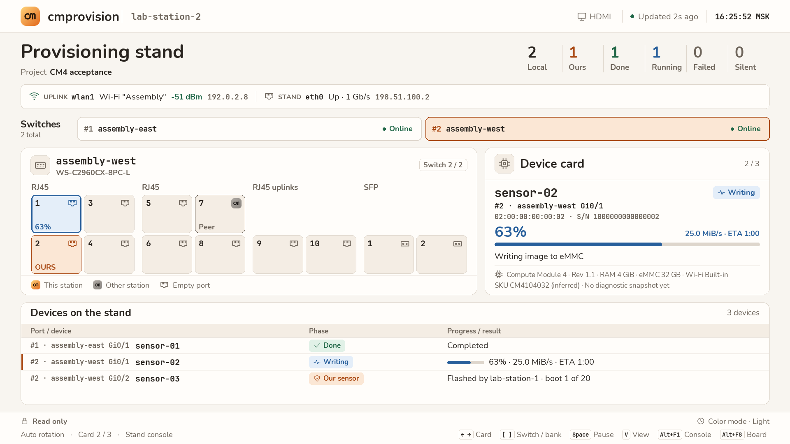

> **Language / Язык:** [English](../hdmi-display.md) | [Русский](hdmi-display.md)

# HDMI-дисплей стенда

Подключите монитор или телевизор к **провижинеру**, чтобы следить за работой стенда. Графическое табло показывает активный проект, передние панели коммутаторов, модули, ход записи и сохранённую диагностику. Оно выводит изображение прямо на активный HDMI-выход. Если графический вывод недоступен, служба показывает текстовое табло на tty8. Оба варианта работают автономно на консольной Raspberry Pi OS Lite.

Когда табло включено, запуск резервной точки Wi-Fi выводит на HDMI QR-код, SSID и пароль на 60 секунд. Отсчёт начинается в момент запуска точки и продолжается при обновлении страницы или перезапуске службы вывода. По истечении времени табло возвращается к обычному экрану. Карточка работает и без FPMS. На FPMS её можно закрыть кнопкой KEY2.

Если новая станция ожидает создания первого администратора, на подключённом экране появятся адрес настройки и код из 16 символов, даже в режиме **Off**. При открытой карточке резервной точки Wi-Fi код настройки появится после её закрытия. Откройте адрес в браузере из сети управления и введите код. После создания учётной записи этот шаг завершён. [Первый веб-администратор](station-setup.md)

Это отдельная возможность, не связанная с [консолью диагностики tty2](local-console.md) на самом прошиваемом модуле.

При включённом [резервном Wi-Fi](rescue-wifi.md) в шапке видны отсчёт поиска либо имя активной точки, адрес и число клиентов. В обычной строке статуса пароля нет; он доступен на временной карточке QR.

На каждом обычном экране видна полоса подключений. **UPLINK** — интерфейс маршрута по умолчанию: для Wi-Fi показаны SSID, сигнал в dBm и IPv4-адрес, для Ethernet — скорость линка и IPv4-адрес. **STAND** обозначает сеть прошивки, **BACKUP** — другой интерфейс с маршрутом по умолчанию, **LINK** — остальные подключённые интерфейсы. Например:

```text
UPLINK wlan1 / Wi-Fi "Lab 78" / -53 dBm / 192.0.2.4
STAND eth0 / UP 1 Gb/s / 172.20.0.1 | LINK eth1 / UP 100 Mb/s / 198.51.100.7
```

FPMS использует те же сетевые данные с общим кэшем на 30 секунд. Они доступны и при выключенной панели. Отсутствующий адрес помечается `no IP`, резервная точка Wi-Fi имеет отдельный статус. В текстовой консоли длинные строки прокручиваются в шапке, а при небольшой высоте экрана часть сведений переходит в нижнюю строку.

## Включение

1. Подключите выход HDMI провижинера к монитору и выберите нужный вход HDMI. Стандартное разрешение — Full HD; более высокие разрешения также поддерживаются. При необходимости локальной навигации подключите клавиатуру к провижинеру.
2. Откройте **Settings → System → HDMI display** в веб-интерфейсе.
3. Выберите режим **Auto**, настройте экраны и цвета, затем сохраните настройки. Отображение запустится через несколько секунд.
4. Нажмите **Alt+F1** для перехода в стандартную системную консоль и **Alt+F8** для возврата к экрану стенда. Доступ по SSH остаётся активным.

После первого сохранения режима Auto вход в систему или клавиатура не требуются: фоновый процесс-наблюдатель запускается при загрузке системы, определяет подключение HDMI и автоматически активирует вывод. Подключение HDMI-кабеля "на лету" также запускает отображение. Сохранённый режим сохраняется при перезагрузках и обновлениях пакетов.

Режим по умолчанию — **Off**. В режиме **Auto** статус HDMI-разъёма `connected` запускает табло. Отключение последнего кабеля HDMI останавливает вывод, а FPMS может продолжать пользоваться общей службой данных. **On** оставляет табло запущенным и при нестабильном определении кабеля. Для графики нужен подключённый HDMI-выход с активным видеорежимом. Настройки вступают в силу во время работы стенда.

Телевизор в режиме ожидания, KVM-переключатель или переходник HDMI могут удерживать статус `connected`. Детекция описывает физический разъём, а не факт просмотра экрана оператором. Используйте Off, если это различие важно.

### Одновременная работа HDMI и HyperPixel

Подключите монитор к HDMI, а прямоугольную панель HyperPixel 4.0 Touch — к разъёму GPIO. Включите **HDMI display** и **FPMS display** в **Settings → System**. На панели можно пользоваться сенсорным меню, пока на мониторе открыто табло стенда. Каждому экрану нужны свой активный канал вывода и свободная плоскость наложения. Если выходы зеркалируют друг друга или для HDMI нет подходящей плоскости, HDMI переходит на tty8. На станции `wlanpi-d62` с CM4 монитор HDMI работал в режиме 3440 × 1440 одновременно с HyperPixel 800 × 480 в альбомной ориентации. [Подключение HyperPixel](fpms-display.md#hyperpixel-40-touch)

### Выбор панели GPIO до первого запуска

Готовый образ ARM64 из релиза использует универсальный профиль `default`. При собственной сборке с `fpms-lite` задайте `CMP_IMAGE_DISPLAY=hyperpixel-4-touch` для прямоугольного HyperPixel или `waveshare-144` для Waveshare 1,44″. Оба профиля настраивают интерфейс GPIO и включают FPMS до первого запуска. Если для станции создан код первого администратора, панель может показать его во время настройки. [Параметры сборки образа станции](../../image/README.md#build-on-a-disposable-debian-host)

Профиль можно применить и к ещё не загружавшемуся образу с `fpms-lite`. На компьютере с Linux смонтируйте корневой раздел образа для записи в `/mnt/cmprovision-image`, а загрузочный — в `/mnt/cmprovision-image/boot/firmware`. Запустите скрипт из каталога исходников cmprovision той же версии.

```sh
sudo python3 image/fpms/prepare-display.py /mnt/cmprovision-image hyperpixel-4-touch
```

Для Waveshare укажите `waveshare-144` последним аргументом. До запуска станции размонтируйте сначала загрузочный раздел, затем корневой. Обновление приложения на работающей станции сохраняет её текущий загрузочный профиль. [Скрипт подготовки образа](../../image/fpms/prepare-display.py)

## Экраны и навигация

На графической карте короткие имена неподвижны. Длинное имя устройства плавно прокручивается внутри порта с паузой 1,5 секунды в начале и в конце. Если табло переключилось на другой коммутатор, прокрутка продолжится с того же места, когда порт снова появится. Номер порта, линк Ethernet, показание PoE и счётчик дополнительных устройств `+N` видны на протяжении всего цикла.

Выберите экран в настройках или нажмите **V** на клавиатуре станции.

- **Stand console** показывает переднюю панель коммутатора, выбранное устройство и список модулей стенда. На плитке порта видны подключённое устройство, линк Ethernet и питание PoE.
- **Full switch map** показывает сразу все 24 или 48 медных портов и четыре аплинка поддерживаемого Catalyst 9200L. Клавиши `[` и `]` переключают коммутаторы.
- **All device cards** показывает несколько модулей одновременно. На карточках видны имена хостов, физические порты, фазы и ход записи. Большая партия занимает несколько страниц.
- **Large device card and diagnostics** показывает характеристики модуля, проект и образ его прошивки, источник и давность диагностики, причину ошибки и следующий шаг. Стрелками также можно выбрать свой сенсор с другого стенда, сетевого соседа или порт с питанием без линка. На небольших картах скорость линка и PoE видны рядом с картой.
- **Automatic** обходит стенд и карты коммутаторов, затем на один интервал открывает подробную карточку. На следующем круге показывает другое устройство. При новой ошибке прошивки табло сразу открывает диагностику. Одновременные ошибки показывает по очереди. Клавиша **Пробел** удерживает текущий экран.



Карточки сменяются каждые 12 секунд по умолчанию. Интервал можно задать от 5 до 60 секунд. **←** и **→** выбирают устройство, **Пробел** ставит смену карточек на паузу и возобновляет её. Локальный выбор экрана действует до остановки табло. При следующем запуске используется вид из настроек.

### Полная карта коммутатора

В разделе **Settings → System → HDMI display** выберите **Full switch map** в поле **Screen** или переключитесь на этот экран клавишей **V** на клавиатуре станции. Имя в списке и **S/N** помогают найти нужный коммутатор в стойке. На полной карте клавиши `[` и `]` переключают коммутаторы. В **Stand console** они листают группы портов, а рядом остаётся карточка устройства.

- **24 медных порта** занимают две группы по двенадцать. Нечётные номера идут над чётными. Ниже четырёх аплинков SFP или SFP+ помещается таблица устройств.
- **48 медных портов** занимают четыре группы по двенадцать. В верхней половине идут порты 1–24, в нижней — 25–48. Ещё ниже, отдельным рядом, расположены четыре аплинка.



Полная карта использует проверенные схемы передней панели Cisco Catalyst C9200L-24P/24T и C9200L-48P/48T с четырьмя фиксированными аплинками. Оба размера помещаются на мониторах Full HD и сверхшироких HDMI-мониторах. Иллюстрация построена на синтетическом снимке коммутатора. Когда набор портов не совпадает с поддерживаемой схемой, открывается консоль стенда с постраничным просмотром. Она также используется при переходе в текстовый режим на tty8. [Поддерживаемые модели и расположение портов](switch-front-panels.md)

### Как найти порт на стенде с несколькими коммутаторами



Сверьте серийный номер на корпусе с **S/N** в списке коммутаторов или в заголовке открытой панели. Надпись `S/N unavailable` означает, что коммутатор ещё не сообщил номер. Если связь пропадает после успешного опроса, последний известный номер остаётся рядом с отметкой `Offline`. В примере Gi0/1 есть на обоих коммутаторах. На карточке `sensor-02` видно, где он подключён — `#2 · assembly-west Gi0/1`.

В списке выделен коммутатор, чьи порты открыты. Клавиша `[` листает страницы портов назад, а `]` — вперёд. Большой коммутатор может занимать несколько страниц. На карточке устройства остаются его коммутатор и порт. Выберите устройство стрелками, чтобы вернуться к его коммутатору. При автоматической смене карта следует за карточками, а затем показывает все страницы, включая коммутаторы без отвечающих портов.

### Как читать плитку порта

Под номером физического порта видно имя хоста модуля, имя станции или имя, которое сосед сообщил по LLDP/CDP. У устройства без имени может отображаться MAC-адрес. Когда на порту видно несколько известных модулей, плитка называет тот, чьё состояние показывает. `+N` после имени — количество остальных модулей. Надпись `No ID` означает, что станция видит признаки подключения, например линк или питание, а устройство пока неизвестно. Прочерк означает, что станция не обнаружила устройство на порту.

| Показание | Что означает |
| --- | --- |
| Ethernet | `1G` и `100M` — согласованная скорость в Гбит/с и Мбит/с. При `Up` линк поднят, скорость неизвестна. `Down` означает отсутствие линка, `?` — отсутствие показания. |
| PoE | Ватты показывают измеренную мощность. При `On` порт подаёт питание, мощность неизвестна. `Idle` означает ожидание устройства, которому нужно питание. При `Off` питание PoE отключено. `Fault` означает ошибку, `Test` — проверку. `?` означает, что показания PoE нет. |

Читайте эти строки независимо. На порту 1 коммутатора assembly-west у `sensor-02` гигабитный линк и потребление 3,2 Вт. Порт 3 подаёт 6,2 Вт при отсутствии линка. Порт 4 пуст, на нём видны `Down` и `Idle`.

На известных моделях карта повторяет физические группы портов со страницы Ports, в том числе чётные и нечётные ряды Cisco 2960CX и отдельные аплинки RJ45/SFP. На остальных моделях раскладка автоматическая. Порт самого провижинера отмечен оранжевым знаком `cm`, соседней станции — серым. Метка `Uplink` обозначает аплинк коммутатора, `UNR` — неопознанное устройство. [Передние панели коммутаторов](switch-front-panels.md) · [Диагностика обнаружения](unrecognized-devices.md)

### Текстовая консоль

Служба использует текстовое табло на tty8, если HDMI-выход неактивен, делит канал вывода с другим разъёмом или у него нет свободной плоскости для наложения изображения. На текстовой панели видны текущий и следующий коммутатор. Страницы портов, карточки, пауза и выбор экрана управляются теми же клавишами.

Под заголовком указан S/N текущего коммутатора, если номер известен. В рамке порта видны номер и состояние прошивки, подключённое устройство и отдельная строка показаний, например `Link Down  PoE 6.2 W`. Для старых снимков, в которых ещё не было серийного номера коммутатора и показаний портов, используется однострочный вид.

Консоль автоматически масштабирует шрифт под текущее разрешение экрана. При использовании встроенных шрифтов Terminus разрешение 1920×1080 использует ячейки 14×28 пикселей, 3440×1440 — ячейки 20×36 пикселей, а 3840×2160 — ячейки 28×56 пикселей. Это обеспечивает около 38–40 строк читаемого текста, предотвращая чрезмерное уменьшение элементов интерфейса на экранах высокого разрешения. Служба-наблюдатель подстраивает tty8 при изменении видеорежима, не переключая консоль, если оператор выбрал её вручную. Перезапуск служб провижининга не требуется. На старых ядрах, не поддерживающих высокие шрифты, происходит автоматический откат к поддерживаемому размеру. Текущий выбор сохраняется в `/run/cmprovision-wallboard/layout.json`; раздел Settings также показывает обнаруженное разрешение.

Макет использует доступную ширину с небольшими полями. На сверхшироких экранах помещается три карточки в строке, на стандартных Full HD и 4K — две. Компактная передняя панель коммутатора не разбивается на части, если помещается рядом с карточкой устройства. В шапке выводится компактная плашка `cm` с именем стенда по центру и текстовым названием проекта.

Модуль именуется по имени хоста, либо по MAC-адресу при отсутствии имени, как в таблице, так и в заголовке карточки устройства. Вторая строка карточки содержит MAC-адрес под именем хоста, либо серийный номер с префиксом `S/N` под MAC-адресом, исключая дублирование данных; при наличии имени хоста серийный номер выводится в четвёртой строке.

Таблица под передней панелью состоит из трёх колонок на всю ширину: **Port / device**, **Phase** и **Progress / result**, где отображаются процент, скорость и оставшееся время прошивки (`63% / 25.0 MiB/s / ETA 1:00`). Первая колонка подстраивается под самое длинное имя порта и устройства (до половины ширины экрана), остальное пространство занимает колонка результата. Длинный текст не обрезается: он задерживается в начале строки, плавно прокручивается со скоростью около трёх позиций в секунду, останавливается в конце и начинает цикл заново; символ `>` на краю колонки указывает на продолжение строки. Этот же принцип используется для имени устройства и порта в карточке, а также для строки ошибки внизу экрана. Отрисовка ускоряется только при активном движении; при помещающемся тексте частота обновления минимальна.

Сенсор, чья временная метка подтверждена общим ключом станции, помечается как `OURS` на порту и `OUR SENSOR` в таблице и карточках. Карточка отображает идентификатор станции и текущую подтверждённую загрузку. Такие сенсоры учитываются в отдельном счётчике `OURS`; показатели `LOCAL` и `DONE` продолжают отражать только прогоны текущей станции.

После списка модулей таблица отображает подключённые к коммутатору сторонние устройства, не являющиеся модулями стенда и не находящиеся в процессе загрузки: колонка фазы показывает `UNR` (неопознанное устройство) или `LNK` (линк поднят без передачи данных), имя берётся из анонсов LLDP или CDP с указанием системы, адреса и возможностей в колонке результата. Для молчащих устройств выводится производитель по базе MAC-адресов (префиксы Raspberry Pi встроены, остальные добавляет пакет `ieee-data`) с самим MAC-адресом. Все внешние строки фильтруются перед выводом. Карточки `flow` и инженерный вид `engineer` отображают скорость записи аналогично таблице: `63% / 25.0 MiB/s / ETA 1:00`. Модуль, выполняющий запись заметно дольше завершённых плат своей партии (2.19.0, [как это определяется](operations.md#a-module-that-takes-longer-than-the-rest)), получает пометку `/ SLOW +3:20` после времени окончания, а его строка подсвечивается цветом предупреждения.

### Цвета

Экран HDMI поддерживает независимые настройки стиля (**Style**, Warm или Neutral) и цветовой темы (**Color mode**, Dark, Light или Auto). В графическом режиме акценты оранжевые для Warm и цвета индиго для Neutral. Текстовая консоль берёт цвета из `resources/css/app.css`. Для неё в тёмном стиле Warm акцент — `#ff8a3d`, в Neutral — `#818cf8`. Цвета полупрозрачного текста смешиваются с фоном. Консоль задаёт эти цвета для восьми позиций палитры tty8 и сбрасывает палитру при остановке. При отсутствии программируемой палитры используются цвета ANSI. Режим Auto учитывает восход, закат и часовой пояс станции, а при отсутствии координат или во время полярного дня и ночи включает Dark. Настройки HDMI общие для станции. Каждый браузер хранит своё оформление. Старые значения Phosphor и Monochrome при чтении переводятся в Warm dark и Neutral dark.

## Значения показателей

Показатель ON STAND учитывает модули, обнаруженные в текущий момент на карте коммутатора. Завершённые записи отключённых модулей не завышают счётчик. Без настроенного управляемого коммутатора недавние запросы модулей отображаются с неопределённым портом. Новая плата, подключённая только по USB, может отображаться как **Unregistered module** отдельно от итогов прошивки.

Прогресс, скорость и расчётное время используют те же алгоритмы, что и веб-интерфейс. Замолчавшие модули помечаются как **NO REPORT**. Температура, напряжение и другие диагностические параметры являются **сохранёнными снимками данных**: их источник и возраст всегда указаны явно. Они не являются онлайн-показаниями датчиков в реальном времени. Если данные приложения не обновляются более 10 секунд, статусная строка заменяется предупреждением **DATA STALE**. При потере связи с коммутатором сохраняются последние известные порты с явным предупреждением.

Файлы образов, скрипты проектов, пароли учётных записей, SNMP-ключи и токены прогонов никогда не передаются на консоль. Локальный экран предназначен для доверенной зоны обслуживания: на нём отображаются имена устройств, MAC-адреса, серийные номера, названия проектов и подсказки по сбоям.

## Службы и устранение неисправностей

Три службы отвечают за вывод. `cmprovision-wallboard` работает от root, следит за HDMI-разъёмом и настройками, запускает и останавливает `cmprovision-wallboard-display`. Табло работает на tty8 от имени выделенного пользователя `cmprovision-wallboard` и использует свободную плоскость DRM/KMS на активном HDMI-выходе, когда она доступна. Служба `cmprovision-wallboard-data` собирает данные командой `wallboard:snapshot --watch --output=/run/cmprovision-wallboard-data/snapshot.json` от имени веб-пользователя. Карточки настройки станции и резервной точки Wi-Fi получают данные из отдельных локальных файлов.

Юнит сбора данных обновляет файл каждые две секунды и использует общий кэш SNMP веб-интерфейса: сохранённый снимок коммутатора используется до 15 секунд, а прямой опрос происходит только по истечении этого срока, поэтому при подключённом мониторе каждый коммутатор опрашивается не чаще одного раза в 15 секунд. Отсутствие монитора в режиме Auto останавливает отрисовщик HDMI; общий юнит данных также останавливается, если его не использует панель FPMS. Служба-наблюдатель продолжает ожидать следующее подключение.

Наблюдатель фиксирует изменение статуса разъёма только после двух одинаковых показаний подряд, исключая дребезг от кабеля или режима ожидания ТВ. Новое подключение переключает виртуальную консоль на tty8; перезапуск службы после сбоя или обновления пакета не перехватывает управление экраном, а упавший дисплей перезапускается трижды с интервалом в 10 секунд, затем раз в минуту.

Настройки хранятся в `/etc/default/cmprovision-wallboard.json` и входят в стандартную резервную копию. Переход в другую виртуальную консоль освобождает графическую плоскость HDMI. Если при остановке службы активна tty8, восстанавливается прежняя консоль. Текстовое табло использует шрифт Terminus, когда он доступен.

Образ станции включает пакет `python3-kms++` как с FPMS, так и без него. Сам пакет приложения требует `python3-pil` и `libdrm2` и рекомендует `python3-kms++`. Если в установленном Debian нет этого дополнительного пакета, табло работает в текстовой консоли. Установленные графические пакеты можно проверить командой `dpkg-query -W python3-pil libdrm2 python3-kms++`.

```sh
systemctl status cmprovision-wallboard cmprovision-wallboard-display cmprovision-wallboard-data
journalctl -u cmprovision-wallboard -u cmprovision-wallboard-display -u cmprovision-wallboard-data -n 50 --no-pager
cat /sys/class/drm/card*-HDMI-A-*/status
cat /sys/class/tty/tty0/active
sudo -u www-data /var/lib/cmprovision/artisan wallboard:snapshot
```

Если экран тёмный, проверьте выбранный вход телевизора, состояние HDMI-разъёма и сохранённый режим. Нажмите **Alt+F8**, чтобы вернуться к табло. Если открылась текстовая консоль, проверьте графические пакеты и журнал службы дисплея. В журнале ищите `HDMI graphical display active` или `HDMI text fallback`. Графическое табло использует текущий видеорежим HDMI. Полные отчёты диагностики и действия восстановления доступны в веб-интерфейсе.

Юнит дисплея намеренно не включается в системный автозапуск: его контролирует исключительно служба-наблюдатель. При удалении или откате пакета все три юнита останавливаются; процедура восстановления `cmprovision-restore` останавливает юнит данных перед заменой базы SQLite. Включение, отключение и смена настроек дисплея не требуют перезагрузки сервера.

Ссылки на используемые технологии: [настройки терминальных служб systemd](https://www.freedesktop.org/software/systemd/man/latest/systemd.exec.html), [Python curses](https://docs.python.org/3/library/curses.html), [интерфейс Linux DRM](https://docs.kernel.org/gpu/drm-uapi.html), [управление консолью Linux](https://man7.org/linux/man-pages/man4/console_codes.4.html), [утилита setfont](https://kbd-project.org/manpages/man8/setfont.8.html), [геометрия фреймбуфера](https://docs.kernel.org/fb/api.html).
