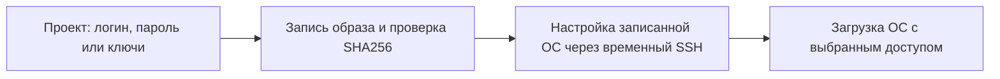
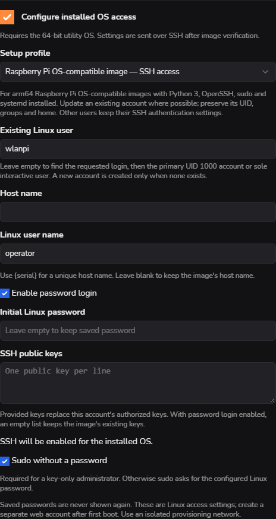

> **Language / Язык:** [English](../image-access.md) | [Русский](image-access.md)

# Задать SSH-логин установленной ОС из проекта

[Эксплуатация](operations.md) · [Настройка образа станции](station-project-setup.md) · [Перенос конфигурации](configuration-transfer.md)

Откройте **Projects → Add / Edit → Configure installed OS access** и выберите **Raspberry Pi OS-compatible image — SSH access**. Профиль доступен и в **Create with wizard**. Устанавливать агент cmprovision в исходный образ не требуется.

Общий файл образа остаётся неизменным. Каждая плата получает параметры проекта после успешной проверки записанного образа, до остальных post-install скриптов и первой загрузки.

## Настройка доступа

1. Выберите образ ОС, накопитель `/dev/mmcblk0` и **Verify that image was written correctly**.
2. Включите **Configure installed OS access** и выберите профиль Raspberry Pi OS-compatible.
3. Задайте желаемый **Linux user name**. Оставьте **Existing Linux user** пустым для автоматического выбора либо укажите точную учётку для изменения или переименования.
4. Задайте пароль Linux, публичные SSH-ключи или оба варианта. Пустой пароль при редактировании сохраняет ранее заданный. При включённом входе по паролю пустой список ключей сохраняет ключи образа; введённые ключи заменяют authorized_keys выбранной учётки.
5. Отдельно выберите **Sudo without a password**. Для входа только по ключу он обязателен. Иначе sudo запрашивает заданный пароль Linux. Профиль включает SSH; настройки аутентификации меняются только у выбранной учётки.
6. Оставьте **Host name** пустым для сохранения имени из образа либо задайте своё, при необходимости с `{serial}`. Сохраните с подтверждением паролем веб-учётки.

*Демонстрационные данные. Нажмите на снимок для увеличения. Учётные данные Linux и веб-учётка cmprovision независимы.*

## Какая учётка меняется?

| Что есть в образе | Результат |
| --- | --- |
| Желаемый логин уже существует | Обновляется эта учётка. |
| Явно указан исходный пользователь | Учётка обновляется или переименовывается; занятое другой учёткой имя отклоняется. |
| Желаемого логина нет | Сначала выбирается основная учётка UID 1000, затем единственная интерактивная. |
| Есть несколько кандидатов | Нужно задать **Existing Linux user**; случайный выбор не выполняется. |
| Обычных учёток нет | Создаётся администратор. Заблокированный шаблон первого пользователя `pi` в чистом Pi OS используется повторно. |

Переименование сохраняет UID, основной GID, дополнительные группы, владельцев файлов и **существующий домашний каталог**. Например, новый `operator` может сохранить `/home/wlanpi`. Службы или задания cron, привязанные к старому логину, могут заблокировать переименование: сохранить логин и сменить его пароль можно.

## Совместимость образа

Первый вариант требует **arm64**-систему Raspberry Pi OS/Debian, **64-битную утилитарную ОС** и ext4-корень на втором разделе `/dev/mmcblkN`. В образе должны уже быть Python 3, `useradd`, `usermod`, `chpasswd`, sudo/visudo, сервер и ключевые утилиты OpenSSH, systemd и группа `sudo`. Недостающие пакеты во время прошивки не скачиваются.

Принудительные SSH-команды, MFA, ограничения входа по группам и конфликтующие правила отдельного пользователя могут помешать настроить доступ. Поддерживаются только `Match User` и `Match all`, включая рекурсивные Include; условия по соединению и группам, циклы Include и неподдерживаемое экранирование отклоняются до изменения учёток. Включённые экземпляры служб со старым логином в имени тоже блокируют переименование, в том числе при экранировании имени; числовые UID в имени и изменение учётки без переименования поддерживаются. В таких случаях прогон завершается понятной ошибкой совместимости, а не успехом с неработающим логином. Аутентификация остальных пользователей сохраняется.

Отдельный профиль **cmprovision station image — access and Wi-Fi** сохраняет прежнюю схему 1, настройку Wi-Fi управления и проверки первого запуска станции. Для нового провижинера выбирайте его. Профиль только SSH не настраивает Wi-Fi, роль станции или веб-учётки.

## Скрипты и ошибки

SSH-chroot не поддерживается: итоговое значение `ChrootDirectory` должно быть `none`. Иное значение отклоняется до изменения учётки или её данных для входа.

Встроенная настройка выполняется post-install помощником через временный ограниченный SSH. Снимок параметров шифруется на провижинере; пароль и его хеш не попадают в публичные скрипты модуля и HTTP-ответы. Пользовательские скрипты продолжают работать в своих [фазах](creation-wizards.md#скрипты); следующий скрипт может намеренно изменить те же настройки ОС.

| Результат post-install | Что делать |
| --- | --- |
| Найдено несколько учёток | Задать **Existing Linux user**. |
| Служба или задание зависит от старого логина | Сохранить логин либо подготовить образ к переименованию. |
| Правила SSH не позволяют запрошенный вход | Проверить ограничения доступа в образе. |
| Нет нужных инструментов, не подходят пути или разделы | Взять совместимый образ либо заранее подготовить зависимости. |

Прерванная настройка не считается успехом. Повтор принимает тот же снимок текущего прогона; для других параметров нужна новая проверенная запись образа. Проект с этим профилем можно [перенести на другую станцию](configuration-transfer.md), включив защиту паролем при передаче учётных данных.

## Статус проверки

Помощник проверен на одноразовых копиях настоящего arm64 Raspberry Pi OS под QEMU: первый пользователь, смена пароля существующей учётки, вход по ключу с sudo, сохранение UID/GID/домашнего каталога/групп, настоящие OpenSSH и sudo, отказы при опасном переименовании и конфликте правил. На полном образе WLAN Pi OS 26.10 также прошли сценарии смены пароля существующего `wlanpi` и доступа только по ключу. Полный шаг новой настройки в аппаратном прогоне ещё требует приёмки; прежний аппаратный тест профиля станции её не заменяет.
