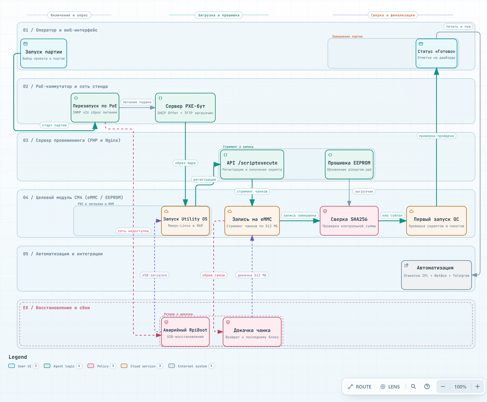

> **Language / Язык:** [English](../operations.md) | [Русский](operations.md)

# Эксплуатация провижинера

[Назад к README](../../README.ru.md) · [Обновление и восстановление](upgrading.md) · [Светодиоды](leds.md) · [Прошивка через USB](usb-provisioning.md) · [Локальная консоль](local-console.md)

Подробное описание параметров проектов и элементов управления стендом. Начните с [руководства по установке](../../README.ru.md#быстрый-старт), если это новый сервер.

Для CM4, не способного перейти в штатную сетевую загрузку, используйте [прошивку по USB](usb-provisioning.md).
Для прямой диагностики на экране и клавиатуре модуля используйте [консоль tty2](local-console.md).
В [руководстве по WLAN Pi M4+](hardware/wlanpi-m4-plus.md) описаны разъёмы и режимы USB обоих устройств.

- [Сквозной процесс провижининга](#сквозной-процесс-провижининга)
- [Порядок в списках](#порядок-в-списках)
- [Модуль, который шьётся дольше остальных](#модуль-который-шьётся-дольше-остальных)
- [Экспорт для NetBox](#экспорт-для-netbox)
- [Как именуется модуль](#как-именуется-модуль)
- [Страница Settings](#страница-settings)
- [Проверка ОС при первой загрузке](#проверка-ос-при-первой-загрузке)
- [Образы из интернета](#образы-из-интернета)
- [Докачка образа и восстановление записи](#докачка-образа-и-восстановление-записи)
- [Повторный провижининг установленного сенсора](#повторный-провижининг-установленного-сенсора)
- [Настройка новой станции из проекта](station-project-setup.md)
- [Встроенный Wi-Fi как холодный запасной](#встроенный-wi-fi-как-холодный-запасной)
- [Сети Wi-Fi](#сети-wi-fi)
- [Дополнительные tagged VLAN](#дополнительные-tagged-vlan)
- [Коммутаторы и перезапуск по PoE](#коммутаторы-и-перезапуск-по-poe)
- [Доступ к сети](#доступ-к-сети)

<a id="provisioning-workflow"></a>
## Сквозной процесс провижининга

<a href="../diagrams/provisioning-flow.ru.html" title="Открыть интерактивную схему Archify"></a>

*Сквозной жизненный цикл партии: от включения питания и сетевой загрузки по PXE до записи на eMMC, проверки первого запуска и интеграций. [Открыть автономную интерактивную схему](../diagrams/provisioning-flow.ru.html) с панорамированием, зумом, светлой/тёмной темой и анимацией переходов.*

<a id="the-order-of-the-lists"></a>
## Порядок в списках

Таблица на **Dashboard** и список на странице **CMs** выводят активные в данный момент модули первыми, затем модули по дате и времени прошивки, самые свежие сверху (модуль со сбоем остаётся на времени сбоя; для событий не сегодняшнего дня выводятся число и месяц). Нажатие на заголовок колонки сортирует по ней: первый клик сортирует от А до Я (либо от новейшего и наибольшего для времени или прогресса); второй клик меняет направление на обратное; третий клик возвращает сортировку по времени. Строки с пустыми значениями в колонке (модуль без привязки к плате, без имени хоста) всегда выводятся в конце, а при совпадении значений сохраняется хронологический порядок. Параметр сортировки сохраняется в URL (`/dashboard?sort=time&dir=asc`, `/cms?sort=hostname`), не сбрасывается при перезагрузке страницы и передаётся по ссылке; экспорт CSV из CMs следует порядку на экране.

Аналогичный клик сортирует списки **Images** (имя файла, размер), **Projects** (имя, образ), **Scripts** (имя, тип, числовой приоритет), **Labels** (имя, тип, хост принтера) и **USB diagnostics** (MAC, серийный номер, время получения, контекст из 50 последних отчётов). Без явной сортировки каждый список отображается в стандартном порядке по имени, а USB-отчёты — от новых к старым.

<a id="a-module-that-takes-longer-than-the-rest"></a>
## Модуль, который шьётся дольше остальных

Партия модулей на одном проекте и одном образе занимает примерно одинаковое время на каждый модуль. Модуль, существенно превышающий это время, обычно имеет проблему: медленный накопитель, повреждённый патч-корд или проседающую скорость сети. Dashboard предупреждает об этом до возникновения ошибки.

**Типичное время** — это медиана времени прогонов завершённых модулей партии (плата, на которой только обновлялся bootloader по USB, прогоном не считается). Пока не завершились хотя бы три модуля, сравнивать не с чем, и отметка не выводится. Активно работающий модуль, продолжающий слать отчёты, помечается бейджем **Slow +m:ss** (отставание от типичного времени), если он выполняется дольше полутора типичных времён **и** дольше чем на две минуты сверх него: в быстрой партии (1 минута на модуль) модуль не помечается из-за лишних 30 секунд, а в 15-минутной партии — из-за лишней минуты. Флаг пересчитывается при каждом обновлении страницы: он снимается, когда модуль завершает работу или когда завершение других плат увеличивает медиану партии. Плитка партии подсчитывает такие модули (`2 slower than the rest`); подсказка чипа **Slow** сообщает типичное время завершённых плат. Замолчавший модуль получает собственный флаг (**No report**) и здесь не учитывается; медленный модуль не считается сбойным, и верхняя плашка со статусом не окрашивается в красный цвет. На HDMI-дисплее к результату модуля добавляется `/ SLOW +3:20`, а строка подсвечивается цветом предупреждения.

Медиана устойчива к единичному модулю, прошивавшемуся целый час; при этом она вычисляется по первым завершившимся модулям, которые обычно быстрее остальных, поэтому плата, слегка уступающая лидерам, может кратковременно получить флаг в начале партии и догнать остальных позже. Именно для этого предусмотрены двухминутный запас и коэффициент 1.5; флаг, исчезнувший сам по себе, не является дефектом.

<a id="export-for-netbox"></a>
## Экспорт для NetBox

Прошитые модули можно импортировать в NetBox как устройства. Пункт **CMs → Export for NetBox** формирует CSV-файлы для массового импорта NetBox (Devices → Import); они включают модули из текущего списка на экране (с учётом выбранного проекта, поиска и порядка), которые **успешно завершили прошивку**: работающие, сбойные модули и модули только с обновлением USB-загрузчика исключаются. Импортируйте файлы в следующем порядке:

1. **Devices**: `name, role, manufacturer, device_type, status, site, serial, comments`. Имя берётся из имени хоста системы модуля, если оно состоит из допустимых символов (буквы, цифры, `.`, `_`, `-`) и уникально в пределах файла; иначе подставляется `cm-` и MAC-адрес без двоеточий. Серийный номер берётся из параметров модуля; в поле комментариев указывается факт прошивки через cmprovision, имя проекта и время (UTC).
2. **Interfaces**: `device, name, type`: создаётся интерфейс `eth0` типа `1000base-t` для каждого устройства.
3. **MAC addresses** (для NetBox 4.2 и новее): `mac_address, device, interface, is_primary`: MAC-адрес порта Ethernet модуля назначается основным адресом интерфейса. В версиях до NetBox 4.2 поле `mac_address` входило непосредственно в таблицу интерфейсов; опция в настройках переносит MAC туда, исключая необходимость в третьем файле.

Параметры site, role, manufacturer, device type и другие задаются в **Settings → Provisioning → NetBox export** (значения по умолчанию: `Default`, `Sensor`, `Raspberry Pi`, `Compute Module 4`, статус `active`, интерфейс `eth0`, `1000base-t`). Они должны быть заранее заведены в NetBox до импорта, иначе система отклонит неизвестные типы или площадки. Файлы формируются исключительно из данных модулей; прямого сетевого взаимодействия с NetBox нет, токены или адреса внешних систем здесь не хранятся.

<a id="how-a-module-is-named"></a>
## Как именуется модуль

Модуль идентифицируется по **MAC-адресу** (встроенного порта Ethernet, закреплённого за модулем независимо от несущей платы) и, после запуска установленной системы, по её **имени хоста (hostname)**. Все страницы веб-интерфейса, экран HDMI и оповещения в чаты выводят имя хоста (при наличии), а рядом — MAC-адрес; если имя хоста отсутствует, выводится MAC-адрес. **Серийный номер** платы остаётся дополнительным параметром: колонка Serial в списке CMs, строка в карточке модуля, поле `S/N` на карточке HDMI, поле `serial` в JSON вебхуков. В шаблонах этикеток поддерживаются плейсхолдеры `$mac`, `$serial` и `$hostname`.

По MAC-адресу ведётся **основной учёт модуля**: он уникален в таблице модулей, URL карточки имеет вид `/cms/<MAC>` (например, `/cms/e4:5f:01:62:9f:d3`; ссылки старого формата `/cms/<serial>` прозрачно перенаправляются на ту же карточку), а в логах и событиях PoE фигурирует MAC-адрес. Плата, подключённая с новым MAC-адресом (например, с внешним сетевым адаптером), но со знакомым серверу серийным номером, сохраняет свою запись и историю с соответствующей отметкой в журнале. Модуль, не передавший MAC-адрес, получает локально сгенерированный MAC (`02:…`) на основе своего серийного номера. В последующих служебных запросах модуль продолжает передавать свой серийный номер, поэтому протокол со стороны утилитарной ОС не меняется.

<a id="the-settings-page"></a>
## Страница Settings

Раздел Settings состоит из четырёх вкладок, каждая с собственным URL (`/settings?tab=network`):

| Вкладка | Содержимое |
| --- | --- |
| **Status** | Службы сервера (dnsmasq, rpiboot, приёмник USB-диагностики, оба воркера очереди, холодный резерв Wi-Fi, веб-сервер) со статусами (работает/остановлена) и кнопками **View log**, а также активная утилитарная ОС. **Backup**: скачивание архива с данными сервера для внешнего хранения с повторным запросом пароля ([что входит и как восстановить](upgrading.md#a-copy-to-keep-away-from-this-server)). |
| **Network** | Сети Wi-Fi, Ethernet-коммутаторы, статические аренды DHCP. |
| **Provisioning** | Утилитарная ОС, Re-provision (ключ провижинера и учётные записи сенсоров), дисплей HDMI. |
| **Notifications** | Каналы уведомлений и текущая партия. |

На всех вкладках, кроме Status, верхняя статусная строка в реальном времени отображает состояние служб («N из 7 работают») и выпадающее меню **Logs** для перехода к журналам. Строка обновляется каждые 30 секунд, позволяя сразу заметить остановку воркера. Каждый блок содержит краткое описание, кнопки действий справа и подробное раскрывающееся руководство **How it works**. Данные запрашиваются только для активной вкладки (параметры Wi-Fi и коммутаторов опрашиваются только на вкладке Network).

Прежние якорные ссылки (`/settings#wifi`, `#reprovision-key`, `#utility-os`, `#hdmi-display`) продолжают работать, автоматически открывая нужную вкладку.

<a id="first-boot-os-check"></a>
## Проверка ОС при первой загрузке

Проект с включённой опцией **Check the OS after the first boot** не завершается сразу после записи образа. Модуль перезагружается в установленную систему прямо на стенде, где отрабатывает однократная служба проверки:

1. После выполнения post-install скриптов утилитарная ОС монтирует записанный корневой раздел (второй раздел образа, ext4) и внедряет службу `cmprovision-firstboot` вместе со скриптами и пакетами первого запуска.
2. Модуль перезагружается. Его загрузчик должен проверять eMMC до сети (`BOOT_ORDER`, например `0xf21`); иначе плата снова уйдёт в сетевую загрузку, и прогон завершится ошибкой «the new system did not start».
3. Новая система получает IP-адрес по DHCP от стенда и дожидается окончания системной загрузки (до 5 минут). Затем она устанавливает пакеты проекта одной командой `apt-get` и запускает first-boot скрипты (до 2 минут на каждый); ненулевой код возврата завершает проверку ошибкой.
4. Служба отправляет на сервер имя хоста, статус systemd и список упавших юнитов. Служба удаляет собственный unit-файл, ссылку автозапуска, скрипты и пакеты; лог сохраняется в `/var/log/cmprovision-firstboot.log` (доступен только root) с текстом скриптов первого запуска.
5. Только после этого прогон считается завершённым. Этикетка может напечатать `$hostname` (событие печати «After the OS check»), и рассылаются уведомления. Если отчёт не поступил за 15 минут, прогон считается сбойным.
6. Модуль остаётся включённым и индицирует итог светодиодами: ACT и PWR плавно загораются и гаснут синхронно при успехе, либо выдают сигнал ошибки при сбое. Начиная с 2.6.4, система также опрашивает сервер каждые 5 секунд на предмет команды **Identify**. Identify запускает быстрое мигание на 30 секунд; нажатие **Stop**, истечение времени или сетевой сбой возвращают исходный результат проверки. Во время мигания опрос учащается до 2 секунд.

Режим Identify после проверки ОС действует **до следующей перезагрузки**. Только бинарный помощник светодиодов сохраняется в закрытом временном каталоге `/run`; постоянные службы или SSH-доступ не создаются, скрипты и пакеты повторно при перезагрузке не запускаются. Карточка модуля и дашборд предлагают кнопку Identify только при свежих опросах (не старше 2 минут). Старые скрипты первой загрузки не поддерживают опрос: обновление одного сервера не добавляет этот функционал ранее прошитым системам; перешейте модуль на обновлённом сервере.

- **First-boot скрипты** представляют собой отдельный тип скриптов (Scripts → first boot): они выполняются от имени root в целевой системе с установленной переменной `$SERVER`.
- **Пакеты** (Scripts → Packages) — это файлы `.deb`, загруженные на сервер. В сети стенда нет выхода в интернет, поэтому apt ничего не скачивает: все зависимости должны присутствовать в образе или быть загружены на сервер, иначе отсутствие зависимости приведёт к ошибке. Рекомендуемые пакеты (recommends) не ставятся. Архитектура пакета должна соответствовать образу (`arm64` для 64-битного, `armhf` для 32-битного) либо быть `all`.
- Любой клиент с доступом к веб-серверу провижинера может скачать файлы из `/uploads`, включая образы: не помещайте секреты в пакеты.
- Установленная система требует наличия systemd и curl. Модули, загруженные по USB (rpiboot), не проверяются: перезагрузка вернёт их в USB-boot.

<a id="re-provision-an-installed-sensor"></a>
## Повторный провижининг установленного сенсора

Используйте **CMs → модуль → Re-provision…**, когда на сенсоре работает установленная ОС и требуется записать новый образ. Текущая реализация поддерживает eMMC/SD, таблицу разделов MBR и корень ext4 на втором разделе. На сенсоре должен быть запущен SSH; загрузчик должен иметь откат к сетевой загрузке при повреждении загрузочных секторов диска. Модуль, находящийся в утилитарной ОС, можно просто перезагрузить по PoE.

1. Выберите активный проект и откройте карточку модуля. Модуль должен иметь активную аренду DHCP в сети стенда, не выполнять запись образа и не находиться на этапе OS check.
2. Нажмите **Check access**. Провижинер пробует подключиться по своему ограниченному SSH-ключу, затем по включённым учётным записям из **Settings → Provisioning → Re-provision (sensor accounts)** в заданном порядке. Если доступ не получен, введите логин и пароль вручную (пользователь должен иметь права sudo). Если учётная запись требует смены пароля при первом входе, введите и подтвердите новый пароль. Сервер проверит новый пароль перед продолжением.
3. Проверьте совпадение серийного номера, IP-адреса, накопителя, CID и следующего проекта. Нажмите **Wipe and re-provision** и подтвердите действие. Команда затирает первый мегабайт диска и отправляет систему в перезагрузку (это не полное безопасное стирание всего накопителя).
4. Карточка ожидает возврата модуля в сетевую загрузку, после чего стандартный прогон провижининга начинается с нуля. При обрыве SSH без подтверждения команда автоматически не повторяется. Дождитесь перезагрузки или повторите проверку доступа через 30 секунд.

Для автоматического доступа по ключу при будущих прошивках включите **Re-provision from the web UI** в редакторе проекта. После сверки образа и post-install скриптов провижинер добавляет свой публичный ключ и агент `/usr/local/sbin/cmprovision-agent` в записанный корень. Ключ использует принудительную команду (forced command) и не предоставляет шелл или проброс портов. Опция по умолчанию выключена и не меняет общую политику входа по SSH в образе. Ошибка внедрения агента не прерывает прошивку и логируется как `agent skipped`.

Вкладка **Settings → Provisioning → Re-provision (provisioner key)** отображает публичный ключ. Приватный ключ хранится в `storage/app/ssh/id_ed25519`; резервные копии и `restore --data-only` сохраняют его. Защищайте бэкапы как серверные учетные данные.

Проверка доступа действует две минуты и привязана к сессии оператора. Пароли хранятся в зашифрованном виде на сервере в течение этого времени и удаляются при закрытии диалога или отправке команды. SSH host key запоминается на время операции; подмена устройства между шагами блокируется.

При изменении активного проекта или его настроек ранее выданное подтверждение аннулируется. Вернувшийся после очистки модуль ожидает подтверждения вместо записи неожиданного образа. Подтвердите проект кнопкой **Confirm current project for next boot** в карточке модуля, затем перезапустите его по PoE, если он ждёт в утилитарной ОС.

<a id="saved-sensor-accounts"></a>
### Сохранённые учётные записи сенсоров

В **Settings → Provisioning → Re-provision (sensor accounts)** можно добавлять, редактировать, включать, отключать, удалять и менять порядок учётных записей. По умолчанию включён профиль `wlanpi / wlanpi` для [WLAN Pi](https://userguide.wlanpi.com/wlan-pi-os/faq/default-password). Профиль `pi / raspberry` отключён по умолчанию для совместимости со старыми образами Raspberry Pi OS; [современные образы требуют настройки пользователя при установке](https://www.raspberrypi.com/news/raspberry-pi-bullseye-update-april-2022/).

Изменения требуют ввода пароля учётной записи веб-интерфейса. Пароли шифруются с помощью APP_KEY провижинера и никогда не отдаются обратно в браузер. Пустой пароль при редактировании сохраняет прежнее значение. Бэкапы сохраняют список вместе с APP_KEY. Смена истёкшего пароля одного сенсора не меняет общий сохранённый профиль.

Поддерживается до 10 профилей (до 3 активных для автопроверки). Включённые профили проверяются по порядку; одинаковые логины не дублируются; побеждает первый подошедший аккаунт с правами sudo. Автопопытки выполняются только при первом нажатии **Check access**, не чаще раза в минуту на модуль; ручной ввод доступен всегда. Изменение SSH host key, сетевой сбой или несовпадение оборудования останавливают перебор. Подбор пароля сам по себе ничего не стирает: требуется явное подтверждение очистки.

<a id="the-provisioners-mark-over-lldp"></a>
### Метка провижинера через LLDP

**Предварительный просмотр (2.23.0).** Устройство, прошитое на другом стенде, является чужим для провижинера, который его не прошивал: каждый провижинер знает только модули из своей базы данных. Благодаря метке устройство при первых загрузках сообщает коммутатору, какой провижинер его прошил, а любой провижинер с тем же ключом меток проверяет это на странице **Ports**.

1. Сгенерируйте ключ меток на одном провижинере и скопируйте его на остальные (от имени веб-пользователя; ключ шифруется APP_KEY и включается в резервные копии):

   ```sh
   sudo -u www-data php /var/lib/cmprovision/artisan sensor:mark-key --generate
   ssh first 'sudo -u www-data php /var/lib/cmprovision/artisan sensor:mark-key --show' \
     | ssh second 'sudo -u www-data php /var/lib/cmprovision/artisan sensor:mark-key --from=-'
   ```

   Команда `sensor:mark-key` без параметров выводит отпечаток ключа (fingerprint).
2. В редакторе проекта включите **Re-provision from the web UI** и задайте параметр **Mark the device over LLDP for the first boots** (до 100 загрузок; 0 — без метки).
3. Установщик агента добавляет службу `cmprovision-mark` в систему. При каждой загрузке служба передаёт демону `lldpd` описание порта `cmprovision mark <provisioner> <boot>/<boots> <code>`: код представляет собой HMAC текста с собственным ключом устройства, меняясь при каждой загрузке. Загрузка после последней удаляет метку, ключ и службу, перезапуская `lldpd` в чистом виде. Система требует наличия `lldpd` (есть в WLAN Pi OS) и `openssl`.
4. На странице **Ports** устройство с подтверждённой меткой и единственным MAC-адресом на порту отображается как **OURS / Our sensor**. В деталях указывается *Flashed by cmprovision on <provisioner>* и номер загрузки. Устройство не добавляется в локальную базу модулей и не увеличивает счётчик выполненных прогонов. Непроверенная или несовпавшая метка остаётся нераспознанной; порт с несколькими устройствами не помечается как наш сенсор.

Ключ устройства является HMAC его MAC-адреса с ключом меток: устройство хранит только собственный ключ, никогда не зная мастер-ключ меток. Провижинер без мастер-ключа отображает метку как непроверенный текст соседа.

<a id="images-from-the-internet"></a>
## Образы из интернета

Кнопка **Add from the internet** на странице Images позволяет серверу скачать образ самостоятельно без выгрузки через браузер. Поддерживаются три источника:

- **GitHub release.** Укажите `owner/name` (например, `WLAN-Pi/pi-gen`); выводятся релизы и файлы образов (пре-релизы по запросу). Использованные репозитории сохраняются в отдельном списке.
- **Raspberry Pi OS.** Официальный список релизов Raspberry Pi (64 и 32 бита, Lite и Full, legacy).
- **Прямая ссылка.** HTTPS-адрес файла `.gz`, `.xz`, `.bz2` или `.zip`, а также опциональная контрольная сумма (64 hex-символа или ссылка на файл `.sha256` / `SHA256SUMS`).

Как происходит скачивание:

- Образ появляется в списке с индикатором прогресса, скоростью и оставшимся временем. При обрыве связи выполняются повторные попытки через 5, 15, 30, 60 и далее каждые 120 секунд; докачка продолжается с последнего байта, в том числе после перезапуска воркера. Двенадцать сбоев подряд (около 15 минут без связи) переводят загрузку в ошибку; кнопка **Retry** возобновляет докачку с диска. **Delete** отменяет скачивание и удаляет временные файлы.
- Скачивание выполняется минутными интервалами в очереди контрольных сумм, не блокируя подсчёт сумм других файлов.
- Образ нельзя выбрать в проекте, пока он не скачан **и не проверен**. Загруженные вручную файлы готовы к использованию сразу после загрузки.
- Проверка: соответствие скачанного файла опубликованному хэшу (GitHub digest, файл `.sha256` рядом, хэш релиза или введённый вручную), а для Raspberry Pi OS — также проверка распакованного образа. Несовпавший или повреждённый файл удаляется. Образ без контрольной суммы принимается только при включении опции **Add without a checksum**.
- Файлы `.zip` переупаковываются на сервере в `.img.gz` «на лету» без промежуточного распакованного файла на диске (модуль поддерживает только gz, xz и bz2). Исходный архив удаляется после проверки нового файла. Архив должен содержать ровно один файл `.img`. На CM4 операция занимает несколько минут для 6 ГБ образа.
- Принимаются только публичные HTTPS-адреса. Частные и локальные сети (включая стендовую `172.20.0.0/16`), цифровые IP-хосты и адреса с логином/паролем отклоняются (включая перенаправления).
- Лимит GitHub API без токена составляет 60 запросов в час: ответы кэшируются на 5 минут; при исчерпании лимита интерфейс указывает время ожидания.
- Функция требует 64-битного PHP.

Диск провижинера невелик (29 ГБ на M4+), и страница Images показывает остаток свободного места. Перед загрузкой проверяется наличие свободного места под файл с запасом в 2 ГиБ (с учётом параллельных загрузок и перепаковки zip). Кнопка **Delete unused images** удаляет образы, не привязанные к проектам и не используемые в активных прошивках.

<a id="image-download-and-write-recovery"></a>
## Докачка образа и восстановление записи

Обрыв соединения больше не приводит к падению прошивки. Модуль скачивает, распаковывает и записывает образ в едином потоке; при обрыве сети curl возобновляет докачку с последнего байта, пока декомпрессор и `dd` продолжают работу. Ошибки сервера 5xx и потеря связи повторяются каждые 5 секунд; через 10 минут без единого байта запись завершается ошибкой (а ошибки 404 прерывают запись немедленно).

Таблица разделов (первый мегабайт) затирается перед записью и записывается последней. Модуль, потерявший питание во время записи (включая перезапуск по PoE), не находит таблицы разделов на eMMC и снова загружается по сети, не пытаясь запустить повреждённую ОС.

Опция проекта **Split the image into 512 MB pieces** расширяет защиту: модуль, перезапущенный во время записи или после сбоя, продолжает прошивку с последнего проверенного блока, скачивая только недостающие данные.

- Сервер создаёт нарезанную на куски gzip-копию образа в фоновом режиме после сохранения проекта (~5 минут для 6 ГБ образа на CM4). До готовности кусков запись идёт с исходного файла, а перезапуск начинает запись с начала.
- Блок считается записанным после сброса на диск через `fsync` и успешной сверки хэша декомпрессором. Обязательно включите **Verify that image was written correctly** для проверки всего образа.
- Карточка модуля показывает позицию продолжения; кнопка **Start over** сбрасывает прогресс и запускает запись с начала.
- Модуль, чей накопитель был перезаписан на другом оборудовании, не продолжает старую запись: прошивка начинается с первого сектора.

<a id="built-in-wi-fi-as-a-cold-spare"></a>
## Встроенный Wi-Fi как холодный запасной

Провижинер с дополнительной Wi-Fi-картой (M.2 или USB) удерживает встроенный адаптер отключённым: пока внешняя карта несёт маршрут по умолчанию, встроенный Wi-Fi не подключён. Если основной маршрут отсутствует в течение 30 секунд (карта извлечена, упал драйвер, пропала сеть), встроенный Wi-Fi автоматически подключается. Когда внешняя карта восстанавливает маршрут по умолчанию и удерживает его 1 минуту, встроенный адаптер снова отключается. Отключается только само устройство, профили NetworkManager не меняются: после перезагрузки поднимаются оба адаптера, а встроенный отключается через минуту.

- IP-адрес провижинера меняется вместе с активным адаптером; служба `<hostname>.local` (avahi) следует за ним.
- Переключения логируются в системный журнал: `journalctl -t cmprovision-uplink` или Settings → Status.
- Параметр `SPARE=no` в `/etc/default/cmprovision-uplink` оставляет встроенный Wi-Fi постоянно подключённым.
- Работает только там, где NetworkManager управляет Wi-Fi (Raspberry Pi OS). На WLAN Pi OS функция не поддерживается.

<a id="wi-fi-networks"></a>
## Сети Wi-Fi

В **Settings → Network → Wi-Fi networks** перечислены сети подключения провижинера в порядке приоритета. Каждая запись представляет собой один профиль NetworkManager, обслуживающий оба адаптера: внешняя карта передаёт трафик, а встроенный адаптер находится в холодном резерве.

- **Add network** принимает SSID (кнопка **Find networks** сканирует эфир), тип защиты (WPA2-Personal, WPA2/WPA3 mixed или WPA3-Personal), пароль и флаг скрытой сети. Любое изменение требует ввода пароля учётной записи.
- Пароль хранится на сервере и повторно в браузере не отображается. Новый пароль для текущей сети применяется при следующем переподключении.
- **Check now** тестирует сеть на простаивающем встроенном адаптере без обрыва связи на основной карте: статус подключения, неверный пароль, сеть не найдена, адрес не получен.
- Порядок (кнопки ↑ ↓) определяет приоритет при подключении; провижинер не разрывает работающее соединение ради более приоритетной сети. Активная сеть не может быть удалена. Журнал изменений доступен через `journalctl -t cmprovision-wifi`.
- Недоступно на WLAN Pi OS.

<a id="additional-tagged-vlans"></a>
## Дополнительные tagged VLAN

На станции с NetworkManager вкладка **Settings → Network → Tagged VLANs** отображает существующие тегированные интерфейсы (включая настроенные вне cmprovision). Порт коммутатора может передавать эти тегированные сети параллельно с нетегированной сетью физического порта.

Для добавления статической сети IPv4 выберите **Add VLAN**, укажите физический интерфейс (например, `eth0`), VLAN ID и адрес станции с префиксом (например, `192.168.50.10/24`), подтвердив действие паролем. Оставьте адрес пустым для создания L2-VLAN без IPv4. Настройте аналогичный VLAN как tagged на порту коммутатора. Подсеть не должна пересекаться с другими сетями или сетью стенда `172.20.0.0/16`. Новый VLAN не создаёт шлюза по умолчанию и не меняет существующие маршруты.

Перед удалением VLAN используйте **Ethernet and VLAN profiles → Disconnect** с подтверждением. Профили, несущие сеть провижининга, удалить нельзя.

<a id="saved-ethernet-and-vlan-connections"></a>
### Сохранённые подключения Ethernet и VLAN

Кнопка **New Ethernet profile** создаёт отключённый профиль, привязанный к физическому интерфейсу, без включения автоподключения. Кнопка **Edit** настраивает IP-параметры до подключения.

Кнопка **Connect** активирует сохранённый профиль. **Apply and connect temporarily** применяет настройки и активирует его одновременно. Оба действия временно заменяют текущий профиль. После подтверждения новый профиль переводится в автоподключение, а у предыдущего автоподключение снимается. Действие **Disconnect** аналогично требует подтверждения по таймеру. Отмена или таймаут (2 минуты) восстанавливают исходные профили и активное соединение.

<a id="addresses-routes-and-the-provisioning-network"></a>
### Адреса, маршруты и сеть провижининга

Вкладка Settings → Network выводит активные подключения Ethernet и VLAN. Поддерживаются статические адреса и DHCP, DNS, шлюзы по умолчанию, статические маршруты и policy routing для IPv4 и IPv6.

Каждый маршрут задаётся одной строкой: префикс назначения, опциональный шлюз и метрика, затем атрибуты. Поддерживаются как формат `203.0.113.0/24 via 192.0.2.1 metric 25`, так и формат NetworkManager `203.0.113.0/24 192.0.2.1 25`. Доступные атрибуты: `table`, `mtu`, `src`, `onlink` и `type` (`unicast`, `blackhole`, `unreachable`, `prohibit`, `throw`):

```text
203.0.113.0/24 via 192.0.2.1 metric 25 table=100 mtu=1400
198.51.100.0/24 type=blackhole table=100
```

Поле **Routing table** задаёт таблицу маршрутизации по умолчанию (`0` — системная). Для изолированного аплинка укажите отдельную таблицу (например, `100`) и добавьте правило: `priority 100 from 192.0.2.0/24 table 100`. Правила задаются построчно с числовыми приоритетами и номерами таблиц. Поддерживаются селекторы `from`, `to`, `fwmark` (с `/mask`), `iif` и `oif`. Маршруты и правила, перенаправляющие трафик провижининга через другой интерфейс, блокируются с автоматическим откатом.

Опция **Ignore automatic routes** сохраняет адреса по DHCP, игнорируя маршруты от DHCP-сервера. Домены поиска DNS также настраиваются; префикс `~corp.example` задаёт routing-only домен, а `~.` перехватывает все запросы (требуется поддержка split-DNS в системном резолвере).

Изменения сетевых настроек требуют ввода пароля и действуют временно. Сервер автоматически откатывает их через две минуты, если вы не подтвердите их применение. Выполняйте сетевые переключения только при отсутствии активных прошивок.

Сеть провижининга можно перенести между активными подключениями Ethernet и VLAN на одном физическом порту. Форма **Configure station role** настраивает роль станции:

- **Primary** назначает адрес `172.20.0.1/16`, привязывает и запускает службы DHCP/TFTP на выбранном интерфейсе, опционально включая загрузку по USB.
- **Secondary** назначает адрес `172.20.0.2/16` и маскирует локальные службы DHCP/TFTP и загрузки по USB. Используется для второй станции в том же сегменте стенда.
- **Disabled** удаляет адрес стенда и маскирует обе службы.

При изменении роли выполняется ARP-проверка на занятость адреса в сегменте. Изменение роли временно и откатывается через 2 минуты без подтверждения оператора.

<a id="switches-and-poe-restart"></a>
## Коммутаторы и перезапуск по PoE

В **Settings → Network → Ethernet switches** перечислены коммутаторы стенда; кнопка **Add switch** запрашивает IP-адрес и SNMP-доступ на чтение (community для v2c, пользователь для v3). Благодаря этому модуль получает привязку к коммутатору и порту в виде `sw01 Gi0/3`, а страница Ports отрисовывает переднюю панель каждого коммутатора. Порт, ведущий к другому коммутатору стенда, помечается как линк (отображается MAC-адрес соседнего коммутатора). Добавление одного коммутатора под двумя адресами блокируется.

Поддерживаемые модели используют точное расположение и номера портов передней панели. Остальные модели используют автоматический порядок. Справочник панелей: [Передние панели коммутаторов](switch-front-panels.md).

Доступ на запись опционален и используется исключительно для перезапуска модулей по PoE: write community для v2c или отдельный пользователь для v3. Кнопка **Check write access** безопасно проверяет запись, считывая и перезаписывая текущее значение порта. При наличии прав на запись карточка модуля, страница Ports и дашборд получают кнопку **Restart**: коммутатор отключает PoE на порту на 5 секунд и включает снова. Кнопка доступна только на портах с модулями cmprovision (или загружающимися Raspberry Pi) и блокируется во время записи bootloader EEPROM. Порт, не включившийся обратно, помечается кнопкой **Power on**.

Устройства, анонсирующие себя по LLDP или CDP (коммутаторы, точки доступа, телефоны, WLAN Pi OS), подробно описываются в блоке **Says about itself**. См. [что устройство сообщает о себе](unrecognized-devices.md#что-устройство-сообщает-о-себе-lldp-и-cdp).

<a id="network-access"></a>
## Доступ к сети

Сеть стенда должна быть физически или логически (VLAN) изолирована на коммутаторе. Не объединяйте сеть провижининга в мост с общей корпоративной сетью.

Эндпоинт `/scriptexecute` не требует пароля: он принимает запросы исключительно из подсети `172.20.0.0/16` и от самого сервера. Запросы из других сетей получают HTTP 403. Подключайте nginx напрямую к клиентам; не используйте reverse proxy перед этим эндпоинтом и не настраивайте директивы nginx `set_real_ip_from` / `real_ip_header`.

Файлы в директории `/uploads` (включая образы ОС и пакеты) доступны любому пользователю с сетевым доступом к веб-серверу провижинера. Не помещайте конфиденциальные данные в эти файлы.

<a id="unrecognized-devices"></a>
## Неопознанные устройства

Статус **Unrecognized** / **UNR** на странице Ports означает, что MAC-адрес порта пока не сопоставлен с известным модулем. Новый модуль регистрируется автоматически, когда его утилитарная ОС запрашивает скрипт провижининга. Окно начальной загрузки составляет 180 секунд для распознанных MAC-адресов Raspberry Pi с известным временем линка. Статус UNR сам по себе не означает аппаратный дефект платы. Следуйте [руководству по диагностике обнаружения](unrecognized-devices.md) для проверки коммутатора, DHCP, передачи загрузочных файлов и вывода консоли.

<a id="module-diagnostics"></a>
## Диагностика модуля

Раздел карточки модуля **Module diagnostics** содержит данные о накопителе, питании и температуре, объёме RAM, интерфейсе Ethernet и параметрах загрузчика. В нём выводятся измерения, сообщения ядра и советы по устранению неполадок, а также доступен повторный сбор снимка данных. Подробнее см. [Диагностика модуля](module-diagnostics.md).
