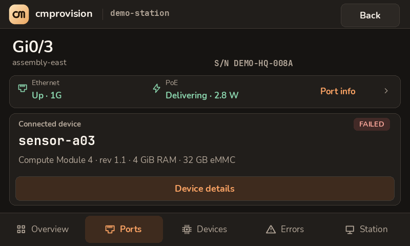
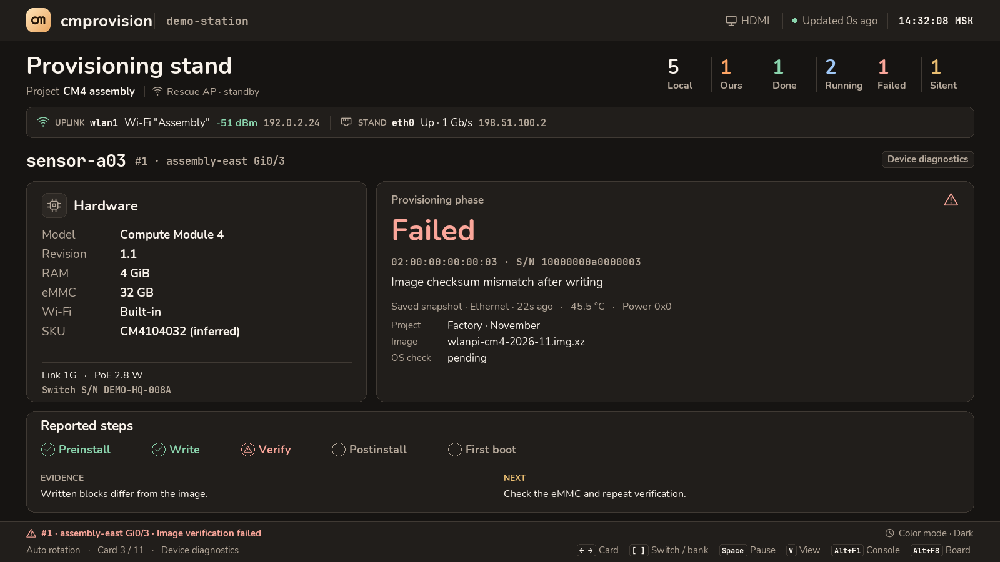

# 2.30.10 — От порта коммутатора к устройству 🔎

## HyperPixel

Откройте порт во вкладке **Ports**, чтобы увидеть скорость Ethernet и питание PoE. В **Port info** доступны серийный номер коммутатора, разъём, изученные MAC-адреса и данные соседей, полученные по LLDP/CDP. В **Device details** можно посмотреть характеристики модуля, проект и образ конкретной прошивки, а также последний отчёт диагностики. Если за портом несколько модулей, выберите нужный по имени. Длинные имена прокручиваются в ячейках карты. [Управление на HyperPixel](https://github.com/nimbo78/cmprovision/blob/v2.30.10/docs/ru/fpms-display.md#как-посмотреть-порт-и-устройство)

## HDMI

В режиме **Automatic** после каждого обхода карт коммутаторов табло показывает следующее устройство. При новом сбое открывается диагностика соответствующего модуля. В режиме **Large device card and diagnostics** стрелками можно выбрать устройство или порт, на котором есть PoE, но ещё не поднялся Ethernet. Длинные имена прокручиваются и на графической карте HDMI. [Режимы табло и клавиши](https://github.com/nimbo78/cmprovision/blob/v2.30.10/docs/ru/hdmi-display.md#экраны-и-навигация)

Для обновления действующей станции откройте **Settings → Updates → Application**. Если на станции установлен `fpms-lite`, обновлятор подберёт пакет той же версии. [Руководство по обновлению](https://github.com/nimbo78/cmprovision/blob/v2.30.10/docs/ru/upgrading.md)
