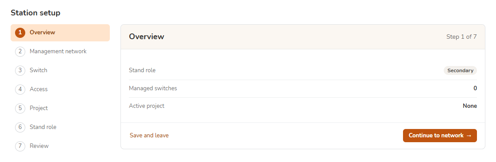

# 2.30.4 — Журнал обновлений и мастер станции 🧙📦

Этот патч объединяет журнал обновлений, мастер настройки станции и исправления CI. Автоматический выпуск публикуется только после проверок, сборки production-пакетов, ARM64-образа станции и проверки подписанных данных обновления.

## Обновления в одном журнале

Settings → Updates объединяет выбранный компонент, доступный выпуск, следующее действие, текущий этап и историю операций. Проверки приложения и Utility OS остаются независимыми. Сохранены подтверждение пароля, возврат назад и обработка восстановления/переподключения. [Инструкция по обновлению](https://github.com/nimbo78/cmprovision/blob/v2.30.4/docs/ru/upgrading.md).

## Пошаговая настройка станции

Откройте **Settings → System → Open setup wizard**. Семь шагов охватывают сеть управления, коммутатор, доступ станции/сенсоров, проект, роль стенда и реальную готовность. Новая ненастроенная станция также предлагает настройку на Dashboard.

Мастер использует существующие формы и подтверждение/откат сети. Открытые редакторы, несохранённые поля и ожидающее подтверждение сети блокируют переход. Черновики web и SSH независимы. Next и Complete setup не применяют конфигурацию, не активируют проект и не запускают службы загрузки. Основной станции нужен подготовленный проект; вторичной или выключенной он необязателен. Итоговая проверка читает настоящие интерфейсы, службы, состояние образа/хешей и подготовленной EEPROM.

## Доступ к станции через web и SSH

Шаг Access и Settings → System позволяют обновить текущий web-профиль/пароль, пароль существующего Linux-администратора и добавить публичные SSH-ключи. Для SSH нужен одноразовый код из действующей sudo/консольной сессии после просмотра конкретной заявки. Веб-помощник выдавать себе код не может. Текущие ключи и политики SSH/sudo сохраняются.

Первый web-пользователь по-прежнему создаётся консольной командой `auth:create-user`. Форма не создаёт и не переименовывает Linux-пользователей, не выдаёт sudo и не меняет общие правила SSH. Явно применённые учётные данные сохраняются в ОС независимо от отката приложения. [Инструкция по настройке](https://github.com/nimbo78/cmprovision/blob/v2.30.4/docs/ru/station-setup.md).

## CI и проверки

Изменения только экранов больше не запускают полную сборку Utility OS; изменения загрузки, диагностики и самой ОС сохраняют обязательные проверки. Проверка восстановления Debian ждёт освобождения настоящего замка рабочего процесса перед следующим сценарием. Защита рабочего обновлятора не менялась.

- Итоговый локальный прогон Linux: **2407 PHP-тестов / 9491 проверка**, три существующих предупреждения и 27 пропусков по окружению; **102 JS-теста**, **15 тестов контроллера доступа**, **2 теста настоящего flock**.
- PR мастера прошёл CI приложения и FPMS/HDMI, включая настоящие операции shadow/OpenSSH/ключей/sudo в одноразовом контейнере, установку, автоматический откат и полное восстановление Debian. Замечания независимого ревью исправлены и проверены повторно.
- Production-пакеты разработки установлены **d62 → da2**. Браузер подтвердил ожидаемые роли: вторичная с выключенной загрузкой и основная с работающей; `stage1-test` на da2 готов. Хеши конфигурации и роли служб сохранились. Временные учётки и файлы установки удалены; на каждой станции оставлен один проверенный снимок. Действующие Linux-учётки ради проверки не менялись.
- Мастер проверен на компьютере и телефоне в Light/Dark/Auto, включая защиту черновиков и переход после подтверждения/отката сети. Ранее журнал обновлений прошёл 120 сочетаний состояния, ширины и оформления.

Готовый образ станции остаётся экспериментальным. Холодный запуск именно этого опубликованного образа, физический обрыв питания при обновлении и полное восстановление зашифрованной копии на железе остаются отдельной приёмкой. Поддержка HyperPixel в выпуск не входит.
