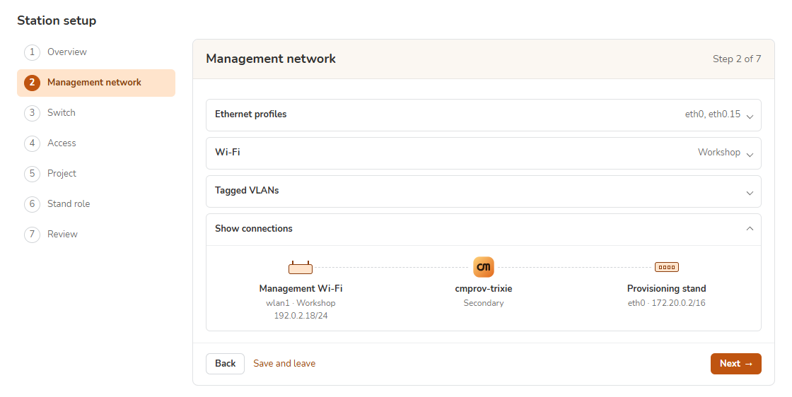

# 2.30.5 — Первый вход через браузер 🗝️

На новой станции откройте адрес управления, введите код из 16 символов с HDMI или FPMS и создайте первого веб-администратора. После входа сразу откроется мастер настройки. При обновлении и восстановлении станции сохраняется обычный вход. [Первый вход и восстановление доступа](https://github.com/nimbo78/cmprovision/blob/v2.30.5/docs/ru/station-setup.md)

## Станция без экрана

При прошивке образа станции 2.30.5 через cmprovision включите в проекте **First web administrator in browser**. После доставки настроек откройте карточку прошитой станции и нажмите **Open setup code**. Подтверждение пароля вернёт вас к коду этой станции. Исходный провижинер хранит свою копию 12 часов с начала прогона. На самой станции код действует до первого использования или замены. [Настройка станции через проект](https://github.com/nimbo78/cmprovision/blob/v2.30.5/docs/ru/station-project-setup.md)

## Компактный мастер

Все семь шагов доступны на телефоне. На шагах настройки сети и роли стенда видны подключение к сети управления и интерфейс прошивки. Для веб-учётки, SSH-доступа к станции и учёток сенсоров теперь отдельные формы. **Save and leave** позволяет вернуться к текущему шагу. После **Complete setup** карточка мастера исчезает из настроек у всех пользователей. Повторно проверить настройки можно по адресу `/settings/setup`.

## Проверка и установка

На физическом CM4 все четыре группы кода в программном кадре FPMS 128 × 128 совпали с карточкой на исходном провижинере. После создания учётки в браузере открылся мастер. На настольной и мобильной ширине проверены выход с сохранением шага и завершение настройки.

Для обновления действующего провижинера откройте **Settings → Updates → Application**. Для новой станции используйте образ Lite для ARM64 из файлов выпуска. Если пакет ставится в подготовленную файловую систему Debian без `/proc`, каждая станция сгенерирует свой код при первой загрузке. На железе первый запуск проверен на предварительной сборке образа. [Инструкция по обновлению](https://github.com/nimbo78/cmprovision/blob/v2.30.5/docs/ru/upgrading.md)
