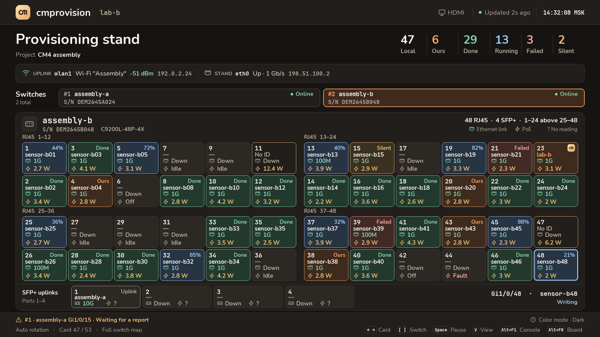

# 2.30.9 — Весь коммутатор на HDMI 🖥️

## Как найти устройство по порту

В **Settings → System → HDMI display** задайте **Auto** в поле **HDMI activation**, а в поле **Screen** выберите **Full switch map**. На работающем табло экраны переключаются клавишей **V**. У поддерживаемого Cisco Catalyst 9200L в один кадр помещаются все 24 или 48 медных портов и четыре аплинка SFP или SFP+. Для 24 портов ниже остаётся таблица устройств. Для 48 портов верхнюю половину занимают порты 1–24, нижнюю — 25–48. Клавиши `[` и `]` переключают коммутаторы. **S/N** можно сверить с номером на корпусе.

На плитке порта видны имя устройства, состояние или скорость Ethernet, а также состояние PoE или мощность в ваттах. Например, `Down` и `6.2 W` означают, что порт подаёт 6,2 Вт при отсутствии линка. В **Stand console** рядом со страницей портов остаётся карточка выбранного устройства. **Automatic** включает полную карту для поддерживаемых коммутаторов и открывает диагностику, если выбранный модуль завершился ошибкой или перестал отвечать. Графическое табло работает на Raspberry Pi OS Lite. Когда графический вывод на HDMI недоступен, включается текстовая консоль tty8. [Управление HDMI и показания портов](https://github.com/nimbo78/cmprovision/blob/v2.30.9/docs/ru/hdmi-display.md#полная-карта-коммутатора)

## Первый запуск и два экрана

Готовый образ ARM64 из релиза использует универсальный профиль `default`. Чтобы включить панель GPIO с первого запуска, выберите `hyperpixel-4-touch` или `waveshare-144` при собственной сборке с `fpms-lite` либо примените профиль к смонтированному образу с этим пакетом до первой загрузки. Если для станции создан код первого администратора, панель может показать его во время настройки. [Выбор экрана до первого запуска](https://github.com/nimbo78/cmprovision/blob/v2.30.9/docs/ru/hdmi-display.md#выбор-панели-gpio-до-первого-запуска)

Прямоугольный HyperPixel 4.0 Touch и графическое HDMI-табло могут работать одновременно на отдельных каналах вывода. На станции `wlanpi-d62` с CM4 монитор HDMI обновлялся в режиме 3440 × 1440, а FPMS продолжал работу на панели 800 × 480 в альбомной ориентации. За 26,1 с наблюдения кадровый буфер HDMI сменился, отметка активности FPMS отставала не более чем на 3,1 с, обе службы работали без перезапусков. На стенде проверяли промежуточную сборку до добавления полной карты. Штатный отрисовщик построил карты на 24 и 48 портов по синтетическим данным в двух разрешениях — 1920 × 1080 и 3440 × 1440. [Подключение HyperPixel](https://github.com/nimbo78/cmprovision/blob/v2.30.9/docs/ru/fpms-display.md#hyperpixel-40-touch)

На работающей станции откройте **Settings → Updates → Application**. Обновлятор сохраняет действующий загрузочный профиль экрана. Если `fpms-lite` уже установлен, обновлятор включит в установку подходящую версию пакета. [Инструкция по обновлению](https://github.com/nimbo78/cmprovision/blob/v2.30.9/docs/ru/upgrading.md)
