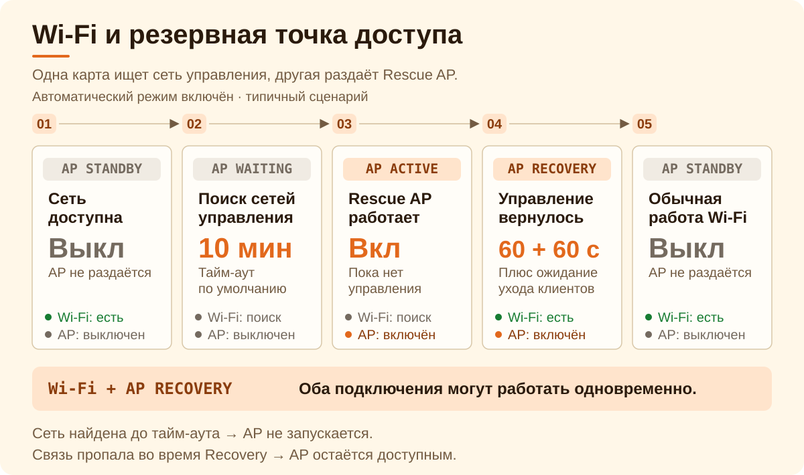
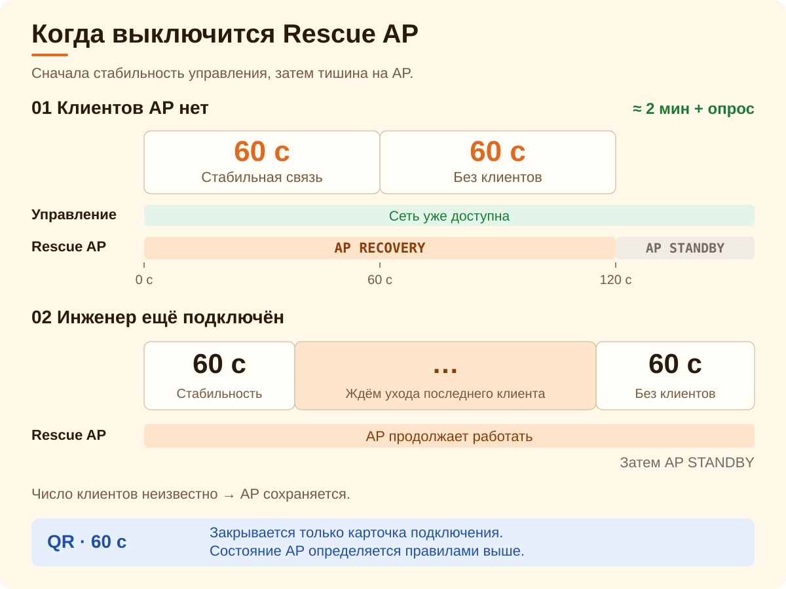
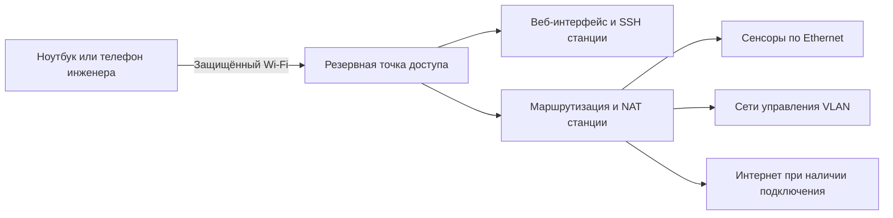

> **Language / Язык:** [English](../rescue-wifi.md) | [Русский](rescue-wifi.md)

# Резервная точка доступа Wi-Fi

Опциональная защищённая точка доступа позволяет инженеру попасть на станцию, когда сохранённые сети управления недоступны. По умолчанию функция выключена. Основная карта продолжает искать сохранённые сети, а отдельная карта обслуживает точку доступа.

## Цикл Wi-Fi и Rescue AP



> [!NOTE]
> **AP STANDBY** означает, что автоматика включена, но точка не раздаёт сеть. **AP RECOVERY** — управление уже вернулось, а точка ещё работает. Обычное подключение Wi-Fi и AP RECOVERY одновременно — ожидаемая ситуация: они используют разные радиокарты.

## Настройте заранее

1. Откройте **Settings → Network → Rescue Wi-Fi access point**.
2. Включите автоматическую точку доступа. По умолчанию поиск сетей управления длится **10 минут**; допустимо от 1 до 30 минут.
3. Оставьте автоматический выбор встроенной карты для точки доступа и внешней карты для подключения к сетям либо выберите их постоянные MAC-адреса в **Radio and network options**. Нужны два независимых радиомодуля. Ради запуска точки доступа работающее клиентское подключение не разрывается.
4. Оставьте автоматическую частную подсеть `/24` либо выберите свою без пересечений с маршрутами и сохранёнными статическими сетями. Доступны каналы 1, 6 и 11 в диапазоне 2,4 ГГц; региональные настройки системы сохраняются.
5. При необходимости отметьте проводные профили и VLAN управления. Рабочий адрес на выбранном профиле тоже предотвращает автоматический запуск точки доступа. Интерфейс прошивки сетью управления не считается.
6. Сохраните настройки, подтвердив пароль веб-учётки. Откройте **Connection details** и сохраните сгенерированные имя сети и пароль. Показ и копирование пароля выполняются отдельными кнопками; в обычных статусах и снимках экранов пароля нет.

> [!IMPORTANT]
> DHCP прошивки должен быть заранее привязан к интерфейсу стенда. Если карточка сообщает об отсутствии привязки, настройте её на вкладке сети в свободное от прошивки время. Запуск точки доступа не перезапускает DHCP стенда и не меняет его Ethernet и VLAN.

## Автоматическая работа



1. Управление вернулось: точка продолжает работать, ждём **60 секунд стабильной связи**.
2. После этого ждём, пока **отключатся все клиенты**, затем отсчитываем **ещё 60 секунд**.
3. Точка выключается, статус меняется на **AP STANDBY**. Если клиентов не было всё это время, это занимает около **2 минут** плюс время опроса и переключения радиокарты.

> [!IMPORTANT]
> Интервалы идут **последовательно**. Новый клиент сбрасывает отсчёт времени без клиентов. Если управление опять пропало, ожидание восстановления начинается заново, а точка остаётся доступной. При неизвестном числе клиентов точка не выключается.

Это **автоматический** цикл. **Start now** запрашивает минимум 15 минут работы AP. Управлением считается рабочий адрес на Wi-Fi либо выбранном проводном профиле или VLAN; интернет не обязателен. Интерфейс прошивки не учитывается.

<details>
<summary>Все правила автоматики</summary>

| Ситуация | Поведение |
|---|---|
| Сети управления исчезли | Продолжается обычный поиск; если запасная карта включена, через 30 секунд пробуем и её. Эти 30 секунд входят в общее окно 10 минут, а не добавляются к нему. |
| Управление недоступно 10 минут | На свободной выбранной карте запускается защищённая точка доступа. |
| Инженер подключился | Откройте адрес из Settings, HDMI или FPMS; нужны обычные веб-учётка или доступ по SSH. |
| Управление восстановилось | После 60 секунд стабильной связи точка остаётся работать, пока подключены клиенты. |
| Клиенты отключились | Ещё через 60 секунд точка выключается, карта возвращается к клиентской работе. |
| Новый маршрут пересёк подсеть точки | Останавливается только наша точка; перед повторным запуском выберите другую подсеть. |
| Нет достоверного статуса сети или числа клиентов | Уже работающая точка сохраняется, неопределённость показывается в статусе. |

</details>

## Как устроен доступ к сенсорам



NetworkManager обеспечивает DHCP, DNS и NAT. Инженер может обращаться к адресам сенсоров и доступным через станцию VLAN без настройки обратных маршрутов на сенсорах. Интернет появляется при наличии соответствующего подключения у станции. Широковещательное обнаружение и сетевая загрузка через точку не ретранслируются. IPv6 на ней выключен. Остальные правила межсетевого экрана станции продолжают действовать.

## Кнопки и пароли

- **Start now** запрашивает минимум 15 минут работы с сохранением проверок безопасности радиокарты.
- **Stop for 15 minutes** приостанавливает автоматический запуск. Отключение работающей точки подтверждается отдельным предупреждением.
- **Resume automatic policy** отменяет паузу.
- Смена имени сети, подсети и пароля при работающей точке применяется при следующем запуске. **Restart with saved settings** отдельно предупреждает об отключении клиентов.
- Выключение функции при работающей точке тоже требует отдельного подтверждения. **Back** отменяет действие.

Пароль генерируется отдельно для каждой станции и не совпадает с паролями веб-интерфейса и SSH. Новый пароль должен содержать от 12 до 63 печатных символов ASCII.

## Статус и восстановление

При запуске резервной точки включённый HDMI-дисплей автоматически показывает QR и данные подключения на **60 секунд от активации AP**. FPMS для этого не нужен. Опросы, перезапуск вывода и переподключение HDMI не продлевают эту минуту. Новый запуск AP даёт новую минуту; остановка AP или отключение HDMI закрывает карточку. Через OK на FPMS можно открыть новую ручную карточку; KEY2 закрывает и её, и автоматическую карточку HDMI.

В Settings видны состояние, обратный отсчёт, имя активной сети, адрес шлюза, число клиентов и отложенные изменения. Сводка подключений показывает резервную точку отдельно от доступа в интернет. HDMI и обе раскладки FPMS выводят то же состояние и адрес подключения. В FPMS Lite откройте **Station** и нажмите **OK** при активной точке: QR подключения появится на FPMS и HDMI на **60 секунд**. Повторное OK переключает FPMS между QR и SSID/паролем; вверх/вниз прокручивает длинные данные, **KEY2** сразу закрывает оба экрана. QR использует параметры работающей точки, а не отложенные настройки. Обычные страницы статуса и общий снимок данных пароля не содержат.

При ошибке запуска проверьте объяснение в карточке, привязку интерфейса прошивки, выбранную карту, пересечения маршрутов и журнал службы:

```sh
sudo journalctl -u cmprovision-rescue-wifi.service -n 80 --no-pager
sudo /usr/lib/cmprovision/rescue-wifi status
```

Зашифрованный полный бэкап включает конфигурацию точки и её профиль NetworkManager как **сетевые настройки**. При переносе по умолчанию сохраняется сеть станции назначения. Явное восстановление сети на другом оборудовании может потребовать выбора новых карт; отсутствие исходного MAC блокирует запуск вместо выбора случайной карты. Подробнее: [полные бэкапы](backups.md).

## Обновление схем

SVG используют ту же тёплую палитру, что и инструкция по LED. Генератор проверяет таймеры и сохранение AP при подключённых клиентах по действующим правилам в коде. После изменения этих правил запустите из корня репозитория:

```sh
python docs/diagrams/build_rescue_wifi.py
python docs/diagrams/build_rescue_wifi.py --check
```

Откройте схему отдельно, чтобы увеличить её. На узком экране все шаги доступны и обычным текстом выше.
