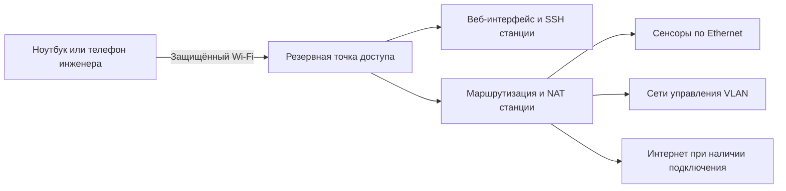

> **Language / Язык:** [English](../rescue-wifi.md) | [Русский](rescue-wifi.md)

# Резервная точка доступа Wi-Fi

Опциональная защищённая точка доступа позволяет инженеру попасть на станцию, когда сохранённые сети управления недоступны. По умолчанию функция выключена. Основная карта продолжает искать сохранённые сети, а отдельная карта обслуживает точку доступа.



## Настройте заранее

1. Откройте **Settings → Network → Rescue Wi-Fi access point**.
2. Включите автоматическую точку доступа. По умолчанию поиск сетей управления длится **10 минут**; допустимо от 1 до 30 минут.
3. Оставьте автоматический выбор встроенной карты для точки доступа и внешней карты для подключения к сетям либо выберите их постоянные MAC-адреса в **Radio and network options**. Нужны два независимых радиомодуля. Ради запуска точки доступа работающее клиентское подключение не разрывается.
4. Оставьте автоматическую частную подсеть `/24` либо выберите свою без пересечений с маршрутами и сохранёнными статическими сетями. Доступны каналы 1, 6 и 11 в диапазоне 2,4 ГГц; региональные настройки системы сохраняются.
5. При необходимости отметьте проводные профили и VLAN управления. Рабочий адрес на выбранном профиле тоже предотвращает автоматический запуск точки доступа. Интерфейс прошивки сетью управления не считается.
6. Сохраните настройки, подтвердив пароль веб-учётки. Откройте **Connection details** и сохраните сгенерированные имя сети и пароль. Показ и копирование пароля выполняются отдельными кнопками; в обычных статусах и снимках экранов пароля нет.

> [!IMPORTANT]
> DHCP прошивки должен быть заранее привязан к интерфейсу стенда. Если карточка сообщает об отсутствии привязки, настройте её на вкладке сети в свободное от прошивки время. Запуск точки доступа не перезапускает DHCP стенда и не меняет его Ethernet и VLAN.

## Автоматическая работа

| Ситуация | Поведение |
|---|---|
| Сети управления исчезли | Продолжается обычный поиск; включённая запасная карта получает свои 30 секунд на подключение. |
| Управление недоступно 10 минут | На свободной выбранной карте запускается защищённая точка доступа. |
| Инженер подключился | Откройте адрес из Settings, HDMI или FPMS; нужны обычные веб-учётка или доступ по SSH. |
| Управление восстановилось | После 60 секунд стабильной связи точка остаётся работать, пока подключены клиенты. |
| Клиенты отключились | Ещё через 60 секунд точка выключается, карта возвращается к клиентской работе. |
| Новый маршрут пересёк подсеть точки | Останавливается только наша точка; перед повторным запуском выберите другую подсеть. |
| Нет достоверного статуса сети или числа клиентов | Уже работающая точка сохраняется, неопределённость показывается в статусе. |

NetworkManager обеспечивает DHCP, DNS и NAT. Инженер может обращаться к адресам сенсоров и доступным через станцию VLAN без настройки обратных маршрутов на сенсорах. Интернет появляется при наличии соответствующего подключения у станции. Широковещательное обнаружение и сетевая загрузка через точку не ретранслируются. IPv6 на ней выключен. Остальные правила межсетевого экрана станции продолжают действовать.

## Кнопки и пароли

- **Start now** запрашивает минимум 15 минут работы с сохранением проверок безопасности радиокарты.
- **Stop for 15 minutes** приостанавливает автоматический запуск. Отключение работающей точки подтверждается отдельным предупреждением.
- **Resume automatic policy** отменяет паузу.
- Смена имени сети, подсети и пароля при работающей точке применяется при следующем запуске. **Restart with saved settings** отдельно предупреждает об отключении клиентов.
- Выключение функции при работающей точке тоже требует отдельного подтверждения. **Back** отменяет действие.

Пароль генерируется отдельно для каждой станции и не совпадает с паролями веб-интерфейса и SSH. Новый пароль должен содержать от 12 до 63 печатных символов ASCII.

## Статус и восстановление

В Settings видны состояние, обратный отсчёт, имя активной сети, адрес шлюза, число клиентов и отложенные изменения. Сводка подключений показывает резервную точку отдельно от доступа в интернет. HDMI и обе раскладки FPMS выводят те же сведения без паролей.

При ошибке запуска проверьте объяснение в карточке, привязку интерфейса прошивки, выбранную карту, пересечения маршрутов и журнал службы:

```sh
sudo journalctl -u cmprovision-rescue-wifi.service -n 80 --no-pager
sudo /usr/lib/cmprovision/rescue-wifi status
```

Зашифрованный полный бэкап включает конфигурацию точки и её профиль NetworkManager как **сетевые настройки**. При переносе по умолчанию сохраняется сеть станции назначения. Явное восстановление сети на другом оборудовании может потребовать выбора новых карт; отсутствие исходного MAC блокирует запуск вместо выбора случайной карты. Подробнее: [полные бэкапы](backups.md).
