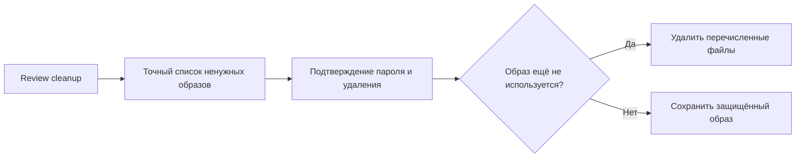

# Хранение файлов, отчёты об устройствах и новые образы

Функции готовятся к версии 2.30.3. Они не устанавливают обновления станции или сенсоров автоматически.

## Хранение файлов

Откройте **Settings → System → Storage**. Измерения загружаются отдельно от страницы и кэшируются на минуту; **Refresh** запускает новое измерение. Карточка показывает свободное место, данные приложения, образы, системные и пакетные копии, файлы восстановления/загрузок обновлятора и полные бэкапы. Прочие файлы ОС находятся вне этих категорий. Недоступный или не успевший измериться каталог отображается как **Unknown**, а не как пустой.

Оценка места для восстановления использует консервативный расчёт обновлятора. Это подсказка: обновлятор повторяет проверку после штатной очистки старой точки, поэтому требуемое и свободное место могут измениться.

Очистка рассматривает только подтверждённые записи, не более 250 за один просмотр. Ставшие ненужными позже образы не добавляются молча. Связи с проектами, текущие прошивки и подготовка образа проверяются заново. Бэкапы и точки отката сохраняют прежние правила хранения; эта кнопка их не удаляет. Обычная кнопка удаления на Images использует ту же защиту.

## Отчёты об устройствах

В карточке модуля **Download device report** скачивает самостоятельный HTML-документ, **JSON** — структурированные данные. HTML содержит палитру и шрифт, работает без сети и печатается из браузера. В USB diagnostics доступны такие же форматы для наблюдений, полученных до регистрации модуля.

Отчёт включает идентификаторы, характеристики, последний записанный результат и этапы прошивки, версии EEPROM, последний известный коммутатор/порт и диагностические факты. Время указано в UTC. USB-снимок может относиться к другой загрузке и не подтверждает успешную прошивку. Предполагаемый артикул не доказывает подлинность платы.

В отчёт не входят пароли, содержимое скриптов, произвольные журналы скриптов/ядра и конфигурация EEPROM. Это ограниченный снимок текущих записей, а не неизменяемый архив всех прежних запусков. Скачивание не опрашивает модуль или коммутатор.

## Новые образы

На **Images** для образов из GitHub доступна кнопка **Check for newer image**. Проверка запускается явно: простое открытие страницы не обращается к внешним сервисам. Список релизов кэшируется на пять минут, результат показывает время проверки.

Подсказка рассматривает стабильные релизы, опубликованные позже записанного, с сохранением архитектуры и варианта файла. Произвольные теги не сортируются как номера версий. Отсутствующие исходные данные, неоднозначность и ошибка источника отображаются явно. Совпадение имён остаётся подсказкой: совместимость железа и опубликованные суммы нужно проверить.

**Browse release images** подставляет репозиторий в существующее окно загрузки. Выберите релиз и файл, скачайте и проверьте образ, затем явно замените его в проекте. Сама проверка не меняет проекты и текущие прошивки.

## DHCP-резервации

Добавление и удаление адреса согласуют базу, атомарную замену конфигурации и перезапуск службы. При ошибке возвращаются прежние резервации и конфигурация. Если прежняя служба тоже не запустилась, сообщение направляет в Service status. Вторичная станция с замаскированным DHCP оставляет его выключенным.
