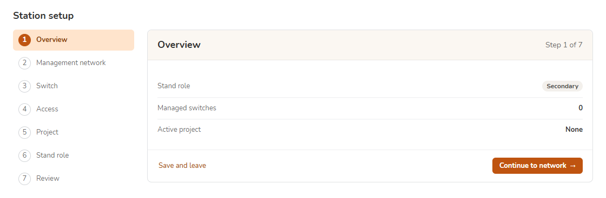
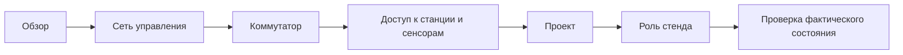
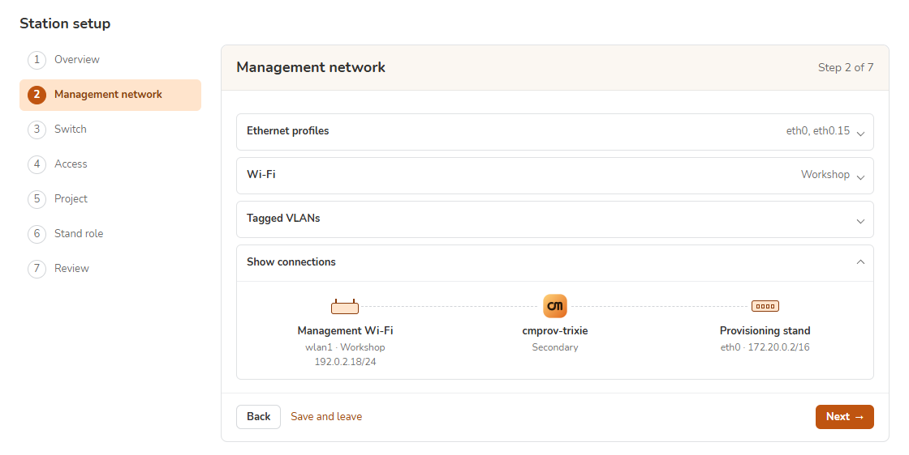
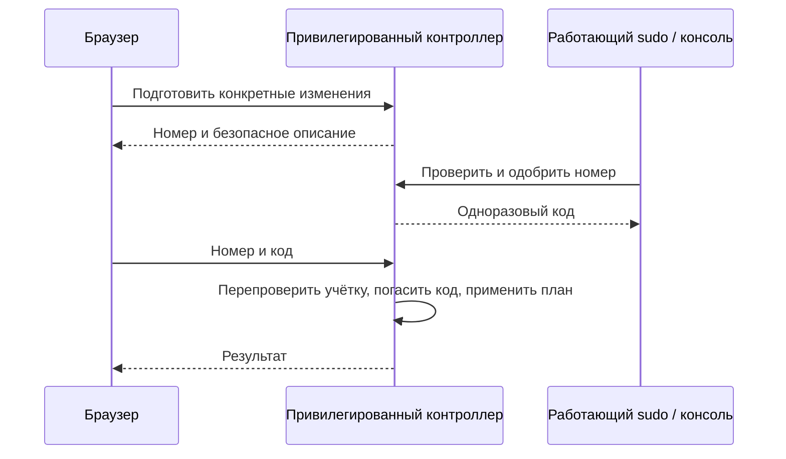

> **Language / Язык:** [English](../station-setup.md) | [Русский](station-setup.md)

# Настроить станцию-провижинер

[Развёртывание](deployment-options.md) · [Мастер проекта](creation-wizards.md) · [Сетевые профили](provisioner-network.md)

Откройте **Settings → System → Open setup wizard**. На новой ненастроенной станции мастер также доступен на Dashboard по кнопке **Set up station**. После **Complete setup** карточка мастера исчезает из настроек у всех пользователей. Чтобы позже проверить конфигурацию, войдите в веб-интерфейс и откройте `/settings/setup`.



*Настоящий интерфейс с отдельной демонстрационной базой; при съёмке оборудование не менялось.*



> [!IMPORTANT]
> При изменении сети стенда сохраняйте независимое управление. **Next** и **Complete setup** не применяют настройки, не активируют проекты и не запускают DHCP. У изменений отдельные явные действия.

## Перед открытием мастера

В готовом образе на CM4 встроенный Broadcom на шине SDIO получает имя `wlan0` до запуска NetworkManager. При наличии одной дополнительной Wi-Fi-карты ей присваивается `wlan1`. Если встроенной карты нет или дополнительных карт несколько, имена определяет Linux.

1. Откройте в браузере адрес управления с HDMI или передней панели. Новая станция покажет **Set up this station**. Можно сразу открыть `/setup`.
2. Введите 16 символов кода с дисплея. Если в проекте включили **First web administrator in browser**, откройте карточку прошитого устройства на исходном провижинере, нажмите **Open setup code** и подтвердите свой веб-пароль. Карточка хранит код 12 часов. Сама станция принимает его до использования или замены.
3. Введите имя, почту для входа и новый веб-пароль. Кнопка **Create administrator** создаст учётку и откроет мастер. При следующих посещениях станция показывает обычный вход.

На станции без дисплея локальный администратор может посмотреть неиспользованный код через SSH или консоль командой `sudo cmprovision-first-admin show`. Чтобы заменить его, выполните `sudo cmprovision-first-admin rotate`, затем `show`. Код индивидуален для каждой станции и сохраняется при перезагрузке. После восстановления бэкапа или удаления пользователей регистрация остаётся закрытой.

Для восстановления доступа на настроенной станции или для версий до 2.30.4 включительно создайте веб-учётку в консоли:

```sh
cd /var/lib/cmprovision
sudo -u www-data php artisan auth:create-user
```

Учётки веб-интерфейса и Linux/SSH независимы. Стандартный веб-пароль и открытая регистрация не добавляются. Первого Linux-пользователя задают через [настройку образа](../../image/README.md), Raspberry Pi Imager или [проект станции](station-project-setup.md).

## Семь шагов

| Шаг | Действие |
| --- | --- |
| Overview | Проверить существующие роль, коммутаторы и активный проект |
| Management network | Сохранить Wi-Fi или Ethernet/VLAN-профили; проверить доступность и подтвердить временную сеть до истечения таймера отката |
| Switch | Добавить и проверить SNMP; неуправляемый коммутатор можно пропустить, без карты портов и управления PoE |
| Access | Сохранить веб-учётку, при необходимости SSH станции и учётки сенсоров |
| Project | Создать/скопировать проект готовым мастером, подготовить образ и явно активировать; вторичной и отключённой станции местный проект не требуется |
| Stand role | Выбрать Primary, Secondary или Disabled; для основной подтвердить изоляцию сети, затем проверить и подтвердить временную смену роли |
| Review | Обновить фактические роль, адрес, службы и готовность проекта; устранить проблемы и завершить настройку |

На телефоне шаг выбирают по названию в списке над сводкой. Кнопка **Continue to network** открывает настройку сети. На шагах **Management network** и **Stand role** раскройте **Show connections**, чтобы увидеть канал управления, саму станцию и интерфейс прошивки. Пока сеть ждёт подтверждения, на экране видны отсчёт до отката и кнопки **Confirm network** и **Restore previous**.



На шаге **Access** откройте нужную группу учёток — **Web account**, **Station SSH** или **Sensor accounts**. На шаге **Review** сначала видны причины, мешающие завершить настройку. В **Other checks** можно посмотреть интерфейсы, адреса и текущий веб-логин.

**Back** возвращает на предыдущий шаг. Чтобы прервать первичную настройку, сохраните или отмените изменения в открытых формах и нажмите **Save and leave**. В том же сеансе браузера кнопка **Resume station setup** в **Settings → System** вернёт вас к этому шагу. При обновлении страницы загружаются сохранённые настройки. Работающая станция автоматически в мастер не перенаправляется.

Для основной станции проверяются готовность и наличие образа, нужные хеши и копия по частям, совпадение подготовленного EEPROM с прошивкой и настройками выбранного проекта. Одной записи об активном проекте недостаточно. Неизвестная сеть или служба не считается намеренно отключённой.

## SSH-доступ самой станции

Та же форма доступна в **Settings → System → Station access**.

1. Выберите существующего Linux-администратора группы `sudo`. При необходимости задайте новый пароль/публичные ключи и **Enable SSH service**. Сервер OpenSSH уже должен быть установлен.
2. Нажмите **Review SSH changes** и при запросе подтвердите веб-пароль.
3. В работающей SSH-сессии администратора или локальной консоли выполните показанную команду:

   ```sh
   sudo cmprovision-access approve <reference>
   ```

4. Проверьте в терминале пользователя, действия и отпечатки ключей. Введите `YES` только для своей ожидаемой заявки, затем перенесите код в браузер.
5. Нажмите **Apply SSH changes**. Сохраняйте старую сессию до успешной проверки нового входа.



> [!NOTE]
> Заявка живёт пять минут, код — не более двух минут и разрешает одно применение. Пять неверных попыток отзывают заявку. Просроченную можно обновить и подготовить заново. Веб-помощник не умеет сам выдавать код.

Существующие пользователи, ключи, правила sudo и общий конфиг SSH сохраняются. Форма добавляет ключи, не создаёт и не переименовывает администраторов, не включает беспарольный sudo. Новый Linux-пароль не отменяет запрет парольного SSH-входа, правила `Match` и другие ограничения ОС. Нестандартные пути ключей настраиваются средствами ОС: форма сообщает об этом вместо изменения SSH-сервера.

Логин прошиваемого сенсора задаётся через [SSH-доступ из проекта](image-access.md). **Sensor accounts** нужны для проверки и сброса сенсоров; они не меняют логин провижинера.
