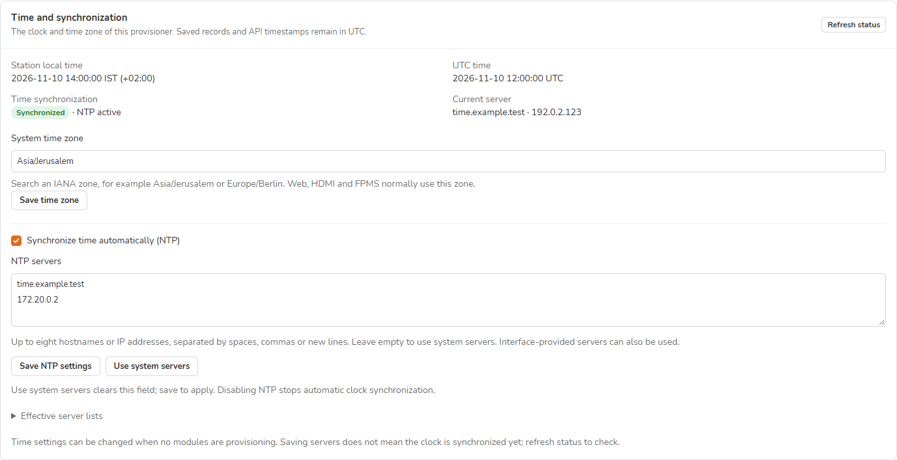
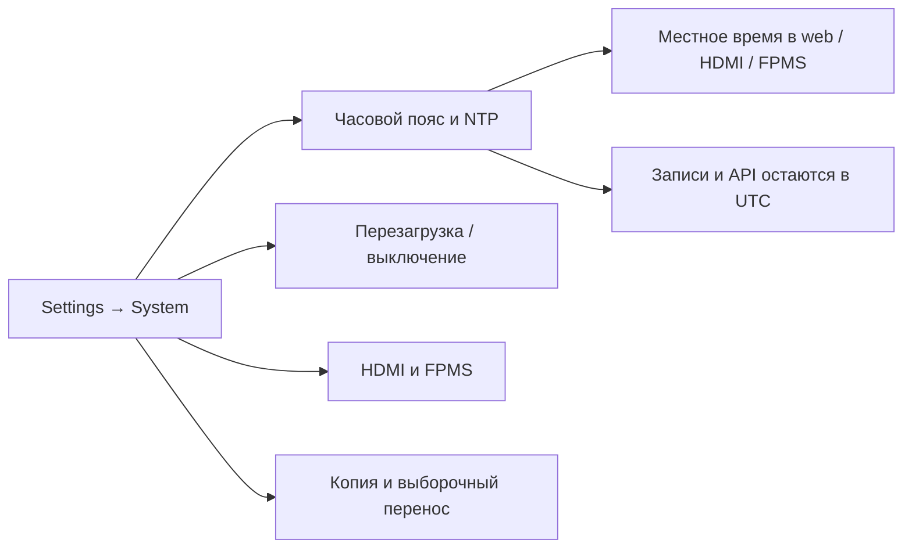

> **Language / Язык:** [English](../system-time.md) | [Русский](system-time.md)

# Время и синхронизация станции

[Эксплуатация](operations.md#страница-settings) · [Копирование и восстановление](upgrading.md)

Откройте **Settings → System → Time and synchronization**. Настройки относятся к самому провижинеру: часы прошиваемых сенсоров они не меняют.

*Данные отдельного демонстрационного стенда; адреса и результат синхронизации иллюстрируют элементы управления.*

## Изменение часового пояса

1. Дождитесь завершения всех незаконченных прошивок на станции.
2. В **System time zone** найдите пояс IANA, например `Asia/Jerusalem` или `Europe/Berlin`.
3. Нажмите **Save time zone** и подтвердите пароль своей учётной записи, если он запрошен.
4. Проверьте **Station local time** и смещение относительно UTC. Перезагрузите другие открытые страницы, чтобы обновить их время и тему Auto. Воркеры очереди дочитают новый пояс после завершения текущих задач. Уже работающий сборщик HDMI/FPMS учитывает пояс в следующем снимке, а часы HDMI показывают выбранное местное время.

> [!NOTE]
> Явно заданный `APP_DISPLAY_TIMEZONE` сохраняет приоритет при отображении времени. Карточка показывает несовпадение. Удалите это серверное переопределение, если web, HDMI и FPMS должны следовать системному поясу.

## Настройка NTP

| Элемент | Результат |
| --- | --- |
| **Synchronize time automatically (NTP)** | Включение или выключение службы синхронизации времени станции. |
| **NTP servers** | До восьми имён серверов, адресов IPv4 или IPv6. Разделяйте пробелами, запятыми или новыми строками; URL и номера портов не нужны. |
| **Use system servers** | Очищает редактируемый список; **Save NTP settings** применяет изменение. Настройки администратора и поставщика сохраняются. |
| **Refresh status** | Читает состояние и текущий сервер, сохраняя несохранённые значения полей. |

Для своего сервера времени укажите его адрес, оставьте NTP включённым и сохраните. Через некоторое время обновите статус. Собственный список заменяет системные записи NTP и очищает резервные записи, пока выбран свой список. **Серверы, полученные через сетевые интерфейсы, тоже могут использоваться**: они видны в **Effective server lists**.

> [!IMPORTANT]
> **Settings saved** подтверждает применение конфигурации, а не ответ сервера. Проверяйте вместе **Synchronized**, **NTP active** и **Current server**. При ошибочном имени или недоступном сервере настройки могут сохраниться, а синхронизация — не состояться.

Изменения допускаются на свободной станции и блокируются при незавершённых операциях с сетью, питанием или обновлением приложения. Чтение статуса не меняет часы. cmprovision не устанавливает дату вручную и не делает станцию сервером NTP.

## Поддержка службы и восстановление

Редактор NTP поддерживает **systemd-timesyncd** — клиент готового образа станции и проверенных провижинеров на Raspberry Pi OS Trixie. Отсутствующая, замаскированная или альтернативная служба явно обозначается и автоматически не заменяется. Часовой пояс настраивается отдельно. При ошибке применения возвращается предыдущая конфигурация и состояние службы, если это возможно; неудачное восстановление явно сообщается.

Управляемый файл — `/etc/systemd/timesyncd.conf.d/90-cmprovision.conf`. Очистка списка удаляет только его. Новые полные снимки сохраняют файлы пояса, наличие или отсутствие управляемого файла и состояние поддерживаемой службы NTP. Полное восстановление применяет эту запись и обновляет службы времени. Старые снимки без записи не меняют неизвестные им параметры службы. **Download backup**, восстановление только данных и выборочный перенос не переносят эти системные файлы на другую станцию.

Поведение основано на документации systemd: [управление временем](https://manpages.debian.org/trixie/systemd/timedatectl.1.en.html) и [конфигурация NTP](https://manpages.debian.org/trixie/systemd-timesyncd/timesyncd.conf.5.en.html).
