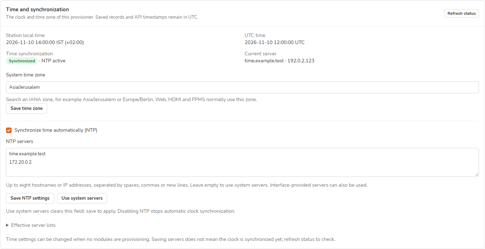
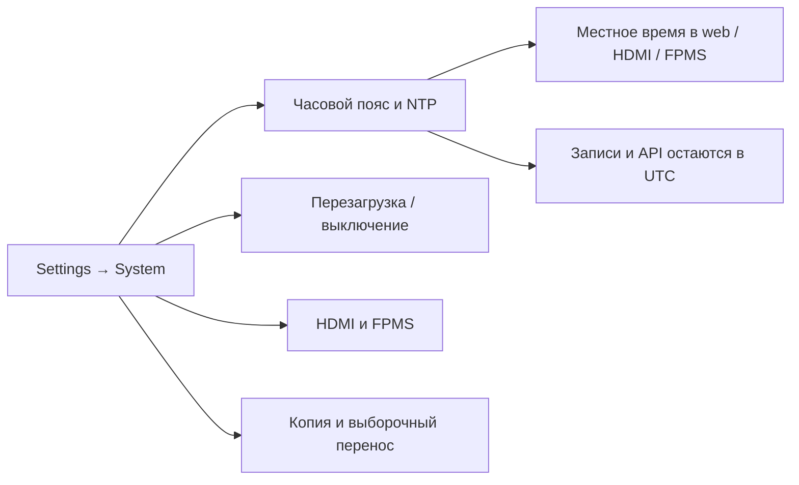

> **Language / Язык:** [English](../system-time.md) | [Русский](system-time.md)

# Время и синхронизация станции

[Эксплуатация](operations.md#страница-settings) · [Копирование и восстановление](upgrading.md)

Откройте **Settings → System → Time and synchronization**. Здесь настраивают часы станции и при необходимости раздают время в сеть прошивки.



*Данные отдельного демонстрационного стенда; адреса и результат синхронизации иллюстрируют элементы управления.*



## Изменение часового пояса

1. Дождитесь завершения всех незаконченных прошивок на станции.
2. В **System time zone** найдите пояс IANA, например `Asia/Jerusalem` или `Europe/Berlin`.
3. Нажмите **Save time zone** и подтвердите пароль своей учётной записи, если он запрошен.
4. Проверьте **Station local time** и смещение относительно UTC. Перезагрузите другие открытые страницы, чтобы обновить их время и тему Auto. Воркеры очереди дочитают новый пояс после завершения текущих задач. Уже работающий сборщик HDMI/FPMS учитывает пояс в следующем снимке, а часы HDMI показывают выбранное местное время.

> [!NOTE]
> Явно заданный `APP_DISPLAY_TIMEZONE` сохраняет приоритет при отображении времени. Карточка показывает несовпадение. Удалите это серверное переопределение, если web, HDMI и FPMS должны следовать системному поясу.

## Настройка NTP

| Элемент | Результат |
| --- | --- |
| **Synchronize time automatically (NTP)** | Включение или выключение службы синхронизации времени станции. |
| **NTP servers** | До восьми имён серверов, адресов IPv4 или IPv6. Разделяйте пробелами, запятыми или новыми строками; URL и номера портов не нужны. |
| **Use system servers** | Очищает редактируемый список; **Save NTP settings** применяет изменение. Настройки администратора и поставщика сохраняются. |
| **Refresh status** | Читает состояние и текущий сервер, сохраняя несохранённые значения полей. |

Для своего источника укажите его адрес, сохраните и обновите статус после первого ответа. В управляемой chrony явный список заменяет заводской пул и источники, полученные по DHCP. В timesyncd могут участвовать и источники сетевых интерфейсов. Действующие списки видны в **Effective server lists**.

> [!NOTE]
> **Settings saved** подтверждает сохранение. **Synchronized**, выбранный источник и возраст последнего замера показывают, получила ли станция достоверное время.

## Раздать время в сеть прошивки

1. На свободной станции с управляемой chrony подтвердите интерфейс или VLAN прошивки в **Settings → Network** и включите синхронизацию часов самой станции.
2. В **Settings → System → Time and synchronization** включите **Serve time on the provisioning network** и сохраните. По умолчанию раздача выключена.
3. Проверьте интерфейс, IPv4, состояние прослушивания и DHCP. Основная станция выдаёт свой адрес в следующей аренде клиентам, запрашивающим опцию 42. На вторичной раздачу можно отдельно разрешить на её собственном адресе. DHCP на ней остаётся выключенным.
4. Запросите время с устройства в сети прошивки. Например, на Cisco IOS задайте `ntp server 172.20.0.1` и посмотрите `show ntp associations` и `show ntp status`. Образ сенсора должен поддерживать опцию 42 либо использовать явно указанный адрес.

Служба слушает UDP 123 на подтверждённых интерфейсе и IPv4 сети прошивки. После холодной загрузки для синхронизации клиентов нужен первый достоверный замер от источника. При потере связи с источником состояние chrony и возраст последнего замера показывают, как давно станция сверяла часы. После выключения раздачи порт закрывается, а опция 42 исчезает из новых ответов DHCP. Существующие аренды обновляются по расписанию клиента. Загрузочная Utility OS управляет своими часами отдельно. [Опция DHCP 42](https://www.rfc-editor.org/rfc/rfc2132#section-8.3) · [Конфигурация chrony](https://chrony-project.org/doc/4.6/chrony.conf.html)

## Подготовить существующую станцию

В новых образах с этой функцией уже настроена chrony. Обновление пакета сохраняет текущую службу времени. Для перехода с systemd-timesyncd выполните команды по SSH на свободной станции. Первой команде нужен доступ к подписанному репозиторию Debian с точной версией установленного timesyncd. Она сохраняет и проверяет старый пакет, chrony и зависимости ещё до замены службы.

```sh
sudo cmprovision-stand-ntp cache-provider
sudo cmprovision-stand-ntp use-chrony
chronyc tracking
chronyc sources -n
```

При замене применяются прежние источники и состояние запуска клиента. Пользовательские конфигурации systemd или chrony предварительно проверьте с администратором стенда. Если переход прервался или для отката приложения требуется прежняя служба, восстановите её из локальных пакетов с настройками на момент перехода. Это доступно и после перезагрузки без внешней сети.

```sh
sudo cmprovision-stand-ntp return-timesyncd
systemctl status systemd-timesyncd
```

Пакеты для автономного восстановления хранятся на самой станции в `/var/lib/cmprovision-time-provider`. Сохраните каталог до окончания приёмки. Изменения в веб-интерфейсе требуют подтверждения пароля и свободного стенда.

## Резервная копия и восстановление

Полная копия сохраняет часовой пояс, управляемые источники и состояние клиента. Разрешение на раздачу входит в группу восстановления **role** и привязано к идентификатору станции. Восстановление только времени не включает раздачу. При переносе на другую станцию разрешите её там для подтверждённого интерфейса. Старые копии timesyncd поддерживаются. Для отката на версию приложения без поддержки chrony также требуется совместимый снимок.
