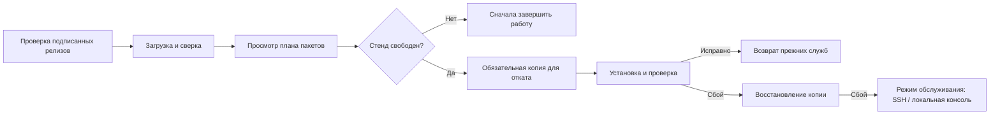

# Обновления станции

Раздел **Settings → Updates** проверяет и устанавливает стабильные версии компонентов. Нужны пакетная установка на Debian 13 / Raspberry Pi OS Trixie и работающий systemd.

| Компонент | Что обновляется | Что обновляется отдельно |
| --- | --- | --- |
| Приложение | `cmprovision4`; соответствующий `fpms-lite`, если он уже установлен | ОС самой станции и выбранная управляемая Utility OS |
| Utility OS | Временная ОС для последующей загрузки плат по Ethernet/USB | Приложение и ОС, уже записанная на сенсоры |

## Проверка и загрузка

1. Откройте **Settings → Updates** и нажмите **Check for updates**. Само открытие страницы не обращается к GitHub.
2. Посмотрите версию, описание и совместимость каждого компонента. Старые неподписанные релизы, черновики, предварительные версии и запросы на слияние не предлагаются для установки.
3. Нажмите **Download and verify**. Прогресс загрузки отражает полученные байты; проверка, настройка пакетов и проверка работоспособности показывают этап без выдуманного процента.

Два переключателя **Automatically check once a day** независимы и изначально выключены. После включения проверка выполняется примерно раз в сутки с небольшим разбросом времени. Автоматической установки нет. Выборочный перенос конфигурации переносит эти предпочтения; ключи доверия, состояние операций и копии для отката в него не входят.

## Установка

1. Завершите активные и незаконченные прошивки, проверки ОС и зарезервированные задачи обработки образов. Молчащая плата всё ещё считается незаконченной работой. Принудительной установки нет.
2. Просмотрите изменения пакетов, нажмите **Review and apply**, подтвердите пароль своей учётной записи и выбранную подготовленную версию. Кнопка **Back** возвращает назад без установки.
3. Не отключайте питание станции. Исполнитель работает независимо от браузера, PHP-FPM и очередей. При потере соединения появляется **Reconnecting**; повторно запускать установку не нужно.
   Ожидаемые ответы о режиме обслуживания обрабатываются внутри состояния обновления. После возврата связи результат операции и установленная версия обновляются автоматически.
   При переходе с 2.27.0 один раз обновите страницу после завершения, чтобы загрузить исправление браузера; повторно запускать установку не нужно.
4. После проверки работоспособности возвращаются прежние состояния служб. Выключенные и замаскированные DHCP/TFTP и USB-загрузка сами не включатся.

Проверка релизов и загрузка файлов разрешены во время прошивки. На время установки блокируются новые старты плат, несовместимые изменения настроек и обработка очередей. Для обновления приложения обязательны согласованная копия и переустанавливаемые прежние пакеты. Недостаток места или отсутствие материалов восстановления останавливает установку. Дополнительные зависимости Debian фиксируются в просмотренном плане и устанавливаются из подготовленного кеша. Откат приложения не является полным откатом ОС станции.

Копия для восстановления включает загруженные образы, поэтому большой библиотеке образов нужно соответствующее дополнительное место. Загрузка сохраняет запас 64 МиБ. Для обновлений приложения и Utility OS хранится **одна успешная точка восстановления в течение 7 дней**. Срок фиксируется при успешном завершении; последующие изменения статуса и диагностики его не продлевают. Для старых записей используется сохранённое время завершения/обновления. Локальная очистка выполняется при запросе статуса на свободном обновляторе и существующим часовым таймером с его случайной задержкой, даже если обе автопроверки выключены. К издателю обращаются только при наступлении срока включённой проверки.

**Перед новым снимком приложения** обновлятор удаляет прежнюю пригодную точку отката, затем проверяет свободное место и создаёт новый снимок. Если места всё равно мало или создание не удалось, старой точки уже нет и поздний откат к ней не предлагается. Это убирает необходимость держать две полные сохранённые копии. Активное или аварийное восстановление и выбранный источник отката защищены до завершения; для отката по-прежнему может потребоваться место одновременно для его источника и страховочной копии. Очистка удаляет только неиспользуемые файлы самого обновлятора и не затрагивает посторонние копии.

## Utility OS и восстановление

Загруженные версии Utility OS хранятся отдельно от пакета приложения в `/var/lib/cmprovision-utility-os/releases`. Проверяются полный состав, суммы и загрузочные файлы Ethernet/USB. Проверка и загрузка не меняют выбранную ОС. При применении ссылку загрузки заменяет веб-пользователь; обновление пакета сохраняет исправный управляемый выбор. Старые загрузочные файлы и современная ОС из пакета остаются доступны.

**Recovery history → Review rollback** возвращает сохранённую предыдущую версию в течение семи дней, пока её точка не удалена перед следующим снимком. Для приложения возвращаются и данные из выбранной копии: последующие изменения теряются. Немедленное автоматическое восстановление происходит под блокировкой новых операций.

При сбое установки или проверки исполнитель автоматически восстанавливает непосредственную предыдущую копию. Прерванная критическая операция восстанавливается без повторной установки; после перезагрузки возвращается блокировка обслуживания. Если восстановление не удалось, появляется **recovery-required**, блокировка остаётся. Зайдите по SSH или с локальной консоли, проверьте `journalctl -u 'cmprovision-update-*'` и `/var/lib/cmprovision-updates/private` и восстановите записанную операцию до открытия стенда. Удалять маркеры блокировки для обхода восстановления нельзя.

Диспетчер загрузочного восстановления протокола 1 хранится в `/var/lib/cmprovision-updates/recover.py`, вне заменяемых dpkg файлов. Он проверяет и запускает сохранённый исполнитель предыдущей операции: частичная замена самого обновлятора или настроек доверия не мешает его восстановлению.

## Диагностика сбоев

В Settings → Updates раскройте **Failure details**: там указаны этап, тип ошибки и идентификатор операции. **Download diagnostics** повторно спрашивает пароль вашей учётной записи и скачивает ограниченный по размеру JSON-отчёт. Сохраните идентификатор вместе с отчётом для разбора проблемы. Первоначальная ошибка и ошибка автоматического восстановления записываются отдельно; в отчёте есть места в коде, HTTP-статус и номер ошибки ОС, если они доступны. Пароли, тела ответов, закрытый вывод команд и произвольные тексты неожиданных исключений не включаются.

Станция хранит закрытые отчёты последних 20 операций с диагностикой; записи незавершённого обновления и состояния recovery-required не удаляются этой очисткой. Если веб-интерфейс недоступен, найдите идентификатор через SSH: `sudo journalctl -u 'cmprovision-update-*' --no-pager`. Отсутствие отчёта не означает успешную установку: смотрите итог операции и режим обслуживания. Не удаляйте pending-файлы ради обхода восстановления.

При обрыве HTTP-чтения выполняется не более трёх попыток. Каждая повторная загрузка пакета начинается с нового временного файла; ошибки сертификата, подписи, суммы и размера остаются отказами. Эта политика никогда не запускает установку повторно.

## Доверие и публикация

Настройки издателя `/etc/cmprovision-updates/publisher.json` и открытый ключ `publisher.pub` принадлежат root. Браузер не может менять репозиторий, ключ или адреса загрузки. Отдельная подпись minisign связывает метаданные с точным стабильным тегом, исходным коммитом, совместимостью, именами, размерами и суммами файлов.

Для публикации стабильного приложения нужен секрет GitHub Actions `CMPROVISION_UPDATE_SIGNING_KEY` с закрытым ключом, соответствующим открытому ключу в исходниках. Пробные сборки и черновики остаются доступны без него. Отдельная публикация Utility OS собирает и проверяет закреплённые исходники, включает полный соответствующий архив исходников и лицензий и не заменяет файлы опубликованной версии. Перед публикацией изменённых загрузочных файлов увеличьте `UOS_VERSION`.

Закрытый ключ хранится вне репозитория с защищённой резервной копией. На станциях нужна только открытая часть. Замену ключа доверия разворачивает администратор; веб-интерфейс не может сам назначить новый корень доверия.
