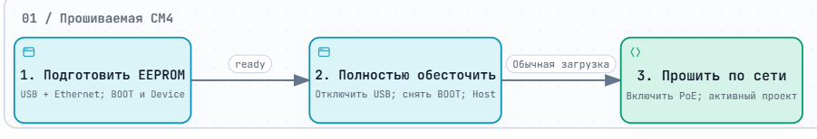
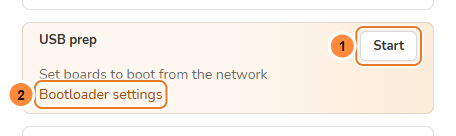
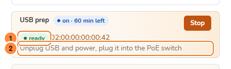

> **Language / Язык:** [English](../usb-prep.md) | [Русский](usb-prep.md)

# Подготовить CM4 к сетевой загрузке

[Эксплуатация](operations.md) · [Полная прошивка через USB](usb-provisioning.md) · [Аппаратная часть M4+](hardware/wlanpi-m4-plus.md)

Используйте **USB prep**, если CM4 загружает имеющуюся ОС вместо обращения к стенду. Подготовьте загрузчик через USB, затем перенесите плату на PoE-коммутатор для сетевой прошивки.

| Во время USB prep | После переноса на стенд |
| --- | --- |
| Обновляется EEPROM; ОС на eMMC остаётся на месте | Активный проект может перезаписать накопитель |
| Дождитесь **ready** | Дождитесь результата обычного провижининга |

> [!IMPORTANT]
> **USB prep подготавливает загрузчик, а не записывает образ ОС.** Ethernet нужен и при подготовке: USB передаёт загрузочные файлы, Ethernet — DHCP и скрипт подготовки.

<a href="../diagrams/usb-prep-flow.ru.png"></a>

*Нажмите на изображение для увеличения. Для интерактивного просмотра скачайте [автономный HTML](../diagrams/usb-prep-flow.ru.html) и откройте его в браузере. На скриншотах ниже — демонстрационные данные.*

## Перед подключением платы

- [ ] Провижинер работает и остаётся в режиме **USB Host**.
- [ ] Нужный проект готов для последующего сетевого прогона.
- [ ] Есть короткий USB-кабель **с передачей данных** и хаб с отдельным питанием, достаточным для целевой платы.
- [ ] Обе платы подключены Ethernet к изолированному коммутатору стенда.
- [ ] Для этой схемы с USB-питанием **PoE целевой платы выключен**, передача данных Ethernet включена.

## 1. Включите USB prep

На **Dashboard** найдите **USB prep** и нажмите **Start** (имя для средств доступности — **Start USB prep**). При ширине меньше 1440 px карточка занимает отдельную строку.

<a href="../assets/guides/usb-prep-start.png"></a>

**1 — Start. 2 — Bootloader settings:** проверьте EEPROM и её настройки в **Settings → Provisioning → USB prep**.

**Ожидаемый результат:** **on** и **Connect a board over USB**. Если Start недоступна, прочитайте причину и сначала добавьте или выберите прошивку EEPROM.

## 2. Подключите и подготовьте целевую плату

> [!WARNING]
> Перед изменением BOOT или OTG отключите **всё питание целевой платы**. Перезапуск PoE не обесточит её, пока подключён USB. Перемычки провижинера оставьте в рабочем положении.

1. На обесточенной целевой плате выберите **USB Device** и установите **BOOT / nRPIBOOT**.
2. Соедините USB-A провижинера → хаб с отдельным питанием → программирующий разъём целевой платы.
3. Ethernet целевой платы оставьте подключённым, PoE — выключенным. Подключение USB-кабеля данных подаст питание и запустит загрузку.
4. Дождитесь **ready**. Попеременное плавное затухание двух светодиодов также означает готовность.

| Фиолетовая Mcuzone `CM4_WiFi7 Rev1.0` / M4+ | Подготовка | Последующая обычная загрузка |
| --- | --- | --- |
| Перемычка **BOOT** | Установлена | Снята |
| Перемычка **OTG** | Установлена: Device | Снята: Host |
| Программирующий кабель | **USB-C power and Program** со стороны HDMI | Отключён |

Для зелёной платы или другой ревизии смотрите [таблицу аппаратных вариантов](hardware/wlanpi-m4-plus.md#управление-загрузкой-и-режимом-usb). AUX USB-C не предназначен для программирования.

<a href="../assets/guides/usb-prep-ready.png"></a>

**Ожидаемый результат:** **ready** и MAC целевой платы. Предыдущие платы считаются как **+N more**. На этом этапе не записывается образ ОС, не выполняется OS check и не печатается этикетка.

## 3. Перенесите плату на PoE-стенд

1. Отсоедините USB и отключите все оставшиеся источники питания целевой платы.
2. Снимите BOOT и восстановите USB Host.
3. Проверьте активный проект, уберите USB-соединение и включите PoE целевой платы.
4. Следите за сетевым прогоном на **Dashboard**, **CMs** или **Ports**. После последней платы нажмите **Stop**.

**Ожидаемый результат:** плата загружается по сети и начинает прогон активного проекта. Обычный прогон заменяет статус USB-подготовки.

## Если ready не появляется

| Что видно | Что проверить дальше |
| --- | --- |
| **Start** недоступна | Прочитайте причину; проверьте **Firmware** и **Bootloader settings** |
| Остаётся **Connect a board over USB** | BOOT, Device, программирующий разъём, кабель данных и питание |
| USB-файлы переданы, но плата не появилась | Ethernet целевой платы, DHCP и доступность провижинера |
| **failed** | Откройте ссылку с MAC и прочитайте журнал перед повтором |
| **no report** | Проверьте питание и оба кабеля; этот статус не означает готовность |
| После подготовки запускается установленная ОС | Проверьте сохранённый порядок EEPROM и доступность сети |

Непрерывный журнал USB-сервера открывается на провижинере:

```sh
sudo journalctl -u cmprovision-rpiboot -f
```

<details>
<summary>Порядок загрузки, таймер и поведение партии</summary>

По умолчанию используется `BOOT_ORDER=0xf12`: сначала сеть, затем eMMC. Подготовка использует собственные выбранные прошивку и настройки, независимо от EEPROM активного проекта.

Последующий проект с обновлением EEPROM может вернуть свой порядок, например `0xf21` с приоритетом eMMC. Проект без обновления сохраняет порядок подготовки. Если сетевой DHCP-сервер не отвечает, такая плата может ждать сеть до 45 секунд перед загрузкой eMMC.

USB prep выключается после **часа без новых плат**; каждая подключившаяся плата продлевает таймер. Пока режим включён, платы с сетевой загрузкой прошиваются обычным образом. Подготовленные платы не входят в обычную партию и не отправляют события в каналы уведомлений.

</details>

Для записи полного образа из загруженной по USB утилитарной ОС используйте [Полную прошивку через USB](usb-provisioning.md). Для экрана и клавиатуры целевой платы — [Локальную консоль / tty2](local-console.md).
