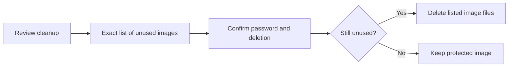

# Storage, device reports and image update hints

These features are being prepared for 2.30.3. They do not install station or sensor updates automatically.

## Storage

Open **Settings → System → Storage**. Measurements load separately and are cached for one minute; **Refresh** requests a new measurement. The card shows free space and application data, uploads, OS/package backups, updater recovery/download files and full backups. Other OS files are outside these categories. An unreadable or timed-out category stays **Unknown**, rather than looking empty.

The recovery estimate uses the updater's conservative space calculation. It is advisory: the updater repeats its own check after retention cleanup, so the required space or available space can change.

Cleanup considers only the reviewed IDs, at most 250 per review. Newly unused images are not silently added. Project references, current runs and image preparation are checked again. Backups and recovery points keep their existing retention rules; this button does not remove them. Manual deletion on Images uses the same protection.

## Device reports

On a module card, choose **Download device report** for a self-contained HTML document, or **JSON** for structured data. HTML includes its palette/font, works offline and can be printed from the browser. USB diagnostics offers the same formats for an observation that arrived before registration.

Reports include identity, hardware interpretation, the latest recorded provisioning result/timeline, EEPROM versions, last recorded switch/port and diagnostic facts. All timestamps use UTC. A USB snapshot can describe another boot and is never treated as proof of successful provisioning. An inferred SKU does not prove authenticity.

Reports omit credentials, script contents, free-form script/kernel logs and EEPROM configuration. They are bounded snapshots of current records, not immutable archives of every previous run. Downloading a report does not poll the module or switch.

## Newer images

On **Images**, a GitHub-sourced image has **Check for newer image**. Checking is explicit; merely opening the page makes no external request. The source reader caches releases for five minutes and each result shows its checked time.

The hint considers stable releases published after the recorded release, retaining the asset's architecture and variant. Tags are not sorted as arbitrary version strings. Missing current metadata, ambiguous assets or source errors are shown explicitly. Matching names remain a hint: review hardware compatibility and published checksums.

**Browse release images** prefills the repository in the existing download window. Choose the release/asset, download and verify it, then deliberately change the project's image. Existing projects and active flashes remain unchanged by checking.

## DHCP reservations

Adding or deleting an assignment now coordinates the database, atomic configuration replacement and reload. A failed apply restores the previous reservations/configuration. If the old service cannot restart, the error points to Service status. A secondary station whose DHCP is masked keeps it disabled.
