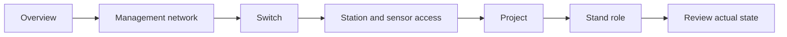
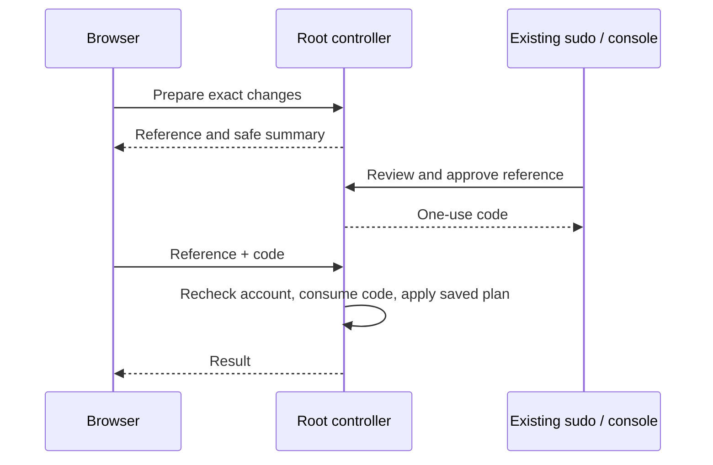

> **Language / Язык:** [English](station-setup.md) | [Русский](ru/station-setup.md)

# Set up a provisioner station

[Deployment options](deployment-options.md) · [Project wizard](creation-wizards.md) · [Network profiles](provisioner-network.md)

Open **Settings → System → Open setup wizard**. A new, unconfigured station also offers **Set up station** on its dashboard. After **Complete setup**, the wizard card disappears from Settings for everyone. To review the setup later, sign in and open `/settings/setup`.


*Actual UI with a disposable demonstration database; no hardware changed for the capture.*



> [!IMPORTANT]
> Keep an independent management connection when changing the stand network. **Next** and **Complete setup** do not apply settings, activate projects or start DHCP. Changes have their own explicit actions.

## Before opening the wizard

On a CM4 running the station image, the onboard SDIO Broadcom radio receives `wlan0` before NetworkManager starts. A single additional Wi-Fi radio receives `wlan1`. Linux assigns the names on systems without the onboard radio or with several additional radios.

1. Open the management address shown on HDMI or the front panel. A fresh station opens **Set up this station**. You can also open `/setup` directly.
2. Enter the 16-character code shown on the display. If the imaging project enabled **First web administrator in browser**, open the flashed device's card on the source station, select **Open setup code** and confirm your web password. The source keeps the code for 12 hours. The station accepts it until used or rotated.
3. Enter your name, sign-in email and a new web password. **Create administrator** signs you in and opens the wizard. Further visits use the normal login.

Without a display, an existing local or SSH administrator can read the unused code with `sudo cmprovision-first-admin show`. To replace an exposed unused code, run `sudo cmprovision-first-admin rotate`, then `show`. Each station has its own code. Rebooting preserves it. Restoring a backup or deleting users keeps registration closed.

For recovery on an established station, or on versions through 2.30.4, create a web account at the console:

```sh
cd /var/lib/cmprovision
sudo -u www-data php artisan auth:create-user
```

Web and Linux/SSH accounts are separate. No default web password or public registration is added. Configure the image's initial Linux user with [image setup](../image/README.md), Raspberry Pi Imager or a [station project](station-project-setup.md).

## Seven steps

| Step | What to do |
| --- | --- |
| Overview | Check the existing role, switches and active project |
| Management network | Save Wi-Fi or Ethernet/VLAN profiles; check connectivity and confirm temporary changes before their rollback timer expires |
| Switch | Add and test SNMP access; an unmanaged switch can be skipped, without port mapping or PoE controls |
| Access | Save your web account, optional station SSH changes and optional sensor accounts |
| Project | Create/copy a project with its existing wizard, prepare its image and explicitly activate it; secondary/disabled stations need no local project |
| Stand role | Choose Primary, Secondary or Disabled; acknowledge an isolated network for Primary, then check and confirm the temporary role change |
| Review | Refresh actual role, address, services and project readiness; resolve blockers and complete setup |

On a phone, use the step selector above the summary to jump by name. **Continue to network** opens the first configuration step. **Show connections** on Management network and Stand role shows the management uplink, this station and the provisioning interface. A pending network change keeps its countdown, **Confirm network** and **Restore previous** in view.


On Access, open **Web account**, **Station SSH** or **Sensor accounts** to edit that group. Review lists blockers first. **Other checks** shows interfaces, addresses and the current web login.

**Back** changes steps. To pause initial setup, save or cancel any open edits and select **Save and leave**. Select **Resume station setup** in **Settings → System** to return to the same step in this browser session. Reloading the page shows the saved configuration. Existing working stations are never redirected into setup automatically.

The primary check verifies image preparation/files, required hashes and split copy, and matches prepared EEPROM against the selected project's firmware/settings. A stale active-project setting is insufficient. Unknown network/service state is not treated as intentionally disabled.

## Station SSH access

The same form is in **Settings → System → Station access**.

1. Choose an existing Linux administrator, or select **Create administrator** and enter a new username. A new account joins the `sudo` group and needs a Linux password, a public SSH key, or both. Give it a password if the operator will use sudo.
2. For a backup login without a key, enter a Linux password and select **Allow SSH password login for this user**. This adds a rule for the selected user. **Enable SSH service** starts the installed OpenSSH server if needed.
3. Select **Review SSH changes** and confirm your web password if asked.
4. In an existing administrator SSH session or local console, run the command shown by the form.

   ```sh
   sudo cmprovision-access approve <reference>
   ```

5. Check the username, requested actions and key fingerprints in the terminal. Type `YES` for your expected request and enter its code in the browser.
6. Select **Apply SSH changes**. Keep your current session open and test the new login in another terminal. To test just the password, run `ssh -o PubkeyAuthentication=no engineer@station-address` with the chosen username and station address.



> [!NOTE]
> Requests last five minutes; approval codes last at most two minutes and work once. Five incorrect attempts revoke a request. Refresh an expired request and prepare it again. The web helper cannot issue its own code.

OpenSSH validates the per-user rule before applying it. Site-specific restrictions such as `AllowUsers` and address-based `Match` rules still apply. Use the OS administration tools for custom key locations.

For a flashed sensor's login, use [Project SSH access](image-access.md). **Sensor accounts** are credentials used to check/re-provision sensors; they do not change the provisioner's login.
