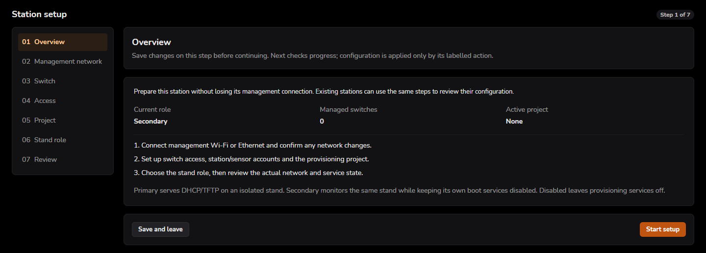
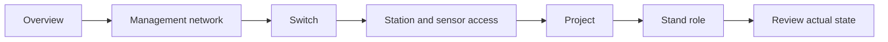
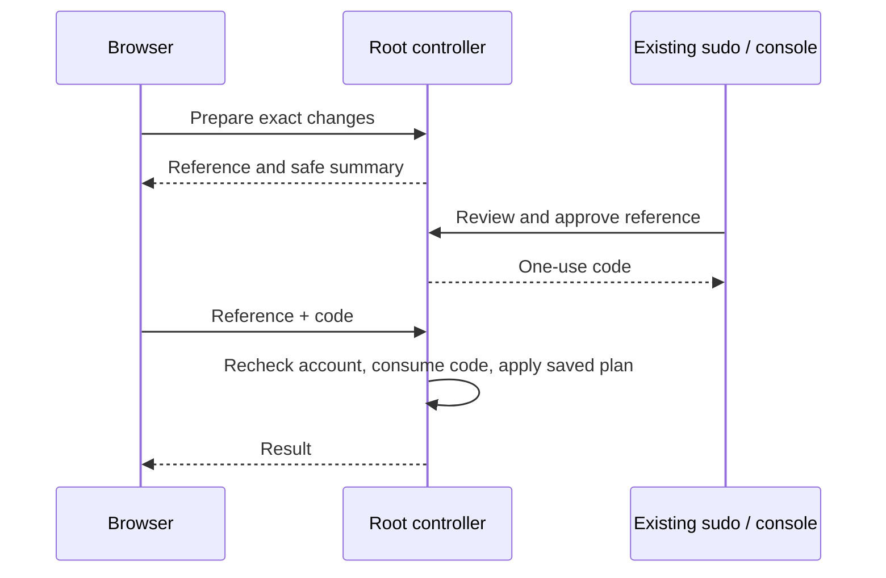

> **Language / Язык:** [English](station-setup.md) | [Русский](ru/station-setup.md)

# Set up a provisioner station

[Deployment options](deployment-options.md) · [Project wizard](creation-wizards.md) · [Network profiles](provisioner-network.md)

Open **Settings → System → Open setup wizard**. A new, unconfigured station also offers **Set up station** on Dashboard. Existing stations can use it to review their configuration.



*Actual UI with a disposable demonstration database; no hardware changed for the capture.*



> [!IMPORTANT]
> Keep an independent management connection when changing the stand network. **Next** and **Complete setup** do not apply settings, activate projects or start DHCP. Changes have their own explicit actions.

## Before opening the wizard

The first web account is created through the existing SSH/local-console procedure:

```sh
cd /var/lib/cmprovision
sudo -u www-data php artisan auth:create-user
```

Web and Linux/SSH accounts are separate. No default web password or public registration is added. Configure the image's initial Linux user with [image setup](../image/README.md), Raspberry Pi Imager or a [station project](station-project-setup.md).

## Seven steps

| Step | What to do |
| --- | --- |
| Overview | Check the existing role, switches and active project |
| Management network | Save Wi-Fi or Ethernet/VLAN profiles; check connectivity and confirm temporary changes before their rollback timer expires |
| Switch | Add and test SNMP access; an unmanaged switch can be skipped, without port mapping or PoE controls |
| Access | Save your web account, optional station SSH changes and optional sensor accounts |
| Project | Create/copy a project with its existing wizard, prepare its image and explicitly activate it; secondary/disabled stations need no local project |
| Stand role | Choose Primary, Secondary or Disabled; acknowledge an isolated network for Primary, then check and confirm the temporary role change |
| Review | Refresh actual role, address, services and project readiness; resolve blockers and complete setup |

**Back** changes steps. **Save and leave** remembers the current step; first save or cancel open editors. Reloading reads saved configuration again, rather than restoring unsaved drafts. Existing working stations are never redirected into setup automatically.

The primary check verifies image preparation/files, required hashes and split copy, and matches prepared EEPROM against the selected project's firmware/settings. A stale active-project setting is insufficient. Unknown network/service state is not treated as intentionally disabled.

## Station SSH access

The same form is in **Settings → System → Station access**.

1. Choose an existing Linux administrator in the `sudo` group. Enter an optional new password/public keys and, if needed, **Enable SSH service**. OpenSSH server must already be installed.
2. Select **Review SSH changes** and confirm your web password if asked.
3. In an existing administrator SSH session/local console, run the command shown by the form:

   ```sh
   sudo cmprovision-access approve <reference>
   ```

4. Check the username, requested actions and key fingerprints in the terminal. Type `YES` for your expected request and enter its code in the browser.
5. Select **Apply SSH changes**. Keep the old SSH session open until a new login succeeds.



> [!NOTE]
> Requests last five minutes; approval codes last at most two minutes and work once. Five incorrect attempts revoke a request. Refresh an expired request and prepare it again. The web helper cannot issue its own code.

Existing users, keys, sudo policy and global SSH configuration remain. The form adds keys; it does not create/rename administrators or enable passwordless sudo. A Linux password does not override disabled SSH password login, `Match` rules or other OS restrictions. Custom key locations require OS tools; the form reports them rather than rewriting the SSH server.

For a flashed sensor's login, use [Project SSH access](image-access.md). **Sensor accounts** are credentials used to check/re-provision sensors; they do not change the provisioner's login.
