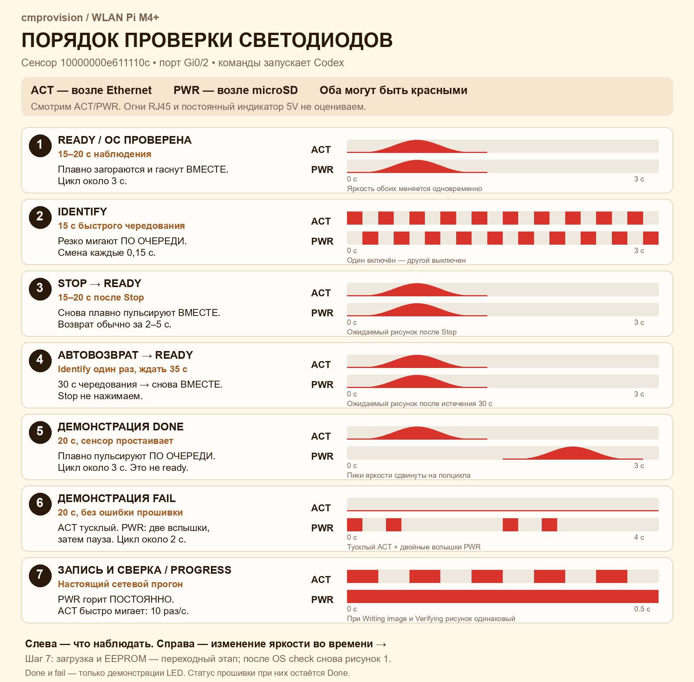

# Визуальная проверка LED на WLAN Pi M4+

Электрические состояния уже проверены программно. Здесь нужно глазами оценить
яркость, плавность, ритм и различимость режимов. Общее описание и схема
расположения — [Светодиоды модуля](../../leds.md).

## Памятка для совместного прогона

На картинке семь шагов, которыми управляет Codex: ready → Identify → Stop →
автовозврат → демонстрация done → демонстрация fail → настоящая запись и
сверка. Оператор наблюдает сенсор и сообщает отличия. Демонстрации здесь идут
перед повторной записью; ниже описаны также самостоятельные действия в UI.
Тайминги рисунков берутся из исходников LED через
`docs/leds/build_acceptance_card.py`.

## Подготовка

Проверяем **сенсор** `10000000e611110c` / `wlanpi-fd3`, Gi0/2. Провижинер
`wlanpi-da2` остаётся включённым. Для этой проверки подходят обычное питание
Ethernet/PoE и разомкнутые BOOT и OTG; HDMI и клавиатура могут остаться.

Смотреть нужно на **ACT** возле Ethernet и **PWR** возле microSD. На M4+ оба
могут быть красными — различаем их по месту и ритму. Индикаторы самого RJ45
и постоянно горящий 5V возле USB-C к этим режимам не относятся.

Открой карточку `10000000e611110c` и убедись, что это Gi0/2. Дальнейший порядок
рассчитан на успешный OS check последнего сетевого прогона. После него LED
и Identify работают до следующей перезагрузки сенсора. Если сенсор уже
перезапускался или Identify недоступен, сначала сообщи об этом: для проверки
нужно снова получить итог свежего прогона.

## 1. Сейчас: успешный OS check — ready

При `Done` и `OS check: passed` наблюдай ACT и PWR **10–15 секунд**.

Ожидается: оба светодиода **плавно загораются и гаснут одновременно**.
Полный цикл занимает около **3 секунд**. Это режим `ready`.

Зафиксируй, видны ли оба светодиода, совпадает ли их ритм и есть ли плавное
изменение яркости. Постоянное свечение или резкие вспышки вместо плавности
сообщи отдельно — это не подтверждает ожидаемый рисунок помощника LED.

## 2. Сейчас: Identify и Stop

1. В карточке этого сенсора нажми **Identify** один раз.
2. В течение примерно **5 секунд** должен смениться рисунок: ACT и PWR
   резко мигают **по очереди**, смена примерно каждые **0,15 секунды**.
   Это заметно быстрее плавной пульсации, один горит, пока другой погашен.
3. Понаблюдай **3–5 секунд** и нажми **Stop**.
4. Обычно в течение **2 секунд**, с небольшим запасом до **5 секунд**,
   должно вернуться одновременное плавное `ready` из пункта 1.

Проверь, что меняется именно сенсор на Gi0/2 и что Stop возвращает прежний
рисунок. Статусы `Done` и `OS check: passed` остаются прежними.

## 3. Сейчас: автоматическое завершение Identify

1. Снова нажми **Identify** один раз.
2. **Не нажимай Stop и не нажимай Identify повторно**: повтор продлевает срок.
3. Засеки время от нажатия. Срок команды — **30 секунд**; с учётом опроса
   к **35-й секунде** должен вернуться `ready`.

Засчитываем, если быстрое чередование прекратилось само и оба светодиода
снова пульсируют вместе. Если оно осталось после 35 секунд, сообщи фактическое
время и состояние кнопки в карточке.

## 4. При следующем согласованном прогоне: progress

Этот пункт можно совместить с проверкой одновременного старта нескольких плат.
Новый прогон для него запускаем отдельно, когда наблюдатель готов.

| Момент на дашборде | Что наблюдать |
|---|---|
| Включение и сетевая загрузка | Первые десятки секунд рисунком управляют загрузчик и ядро; по нему `progress` не оцениваем. |
| Pre-install / проверка EEPROM | PWR горит, ACT может быть погашен, пока его вывод занят EEPROM. Это ожидаемо. |
| Writing image | PWR горит постоянно, ACT быстро мигает: около 10 раз в секунду. Смотреть 10–15 секунд. |
| Verifying | Такой же `progress`: PWR постоянный, ACT быстро мигает. Смотреть ещё 10–15 секунд. |
| Checking the OS | Сенсор перезагружается; промежуточный рисунок не оцениваем как итог. |
| Done + OS check passed | Возвращается совместная плавная пульсация `ready`. |

Между перезагрузкой в WLAN Pi OS и итогом OS check отдельного заданного
рисунка cmprovision нет. Этот промежуток не покрывается памяткой; итоговый
LED-цикл начинается после проверки записанной ОС.

Ожидаемый переход: ACT начинает мигать после pre-install, продолжает при
записи и сверке, а после успешного OS check оба пульсируют вместе. Частоту
вручную считать не нужно; достаточно отличить быстрое мигание от постоянного
свечения и медленного изменения яркости.

## 5. На простаивающем сенсоре: демонстрация done и fail

В `stage1-test` включён OS check, поэтому отдельного итогового `done` перед
ним не будет: сенсор перезагружается и показывает `ready` по результату ОС.
Для визуальной оценки двух оставшихся рисунков я отдельно включу короткую
демонстрацию LED **после завершения всех операций с накопителем**:

| Демонстрация | Что увидеть за 10–15 секунд |
|---|---|
| `done` | ACT и PWR плавно загораются **по очереди**, со сдвигом в полцикла. Общий цикл около 3 секунд. В отличие от `ready`, они не пульсируют вместе. |
| `fail` | ACT тускло светится; PWR даёт **две короткие вспышки**, затем длинную паузу. Рисунок повторяется примерно раз в 2 секунды. |

Это только показ рисунка: специально прерывать прошивку, отключать PoE или
получать настоящий `Failed` не требуется. Во время демонстрации штатное
управление LED временно приостанавливается, чтобы два процесса не управляли
одними светодиодами. Затем восстанавливаем `ready` и проверяем возврат
обычного управления и Identify. Запись образа и статус CM от демонстрации
не меняются.

## Что прислать после наблюдения

Можно коротким списком; непроверенные пункты так и обозначить:

- `ready`: оба видны, пульсируют вместе, плавно — да/нет.
- `Identify`: быстрое чередование на нужном сенсоре — да/нет.
- `Stop`: вернулся `ready` — да/нет.
- `30 секунд`: сам вернулся `ready` — да/нет.
- `progress`: PWR постоянный, ACT быстро мигает при записи и сверке — да/нет.
- `done`: плавно по очереди — да/нет.
- `fail`: ACT тусклый, PWR две вспышки и пауза — да/нет.

Фото помогает подтвердить расположение, видео — ритм и плавность; достаточно
и непосредственного наблюдения с описанием. Эта инструкция сама по себе не
закрывает пункты [чек-листа приёмки](2026-10-20-usb-tty2-acceptance.md).
