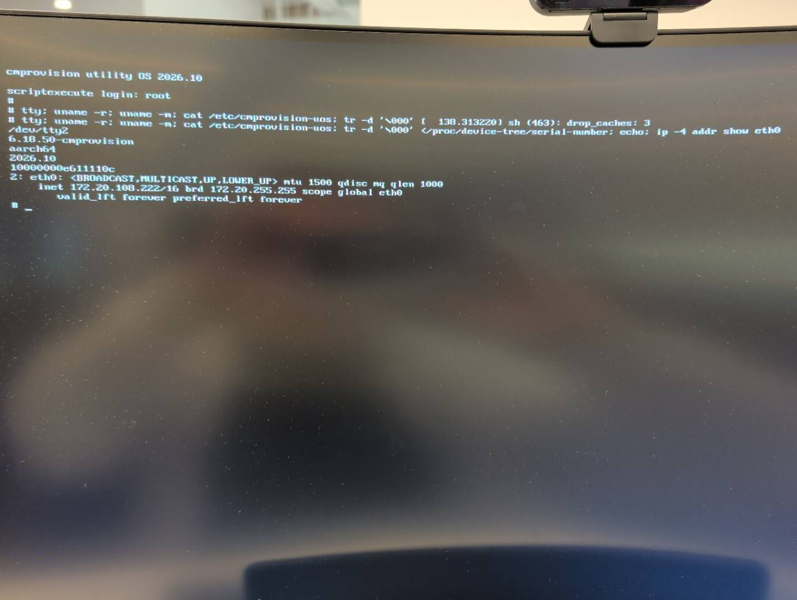

# Utility OS: аппаратная проверка tty2, 20 октября 2026

## Подключение и проверки до запуска

Пользователь подключил HDMI-монитор и USB-клавиатуру к сенсору WLAN Pi M4+
на Gi0/2, питание — Ethernet/PoE; обе перемычки BOOT и OTG сняты.
Провижинер — отдельный WLAN Pi M4+ `wlanpi-da2`.

Перед запуском в 12:13:15 UTC проверены:

- сенсор `10000000e611110c`, MAC `e4:5f:01:62:9f:d3`, IP `172.20.108.222`;
- Gi0/2 коммутатора `t-iof-sw01-provision`, единственный MAC и линк 1 Gbit/s;
- eMMC `/dev/mmcblk0`, CID `150100424a5444345203b3f2c00e7800`, 61071360 секторов;
- ответ установленного ограниченного SSH-агента и отсутствие активных прошивок.

## Сетевой прогон

В 12:14:31 UTC штатный сервис Re-provision подтвердил очистку загрузочного
сектора и ожидание сетевого старта. Доступ — служебный ключ; пароль сенсора
не менялся. Повторная отправка wipe автоматически не выполняется.

Выбран существующий `stage1-test` (id 2): образ
`wlanpi-os-26.10-DeadEye-full.img.gz` (id 6), verify, OS check и re-provision
включены, split выключен. EEPROM — `default/pieeprom-2026-09-23.bin` с
настройками проекта; перед запуском проверен SHA256 готового EEPROM-файла.
Utility OS — `scriptexecute64` / `2026.10`.

Ожидаемые размер и SHA256 распакованного образа:
6211764224 байта,
`4c6d703e710014465306ec66ef0c6f77a7d5b8b558421c501d33460de712477a`.

Новый сетевой проход зарегистрирован в 12:15:04 UTC, запись началась в
12:15:05. EEPROM уже совпадала (`identical`), запись EEPROM не выполнялась.
Операция Re-provision перешла в `booted`; 79 остальных записей CMs сохранили
свои фазы и времена запуска/OS check.

| Этап | Время UTC, 20 октября |
|---|---|
| Re-provision подтвердил wipe | 12:14:31 |
| Начало сетевого прохода | 12:15:04 |
| Начало записи | 12:15:05 |
| Начало сверки SHA256 | 12:17:14 |
| Сверка успешна, переход к OS check | 12:19:41 |
| OS check passed, Done | 12:21:15 |

От регистрации запуска до Done — **6:11**: preinstall 0:01, запись 2:09,
сверка и post-install 2:27, загрузка установленной ОС и OS check 1:34.
Проверены все 6211764224 байта, SHA256 совпал. Возврат post-install — 0.

Это прогон с существующими настройками стендового проекта: его post-install
пропускает Firefox first-boot setup, устанавливает стендовый SSH-ключ,
снимает требование сменить пароль и настраивает sudo для `wlanpi`.
Эти скрипты при проверке tty2 не редактировались.

OS check установил пакет `cmprovision-oscheck-test`, проверил его файл и
активность SSH. Итог: `systemd: running`, `failed units: none`, hostname
`wlanpi-fd3`. Дополнительная проверка SSH в 12:21:36 UTC подтвердила загрузку
с eMMC (`/dev/mmcblk0p2`, ext4, boot mode 1), нужные serial/MAC/CID и отсутствие
сбоев служб. Версия установленной ОС — Debian 13; это уже система образа,
не временная Utility OS.

После прогона активных прошивок нет, `stage1-test` остаётся выбранным,
все остальные 79 записей CMs сохранили фазы и времена запуска/OS check.

## Программная диагностика локальной консоли

Существующий preinstall-скрипт стендового проекта открывает диагностическую
оболочку на порту 2323. Через неё, после проверки serial, прочитаны состояния
работающей временной ОС:

- ядро `6.18.50-cmprovision`, `aarch64`, маркер `2026.10`;
- активная виртуальная консоль `tty2`;
- USB-клавиатура `SIGMACHIP USB Keyboard`, VID:PID `1c4f:0026`, обработчики
  `kbd`, `leds`, `event0`;
- framebuffer `BCM2708 FB`, размер 1824 × 984.

Это дополнительный стендовый доступ из проекта; в поставляемой Utility OS
по-прежнему нет службы сетевого входа. Обнаружение устройств и активная
tty2 сами по себе не подтверждают видимое изображение и выполненный локальный
вход; эти пункты проверены пользователем отдельно.

## Подтверждение пользователя и фото

Пользователь подтвердил вход как `root` с пустым паролем и выполнение команд
с физической USB-клавиатуры. Предоставленное фото HDMI-монитора показывает:

| Проверка | Результат на экране |
|---|---|
| Консоль | `/dev/tty2` |
| Ядро | `6.18.50-cmprovision` |
| Архитектура | `aarch64` |
| Utility OS | `2026.10` |
| CPU serial | `10000000e611110c` |
| Ethernet | `eth0`, `UP,LOWER_UP`, `172.20.108.222/16` |

На отдельный вопрос о переключении Alt+F1 → Alt+F2 между экраном прошивки и
консолью при продолжающейся прошивке пользователь ответил:
«Да, переключение работало».

**Приёмка tty2 пройдена полностью:** HDMI, USB-клавиатура, вход, версии и
идентичность сенсора, переключение консолей, запись, SHA256 и OS check.

Программный статус сервера не заменяет наблюдение за монитором и клавиатурой.
После перезагрузки для OS check на мониторе уже установленная WLAN Pi OS;
вход `root` с пустым паролем и маркер `2026.10` относятся к временному этапу.
В общем [чек-листе приёмки](2026-10-20-usb-tty2-acceptance.md) ещё остаются
визуальная проверка LED и одновременный старт нескольких сенсоров.
