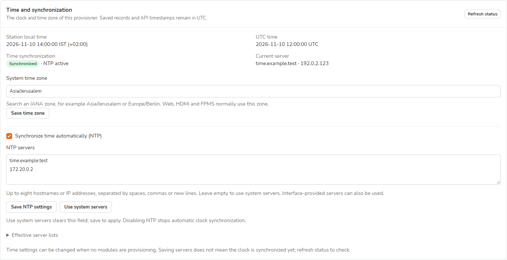
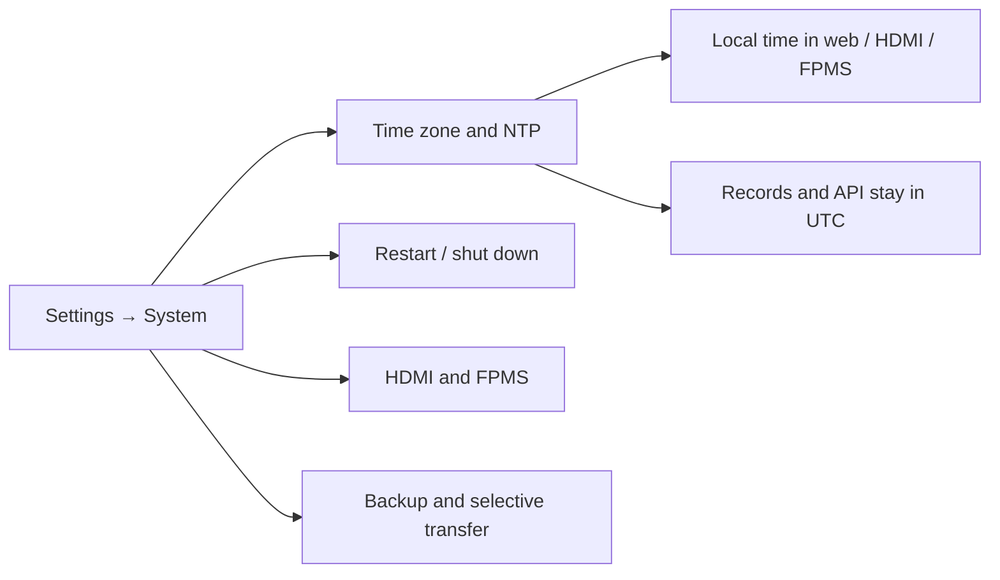

> **Language / Язык:** [English](system-time.md) | [Русский](ru/system-time.md)

# Station time and synchronization

[Operations](operations.md#the-settings-page) · [Backup and restore](upgrading.md)

Open **Settings → System → Time and synchronization**. Set the station clock here and optionally offer its time to devices on the provisioning link.



*Disposable demo data; the addresses and synchronization result illustrate the controls.*



## Change the time zone

1. Wait until the station has no unfinished provisioning runs.
2. Search **System time zone** for an IANA name, such as `Asia/Jerusalem` or `Europe/Berlin`.
3. Select **Save time zone** and confirm your account password when asked.
4. Check **Station local time** and its UTC offset. Reload other open pages to refresh their timestamps and Auto appearance. Queue workers finish their current jobs before loading the new zone. Running HDMI/FPMS publishers pick it up on the next snapshot; the HDMI clock also uses the selected local zone.

> [!NOTE]
> An explicitly configured `APP_DISPLAY_TIMEZONE` continues to override display formatting. The card identifies a mismatch. Remove that server override if web, HDMI and FPMS should follow the system zone.

## Configure NTP servers

| Control | Result |
| --- | --- |
| **Synchronize time automatically (NTP)** | Enable or disable the station's time synchronization service. |
| **NTP servers** | Up to eight hostnames, IPv4 or IPv6 addresses. Separate them with spaces, commas or new lines; omit URLs and ports. |
| **Use system servers** | Clear the editable list; **Save NTP settings** applies the change. Administrator/vendor defaults remain intact. |
| **Refresh status** | Read current synchronization state and server without discarding unsaved fields. |

For a private source, enter its address, save, and refresh after it has answered. With managed chrony an explicit list replaces the default pool and DHCP-provided sources. With timesyncd, link-provided sources can still participate. Expand **Effective server lists** to see what the station is using.

> [!NOTE]
> **Settings saved** confirms the configuration. **Synchronized**, the current source and the age of its last sample show whether the station has usable time.

## Serve devices on the provisioning network

1. On an idle station with managed chrony, confirm the provisioning interface or VLAN under **Settings → Network** and enable the station's own NTP synchronization.
2. In **Settings → System → Time and synchronization**, enable **Serve time on the provisioning network** and save. Serving is initially off.
3. Check the displayed interface, IPv4 address, listener and DHCP status. On the primary station, clients requesting option 42 receive its address in their next DHCP lease. A secondary can serve on its own address when explicitly enabled. Its DHCP service stays off.
4. From a stand device, query the displayed address. For example, on Cisco IOS configure `ntp server 172.20.0.1` and inspect `show ntp associations` and `show ntp status`. A sensor OS must support DHCP option 42 or use an explicitly configured server.

The server listens on UDP 123 on the confirmed provisioning IPv4 and interface. A new station needs a valid upstream sample before clients can synchronize. After an upstream outage, chrony's clock estimate and the age of the last sample show the difference between holdover and a fresh sample. Switching serving off closes the listener and removes option 42 from future DHCP replies. Existing leases refresh according to their own schedule. Early boot in the flashing Utility OS has its own time policy. [DHCP option 42](https://www.rfc-editor.org/rfc/rfc2132#section-8.3) · [chrony configuration](https://chrony-project.org/doc/4.6/chrony.conf.html)

## Prepare an existing station

New images built with this feature include managed chrony. A package upgrade preserves the existing provider. On a station using systemd-timesyncd, perform the following over SSH during an idle maintenance window. The first command needs working signed Debian package repositories and the exact installed timesyncd version. It downloads the old provider, chrony and dependencies and verifies the cache before making changes.

```sh
sudo cmprovision-stand-ntp cache-provider
sudo cmprovision-stand-ntp use-chrony
chronyc tracking
chronyc sources -n
```

The switch applies the existing source list and client enablement. Review custom systemd or chrony configuration with the site administrator first. If a switch is interrupted or an application rollback requires the former provider, use the retained packages and saved time settings, including after a reboot with the uplink down.

```sh
sudo cmprovision-stand-ntp return-timesyncd
systemctl status systemd-timesyncd
```

The cache is local to this station at `/var/lib/cmprovision-time-provider`. Its files are also needed for offline recovery. Keep the cache until the transition is accepted. The web interface asks for a confirmed password when saving time settings and blocks changes during provisioning or other station maintenance.

## Backup and restore

Full backups record the time zone, managed upstreams and client state. Consent to serve time belongs to the **role** restore group and is tied to the station identity. A time-only restore cannot enable serving. After migrating to another station, enable serving locally for its confirmed link. Legacy timesyncd snapshots remain readable. Returning to an older application that cannot manage chrony also requires a compatible recovery snapshot.
