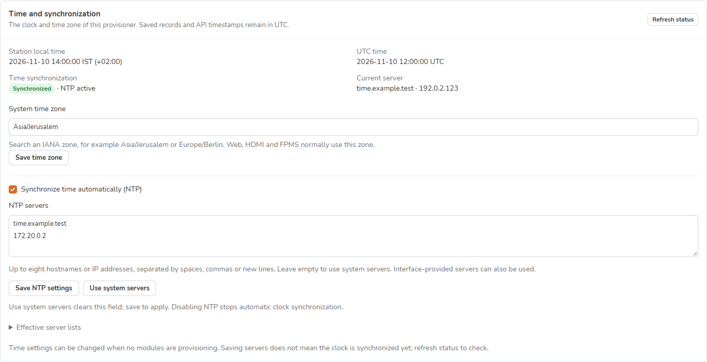
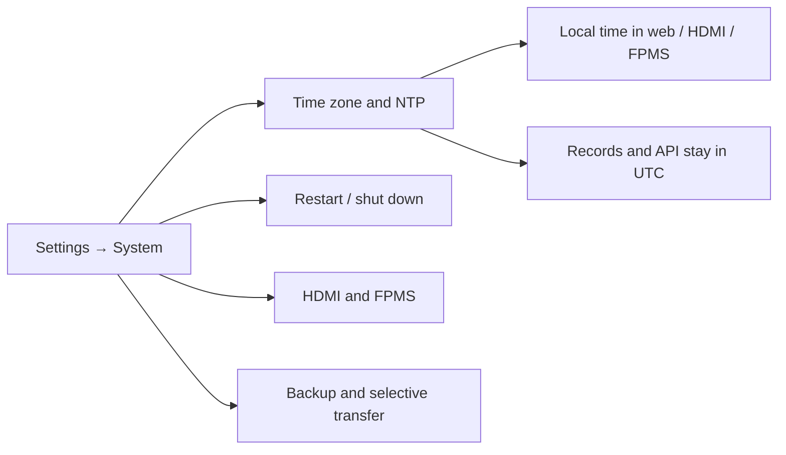

> **Language / Язык:** [English](system-time.md) | [Русский](ru/system-time.md)

# Station time and synchronization

[Operations](operations.md#the-settings-page) · [Backup and restore](upgrading.md)

Open **Settings → System → Time and synchronization**. These controls belong to the provisioner; they do not configure clocks on the sensors it flashes.

*Disposable demo data; the addresses and synchronization result illustrate the controls.*

## Change the time zone

1. Wait until the station has no unfinished provisioning runs.
2. Search **System time zone** for an IANA name, such as `Asia/Jerusalem` or `Europe/Berlin`.
3. Select **Save time zone** and confirm your account password when asked.
4. Check **Station local time** and its UTC offset. Reload other open pages to refresh their timestamps and Auto appearance. Queue workers finish their current jobs before loading the new zone. Running HDMI/FPMS publishers pick it up on the next snapshot; the HDMI clock also uses the selected local zone.

> [!NOTE]
> An explicitly configured `APP_DISPLAY_TIMEZONE` continues to override display formatting. The card identifies a mismatch. Remove that server override if web, HDMI and FPMS should follow the system zone.

## Configure NTP servers

| Control | Result |
| --- | --- |
| **Synchronize time automatically (NTP)** | Enable or disable the station's time synchronization service. |
| **NTP servers** | Up to eight hostnames, IPv4 or IPv6 addresses. Separate them with spaces, commas or new lines; omit URLs and ports. |
| **Use system servers** | Clear the editable list; **Save NTP settings** applies the change. Administrator/vendor defaults remain intact. |
| **Refresh status** | Read current synchronization state and server without discarding unsaved fields. |

For a private time service, enter its address, keep NTP enabled, save, then refresh status after it has had time to answer. The managed system list replaces other system NTP entries and clears fallback entries while custom servers are selected. **Interface-provided servers may still participate**; expand **Effective server lists** to inspect them.

> [!IMPORTANT]
> **Settings saved** means the configuration was applied, not that the server has answered. Check **Synchronized**, **NTP active** and **Current server** together. A wrong hostname or unreachable server can leave a correctly saved configuration unsynchronized.

Changes require an idle station and are blocked during pending network, power or application-update operations. Reading status does not change the clock. cmprovision never manually sets the date or makes the provisioner an NTP server.

## Supported service and recovery

The NTP editor supports **systemd-timesyncd**, the client used by the station image and the tested Raspberry Pi OS Trixie provisioners. A missing, masked or alternative service is reported explicitly; it is not replaced automatically. Time zone controls remain independent. Failed application restores the previous configuration/service state when possible; an incomplete recovery is reported.

The managed file is `/etc/systemd/timesyncd.conf.d/90-cmprovision.conf`. Clearing the list removes only that file. New full system snapshots record the time-zone files, managed file presence/absence and supported NTP service enablement/running state. Full restore applies that record and refreshes the time services; older snapshots without the record leave unrecorded service choices alone. **Download backup**, data-only restore and selective import/export do not carry these system files to another station.

Implementation follows the systemd documentation for [time controls](https://manpages.debian.org/trixie/systemd/timedatectl.1.en.html) and [NTP server configuration](https://manpages.debian.org/trixie/systemd-timesyncd/timesyncd.conf.5.en.html).
