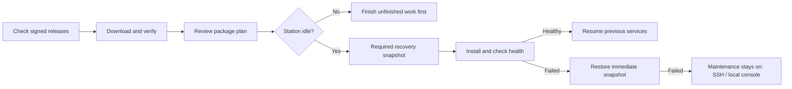

# Station updates

Use **Settings → Updates** to check and install stable component releases. This requires the packaged installation on Debian 13 / Raspberry Pi OS Trixie and a working systemd manager.

| Component | What changes | What stays separate |
| --- | --- | --- |
| Application | `cmprovision4`; matching `fpms-lite` only when already installed | The host OS and selected managed Utility OS |
| Utility OS | Temporary Ethernet/USB boot files for subsequently connected boards | Application version and installed sensor OS |

## Check and download

1. Open **Settings → Updates** and select **Check for updates**. Opening the page alone does not contact GitHub.
2. Read the available version, notes and compatibility result for each component. Old unsigned releases, drafts, prereleases and pull requests are not installation candidates.
3. Select **Download and verify**. Download progress shows received bytes. Verification, package configuration and health checks show their current stage without a fabricated percentage.

The two **Automatically check once a day** switches are independent and initially off. The timer checks enabled components approximately daily, with scheduling jitter. It never installs anything automatically. The selective configuration transfer can move these preferences; it does not transfer publisher keys, operation state or recovery snapshots.

## Apply

1. Finish all active or unfinished provisioning, OS checks and reserved image jobs. A silent board is still unfinished work. There is no force-install option.
2. Review the required package changes, choose **Review and apply**, confirm your account password and approve the exact prepared version. **Back** leaves the confirmation without installing.
3. Keep station power connected. The worker continues independently of the browser, PHP-FPM and queue workers. A lost connection shows **Reconnecting**; do not submit another installation.
   Expected maintenance responses are handled within the update status area. When the station returns, the operation result and installed version refresh automatically.
   When upgrading from 2.27.0, refresh the page once after completion to load this browser fix; do not apply again.
4. After a successful health check, the station restores its prior service states. Previously masked DHCP/TFTP or USB boot services remain masked.

Checks and downloads can run during provisioning. Critical installation pauses new board starts, conflicting configuration changes and queue processing. The application update requires a consistent snapshot and reinstallable previous packages; insufficient free space or missing recovery material prevents installation. Additional Debian dependency changes are pinned to the reviewed plan and installed from the prepared cache. This is an application recovery mechanism, not a full host-OS downgrade.

Recovery snapshots include uploaded images, so large image libraries need enough additional free space for their copy. Downloads preserve a 64 MiB safety reserve. **One successful recovery point** is retained across application and Utility OS updates. Older history is reduced to this limit while idle and before the next snapshot's space check. Active/critical recovery and the selected rollback source stay protected until resolved, so replacement may temporarily need space for two copies. Cleanup removes only the updater's inactive, unreferenced files and leaves unrelated backups untouched.

## Utility OS and recovery

Downloaded Utility OS releases live outside application package directories in `/var/lib/cmprovision-utility-os/releases`. Preparation validates the complete inventory, checksums and required Ethernet/USB files. Checking or downloading never changes the boot selection. Applying changes the boot link as the web user; a package upgrade preserves a valid managed selection. Legacy and bundled modern boot files remain selectable.

**Recovery history → Review rollback** can restore a retained prior version. An application rollback also restores that snapshot's application data: later changes are discarded. Immediate automatic recovery runs while maintenance blocks intervening work.

If installation or its health checks fail, the updater restores the immediate snapshot automatically. Interrupted critical operations are recovered without repeating installation; boot recovery recreates the maintenance gate. If recovery fails, the page reports **recovery-required** and the gate stays closed. Use SSH/local console, inspect `journalctl -u 'cmprovision-update-*'` and `/var/lib/cmprovision-updates/private`, and resolve the recorded operation before reopening the stand. Do not delete pending files to bypass recovery.

The protocol-1 boot dispatcher is retained at `/var/lib/cmprovision-updates/recover.py`, outside files replaced by dpkg. It verifies and launches the previous operation's saved Python runner, so a partly replaced updater or trust configuration does not prevent its own recovery.

## Failure diagnostics

Expand **Failure details** in Settings → Updates to see the failed phase, exception type and operation reference. **Download diagnostics** asks for your account password again and exports a bounded JSON report. Keep the reference with the report when requesting help. It distinguishes the original failure from any failure during automatic recovery, and records code locations and constrained HTTP status/OS error numbers. Passwords, response bodies, private command output and unexpected exception messages are excluded.

Reports are retained privately on the station for the latest 20 diagnostic operations, with pending/recovery-required records protected from cleanup. For an unavailable web interface, use the reference over SSH: `sudo journalctl -u 'cmprovision-update-*' --no-pager`. A missing report does not mean an installation succeeded: use the recorded operation outcome and maintenance state. Do not remove pending markers to bypass recovery.

Interrupted read-only HTTP transfers have at most three attempts. A payload retry starts with a fresh partial file; certificate, signature, checksum and size failures remain rejections. Installations are never repeated by this retry policy.

## Publisher and release administration

`/etc/cmprovision-updates/publisher.json` and `publisher.pub` are root-owned trust configuration. The browser cannot change the repository, key or download URLs. Metadata uses a detached minisign signature and binds the exact stable tag, source commit, compatibility, filenames, sizes and SHA-256 digests. HTTPS and checksums complement signature verification.

Stable application publication requires `CMPROVISION_UPDATE_SIGNING_KEY` in GitHub Actions and the matching versioned public key. Artifact-only and draft-only builds remain available without the production signing key. Independent Utility OS publication builds and tests the pinned source, includes its complete matching legal-info archive and never replaces published version assets. Bump `UOS_VERSION` before publishing different boot files under a new version.

Keep the signing key outside the repository, with a protected recovery copy. Stations need only its public part. Revocation/rotation requires an administrator to deploy a new trusted public key; the browser cannot authorize its own new trust root.
