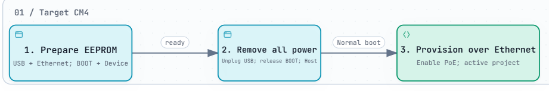
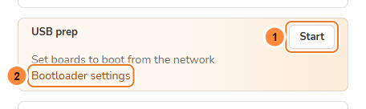
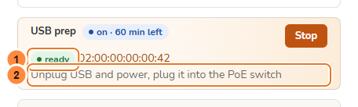

> **Language / Язык:** [English](usb-prep.md) | [Русский](ru/usb-prep.md)

# Prepare a CM4 for network boot

[Operations](operations.md) · [Full USB provisioning](usb-provisioning.md) · [M4+ hardware](hardware/wlanpi-m4-plus.md)

Use **USB prep** when a CM4 boots its existing OS instead of reaching the stand. Prepare its bootloader over USB, then move it to the PoE switch for network provisioning.

| During USB prep | Afterwards, on the stand |
| --- | --- |
| EEPROM is updated; the OS on eMMC stays in place | The active project can overwrite target storage |
| Wait for **ready** | Wait for the normal provisioning result |

> [!IMPORTANT]
> **USB prep prepares the bootloader, not the OS image.** Ethernet is required during preparation too: USB supplies boot files; Ethernet supplies DHCP and the preparation script.

<a href="diagrams/usb-prep-flow.png"></a>

*Select the image to enlarge it. For interactive exploration, download [the standalone HTML](diagrams/usb-prep-flow.html) and open it in your browser. Screenshots below use demo data.*

## Before connecting a board

- [ ] The provisioner works and remains a **USB Host**.
- [ ] The intended project is ready for the later network run.
- [ ] You have a short **data-capable** USB cable and a powered hub with enough capacity for the target.
- [ ] Both units have Ethernet to the isolated stand switch.
- [ ] Target **PoE is disabled** for this USB-powered setup; Ethernet data remains enabled.

## 1. Turn on USB prep

On **Dashboard**, find **USB prep** and select **Start** (accessible name: **Start USB prep**). Below 1440 px, the tile has its own row.

<a href="assets/guides/usb-prep-start.png"></a>

**1 — Start. 2 — Bootloader settings:** review EEPROM firmware and configuration under **Settings → Provisioning → USB prep**.

**Expected:** **on** and **Connect a board over USB**. If Start is disabled, read its reason and add or select EEPROM firmware first.

## 2. Connect and prepare the target

> [!WARNING]
> Disconnect **all target power** before changing BOOT or OTG. PoE restart cannot power off a USB-powered target. Leave the provisioner's boot controls unchanged.

1. With the target unpowered, select **USB Device** routing and assert **BOOT / nRPIBOOT**.
2. Connect provisioner USB-A → powered hub → target programming connector.
3. Keep target Ethernet connected to the switch, with target PoE off. Connecting the USB data cable powers and boots the target.
4. Wait for **ready**. Both LEDs fading in turn also indicate readiness.

| Purple Mcuzone `CM4_WiFi7 Rev1.0` / M4+ | Preparation | Later normal boot |
| --- | --- | --- |
| **BOOT** jumper | Fitted | Removed |
| **OTG** jumper | Fitted: Device | Removed: Host |
| Programming cable | HDMI-side **USB-C power and Program** | Disconnected |

For the green carrier or another revision, use the [board-specific table](hardware/wlanpi-m4-plus.md#boot-and-usb-role-controls). AUX USB-C is not the programming connector.

<a href="assets/guides/usb-prep-ready.png"></a>

**Expected:** **ready** and the target MAC. Earlier boards are counted as **+N more**. No OS image, OS check or label is produced at this stage.

## 3. Move it to the PoE stand

1. Unplug USB and disconnect every remaining target power source.
2. Release BOOT and restore USB Host routing.
3. Check the active project, remove the USB connection and enable target PoE.
4. Follow the network run on **Dashboard**, **CMs** or **Ports**. Select **Stop** after preparing the last board.

**Expected:** the board boots from the network and starts the active project's run. The normal run replaces its USB-prep-only status.

## If ready never appears

| What you see | Next check |
| --- | --- |
| **Start** disabled | Read the reason; check **Firmware** and **Bootloader settings** |
| **Connect a board over USB** persists | BOOT, Device routing, programming connector, data cable and power |
| USB files transfer, but no board appears | Target Ethernet, DHCP and connectivity to the provisioner |
| **failed** | Open the MAC link and inspect its log before retrying |
| **no report** | Check power and both cables; this is not ready |
| Installed OS boots after preparation | Check saved EEPROM boot order and network availability |

For the continuous USB-server log, run on the provisioner:

```sh
sudo journalctl -u cmprovision-rpiboot -f
```

<details>
<summary>Boot order, timeout and batch behaviour</summary>

Default preparation uses `BOOT_ORDER=0xf12`: network first, then eMMC. It uses its own selected firmware/settings, independently of the active project's EEPROM configuration.

A later project with an EEPROM update can restore its own order, for example `0xf21` with eMMC first. A project without one leaves the preparation order in place. Without an answering network DHCP server, that board can wait up to 45 seconds before booting eMMC.

USB prep switches off after **one hour without a board**; each arriving board extends the timer. Network-booted boards continue normal provisioning while it is on. Prepared boards are excluded from the normal batch and notification channels.

</details>

For a complete image write from the USB-booted utility OS, use [Full USB provisioning](usb-provisioning.md). For a target screen and keyboard, use [Local console / tty2](local-console.md).
