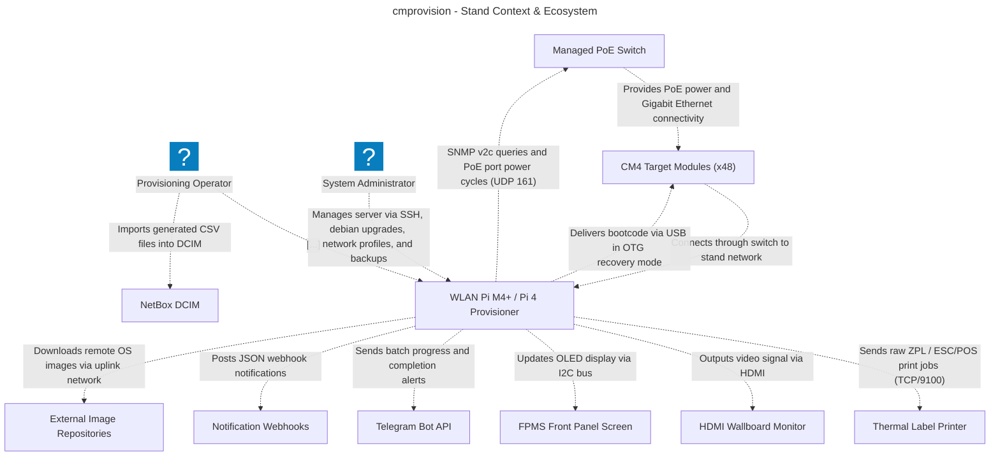
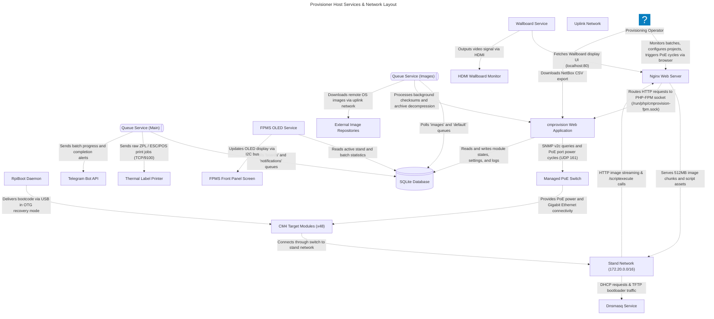
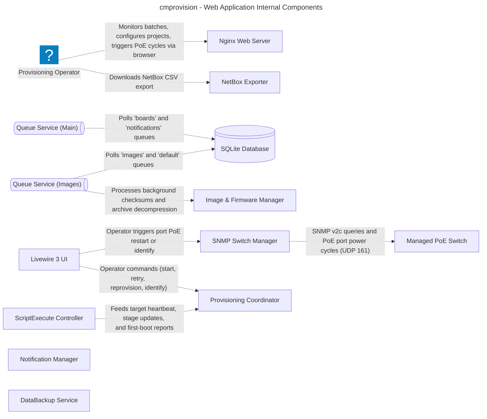
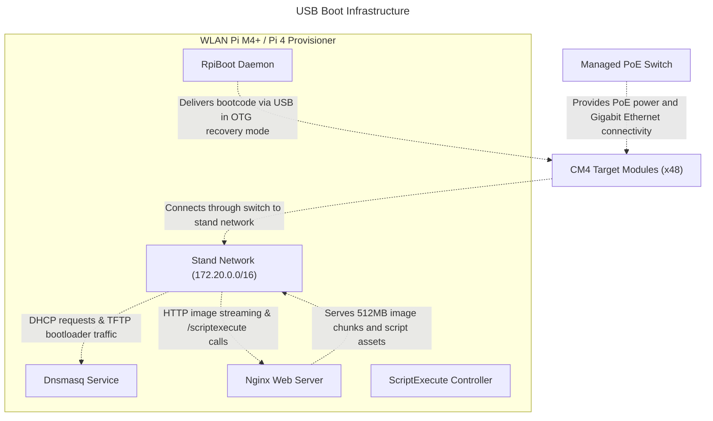

<!-- Generated by likec4 export markdown. Do not edit manually. -->

# cmprovision Architecture

### cmprovision - Stand Context & Ecosystem

High-level view of actors, bench hardware, provisioner server, and external integrations

### Provisioner Host Services & Network Layout

Services, daemons, and networks running on Raspberry Pi OS Trixie (Debian 13)

### cmprovision - Web Application Internal Components

Laravel 13 application components, controllers, coordinators, services, and persistence

### End-to-End CM4 Provisioning Workflow

Step-by-step lifecycle from power-on and PXE boot to eMMC flash, verification, first-boot OS check, and label printing

```mermaid
---
title: "End-to-End CM4 Provisioning Workflow"
---
graph LR
  Operator@{ icon: "fa:user", shape: rounded, label: "Provisioning Operator" }
  ProvisionerAppUi@{ shape: rectangle, label: "Livewire 3 UI" }
  ProvisionerAppSwitches@{ shape: rectangle, label: "SNMP Switch Manager" }
  Managed_switch@{ shape: rectangle, label: "Managed PoE Switch" }
  ProvisionerRpiboot@{ shape: rectangle, label: "RpiBoot Daemon" }
  Cm4_targets@{ shape: rectangle, label: "CM4 Target Modules (x48)" }
  ProvisionerDnsmasq@{ shape: rectangle, label: "Dnsmasq Service" }
  ProvisionerNginx@{ shape: rectangle, label: "Nginx Web Server" }
  ProvisionerAppScriptexecute@{ shape: rectangle, label: "ScriptExecute Controller" }
  ProvisionerAppCoordinator@{ shape: rectangle, label: "Provisioning Coordinator" }
  ProvisionerSqlite_db@{ shape: disk, label: "SQLite Database" }
  ProvisionerQueue_main@{ shape: horizontal-cylinder, label: "Queue Service (Main)" }
  Label_printer@{ shape: rectangle, label: "Thermal Label Printer" }
  Telegram_api@{ shape: rectangle, label: "Telegram Bot API" }
  Webhook_targets@{ shape: rectangle, label: "Notification Webhooks" }
  Operator -. "`Selects active project and starts batch`" .-> ProvisionerAppUi
  ProvisionerAppUi -. "`Triggers PoE power cycle for target 
ports`" .-> ProvisionerAppSwitches
  ProvisionerAppSwitches -. "`SNMP v2c power cycle command (UDP 161)`" .-> Managed_switch
  Managed_switch -. "`Delivers PoE power to target board`" .-> Cm4_targets
  Cm4_targets -. "`DHCP Discover over stand network`" .-> ProvisionerDnsmasq
  ProvisionerDnsmasq -. "`DHCP Offer (IP + PXE boot filename)`" .-> Cm4_targets
  Cm4_targets -. "`TFTP request for kernel & initramfs`" .-> ProvisionerDnsmasq
  ProvisionerDnsmasq -. "`Transfers Utility OS micro-system`" .-> Cm4_targets
  ProvisionerRpiboot -. "`Injects bootcode.bin over USB OTG 
connection`" .-> Cm4_targets
  Cm4_targets -. "`Calls /scriptexecute with serial, MAC, 
and board revision`" .-> ProvisionerNginx
  ProvisionerNginx -. "`Validates StandNetworkOnly middleware 
and forwards`" .-> ProvisionerAppScriptexecute
  ProvisionerAppScriptexecute -. "`Registers module, transitions phase to 
'writing'`" .-> ProvisionerAppCoordinator
  ProvisionerAppCoordinator -. "`Saves module state and assigned IP`" .-> ProvisionerSqlite_db
  ProvisionerAppScriptexecute -. "`Returns flashing script with image piece 
URLs`" .-> ProvisionerNginx
  ProvisionerNginx -. "`Executes provisioning script`" .-> Cm4_targets
  Cm4_targets -. "`HTTP GET /storage/app/images/{chunk}`" .-> ProvisionerNginx
  ProvisionerNginx -. "`Streams compressed image stream`" .-> Cm4_targets
  Cm4_targets -. "`Decompresses and writes raw blocks to 
eMMC`" .-> Cm4_targets
  Cm4_targets -. "`Heartbeat: writes completed, verifying 
SHA256`" .-> ProvisionerNginx
  Cm4_targets -. "`Calculates eMMC hash and updates EEPROM 
bootloader`" .-> Cm4_targets
  Cm4_targets -. "`Reports verification success, reboots 
into target OS`" .-> ProvisionerNginx
  Cm4_targets -. "`Calls /scriptexecute from booted target 
OS`" .-> ProvisionerNginx
  ProvisionerNginx -. "`Reports actual hostname, installs extra 
.deb packages`" .-> ProvisionerAppScriptexecute
  ProvisionerAppCoordinator -. "`Marks module phase as 'done'`" .-> ProvisionerSqlite_db
  ProvisionerQueue_main -. "`Sends raw barcode print job (MAC, 
Serial, Hostname)`" .-> Label_printer
  ProvisionerQueue_main -. "`Sends batch progress update`" .-> Telegram_api
  ProvisionerQueue_main -. "`Posts batch notification`" .-> Webhook_targets
```

### USB Boot Infrastructure

Physical switch, PoE delivery, DHCP/TFTP PXE boot, USB OTG recovery, and image streaming

